<div align="center">



<br/><br/>



<br/><br/>


**AI case-taking for India's crowded OPDs.**<br/>
An AI calls the patient in their own language, takes a doctor-style history, reads their old papers,<br/>
and puts a structured, ABHA-linked summary on the doctor's screen **before the consultation starts.**

</div>


## 🩺 The problem

<table>
  <tr>
    <td align="center" width="33%"><h2>up to 10,000</h2>OPD patients a day in one tertiary hospital</td>
    <td align="center" width="33%"><h2>2–5 min</h2>per consultation for history, exam, old papers and prescription</td>
    <td align="center" width="33%"><h2>70–80 %</h2>of diagnoses reachable from a well-taken history alone</td>
  </tr>
</table>

History-taking is the most important diagnostic step, and it is the one that gets cut. Ayurvedic assessment (Prakriti, Agni, Koshtha, Dashavidha Pariksha) needs even more time, and patients arrive with bags of unsorted paper records.
<sub>Figures from the PS 26047 background, including a BMJ Open (2017) study of consultation length across 67 countries.</sub>

## ⚙️ How it works



| # | Step | What happens |
|:-:|---|---|
| 1 | **AI case-taking call** | After OPD registration the AI calls the patient on any phone, verifies ABHA / mobile OTP and records spoken consent. |
| 2 | **Case-taking** | A clinical ontology picks every question (SOCRATES for pain, full past / drug / family / personal history, review of systems). The patient speaks or presses keys. |
| 3 | **Red-flag check** | Deterministic rules run after every answer. An emergency alerts the triage nurse and transfers the call. |
| 4 | **Documents** | Old prescriptions and reports are photographed (SMS link or kiosk), read by OCR and placed on a timeline, with abnormal labs flagged. |
| 5 | **Doctor summary** | A fact-checked, structured summary is on the doctor's screen before the patient walks in. The doctor edits and confirms, and it goes to the HIS and ABHA as FHIR R4. |


## 🗣️ Speaks the patient's language



No app, no typing, no reading. It works on a ₹1,000 feature phone. On-site walk-ins use a **kiosk with a telephone handset**: the same call experience, without the OPD noise.

## 🚨 Red-flag triage



The AI never decides who is an emergency on its own. Readable, clinician-reviewed rules (`RF-CARD-01`, `RF-NEURO-01`, …) run after every answer, and if anything fails the system escalates to a human.

## 📄 Document AI




## 🌿 Ayurveda mode

Built for the **All India Institute of Ayurveda**. For AYUSH OPDs the call adds:

| Captured by the call | Marked for the physician |
|---|---|
| Prakriti questionnaire (Vata / Pitta / Kapha), Agni, Koshtha, Ahara-Vihara, Nidana | Nadi, Jihva, Sparsha, Sara |
| Dashavidha items the patient can report: Pramana, Satmya, Sattva, Ahara Shakti, Vyayama Shakti, Vaya | Anything needing physical examination |
| NAMASTE / ICD-11 TM2 coding for Ayurvedic concepts | Final Ayurvedic diagnosis |

## 🧱 Stack

| Layer | Technology |
|---|---|
| Speech | **Sarvam Saaras v3** (STT, 8 kHz phone audio) · **Bulbul v3** (TTS) · on-premise: AI4Bharat IndicConformer / Indic Parler-TTS |
| Brain | Clinical ontology + state machine · **Sarvam-30B** (live) · **Sarvam-105B** (summary) |
| Documents | **Sarvam Vision** OCR · Claude Haiku 4.5 fallback for hard handwriting · OpenCV |
| Voice | Pipecat · Silero VAD · Exotel / Twilio · WebRTC |
| Backend | Python · FastAPI · PostgreSQL · Redis · Celery · MinIO |
| Frontend | React · TypeScript · Vite · Tailwind |
| Interoperability | ABDM (ABHA, consent, HIP) · FHIR R4 (NRCeS profiles) · SNOMED CT · LOINC · NAMASTE |

## 📚 Documentation

All project documents live in [`docs/`](docs/README.md):

| | |
|---|---|
| [01 Idea](docs/01-idea.md) | [08 AI Pipeline](docs/08-ai-pipeline.md) |
| [02 Requirements](docs/02-requirements.md) | [09 Data Model & API](docs/09-data-model-and-api.md) |
| [03 Architecture](docs/03-architecture.md) | [10 Security & Privacy](docs/10-security-privacy.md) |
| [04 Tech Stack](docs/04-tech-stack.md) | [11 Testing & Evaluation](docs/11-testing-evaluation.md) |
| [05 Wireframes](docs/05-wireframes.md) | [12 Project Plan](docs/12-project-plan.md) |
| [06 Folder Structure](docs/06-folder-structure.md) | [13 Demo & Pitch](docs/13-demo-and-pitch.md) |
| [07 Conversation Design](docs/07-conversation-design.md) | 📑 [Idea deck (PDF)](docs/MediKiosk_SIH2026_Idea.pdf) |

## 🚀 Quick start (planned)

```bash
cp .env.example .env        # add SARVAM_API_KEY + ABDM sandbox credentials
make up                     # start all services with Docker Compose
make migrate && make seed   # database + demo data
make pregen-audio           # pre-generate question audio (hi, te, en)
```

Then open `/kiosk`, `/doctor`, `/triage`. See [docs/06-folder-structure.md §9](docs/06-folder-structure.md).

## 👥 Team

**Team Taraket** · Smart India Hackathon 2026 · PS 26047 · Ministry of Ayush / All India Institute of Ayurveda

## ⚠️ Disclaimer

MediKiosk produces an **AI-generated draft of patient-reported history** for physician review. It does not diagnose or recommend treatment. Every summary must be verified by a qualified clinician.


