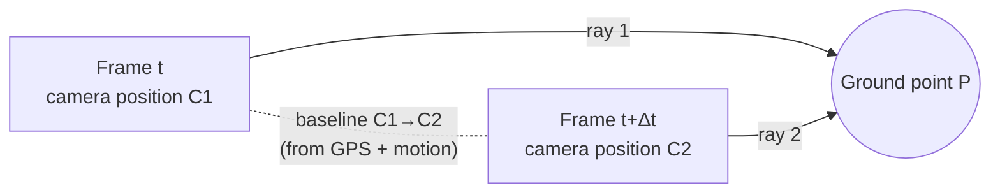
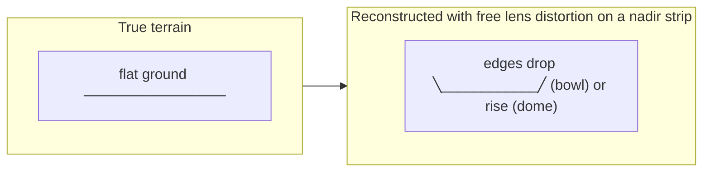
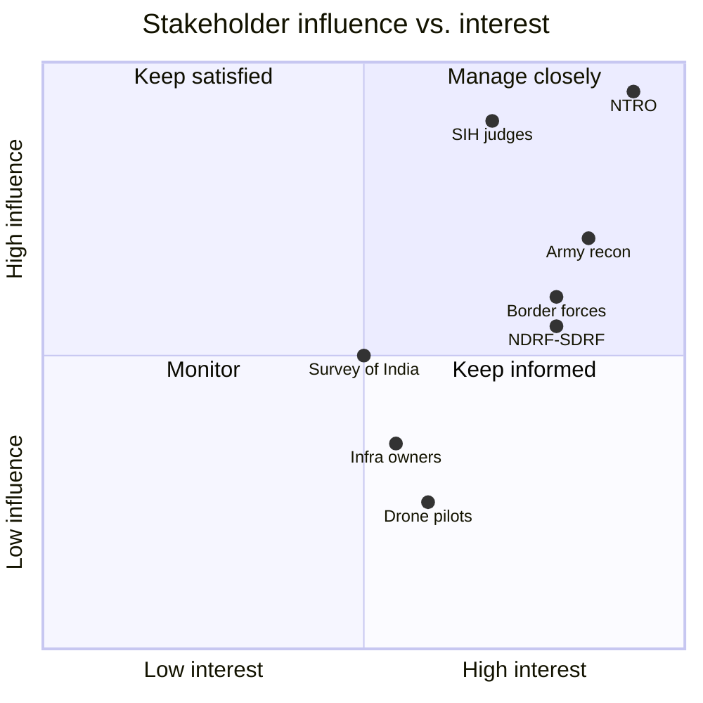
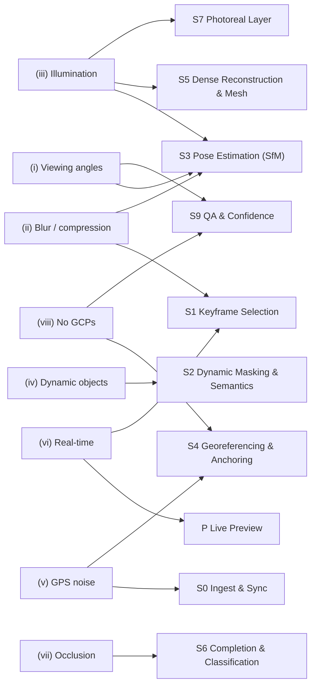

# 01 · Problem Statement & Analysis

> **Purpose:** Reproduce SIH 2026 PS 26158 exactly as published, then break it down into what it really asks for, who it serves, where it is hard, and how each stated challenge maps onto a Drishti3D pipeline stage.
>
> **Status:** Draft v1.0 · 2026-09-30 · Owner: R2 Geo & Accuracy Lead (analysis), R6 Data, Flight Ops & Pitch (NTRO liaison)

---

## Contents

1. [PS at a glance](#1-ps-at-a-glance)
2. [Official problem statement text](#2-official-problem-statement-text)
3. [The missing "Desired Output / Evaluation Criteria" table](#3-the-missing-desired-output--evaluation-criteria-table)
4. [The problem in plain language](#4-the-problem-in-plain-language)
5. [Why a single pass is hard](#5-why-a-single-pass-is-hard)
6. [Stakeholder analysis](#6-stakeholder-analysis)
7. [User personas](#7-user-personas)
8. [Mission scenarios](#8-mission-scenarios)
9. [Challenge-by-challenge countermeasures](#9-challenge-by-challenge-countermeasures)
10. [Input-by-input value analysis](#10-input-by-input-value-analysis)
11. [Implicit requirements](#11-implicit-requirements)
12. [Open questions to clarify with NTRO](#12-open-questions-to-clarify-with-ntro)

---

## 1. PS at a glance

| Field | Value |
|---|---|
| **PS ID** | **SIH26158** (PS 26158) |
| **Title** | Single-Pass Drone Video to Accurate 3D Model Generation System |
| **Organisation** | National Technical Research Organisation (NTRO) |
| **Category** | Software |
| **Theme** | Robotics and Drones |
| **Hackathon** | Smart India Hackathon (SIH) 2026 |
| **Idea submission deadline** | 30 September 2026 (per public mirror; verify on sih.gov.in) |
| **Dataset link** | *None published with the PS* |
| **YouTube / reference video** | *None published with the PS* |
| **Desired Output / Evaluation Criteria** | ⚠ **Empty in the published listing**. See [§3](#3-the-missing-desired-output--evaluation-criteria-table) |
| **Official listing** | https://www.sih.gov.in/sih2026PS |

> **Source note.** The text in §2 was taken from the public mirror [zaidsayyed.in / SIH26158](https://zaidsayyed.in/tools/sih-problem-statements/sih26158) and matches the other mirrors we checked ([NoBugNinja PS list](https://github.com/NoBugNinja/Smart-India-Hackathon-SIH-2026-Problem-Statements/blob/main/README.md)). Where the mirror gives a direct quotation we reproduce it in quotation marks. Where the mirror only paraphrases, we say so. **R6 must check every line word for word against sih.gov.in and the NTRO PDF on Google Drive linked from the portal, and update this section.**

---

## 2. Official problem statement text

### 2.1 Background

> "Generation of accurate 3D models of buildings, infrastructure, terrain, and objects typically requires multiple drone passes, extensive image overlap, specialized flight planning, and significant post-processing time."

*(Continuation. The mirror paraphrases this part rather than quoting it.)* In many operational scenarios, such as disaster response, surveillance, infrastructure inspection, military reconnaissance and rapid mapping, there is only a **single data-capture opportunity**.

### 2.2 Description

> "Design and develop an AI-enabled system capable of generating a georeferenced and metrically accurate 3D model of a scene using only a single-pass drone video stream captured from a moving UAV."

The system should reconstruct:

1. 3D terrain and structures
2. Building facades and rooftops
3. Roads and infrastructure
4. Vegetation and obstacles
5. Textured 3D meshes or point clouds

### 2.3 Expected solution / deliverables

> "The generated model should be suitable for visualization, measurement, and analysis purposes."

### 2.4 Key challenges (as numbered in the PS)

| # | Challenge |
|---|---|
| (i) | Limited viewing angles due to single flight path |
| (ii) | Motion blur and video compression artifacts |
| (iii) | Variable illumination and shadows |
| (iv) | Dynamic objects (vehicles, humans, animals) |
| (v) | GPS inaccuracies and sensor noise |
| (vi) | Real-time or near-real-time processing requirements |
| (vii) | Reconstruction of occluded surfaces |
| (viii) | Maintaining metric accuracy without extensive Ground Control Points (GCPs) |

### 2.5 Input data

| Mandatory | Optional |
|---|---|
| Drone video (1080p / 4K) | IMU data |
| GPS coordinates | Barometric altitude |
| Flight metadata | Camera intrinsic parameters |
| | RTK/PPK corrections |

### 2.6 Potential applications

(i) Border and strategic area mapping · (ii) Disaster damage assessment · (iii) Urban planning and smart cities · (iv) Infrastructure inspection · (v) Construction progress monitoring · (vi) Archaeological documentation · (vii) Digital twin generation · (viii) Military reconnaissance and mission planning

### 2.7 Dataset

No dataset or sample video is attached to the public listing. We should assume that **the Grand Finale will use an unseen NTRO video**, as the charter already does (Principle 5: *"One command, any video"*). Until then we test on public stand-ins (MARS-LVIG, UseGeo, UAVD4L, ODM samples) and on our own green-zone flights. See [11-testing-and-evaluation.md](11-testing-and-evaluation.md) and [12-flight-and-data-capture-guide.md](12-flight-and-data-capture-guide.md).

---

## 3. The missing "Desired Output / Evaluation Criteria" table

The published PS has a **"Desired Output / Evaluation Criteria" section with no content**. The mirror confirms that the listing has "no explicit" accuracy or time targets ([zaidsayyed.in](https://zaidsayyed.in/tools/sih-problem-statements/sih26158)).

Several competitor repositories quote **"< 15 min processing for a 10-min video"** and **"≤ 1 m spatial accuracy"**, plus output formats **OBJ, PLY, LAS, GeoTIFF, glTF, FBX** ([Tesseract](https://github.com/kartikshirode/sih26158-single-pass-3d), which labels them "inferred targets"; [Scout-3D](https://github.com/HoneyBadger-010/Scout-3D)). These may come from a longer NTRO PDF, or they may be one team's guesses that others copied. **We do not know which.**

**Our stance:**

| Item | Status | Where we use it |
|---|---|---|
| ≤ 15 min for a 10-min 4K clip | **To be confirmed.** Adopted as our own target (`fast` profile) | Charter §6, [03-requirements.md](03-requirements.md) |
| ≤ 1 m absolute accuracy | **To be confirmed.** Adopted as our *anchored* target (≤ 1 m CE90 / LE90) | Charter §6, [06-georeferencing-and-accuracy.md](06-georeferencing-and-accuracy.md) |
| Output formats OBJ / PLY / LAS / GeoTIFF / glTF / FBX | **To be confirmed.** We cover all of them except FBX, which is a stretch goal via conversion | [08-data-formats-and-interfaces.md](08-data-formats-and-interfaces.md) |
| Accuracy measurement method | **Unknown.** We assume ASPRS Ed. 2 (2023) practice plus CE90/LE90 | [11-testing-and-evaluation.md](11-testing-and-evaluation.md) |

> **Action (R6, before M1):** Download the NTRO PS PDF from the Google Drive link on the sih.gov.in PS page. Record the verbatim evaluation table here. If it differs from the charter §6 targets, update the charter first, then propagate.

---

## 4. The problem in plain language

A drone flies **once** over an area, for example along a road, over a collapsed building block or along a border fence, while it records ordinary video and logs its GPS position. NTRO wants software that takes that one video and produces a **3D digital copy of the scene** that:

- **looks right**: textured, so a human analyst recognises buildings, roads and trees;
- **measures right**: a 20 m wall is 20 m in the model (*relative* or *metric* accuracy);
- **sits in the right place on Earth**: the model's corner is at the same latitude, longitude and height as the real corner (*absolute* accuracy, or *georeferencing*);
- is ready **quickly**, "real-time or near-real-time";
- does this **without surveyors first laying out many ground markers** (GCPs).

The usual professional workflow does the opposite. It flies a planned lawn-mower grid with 70–80 % image overlap, often a second crossing grid, lays out GCPs, and then processes for hours. Team mirrors describe it as needing "80%+ frontal and 70%+ side overlap and 45–90 min grid or crosshatch flights" ([aerotwin mirror](https://github.com/aerotwin/drone-video-to-3d)). Real missions often cannot afford that. The site may be dangerous, the airspace window short, or the event over.

**One sentence:** turn *"one video + rough GPS"* into *"a measurable, correctly placed 3D map"*, fast, and be honest about how accurate it is.

---

## 5. Why a single pass is hard

### 5.1 Parallax: how 3D comes out of 2D

Close one eye and move your head sideways. Near objects slide across your view faster than far ones. That difference is **parallax**, and it is the only source of depth in a single moving camera. Photogrammetry finds the same point in two frames, knows (or estimates) where the camera was for each frame, and intersects the two viewing rays. The wider the angle between the rays (the **baseline-to-depth ratio**), the more precise the depth.

A single pass limits parallax in four ways:

| Difficulty | What happens | Consequence |
|---|---|---|
| **Short effective baselines** | Consecutive video frames are only centimetres to metres apart, so the rays are almost parallel | Depth is noisy unless we pick keyframes far enough apart. This is why S1 selects frames by *parallax*, not by a fixed time step |
| **Forward motion** (camera looking ahead or obliquely forward) | Points near the direction of travel (the *focus of expansion*) barely move in the image, so their depth is poorly constrained (basic epipolar geometry) | Weak geometry in the image centre for forward-looking video. Nadir or side-oblique views are better |
| **One-sided views** | Every surface is seen from one side only. The far side of a building, the underside of eaves and narrow alleys are never observed | Holes and occluded facades (challenge vii). These must be *flagged*, not faked |
| **Near-parallel, collinear strip geometry** | All cameras lie on one line and point roughly the same way. Self-calibrating bundle adjustment cannot separate lens radial distortion from terrain shape | **Doming**: a bowl or dome height error, "metre magnitude in simulation and about 0.2 m in a real test" ([James & Robson 2014](https://discovery.ucl.ac.uk/id/eprint/1443475/1/esp3609.pdf)) |

### 5.2 Doming, the signature single-strip failure

James & Robson found that a second set of flight lines at another azimuth **did not help much**. What helped was **varying camera pointing or altitude**: oblique images at **20–30° cut DEM deformation by one to two orders of magnitude**, and fixing K1 to a doming-free value gave a **tenfold** reduction ([James & Robson 2014](https://discovery.ucl.ac.uk/id/eprint/1443475/1/esp3609.pdf)). A newer recommendation is oblique images at 20–45° making up at least 10 % of the block ([Drones 2025, 9(6), 387](https://doi.org/10.3390/drones9060387)). Drishti3D answers this with **locked or pre-calibrated intrinsics** (S3), a **doming test** (S9), and a **capture guideline** ([12-flight-and-data-capture-guide.md](12-flight-and-data-capture-guide.md)).

### 5.3 Other quiet single-pass problems

| Problem | Why it matters | Evidence |
|---|---|---|
| **Roll about the flight axis is unobservable from GPS alone** | GPS positions along a straight line are collinear, so a GPS-only similarity fit can rotate the model about that line freely | Derived geometric inference in the research report. It is not a sourced result. Roll must come from gimbal attitude, IMU gravity, a curved path or altitude change |
| **No loop closure** | A single pass never revisits a place, so SLAM drift is never corrected | "Vertical RMSE exceeded 100 m in 29 of 34 long runs" across five monocular SLAM systems ([arXiv 2608.18632](https://arxiv.org/html/2608.18632)) |
| **Video ↔ GPS time offset** | DJI `.SRT` logs are in local time with no timezone, and their latency against exposure has never been measured publicly | Sync must be **< 1 ms** for cm-level direct georeferencing at 10–30 m/s ([ResearchGate](https://www.researchgate.net/publication/311555608_Time_synchronization_of_consumer_cameras_on_Micro_Aerial_Vehicles); [ScienceDirect 2025](https://www.sciencedirect.com/science/article/abs/pii/S2352938525003544)) |
| **Rolling shutter** | Each image row is exposed at a slightly different time, so a moving drone skews the image | 74 ms readout (Phantom 2 Vision+) ≈ 10 px displacement at 8 m/s, 70 m ([Vautherin et al. 2016](https://isprs-annals.copernicus.org/articles/III-3/139/2016/isprs-annals-III-3-139-2016.pdf)) |
| **Video frames are weaker than stills** | 4K frames are ~8 MP versus ~20 MP stills, with compression and motion blur | [PhotoModeler](https://www.photomodeler.com/tip-47-extract-stills-from-video-for-photogrammetry/). Dense-enough sampling (1 frame / 2.5 s) still matched stills at 1.1–2.7 cm boundary RMSE ([Remote Sens. 2021](https://doi.org/10.3390/rs13142745)) |
| **Consumer GNSS bias** | Positions are several metres off, but mostly as a *rigid* shift | 2.29 m H / 3.93 m V RMSE, with Z standard deviation only 0.18 m ([Zhang et al. 2019](https://esurf.copernicus.org/preprints/esurf-2019-2/esurf-2019-2.pdf)) |

---

## 6. Stakeholder analysis

| Stakeholder | Role / interest | What they need from Drishti3D | Influence | Our engagement |
|---|---|---|---|---|
| **NTRO** (PS sponsor, evaluator) | India's technical intelligence agency under the PMO / NSA, covering IMINT and GEOINT ([Wikipedia](https://en.wikipedia.org/wiki/National_Technical_Research_Organisation)) | Deployable, secure, offline tool. Honest accuracy in CE90/LE90. Works on their FMV formats | **Very high** (judges, potential adopter) | Speak their language (CE90/LE90, KLV, air-gapped). Ask the clarifying questions in §12 |
| **Army / paramilitary reconnaissance units** | Rapid terrain intelligence for mission planning | Line-of-sight, heights, routes, obstacle positions on a map-registered model | High (end user) | Measurement tools, KLV ingest, offline bundle |
| **Border management** (BSF, ITBP, SSB) | Mapping fences, posts, terrain along borders | Georeferenced models of strips that are often flown once, typically in red zones | High | Linear-pass robustness (strip geometry), confidence map |
| **Disaster response** (NDRF, SDRFs, NDMA, district administration) | Damage assessment after floods, earthquakes, landslides | Fast first picture (minutes), volumes of debris, collapsed-structure identification | High | Live 2D preview (P) plus metric 3D minutes later |
| **Urban planning / smart cities / Survey of India** | Digital twins, NAKSHA, SVAMITVA extensions | Standard formats (3D Tiles, COG, LAS). LoD2-style buildings | Medium | Open-standard exports (S8), LoD2 completion (S6) |
| **Infrastructure owners** (NHAI, railways, power utilities) | Corridor inspection | Measurements along linear assets | Medium | Corridor-strip handling, length accuracy |
| **Drone operators / pilots** | Fly and hand over data | Simple capture guidance, a tool that accepts DJI `.SRT` as-is | Medium | [12-flight-and-data-capture-guide.md](12-flight-and-data-capture-guide.md) |
| **SIH evaluators and nodal centre** | Score novelty, feasibility, impact and clarity | A clear pitch, a working demo, numbers | Very high (short term) | [14-demo-and-pitch.md](14-demo-and-pitch.md) |

*(Quadrant positions are the team's qualitative judgement, not measured data.)*

---

## 7. User personas

### Persona A: Maj. Ananya Rao, reconnaissance planning officer
| | |
|---|---|
| **Context** | Forward unit. Receives FMV from a tactical UAV (KLV-tagged MPEG-TS) after a single sortie along a valley |
| **Goal** | Within the hour, know ridge heights, line-of-sight from a post, and the width of a track, all on a map grid |
| **Pain points** | Cannot re-fly (red zone, exposure risk). No internet. Existing tools want grid flights or cloud upload |
| **Needs from us** | KLV ingest (S0), offline Docker bundle, CE90/LE90 on every product, measurement tools, clear "inferred" flags so she does not plan on fake geometry |
| **Success looks like** | "The model's ridge is within a metre of our map, and I can see which parts the drone never saw." |

### Persona B: Rahul Verma, NDRF / SDRF drone operator (disaster response)
| | |
|---|---|
| **Context** | Flood or landslide site. A DJI Mavic-class drone with `.MP4` + `.SRT`. A laptop with a GPU in the field vehicle |
| **Goal** | Show the incident commander a map in minutes. Estimate debris volume and blocked roads |
| **Pain points** | Battery and time allow one pass. Weather is changing. Moving rescuers and vehicles appear in the video |
| **Needs from us** | Drag-and-drop upload, **live 2D preview within about 60 s** (P), `fast` profile, volume tool, dynamic masking (S2) |
| **Success looks like** | "The preview was on screen before I'd packed the drone. The 3D came while we were still in the briefing." |

### Persona C: Dr. Meera Iyer, GIS analyst (NTRO / Survey of India style lab)
| | |
|---|---|
| **Context** | Desktop workstation. Receives models from the field. Integrates them with reference orthophotos, DEMs and vector layers in QGIS / ArcGIS |
| **Goal** | Trust the model's position. Overlay it on existing layers. Report accuracy formally |
| **Pain points** | Pretty meshes that are metres off. No stated CRS or vertical datum. No accuracy evidence |
| **Needs from us** | Correct CRS and vertical datum metadata (WGS84 / UTM, ellipsoidal vs. orthometric), COG / LAS / 3D Tiles, **accuracy report** (S9) with checkpoints, bias-vs-noise split |
| **Success looks like** | "The JSON report tells me RMSE, CE90, LE90, number of checkpoints and method. I can cite it." |

### Persona D: Karthik N., municipal planning / infrastructure engineer
| | |
|---|---|
| **Context** | Smart-city cell. A contractor flies a road corridor once a month |
| **Goal** | Measure road widths, building setbacks and construction progress |
| **Pain points** | Budget for full photogrammetry surveys is limited. Needs standard formats |
| **Needs from us** | Relative accuracy ≤ 0.5 % (target), LoD2 building outlines (S6), glTF / 3D Tiles exports, browser viewer |
| **Success looks like** | "Setback measurements agree with the tape to within a few centimetres on a 20 m frontage." |

---

## 8. Mission scenarios

### Scenario 1: Post-earthquake damage assessment (disaster response)

| Step | What happens | Stages |
|---|---|---|
| 1 | The operator flies one 8-minute straight pass at ~80 m over a damaged town block. Video + `.SRT` | Capture (doc 12) |
| 2 | Upload to a field laptop. Drishti3D starts ingest and time sync | S0 |
| 3 | A **live 2D mosaic** appears within about 60 s (target). The commander sees which streets are blocked | P |
| 4 | Keyframes are selected, rescuers and vehicles masked, poses solved | S1–S3 |
| 5 | Anchored to the last available reference orthophoto / DSM. CE90 before and after is shown | S4, S9 |
| 6 | Textured mesh, DSM and orthomosaic are ready within the ≤ 15 min target. Debris volume is measured against the reference DSM | S5, S8, viewer |
| 7 | The confidence map shows that collapsed interiors and alleys are *inferred* or *unobserved* | S6, S9 |

### Scenario 2: Border strip mapping (strategic / reconnaissance)

| Step | What happens | Stages |
|---|---|---|
| 1 | An authorised operator flies a 3 km linear pass along a fence line. Output is MPEG-TS with **MISB ST 0601 KLV** | Capture |
| 2 | An analyst loads it on an **air-gapped** workstation. KLV is decoded to per-frame position and attitude | S0 |
| 3 | Long-strip handling: sub-scene segmentation, locked intrinsics, gravity / gimbal roll priors | S3 |
| 4 | Registration to an on-premise reference orthophoto / DSM gives sub-metre anchoring (target) | S4 |
| 5 | Doming test along track. LE90 reported | S9 |
| 6 | Export as 3D Tiles and LAS into the unit's GIS. Nothing leaves the machine | S8 |

### Scenario 3: Infrastructure corridor inspection (civil)

| Step | What happens | Stages |
|---|---|---|
| 1 | A contractor flies one pass along a highway flyover with a 25° forward-oblique gimbal (per our capture guide) | Capture |
| 2 | Optional **RTK/PPK** log supplied → `--rtk rtk.pos` | S0, S4 |
| 3 | The metric mesh gives clearances, deck width and pier heights. Relative length error is reported | S5, S9 |
| 4 | A Gaussian-splat photoreal layer is added for stakeholder presentations, clearly marked **display only** | S7 |
| 5 | Absolute accuracy ≤ 0.10 m CE90 (RTK target), verified on checkpoints | S9 |

---

## 9. Challenge-by-challenge countermeasures

| PS challenge | Root cause | Drishti3D countermeasure | Stage(s) | Evidence |
|---|---|---|---|---|
| **(i) Limited viewing angles due to single flight path** | Near-parallel, collinear views. Doming. Unobservable roll | Lock or pre-calibrate intrinsics (never free K1 on a nadir strip). Gravity / gimbal roll priors. Sub-scene segmentation on long strips. Doming test. Capture guideline recommending a 20–30° oblique gimbal | S3, S9, doc 12 | [James & Robson 2014](https://discovery.ucl.ac.uk/id/eprint/1443475/1/esp3609.pdf); [MDPI RS 18(14):2321](https://www.mdpi.com/2072-4292/18/14/2321) |
| **(ii) Motion blur and video compression artifacts** | Exposure during motion, H.264/H.265 compression, rolling shutter | Variance-of-Laplacian blur rejection per window. Parallax keyframing. Rolling-shutter camera model in bundle adjustment | S1, S3 | [Vautherin et al. 2016](https://isprs-annals.copernicus.org/articles/III-3/139/2016/isprs-annals-III-3-139-2016.pdf); [Remote Sens. 2021](https://doi.org/10.3390/rs13142745) |
| **(iii) Variable illumination and shadows** | Auto-exposure drift, sun and cloud changes | Learned features robust to appearance change (ALIKED + LightGlue). Seam levelling in texturing. Per-image exposure compensation in the splat layer. Shadow removal **not claimed** (aerial shadow removal is unsolved) | S3, S5, S7 | [PGSR](https://arxiv.org/html/2406.06521v2); [VastGaussian](https://arxiv.org/pdf/2402.17427) |
| **(iv) Dynamic objects (vehicles, humans, animals)** | Moving features corrupt matching and texture | YOLO-seg / SAM 2 masks applied **before** feature matching. Masked from texture. Residual masking in the splat layer | S2, S3, S5, S7 | [DroneSplat](https://arxiv.org/abs/2503.16964) (+0.9 to +2.4 dB PSNR) |
| **(v) GPS inaccuracies and sensor noise** | Consumer GNSS ~2–4 m bias. Unknown SRT latency | Automatic video↔GPS **time-offset estimation** (cross-correlate GPS velocity with SfM velocity). Robust 7-DoF alignment. **Registration to reference ortho / DSM**. Optional RTK/PPK, SoI CORS, GAGAN, or a single GCP. Bias-vs-noise report | S0, S4, S9 | [Zhang et al. 2019](https://esurf.copernicus.org/preprints/esurf-2019-2/esurf-2019-2.pdf); [Edgybees](https://www.geospatialexploitationproducts.com/third-party-solutions/edgybees/) |
| **(vi) Real-time or near-real-time processing** | MVS and bundle adjustment are heavy. Live 3D is not proven in the literature | Two-tier delivery: **live 2D preview** (P) in seconds, metric 3D in the ≤ 15 min `fast` profile (target). Global SfM (GLOMAP in COLMAP 4.x). GPU bundle adjustment. Keyframing to ~1–2 fps | P, S1, S3, S5 | [GLOMAP](https://arxiv.org/html/2407.20219v2); [ISPRS Annals 2025](https://isprs-annals.copernicus.org/articles/X-2-W2-2025/65/2025/) (2.3 fps mosaicking) |
| **(vii) Reconstruction of occluded surfaces** | One-sided views | Plane-based **LoD2** roof and wall fitting (City3D-style) for occluded facades, **flagged *inferred***. Per-surface **confidence map** (*observed-high / observed-low / inferred*). No unflagged diffusion hallucination | S6, S9 | [City3D](https://arxiv.org/abs/2201.10276); [GSFix3D](https://ar5iv.labs.arxiv.org/html/2508.14717) |
| **(viii) Metric accuracy without extensive GCPs** | Scale and position must come from somewhere other than GCPs | Scale from GPS baselines (relative). Absolute placement from reference data, correction services or ≤ 1 GCP. Proof with **≥ 30 independent checkpoints** reported as RMSE / CE90 / LE90 | S4, S9 | [ASPRS Ed. 2](https://lidarmag.com/2023/10/06/the-asprs-positional-accuracy-standards-edition-2/amp/); PPK zero-GCP XY 2.4 cm / Z 2.2 cm ([Zhang et al.](https://esurf.copernicus.org/preprints/esurf-2019-2/esurf-2019-2.pdf)) |

---

## 10. Input-by-input value analysis

| Input | Mandatory? | What it gives us | Typical quality | How Drishti3D uses it | If missing |
|---|---|---|---|---|---|
| **Drone video (1080p / 4K)** | Yes | Parallax, texture, semantics | 4K frame ≈ 8 MP. Compressed. Often rolling-shutter | S1 keyframes, S2 masks, S3 features, S5 texture | No product possible |
| **GPS coordinates** | Yes | **Metric scale** (baselines) and a rough absolute position | Consumer: ~2.29 m H / 3.93 m V RMSE, mostly rigid bias ([Zhang et al.](https://esurf.copernicus.org/preprints/esurf-2019-2/esurf-2019-2.pdf)) | S3 pose priors, S4 7-DoF alignment, P mosaic placement | Scale only from other sources (baro, known object). Absolute position impossible without a reference |
| **Flight metadata** (DJI `.SRT`, KLV) | Yes | Per-frame time, altitude, gimbal angles, focal length / zoom | SRT: local time, no timezone, format varies by model. KLV: MISB ST 0601 standard fields | S0 parsing and sync. Gimbal gives roll/pitch priors (S3). Focal length gives an intrinsics hint | Fall back to video-only SfM with scale from GPS track only |
| **IMU data** | Optional | Gravity direction (fixes roll about track). High-rate motion | Consumer video files usually lack a synchronised raw IMU stream ([VINS-Mono](https://arxiv.org/abs/1708.03852)) | S3 gravity prior. Rolling-shutter velocity | Use gimbal attitude from metadata |
| **Barometric altitude** | Optional | Smooth relative height, counters vertical drift | Relative precision good, absolute offset drifts with weather | S3 / S4 vertical constraint | Use GPS altitude (the noisiest axis) |
| **Camera intrinsic parameters** | Optional | Focal length, principal point, distortion (K1…) | From a lab calibration or a manufacturer profile | **Fixed intrinsics in S3**, the main anti-doming measure | Constrained self-calibration plus the doming test. Flag the risk in the report |
| **RTK/PPK corrections** | Optional | cm-level camera positions | PPK zero-GCP XY 2.4 cm / Z 2.2 cm ([Zhang et al.](https://esurf.copernicus.org/preprints/esurf-2019-2/esurf-2019-2.pdf)). RTK/PPK studies report 1–3 cm H and 4–6 cm V ([Semantic Scholar](https://pdfs.semanticscholar.org/5c9e/bad8e2cf3acf82d7a2a7ca7db2312f58b492.pdf)) | S4 high-accuracy anchoring (target ≤ 0.10 m CE90). Still check against ≥ 1 checkpoint for false fixes | Use ortho/DSM registration, CORS, GAGAN or a single GCP |

**Inputs we add ourselves (not in the PS):** reference orthophoto / DSM (`--ref-ortho`, `--ref-dsm`), a single GCP file (`--gcp`), and Survey of India CORS / GAGAN-corrected positions. These are how we reach the anchored target without "extensive GCPs". See [06-georeferencing-and-accuracy.md](06-georeferencing-and-accuracy.md).

---

## 11. Implicit requirements

The PS does not state these requirements, but anyone who knows the sponsor and the domain would expect them.

| # | Implicit requirement | Why | Source / reasoning |
|---|---|---|---|
| IR-1 | **Fully offline / air-gapped operation**, with no cloud API at runtime | NTRO is an intelligence agency. Border and reconnaissance data is sensitive | [Wikipedia NTRO](https://en.wikipedia.org/wiki/National_Technical_Research_Organisation); charter Principle 4 |
| IR-2 | **Data localisation**: data finer than 1 m H / 3 m V must be Indian-owned and stored and processed in India | A ≤ 1 m system produces regulated data | [DST Geospatial Guidelines 2021](https://dst.gov.in/sites/default/files/Final%20Approved%20Guidelines%20on%20Geospatial%20Data.pdf) |
| IR-3 | **Security hygiene**: no telemetry, no auto-updates, local user access only, reproducible Docker images | Deployment inside secure networks | Team inference |
| IR-4 | **Licence-clean for defence use** | Some weights exclude military use (VGGT-1B-Commercial). DUSt3R / MASt3R are non-commercial. OpenMVS / ODM are AGPL-3.0 | [VGGT GitHub](https://github.com/facebookresearch/vggt); charter §8 |
| IR-5 | **Accuracy in defence terms: CE90 / LE90**, alongside RMSE (ASPRS Ed. 2) | Defence and GEOINT audiences use circular and linear error at 90 % | [Maxar accuracy whitepaper](https://dg-cms-uploads-production.s3.amazonaws.com/uploads/document/file/38/DG_ACCURACY_WP_V3.pdf); [ASPRS Ed. 2](https://lidarmag.com/2023/10/06/the-asprs-positional-accuracy-standards-edition-2/amp/) |
| IR-6 | **Separate relative and absolute accuracy** | They have different error sources, and one can be good while the other is bad | Charter Principle 2 |
| IR-7 | **Explicit CRS and vertical datum** (WGS84 ellipsoidal vs. EGM96 / orthometric heights) | A datum mix-up alone can cause tens of metres of vertical error in India (geoid undulation) | Doc 06 |
| IR-8 | **Military FMV support** (MPEG-TS with MISB ST 0601 KLV, STANAG 4609) | NTRO / Army UAVs do not produce DJI `.SRT` | [klvdata](https://pypi.org/project/klvdata/) |
| IR-9 | **Robust on unseen video**, with graceful degradation | The finale uses an unknown NTRO video | Charter Principle 5 |
| IR-10 | **Honest labelling of inferred geometry** | Analysts must not plan on hallucinated walls | Charter Principle 3 |
| IR-11 | **Standard, GIS-ready outputs** (LAS/LAZ, COG, 3D Tiles, glTF) | Integration with existing GIS and Cesium stacks | Doc 08 |
| IR-12 | **Commodity hardware** (single RTX-class GPU) | Field and lab deployment without a data centre | Charter §8 |
| IR-13 | **Lawful test flights**: green zone ≤ 120 m under Drone Rules 2021 | Team flights must be legal. Border (red zone) video comes from authorised operators | [PIB Drone Rules](https://static.pib.gov.in/writereaddata/specificdocs/documents/2022/jan/doc202212810701.pdf) |

---

## 12. Open questions to clarify with NTRO

Raise these through the SIH portal Q&A or the nodal centre SPOC. Record answers here and in the charter.

| # | Question | Why it matters | Default assumption until answered |
|---|---|---|---|
| Q1 | What are the exact **Desired Output / Evaluation Criteria**? (The table is empty in the listing.) | Drives every target | Charter §6 targets |
| Q2 | Is "≤ 1 m" **absolute** (vs. Earth) or **relative** (internal)? At what confidence: RMSE, CE90 or LE90? | Changes design effort by an order of magnitude | Absolute, CE90 / LE90 |
| Q3 | Is "< 15 min for 10-min video" a requirement, and on what **hardware**? | GPU budget, profile design | RTX 3060 minimum, RTX 4090 ideal |
| Q4 | What **drone / camera** will the finale video come from? Nadir, oblique or forward-looking? Altitude and speed? | Doming risk, intrinsics, rolling shutter | Consumer DJI-class, nadir or oblique, 60–120 m |
| Q5 | What **metadata format** comes with it: DJI `.SRT`, KLV (MISB 0601), CSV, flight-controller logs? | S0 parser coverage | `.SRT` first, KLV as stretch |
| Q6 | Will **reference data** (orthophoto, DSM, known points) be available at the finale? | Our main anchoring path | Public / open DEM plus optional single GCP |
| Q7 | Will **RTK/PPK** or CORS data be provided? | Unlocks the ≤ 0.10 m tier | Not provided |
| Q8 | How will accuracy be **measured**: their checkpoints, a LiDAR truth, or visual judgement? | Our QA must match their method | ASPRS-style checkpoints |
| Q9 | Which **output formats** are mandatory? (Mirrors mention FBX.) | Export scope | LAS/LAZ, COG, OBJ, GLB, 3D Tiles; FBX as stretch |
| Q10 | Is **real-time** processing *during* flight expected, or post-landing near-real-time? | Scope of live preview vs. 3D | Near-real-time: 2D live, 3D post-flight |
| Q11 | Is **edge / onboard** processing of interest? | Future roadmap | Out of scope for SIH |
| Q12 | Any **licensing constraints** for deployment (AGPL, model weights)? | Choice of OpenMVS / ODM / YOLO | Hackathon OK. Record all licences in doc 07 |
| Q13 | Any **CRS / datum** preference (WGS84 / UTM, Indian grid, orthometric heights)? | Export defaults | WGS84 + UTM zone, EGM96 orthometric heights plus ellipsoidal in metadata |
| Q14 | Are GPU workstations provided at the nodal centre, or do we bring our own? | Finale logistics | Bring our own |

---

## Related documents

- [00-project-charter.md](00-project-charter.md): single source of truth
- [02-solution-overview.md](02-solution-overview.md)
- [03-requirements.md](03-requirements.md)
- [04-system-architecture.md](04-system-architecture.md)
- [05-pipeline-design.md](05-pipeline-design.md)
- [06-georeferencing-and-accuracy.md](06-georeferencing-and-accuracy.md)
- [07-tech-stack.md](07-tech-stack.md)
- [08-data-formats-and-interfaces.md](08-data-formats-and-interfaces.md)
- [09-viewer-and-ui.md](09-viewer-and-ui.md)
- [10-setup-and-repo-structure.md](10-setup-and-repo-structure.md)
- [11-testing-and-evaluation.md](11-testing-and-evaluation.md)
- [12-flight-and-data-capture-guide.md](12-flight-and-data-capture-guide.md)
- [13-project-plan.md](13-project-plan.md)
- [14-demo-and-pitch.md](14-demo-and-pitch.md)
- [15-research-and-references.md](15-research-and-references.md)
- [16-glossary.md](16-glossary.md)
