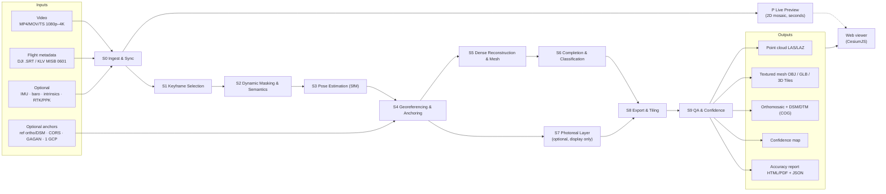
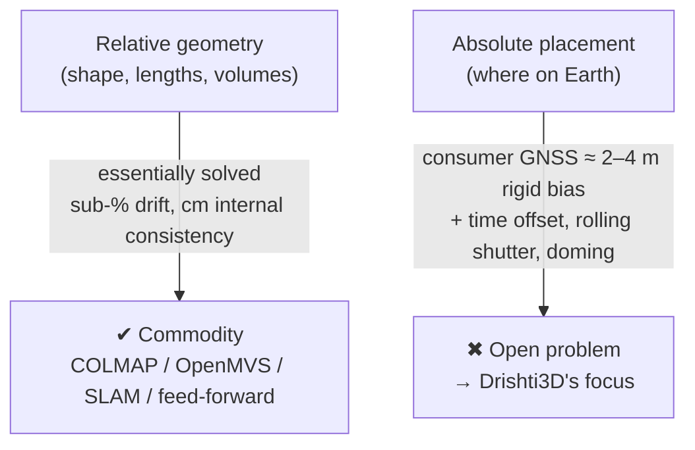
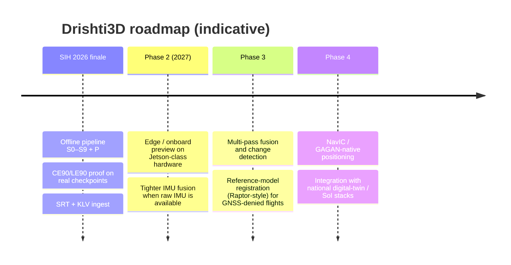

# 02 · Solution Overview: Drishti3D

> **Purpose:** Explain what Drishti3D is, how it works, why it is different from existing products and competitor teams, and where it is heading. This is the document to read before the pitch.
>
> **Status:** Draft v1.0 · 2026-09-30 · Owner: whole team (pitch owner R6)

---

## 1. The concept in one paragraph

**Drishti3D** (दृष्टि, "vision / sight") is an **offline, AI-assisted photogrammetry pipeline and web viewer**. It turns **one drone video pass + its GPS / flight log** into a **georeferenced, measurable, textured 3D model**: a point cloud, textured mesh, orthomosaic, DSM/DTM, a confidence map and a formal accuracy report. Relative 3D shape from video is already a solved problem. Our engineering effort goes into the part that is **still open: placing that shape correctly on the Earth, and proving it with numbers.**

> *Tagline:* **One pass. One video. A measurable 3D world.**

---

## 2. How it works, in plain language

### 2.1 The parallax analogy

Hold a finger in front of your face and look at it with one eye, then the other. The finger jumps against the background, and the closer it is, the bigger the jump. Your brain turns that jump (**parallax**) into depth.

A drone flying past a building does the same thing **over time**. Frame 100 and frame 160 see the same rooftop corner from two slightly different positions. If we know **where the camera was** for each frame and **which pixel is the same corner** in both, we can draw two rays and see where they cross. That crossing point is the corner in 3D. Repeat this for millions of points and you have a 3D model.

Three things decide how good that model is:

| Question | Everyday version | Drishti3D answer |
|---|---|---|
| *Which pixels match?* | "Is that the same window?" | Learned features (ALIKED + LightGlue). Moving cars and people are masked out first (S2, S3) |
| *Where was the camera, and which way was it pointing?* | "Where was my head?" | Structure-from-Motion solves all camera poses together, helped by GPS, gravity and gimbal priors (S3) |
| *Where is the model on Earth?* | "Which street is this on the map?" | GPS gives a rough answer (metres off). We then **snap** the model onto a reference map or correction data and **measure** how far off it still is (S4, S9) |

### 2.2 The story of one run

1. **Ingest & Sync (S0).** Read the video and its GPS log. Work out the exact time offset between them, which is often wrong by a fraction of a second.
2. **Keyframe Selection (S1).** Keep only sharp frames that are far enough apart to show parallax, about 1–2 per second.
3. **Dynamic Masking & Semantics (S2).** Blank out moving vehicles, people and on-screen overlays so they do not confuse the geometry.
4. **Pose Estimation (S3).** Solve where every keyframe camera was, using GPS as a guide and with the lens model locked to prevent doming.
5. **Georeferencing & Anchoring (S4).** Fit the model to GPS, then register it to a reference orthophoto / DSM, RTK/PPK, CORS, GAGAN or a single known point to remove the metre-level GPS bias.
6. **Dense Reconstruction & Mesh (S5).** Fill in millions of points, build a surface mesh, paint photographs onto it, and rasterise the DSM / orthomosaic.
7. **Completion & Classification (S6).** Label ground, buildings, roads and vegetation. Fit simple roof and wall planes where the drone could not see, and flag them *inferred*.
8. **Photoreal Layer (S7, optional).** Train a Gaussian-splat model for photorealistic viewing only, never for measurement.
9. **Export & Tiling (S8).** Write LAS/LAZ, COG GeoTIFF, OBJ/GLB and 3D Tiles.
10. **QA & Confidence (S9).** Compare against checkpoints. Report RMSE, CE90, LE90, bias vs. noise and doming. Build the confidence map.
11. **Live Preview (P, in parallel).** While all this runs, a 2D map mosaic grows on screen within seconds.

---

## 3. End-to-end flow



Processing **profiles**: `preview` (2D only, seconds) · `fast` (default, ≤ 15 min target for a 10-min 4K clip) · `quality` (maximum detail, no time limit).

One command:

```bash
drishti run --video flight.mp4 --srt flight.srt [--rtk rtk.pos] [--ref-ortho ref.tif] \
            [--ref-dsm ref_dsm.tif] [--gcp gcp.csv] --profile fast --out data/runs/<run_id>
```

---

## 4. The core insight: relative is solved, absolute is open



| Finding | Number | Source |
|---|---|---|
| Consumer-GNSS error is almost entirely a **rigid shift** | RMSE 2.29 m H / 3.93 m V, with vertical standard deviation only **0.18 m** | [Zhang et al. 2019](https://esurf.copernicus.org/preprints/esurf-2019-2/esurf-2019-2.pdf) |
| Converted to defence terms | ≈ **3.5 m CE90 / 6.5 m LE90** (derived conversion) | Research report; [Maxar whitepaper](https://dg-cms-uploads-production.s3.amazonaws.com/uploads/document/file/38/DG_ACCURACY_WP_V3.pdf) |
| Internal consistency can be excellent while absolute placement is poor | 4.8 mm ICP RMS internal, but **5.26 m CE90** absolute (GS from video + GNSS) | [T&F 2026](https://www.tandfonline.com/doi/abs/10.1080/19479832.2026.2661679) |
| With PPK and zero GCPs | XY **2.4 cm**, Z **2.2 cm** | [Zhang et al. 2019](https://esurf.copernicus.org/preprints/esurf-2019-2/esurf-2019-2.pdf) |
| Registration to prior geodata gives metre-level accuracy without GCPs | Edgybees **1–2 m**. Vantor Raptor **< 3 m** | [BAE GXP](https://www.geospatialexploitationproducts.com/third-party-solutions/edgybees/); [Vantor](https://vantor.com/product/mission-solutions/raptor) |
| Monocular SLAM on short nadir flights | MASt3R-SLAM **0.53 %**, DROID-SLAM **0.58 %** horizontal drift. Vertical RMSE > 100 m in 29 of 34 long runs | [arXiv 2608.18632](https://arxiv.org/html/2608.18632) |

**Implication:** because the dominant error is a *bias*, **one good anchor removes most of it**. Our thesis is to **treat georeferencing as the core engineering problem, not a final alignment step, and to prove accuracy with numbers.**

---

## 5. Five differentiators

| # | Differentiator | What it is | Why it matters | Stages |
|---|---|---|---|---|
| 1 | **Accuracy engine** | Automatic video↔GPS time-sync. Rolling-shutter modelling. Locked intrinsics. Strip-degeneracy handling (gravity / gimbal roll, sub-scene segmentation). **Absolute anchoring** by ortho / DSM registration, with optional RTK/PPK, SoI CORS, GAGAN or one known point | Attacks the actual open problem. Most teams ignore time offset and rolling shutter | S0, S3, S4 |
| 2 | **Proof, not claims** | A before/after accuracy table on real checkpoints in **CE90 / LE90**, RMSE, and bias vs. noise, following ASPRS Ed. 2 (2023) (≥ 30 independent checkpoints) | No public competitor repo shows measured absolute accuracy on a real flight | S9 |
| 3 | **Honest confidence map** | Every surface is tagged *observed-high*, *observed-low* or *inferred*. Occluded facades are completed with plane-based LoD2 priors and flagged | Answers challenge (vii) truthfully. Analysts don't plan on fake geometry | S6, S9 |
| 4 | **Mission-ready** | Fully **offline / air-gapped** (DST 2021 data localisation). Ingests DJI `.SRT` **and** military FMV KLV (MISB ST 0601 / STANAG 4609). Licence-clean models | Fits NTRO's security posture and real sensor formats | S0, packaging |
| 5 | **Two-tier speed** | Live **2D** preview in seconds. Metric **3D** minutes later. We never claim real-time 3D that the literature doesn't support | Meets "near-real-time" honestly. Live 2D mosaicking at ~2.3 fps on CPU is proven ([ISPRS Annals 2025](https://isprs-annals.copernicus.org/articles/X-2-W2-2025/65/2025/)) | P, profiles |

---

## 6. Competitive landscape

### 6.1 Products and systems

| Who | Type | Input | Speed | Published accuracy | Gap vs. PS 26158 |
|---|---|---|---|---|---|
| **DJI Terra (real-time) / FlightHub 2** | Commercial | Stills / **≤ 500 streamed thumbnails** | ~5 min (FlightHub 2 rapid modelling) | Terra real-time is self-described "of low accuracy". None published for FlightHub 2. The "within 4 cm, no GCPs" figure applies only to P4 RTK stills processed in full after flight | Not video. The accurate mode needs RTK and full reprocessing ([DJI Terra FAQ](https://enterprise.dji.com/dji-terra/faq); [DJI blog](https://enterprise-insights.dji.com/blog/blog/dji-flighthub-2-new-version-zenmuse-l3-2026)) |
| **Pix4D** (Pix4Dreact / PIX4Dmapper) | Commercial | Stills. Only legacy Mapper imports video, and it loses EXIF | Pix4Dreact: rapid 2D only | Depends on GCP/RTK | Rapid product is 2D. Video path is legacy ([Pix4D](https://www.pix4d.com/product/pix4dreact); [support](https://support.pix4d.com/hc/en-us/articles/205294735)) |
| **Skydio X10 Onboard Modeling** | Commercial | 1920×1440 HD thumbnails | **~30 images/min**, "within minutes after the flight" | **None published** | A coverage check. Real deliverables are exported to Pix4D / Bentley ([Skydio](https://support.skydio.com/hc/en-us/articles/20938651178907-How-to-create-Onboard-Maps-and-Models-with-Skydio-X10)) |
| **SkyeBrowse** | Commercial | Single continuous video (**~2-min orbit**) | "A few minutes" | 0.5 in (Commercial/Pro), 0.1 in ("16K Ultra"). Vendor claims, likely *relative*, not independently validated | An orbit gives converging views, the opposite of a linear pass. No absolute georeferencing evidence ([The Drone Girl](https://www.thedronegirl.com/2026/09/18/skyebrowse/)) |
| **Agisoft Metashape / Bentley iTwin Capture** | Commercial | Video → extracted frames (+ SRT in Metashape) | Hours (batch) | Depends on GCP/RTK | Standard SfM on frames. Not near-real-time ([Agisoft forum](https://www.agisoft.com/forum/index.php?topic=15164.0)) |
| **Vantor (Maxar) Raptor** | Defence | Live FMV + prebuilt encrypted 3D terrain base (> 90 M km²) | Real-time positioning | **< 3 m** target coordinates (Sync/Ace). **< 10 m RMSE** vision positioning (Guide) | **Generates no new 3D.** Registers to existing 3D ([Vantor](https://vantor.com/product/mission-solutions/raptor)) |
| **Edgybees** | Defence | Live aerial video + satellite imagery | "In seconds" | **1–2 m** georegistration | No new 3D ([BAE GXP](https://www.geospatialexploitationproducts.com/third-party-solutions/edgybees/)) |
| **US Army One World Terrain / RAPTRS** (USC ICT) | Defence | Dedicated sUAS photogrammetric collection, ~1 km² | **~3 h** (down from weeks) | Not public | Not single-pass, not near-real-time ([army.mil](https://www.army.mil/article/243238/soldiers_equipped_with_game_changing_drone_technology)) |
| **IARPA WRIVA** | Research programme | Very sparse ground / UAV / satellite imagery | n/a (42-month programme from 2023) | Camera geolocation target within 5 m | Research, not a product ([IARPA](https://www.iarpa.gov/research-programs/wriva)) |
| **OpenDroneMap (ODM)** | Open source (AGPL-3.0) | `.mp4/.mov/.ts` + DJI `.srt` since v3.0.4, capped at **500 frames** (`--video-limit`) by default | Slow: 242 images, ultra quality = **124 min CPU / 62 min GPU** | Depends on GCP/RTK | Batch. Far outside a 15-min budget at high quality ([ODM](https://github.com/OpenDroneMap/ODM); [benchmark](https://community.opendronemap.org/t/hardware-recommendations-cpu-cores-graphics-card-cuda-nvidia-memory-ram-storage/13705)). **Our M1 baseline** |
| **COLMAP 4.x (+ GLOMAP)** | Open source (BSD) | Images | Global mapper "orders of magnitude faster" than incremental | Reference-grade relative accuracy | A library, not a product. Absolute accuracy only as good as the priors ([GLOMAP](https://arxiv.org/html/2407.20219v2); [releases](https://github.com/colmap/colmap/releases)). **Our S3 core** |
| **OpenREALM** | Open source | UAV video (ROS1) | Real-time 2.5D map + ortho on a Jetson Xavier NX | Not a metric product | Alpha. Last significant update ~2020 ([GitHub](https://github.com/laxnpander/OpenREALM)) |
| **GeoFF3D** (research, 2026) | Research code | GPS-tagged images | ~2,000 images in ~5 min | F@5 = 0.848 on long UAVScenes sequences | Licence and hardware unverified. Candidate S3 fallback only after a licence check ([arXiv 2608.28288](https://arxiv.org/abs/2608.28288)) |

### 6.2 Competitor SIH 2026 teams (public repos for PS 26158)

At least **ten** public repos exist. The shared baseline is **COLMAP / GLOMAP + OpenMVS + GPS alignment**.

| Repo | Notable features | Reported results | What they don't show |
|---|---|---|---|
| **Tesseract** ([kartikshirode/sih26158-single-pass-3d](https://github.com/kartikshirode/sih26158-single-pass-3d)) | Most mature. Shot-cut filtering, optical-flow keyframing, MapAnything focal estimate, COLMAP global mapper with fixed intrinsics, OpenMVS, custom seam levelling, SRT GPS alignment, gravity-fixed roll/pitch, "honest output" manifest | 548 s for a **synthetic** 10-min flight. **0.344 m median error on synthetic data**. 293 s for an 18.9 s clip | Absolute accuracy on a **real** flight with independent checkpoints |
| **Scout-3D** ([HoneyBadger-010/Scout-3D](https://github.com/HoneyBadger-010/Scout-3D)) | "No grid, no second pass, no surveyed markers, near real time" | Not verified | Measured accuracy |
| **noob-rishav** ([SIH26158-Drone-3D-Reconstruction](https://github.com/noob-rishav/SIH26158-Drone-3D-Reconstruction)) | Replaces GCPs with GPS + IMU | Not verified | Measured accuracy |
| Others: [Trinetra-3D](https://github.com/Gambheer-Gowda/Trinetra-3D), [Aero3D](https://github.com/Jyotiraditya1006/Aero3D), [AeroSphere](https://github.com/chandana-ux/AeroSphere), [aerotwin](https://github.com/aerotwin/drone-video-to-3d), [pavan0010gowda](https://github.com/pavan0010gowda/SIH-2026---26158-Single-Pass-Drone-Video-to-3D-Model), [SIH26](https://github.com/supreetborikar-build/SIH26), [GaRuDa frontend](https://github.com/Project-GaRuDa1/garuda-frontend-prototype) | Variants of the baseline or front-end prototypes | n/a | n/a |

> **Takeaway:** a pretty mesh is table stakes, and even "honest reporting" is no longer novel (Tesseract has it). **The open ground is real-flight absolute accuracy against independent checkpoints**, plus doming control, time-sync / rolling-shutter handling and NTRO-grade deployment.

### 6.3 USP matrix

✔ = does it / published · ◐ = partial or unvalidated · ✖ = no · ? = unknown

| Capability | DJI Terra / FH2 | Skydio X10 | SkyeBrowse | Raptor / Edgybees | ODM | Tesseract (SIH) | **Drishti3D (planned)** |
|---|---|---|---|---|---|---|---|
| Accepts plain video | ✖ | ✖ | ✔ | ✔ (FMV) | ✔ (≤ 500 frames) | ✔ | **✔** |
| Linear single pass (not orbit / grid) | ✖ | ◐ | ✖ | ✔ | ◐ | ✔ | **✔** |
| Generates new 3D | ✔ | ✔ | ✔ | ✖ | ✔ | ✔ | **✔** |
| Published absolute accuracy for video input | ✖ | ✖ | ✖ (relative claim) | ✔ (1–3 m) | ✖ | ◐ (synthetic) | **Target: ✔ on real checkpoints** |
| Video↔GPS time-offset estimation | ? | ? | ? | ? | ✖ | ? | **✔** |
| Rolling-shutter model | ? | ? | ? | ? | ✔ (profiles for some DJI) | ? | **✔** |
| Doming test / strip-degeneracy handling | ✖ | ✖ | ✖ | n/a | ✖ | ◐ (fixed intrinsics) | **✔** |
| Reference ortho / DSM anchoring | ✖ | ✖ | ✖ | ✔ | ✖ | ✖ | **✔** |
| CE90 / LE90 reporting | ✖ | ✖ | ✖ | ✔ | ✖ | ◐ | **✔** |
| Confidence / inferred-surface map | ✖ | ✖ | ✖ | n/a | ✖ | ◐ (manifest) | **✔** |
| KLV (MISB 0601) ingest | ✖ | ✖ | ✖ | ✔ | ✖ | ✖ | **✔ (stretch)** |
| Fully offline | ◐ | ✔ (on-controller) | ✖ (cloud) | ◐ | ✔ | ✔ | **✔** |
| Live 2D preview | ✔ | ✔ | ✖ | ✔ | ✖ | ? | **✔** |

*"?" means we found no public information. The Drishti3D column shows **planned** capability, to be demonstrated by M3–M4.*

---

## 7. What we deliberately do NOT do

| We do not… | Because… |
|---|---|
| Claim **real-time full 3D** during flight | The literature does not support metric live 3D. SLAM + GS systems mostly run at 0.3–3.7 fps and are tested indoors ([SplatMAP](https://arxiv.org/html/2501.07015)). We ship live **2D** plus fast 3D |
| Use **Gaussian splats for measurement** | 3DGS geometry is "generally slightly lower than traditional photogrammetry" ([ISPRS 2026](https://isprs-archives.copernicus.org/articles/XLVIII-2-W12-2026/143/2026/isprs-archives-XLVIII-2-W12-2026-143-2026.pdf)). S7 is display only |
| Hallucinate unseen geometry **without a flag** | Diffusion completion is plausible but non-metric ([GSFix3D](https://ar5iv.labs.arxiv.org/html/2508.14717)). LoD2 planes are flagged *inferred* |
| Rely on **monocular depth networks for scale** | Aerial domain gaps are significant ([AerialMetric](https://arxiv.org/abs/2606.29716)). Scale comes from GPS baselines and altitude |
| Ship **military-use-restricted or non-commercial weights** as default | VGGT-1B-Commercial excludes military use. DUSt3R / MASt3R are non-commercial ([VGGT](https://github.com/facebookresearch/vggt)) |
| Depend on any **cloud service** at runtime | DST 2021 data localisation and NTRO security |
| Build **flight control / autopilot** or **onboard processing** | Out of scope (charter §5). Onboard processing is future work |
| Promise **survey-grade (cm) absolute accuracy with no correction source** | Physically unsupported by consumer GNSS |
| Do **multi-pass fusion / change detection** in the SIH build | Stretch / future (§9) |

---

## 8. Impact & applications

| PS application | How Drishti3D helps | Key product |
|---|---|---|
| Border and strategic area mapping | Georeferenced strip models from one authorised pass. Air-gapped | 3D Tiles + LAS, CE90/LE90 report |
| Disaster damage assessment | Preview in seconds, 3D in minutes. Debris volumes. Blocked roads | 2D preview, DSM difference, volume tool |
| Urban planning and smart cities | LoD2-style buildings, orthomosaic, DSM/DTM in open formats | COG, 3D Tiles, classified point cloud |
| Infrastructure inspection | Corridor measurements, clearances, heights | Mesh + measurement tools |
| Construction progress monitoring | Repeatable single-pass capture. Volumes | DSM, volume tool (multi-epoch in future) |
| Archaeological documentation | Fast textured record of sites with limited flight access | Textured mesh, splat layer |
| Digital twin generation | Standard 3D Tiles / glTF into Cesium-based twins | 3D Tiles |
| Military reconnaissance and mission planning | Heights, line-of-sight, routes. KLV ingest | Viewer measurements, KLV path |

**Why it matters in India:** the national reference for "accurate" drone mapping is SVAMITVA, with ~3.3 lakh villages at 1:500 scale and ±5 cm using RTK/PPK and CORS ([PIB](https://static.pib.gov.in/WriteReadData/specificdocs/documents/2022/jun/doc20226862301.pdf)). That needs planned surveys. Drishti3D targets a **rapid-response tier** (≤ 1 m anchored, target) for situations where a survey is not possible, and it uses domestic anchors: **Survey of India CORS** (±3 cm RTK/NRTK, free for government and academia) and **GAGAN** (~1.5 m H / 2.5 m V) ([SoI CORS](https://cors.surveyofindia.gov.in/introduction.html); [GAGAN](https://en.wikipedia.org/wiki/GPS-aided_GEO_augmented_navigation)).

The route from SIH to adoption exists. After SIH 2024, ISRO accepted a **video geotagging** tool ([PIB SIH 2024](https://static.pib.gov.in/WriteReadData/specificdocs/documents/2024/dec/doc20241211470201.pdf)). Drishti3D is built in the same way, as a practical, measurable, deployable geospatial utility.

---

## 9. Future roadmap (post-SIH)



| Item | Description | Enabler / evidence |
|---|---|---|
| **Edge / onboard processing** | Run keyframing, masking and the 2D preview on the drone or ground-station hardware. Transfer only keyframes | OpenREALM ran on a Jetson Xavier NX ([GitHub](https://github.com/laxnpander/OpenREALM)). DPVO needs < 3 GB GPU ([arXiv 2608.18632](https://arxiv.org/html/2608.18632)) |
| **Multi-pass change detection** | Co-register repeat single passes. Compute DSM and mesh differences (damage, construction, border changes) | Our S4 registration already aligns to reference DSMs. The same mechanism applies to our own earlier outputs |
| **GNSS-denied operation** | Vision-based positioning against prior 3D / imagery | Vantor Raptor < 10 m RMSE vision positioning ([Vantor](https://vantor.com/product/mission-solutions/raptor)) |
| **NavIC / GAGAN native** | Use Indian GNSS / SBAS corrections by default | NavIC alone ~5–20 m. GAGAN ~1.5 m H ([IRNSS](https://en.wikipedia.org/wiki/Indian_Regional_Navigation_Satellite_System); [GAGAN](https://en.wikipedia.org/wiki/GPS-aided_GEO_augmented_navigation)) |
| **Feed-forward acceleration** | GPS-anchored feed-forward reconstruction for faster poses | GeoFF3D ~2,000 images in ~5 min. **Licence must be verified first** ([arXiv 2608.28288](https://arxiv.org/abs/2608.28288)) |
| **Splat + mesh in one viewer** | Photoreal splat layer beside a measurable mesh | KHR_gaussian_splatting in CesiumJS 1.139 (Mar 2026), with hierarchical LOD for splat 3D Tiles (Apr 2026) ([radiancefields.com](https://radiancefields.com/cesium-brings-khr_gaussian_splatting-support-to-cesiumjs-and-unreal-engine); [Cesium blog](https://cesium.com/blog/2026/04/27/3d-gaussian-splats-lod/)) |

---

## 10. Feasibility and risks summary

### 10.1 Why this is feasible in a hackathon timeline

- **Mature building blocks:** COLMAP 4.x (GPS / gravity priors, ALIKED / LightGlue, GPU bundle adjustment), OpenMVS, GDAL / PDAL, CesiumJS. We engineer the *join*, not the whole stack.
- **Baseline first:** ODM already ingests video + SRT (M1 in charter §11). We are never without a working product.
- **Evidence-backed design:** each stage choice is traced to a published result (see [05-pipeline-design.md](05-pipeline-design.md) and [15-research-and-references.md](15-research-and-references.md)).
- **Commodity hardware:** RTX 3060 12 GB minimum, RTX 4090 ideal (charter §8).
- **Public truth data:** MARS-LVIG (RTK poses + DJI L1 LiDAR), UseGeo, UAVD4L, plus our own green-zone flight with ≥ 30 checkpoints.

### 10.2 Top risks

| # | Risk | Likelihood | Impact | Mitigation | Owner |
|---|---|---|---|---|---|
| R1 | Official targets differ from our assumed ≤ 15 min / ≤ 1 m | Medium | High | Get the NTRO PDF now ([01](01-problem-statement.md) §3). Keep targets configurable per profile | R6 |
| R2 | The 15-min budget is missed on 4K / long clips | Medium | High | Keyframe at 1–2 fps. Global SfM. Medium-resolution OpenMVS. `fast` profile tuning. Time budget per stage *(timings are estimates to measure)* | R1 |
| R3 | No reference ortho / DSM for the finale area | Medium | High | Fallback chain: RTK/PPK → CORS / GAGAN → single GCP → GNSS-only, **reported honestly** | R2 |
| R4 | Doming or roll error on long straight strips | Medium | Medium | Fixed intrinsics. Gravity / gimbal priors. Sub-scene segmentation. Doming test | R2 |
| R5 | Unknown SRT variant or no metadata in the finale video | Medium | High | Tolerant parsers (multiple DJI formats, KLV, CSV). Video-only fallback with a warning | R2 |
| R6 | Licence conflict (AGPL, non-commercial weights) | Low–Medium | Medium | Licence register in [07-tech-stack.md](07-tech-stack.md). Prefer ALIKED and SAM 2 (Apache-2.0) | R4 |
| R7 | GPU memory limits (OpenMVS, SAM 2, splats) | Medium | Medium | Tiling. SAM 2 only on keyframes. S7 optional | R3 / R4 |
| R8 | Unable to fly our own real test (weather, permissions) | Low–Medium | High | Book a green-zone site early. MARS-LVIG as a backup truth dataset | R6 |
| R9 | Feed-forward fallback licence unknown | Medium | Low | Treat as optional. COLMAP remains primary | R1 |

Full risk register: [13-project-plan.md](13-project-plan.md).

---

## Related documents

- [00-project-charter.md](00-project-charter.md): single source of truth
- [01-problem-statement.md](01-problem-statement.md)
- [03-requirements.md](03-requirements.md)
- [04-system-architecture.md](04-system-architecture.md)
- [05-pipeline-design.md](05-pipeline-design.md)
- [06-georeferencing-and-accuracy.md](06-georeferencing-and-accuracy.md)
- [07-tech-stack.md](07-tech-stack.md)
- [08-data-formats-and-interfaces.md](08-data-formats-and-interfaces.md)
- [09-viewer-and-ui.md](09-viewer-and-ui.md)
- [10-setup-and-repo-structure.md](10-setup-and-repo-structure.md)
- [11-testing-and-evaluation.md](11-testing-and-evaluation.md)
- [12-flight-and-data-capture-guide.md](12-flight-and-data-capture-guide.md)
- [13-project-plan.md](13-project-plan.md)
- [14-demo-and-pitch.md](14-demo-and-pitch.md)
- [15-research-and-references.md](15-research-and-references.md)
- [16-glossary.md](16-glossary.md)
