# 03 · Architecture Document — MediKiosk

This document describes how MediKiosk is built: components, how they talk, how data flows, and how it is deployed.
Related: [04-tech-stack.md](04-tech-stack.md) · [09-data-model-and-api.md](09-data-model-and-api.md) · [08-ai-pipeline.md](08-ai-pipeline.md) · [10-security-privacy.md](10-security-privacy.md)

---

## 1. Architecture principles

| # | Principle | What it means in practice |
|---|---|---|
| P1 | **Deterministic clinical core** | The *ontology + state machine* decides what to ask. The LLM never invents questions or diagnoses. |
| P2 | **Physician in the loop** | Every AI output is a draft; the doctor confirms. Provenance (interview / document / doctor) is stored for every fact. |
| P3 | **Safety beats speed** | Red-flag rules run after *every* answer; on any doubt → escalate to a human. |
| P4 | **Provider-agnostic AI** | STT, TTS, LLM and OCR sit behind adapters. Sarvam cloud ↔ on-prem models ↔ fallbacks swap by config. |
| P5 | **Privacy by design** | Consent before capture, encryption everywhere, minimum retention, audit everything. |
| P6 | **Channel-agnostic** | Phone call, kiosk and upload link all feed the *same* Interview Engine and visit record. |
| P7 | **Resumable** | Every answer is persisted immediately; dropped calls resume from the last question. |
| P8 | **Standards first** | Internal canonical JSON maps 1-to-1 to FHIR R4 (NRCeS / ABDM profiles) and standard codes. |

---

## 2. System context

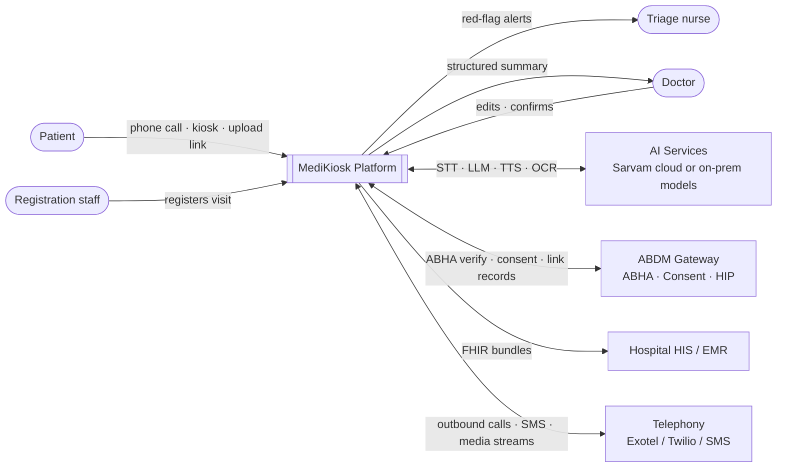

---

## 3. Container view

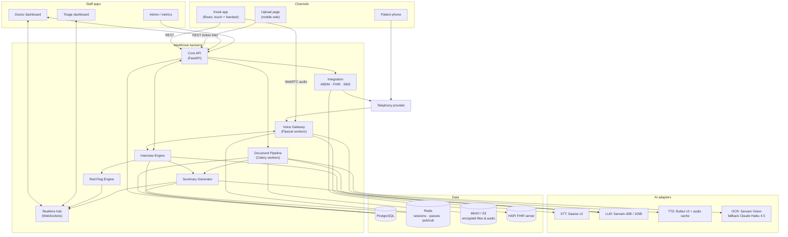

### 3.1 Container responsibilities

| Container | Responsibility | Scales by |
|---|---|---|
| **Voice Gateway** | Runs one Pipecat pipeline per live call: audio in/out, VAD, turn detection, STT, TTS, barge-in, DTMF, call transfer | Stateless workers; 1 worker process ≈ 10–20 concurrent calls (tune in load test) |
| **Core API** | REST endpoints, auth, visit lifecycle, consent, uploads, doctor/triage/admin APIs | Horizontal replicas behind nginx |
| **Interview Engine** | Loads ontology, drives the state machine, calls the extractor, validates slots, persists answers, asks Red-Flag Engine | In-process library used by Voice Gateway and Core API; session state in Redis |
| **Red-Flag Engine** | Evaluates rules on every updated history; raises alerts; triggers escalation | In-process, pure function — must be fast (< 20 ms) |
| **Document Pipeline** | Async: preprocess → OCR → extraction → normalization → timeline → lab/drug flags | Celery worker pool |
| **Summary Generator** | Merges interview + document facts; generates summary JSON + rendered text; re-runs on edits | Celery task |
| **Integration** | ABDM client (ABHA verify, consent, HIP link/share), FHIR builder & push, SMS/WhatsApp, telephony control | Celery tasks + API calls |
| **Realtime hub** | WebSocket channels for triage alerts, doctor queue updates, kiosk progress | Redis pub/sub fan-out |

---

## 4. The Interview Engine (the "brain")

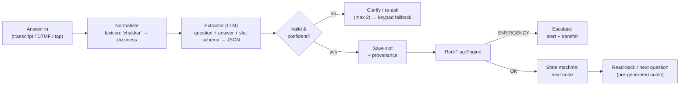

### 4.1 Components

| Component | Type | Description |
|---|---|---|
| Ontology Loader | Code | Loads YAML question banks (`backend/ontology/`), validates against `schema.json`, builds a graph per department mode (allopathy / ayurveda) |
| State Machine | Code (deterministic) | Walks sections in order: Intake → Chief Complaint → HPI (complaint tree) → Past → Surgical → Drugs → Allergies → Family → Personal → Obstetric (only if relevant) → ROS → [Ayurveda] → Wrap-up. Branches on slot values (`if onset == sudden …`) |
| Normalizer | Code + dictionaries | Maps colloquial words in each language to canonical terms before and after extraction |
| Extractor | LLM (Sarvam-30B) | Given the current question, expected slot schema, and the transcript → returns strict JSON (value, unit, confidence, `unclear` flag). Never free-form. |
| Validator | Code | Type/range checks (duration > 0, severity 0–10), confidence threshold, contradiction check |
| Clarifier | LLM + templates | Template re-ask first; LLM-phrased clarification only if template fails; after 2 failures → keypad/touch options |
| Read-back | Templates | "You said the pain started 2 days ago, suddenly. Correct?" — per section, not per question, to save time |
| Red-Flag Engine | Rules (YAML) + optional LLM check | See [07-conversation-design.md §7](07-conversation-design.md) |

### 4.2 Session state (Redis, mirrored to PostgreSQL)

```json
{
  "session_id": "ses_7f3a…",
  "visit_id": "vis_19c2…",
  "language": "te",
  "mode": "allopathy",
  "channel": "phone",
  "current_node": "chest_pain.radiation",
  "section_queue": ["past_history", "drugs", "allergies", "family", "personal", "ros"],
  "slots": { "cc.complaints": ["chest_pain"], "hpi.chest_pain.onset": "sudden", "hpi.chest_pain.duration_days": 2 },
  "retries": { "chest_pain.radiation": 1 },
  "red_flags": [],
  "started_at": "2026-09-10T09:12:03+05:30"
}
```

---

## 5. Key flows (sequence diagrams)

### 5.1 One voice turn

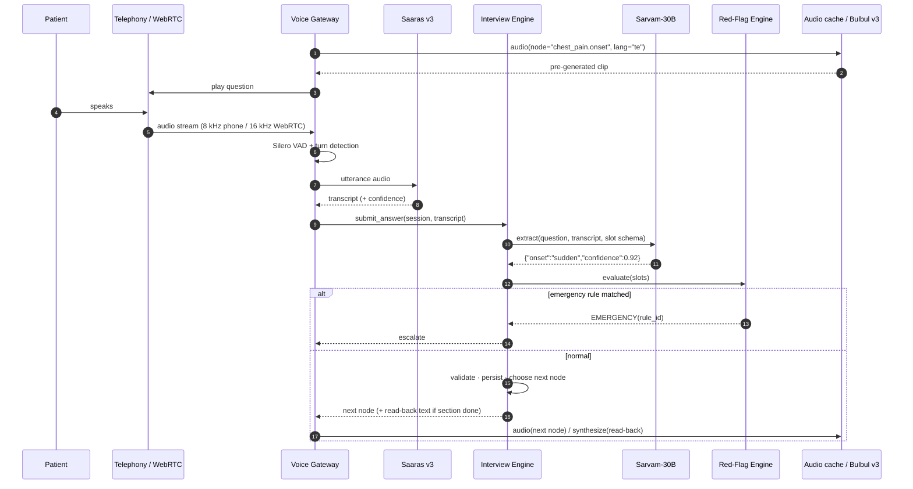

### 5.2 Red-flag escalation

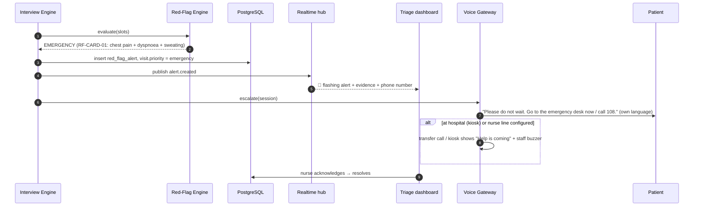

### 5.3 Document processing

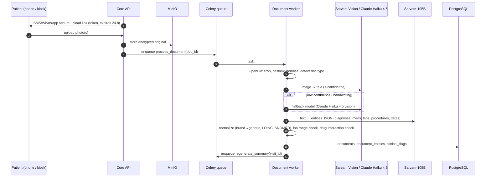

### 5.4 Summary → doctor → FHIR

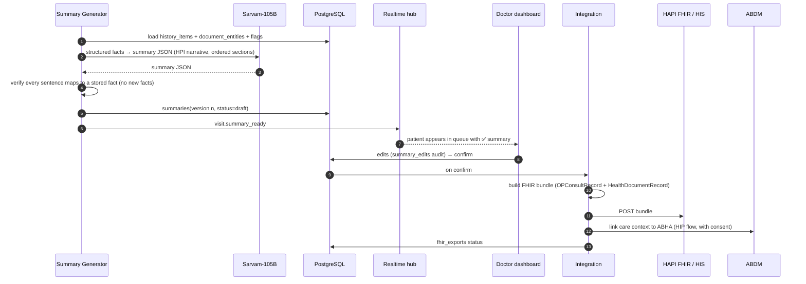

### 5.5 Identify & consent (call start)

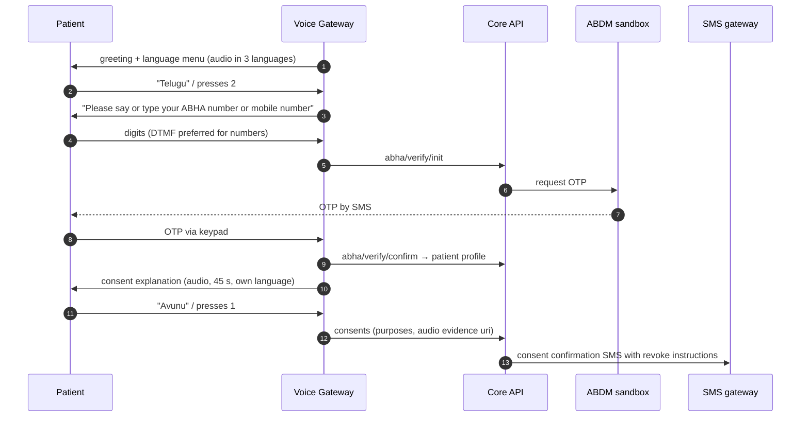

---

## 6. Visit lifecycle

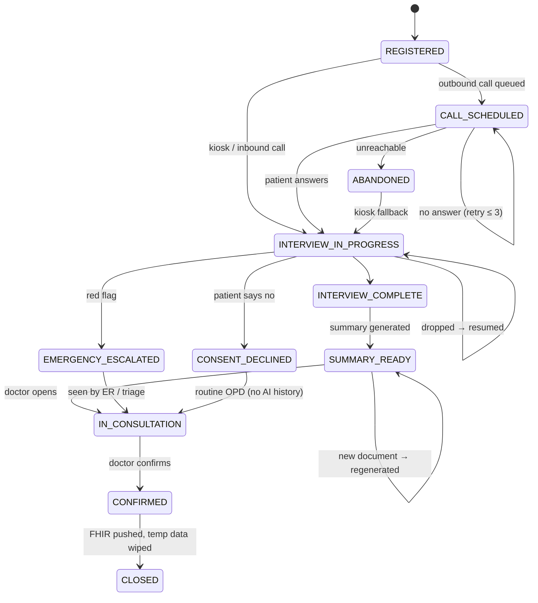

---

## 7. AI provider abstraction

All AI calls go through small interfaces so the provider can change without touching business logic.

```python
class STTProvider(Protocol):
    async def transcribe_stream(self, audio: AsyncIterator[bytes], lang: str, sample_rate: int) -> AsyncIterator[Transcript]: ...

class TTSProvider(Protocol):
    async def synthesize(self, text: str, lang: str, voice: str) -> bytes: ...

class LLMProvider(Protocol):
    async def extract(self, prompt: str, schema: dict) -> dict: ...          # strict JSON
    async def generate(self, prompt: str, schema: dict | None = None) -> str | dict: ...

class OCRProvider(Protocol):
    async def read(self, image: bytes, hints: dict) -> OCRResult: ...        # text + blocks + confidence
```

| Interface | Default (cloud) | Fallback | On-prem |
|---|---|---|---|
| STT | Sarvam Saaras v3 | Bhashini ASR | AI4Bharat IndicConformer |
| TTS | Sarvam Bulbul v3 | Bhashini TTS | AI4Bharat Indic Parler-TTS |
| LLM (live) | Sarvam-30B | Sarvam-105B | Sarvam-30B via vLLM |
| LLM (summary) | Sarvam-105B | Claude Haiku 4.5 | Sarvam-105B via vLLM |
| OCR | Sarvam Vision | Claude Haiku 4.5 (vision) | Surya / PaddleOCR |

Selection is by environment variables (`STT_PROVIDER=sarvam`, …) — see [04-tech-stack.md §9](04-tech-stack.md).

---

## 8. Latency budget (voice turn)

| Stage | Target | Notes |
|---|---|---|
| End-of-speech detection (VAD + turn model) | 200–300 ms | Longer silence threshold for elderly (configurable) |
| STT (streaming, final) | ≤ 300 ms | Streaming partials start during speech |
| Normalizer + LLM extraction | ≤ 600 ms | Sarvam-30B, short prompt, cached system prompt |
| Red-flag + state machine | ≤ 20 ms | Pure code |
| Next audio start | ≤ 100 ms | Pre-generated clips; live TTS only for read-backs (~300 ms) |
| **Total (patient stops → AI speaks)** | **≤ 1.5 s (p90)** | Filler sound ("hmm…") if > 1.2 s |

---

## 9. Deployment views

### 9.1 Hackathon / demo (single cloud VM or laptop)

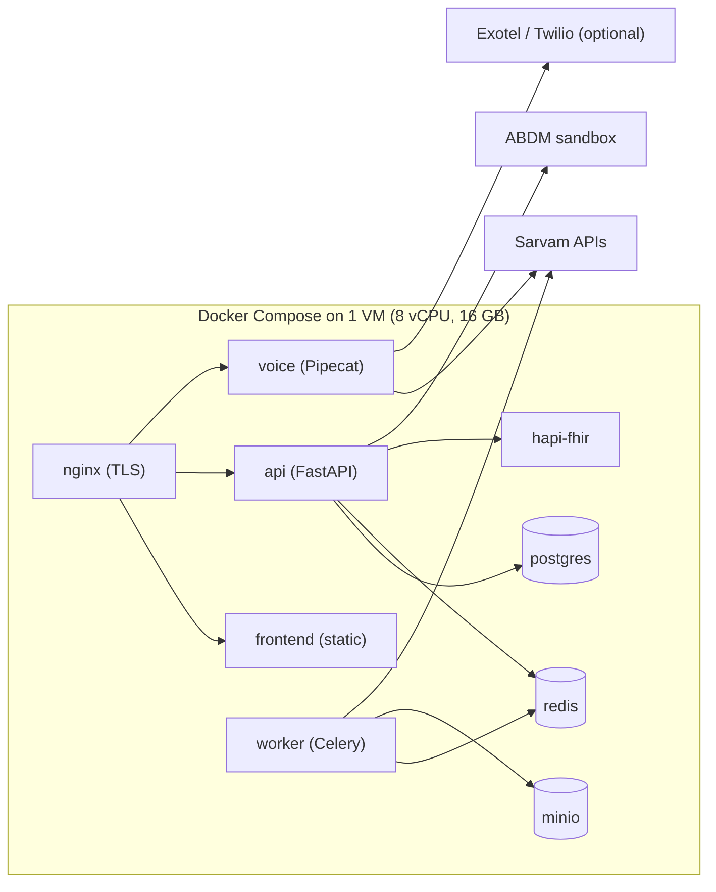

### 9.2 Hospital on-premise (production target)

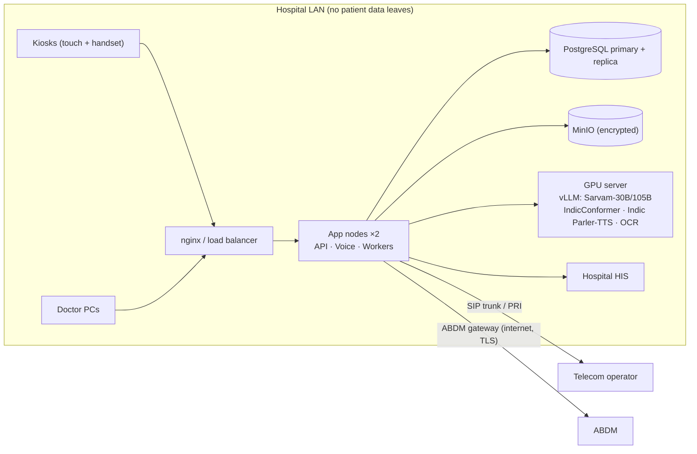

### 9.3 Capacity estimate (5,000 patients/day)
- Interviews concentrated in ~6 hours, ~8 min each → ≈ **110 concurrent calls average, ~150 peak**.
- Voice workers: ~10–15 processes (verify in load test).
- LLM tokens: ~100K tokens/patient → ~500M tokens/day → cloud cost dominated by STT/TTS; on-prem needs ≥ 1–2 inference GPUs (size by load test).
- Documents: ~2 pages/patient → 10,000 pages/day → OCR worker pool of 4–8.

---

## 10. Failure handling & fallbacks

| Failure | Detection | Behaviour |
|---|---|---|
| STT low confidence | confidence < threshold | Re-ask once → offer keypad/touch options |
| STT provider down | timeouts / 5xx | Switch to fallback provider (circuit breaker); if none, switch to keypad-only mode |
| LLM timeout | > 2 s | Template-based slot parse for closed questions; skip-and-flag for free text |
| Call dropped | telephony event | Session kept 24 h; auto call-back once; resume at last node |
| Patient unreachable | 3 attempts | Visit → ABANDONED; kiosk fallback on arrival |
| OCR low confidence | per-block confidence | Fallback OCR model; entity marked "unverified"; doctor sees original image |
| ABDM sandbox down | errors | Continue with mobile-OTP identity; link to ABHA later (retry queue) |
| HIS push fails | non-2xx | Retry with backoff; summary still visible in doctor dashboard |
| Red-flag engine error | exception | **Fail safe** → treat as potential emergency, alert triage |

---

## 11. Cross-cutting concerns

| Concern | Approach | Detail |
|---|---|---|
| Authentication | Staff: JWT (short-lived access + refresh), roles `doctor`, `nurse`, `registration`, `admin`. Patients: ABHA/mobile OTP; upload links: single-use signed tokens | [10](10-security-privacy.md) |
| Authorization | Role-based + department scoping (doctor sees own department queue) | [10](10-security-privacy.md) |
| Encryption | TLS 1.2+ everywhere; AES-256 at rest (MinIO SSE, PostgreSQL column encryption for mobile/ABHA) | [10](10-security-privacy.md) |
| Audit | Every read/write of patient data → `audit_logs` | [09](09-data-model-and-api.md) |
| Observability | Structured JSON logs (no PHI), request IDs, Prometheus metrics (latency per stage, STT confidence, call outcomes) | [11](11-testing-evaluation.md) |
| i18n | UI strings `frontend/src/i18n/*.json`; question text in ontology YAML per language; pre-generated audio per language | [07](07-conversation-design.md) |
| Configuration | `.env` + typed settings (`app/core/config.py`) | [04](04-tech-stack.md) |
