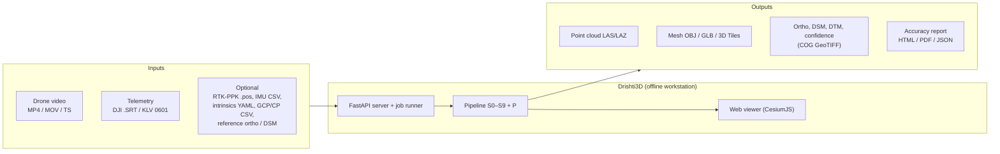

# 03 · Requirements Specification

> **Purpose:** the Software Requirements Specification (SRS) for Drishti3D. It defines what the system must do, how well it must do it, and how each requirement traces back to the PS 26158 challenges and deliverables.
>
> **Status:** Draft v1.0 · 2026-09-30 · Owner: R1 Pipeline Lead (functional), R2 Geo & Accuracy Lead (accuracy NFRs) · Normative source: [`00-project-charter.md`](00-project-charter.md)

---

## Table of contents

1. [Introduction](#1-introduction)
2. [Scope](#2-scope)
3. [Actors and stakeholders](#3-actors-and-stakeholders)
4. [Assumptions, dependencies and constraints](#4-assumptions-dependencies-and-constraints)
5. [Functional requirements](#5-functional-requirements)
6. [Non-functional requirements](#6-non-functional-requirements)
7. [Input data requirements](#7-input-data-requirements)
8. [Output requirements](#8-output-requirements)
9. [Traceability matrix](#9-traceability-matrix)
10. [Out of scope](#10-out-of-scope)
11. [Verification approach](#11-verification-approach)
12. [Open issues](#12-open-issues)

---

## 1. Introduction

### 1.1 Purpose of this document

This SRS is the contract between the six team roles (R1–R6, see charter §10), and between the team and the evaluators. Every functional requirement (FR) and non-functional requirement (NFR) has:

- a **stable ID** (never renumbered; deleted IDs are marked *withdrawn*);
- a **MoSCoW priority** — **M**ust (MVP / Finale blocker), **S**hould (expected at Finale), **C**ould (stretch), **W**on't (this edition);
- a **testable acceptance criterion**, verified as described in [`11-testing-and-evaluation.md`](11-testing-and-evaluation.md).

### 1.2 Conventions

| Term | Meaning in this document |
|---|---|
| *shall* | Mandatory for the stated priority |
| *should* | Recommended; deviation must be recorded |
| Stage IDs | S0–S9 and P exactly as defined in charter §7 |
| Profiles | `preview`, `fast` (default), `quality` — charter §7 |
| Reference workstation | RTX 3060 12 GB (minimum) / RTX 4090 24 GB (ideal), 64 GB RAM, 1 TB NVMe — charter §8 |
| Run | One execution of the pipeline on one video, stored under `data/runs/<run_id>/` |
| Checkpoint (CP) | Independently surveyed point **not** used in processing, used only for accuracy assessment |
| GCP | Surveyed point **used** in processing to anchor the model |
| Anchor | Any absolute correction source: reference ortho/DSM, RTK/PPK, CORS, GAGAN, single GCP |

### 1.3 Definitions of accuracy terms

Following ASPRS Positional Accuracy Standards Ed. 2 (2023) and NSSDA conversion factors (see [`06-georeferencing-and-accuracy.md`](06-georeferencing-and-accuracy.md)):

| Metric | Definition |
|---|---|
| RMSE_x, RMSE_y, RMSE_z | Root-mean-square of checkpoint residuals per axis |
| RMSE_H | √(RMSE_x² + RMSE_y²) |
| **CE90** | ≈ 2.146 × RMSE_x (valid when RMSE_x ≈ RMSE_y); equivalently ≈ 1.5175 × RMSE_H |
| **LE90** | 1.6449 × RMSE_z |
| Bias / noise split | Mean residual (systematic) vs standard deviation (random) per axis |
| Relative (length) error | \|L_model − L_truth\| / L_truth on tape- or survey-measured distances |
| Doming residual | Peak vertical deviation of the model DSM from a truth DSM/LiDAR along the strip, after removing a best-fit plane |

---

## 2. Scope

### 2.1 Product statement

Drishti3D is an **offline, AI-assisted photogrammetry system** that converts **one drone video pass + GPS/flight metadata** into a **georeferenced, metrically accurate, textured 3D model** (terrain, facades, rooftops, roads, vegetation, obstacles), with a **measured accuracy report** and a **web viewer** for visualisation and measurement (charter §2).

### 2.2 System boundary

### 2.3 Release scope

| Release (Rel-#; not the R# role IDs of charter §10) | Milestone (charter §11) | Scope summary |
|---|---|---|
| Rel-0 Baseline | M1 | ODM on sample + own video; first model (reference only, not shipped) |
| Rel-1 MVP | M2 | S0–S5 end-to-end with one `drishti run` command; LAS, OBJ, ortho, DSM |
| Rel-2 Accuracy | M3 | S4 anchoring + S9 QA with ≥30 checkpoints; CE90/LE90 report |
| Rel-3 Product | M4 | Viewer, measurement, 3D Tiles, confidence map, live preview (P) |
| Rel-4 Finale | M5 | Docker offline bundle, hardening on unseen video, KLV (stretch) |

---

## 3. Actors and stakeholders

| Actor | Type | Goals | Primary interactions |
|---|---|---|---|
| **Drone Operator** | Human, field | Fly an authorised pass; hand over video + telemetry quickly | Uploads data, starts run, watches live preview |
| **Analyst** | Human, office | Measure distances/heights/areas/volumes, inspect confidence, export products | Web viewer, exports, accuracy report |
| **Administrator** | Human, IT/ops | Install offline bundle, manage users, storage, updates | Docker compose, CLI, config files |
| **Evaluator / Judge** (NTRO, SIH jury) | Human, external | Verify accuracy and speed claims on unseen video | Report, checkpoints upload, benchmark CLI |
| **Surveyor** | Human, field | Provide checkpoints / GCPs from RTK/total station | GCP/CP CSV |
| **Drone** | External system | Records video + telemetry | Produces files (no live link in MVP) |
| **Reference data store** | External data | Supplies reference ortho/DSM, CORS/PPK files | Files on local disk (no network) |
| **Job runner / worker** | Internal system | Executes stages, reports progress | Pipeline package, GPU tools |

Stakeholders not directly using the system: NTRO (sponsor), SIH organisers, team members R1–R6.

---

## 4. Assumptions, dependencies and constraints

### 4.1 Assumptions

| ID | Assumption | If false |
|---|---|---|
| A-01 | Video is from a single continuous pass (no hard cuts except start/end); shot cuts are detected and split | S1 splits into segments; each is reconstructed separately and merged by GPS |
| A-02 | A telemetry source exists: DJI `.SRT` (sidecar) **or** KLV in MPEG-TS, **or** a GPX/CSV track | Without any GPS the run completes in **relative-only** mode, clearly flagged; absolute metrics are not reported |
| A-03 | Camera is a single frame camera (no 360°, no stitched multi-camera) | Rejected at S0 with a clear error |
| A-04 | Scene is predominantly static; moving objects occupy a minority of each frame | S2 masks dynamic classes; heavily dynamic scenes degrade completeness |
| A-05 | Flight altitude 30–150 m AGL, speed ≤ 15 m/s (typical consumer/defence sUAS) | Outside this range the system still runs; accuracy targets are not guaranteed |
| A-06 | Camera intrinsics are either supplied, available from a per-model calibration library, or estimable from metadata (focal length) | Constrained self-calibration with doming warning (see FR-SFM-04) |
| A-07 | The official PS evaluation criteria are not yet published; targets are our own (charter §6) | Targets updated in charter first, then here |

### 4.2 Dependencies

- COLMAP 4.x with global mapper (GLOMAP merged), pycolmap; OpenMVS; GDAL, PDAL, pyproj, rasterio; PyTorch 2.x with CUDA 12; ffmpeg; `klvdata`. Full list with licences in [`07-tech-stack.md`](07-tech-stack.md).
- NVIDIA GPU with CUDA 12 driver on the host.
- For absolute anchoring without RTK: a reference orthophoto and/or DSM covering the area, supplied offline by the user.

### 4.3 Constraints

| ID | Constraint | Source | Consequence for design |
|---|---|---|---|
| C-01 | **DST Geospatial Guidelines (15 Feb 2021):** data finer than **1 m horizontal / 3 m vertical** must be created/owned by Indian entities and **stored and processed in India** | [DST guidelines](https://dst.gov.in/sites/default/files/Final%20Approved%20Guidelines%20on%20Geospatial%20Data.pdf) | Our ≤1 m target produces regulated data → fully **offline/on-premise**, no foreign cloud APIs, no telemetry (NFR-SEC-*, NFR-OFF-*) |
| C-02 | **Drone Rules 2021 / Digital Sky airspace map:** own demo flights only in **green zones (≤120 m / 400 ft AGL)**; red zones need Central Government permission | [PIB Drone Rules backgrounder](https://static.pib.gov.in/writereaddata/specificdocs/documents/2022/jan/doc202212810701.pdf) | System works on **pre-recorded** video from authorised operators; no flight control; flight guide in [`12-flight-and-data-capture-guide.md`](12-flight-and-data-capture-guide.md) |
| C-03 | **Offline / air-gapped runtime** | Charter §4, §12 | All models, weights, fonts, map tiles and JS bundled; no CDN; CesiumJS ion disabled |
| C-04 | **Licence policy:** no weights whose licence excludes military use (e.g. VGGT-1B-Commercial); no non-commercial weights as default; AGPL components (OpenMVS, ODM, Ultralytics) noted for deployment | Charter §8 | Licence register in `07-tech-stack.md`; CI licence check (NFR-LIC-*) |
| C-05 | Reference hardware: single workstation, RTX 3060 12 GB minimum | Charter §8 | GPU memory budget ≤ 11 GB in `fast` profile; excludes ~30 GB learned SLAM (DROID/MASt3R-SLAM) as default ([arXiv 2608.18632](https://arxiv.org/html/2608.18632)) |
| C-06 | 36-hour Grand Finale on unseen NTRO video | Charter §11 | Robustness over peak quality; one-command run; graceful degradation |
| C-07 | Data handling for sensitive sites (negative list) | DST 2021 | No publication of outputs outside the workstation; export is an explicit user action |

---

## 5. Functional requirements

Priority key: **M** Must · **S** Should · **C** Could · **W** Won't (this edition). "Stage" names the charter stage that implements the requirement.

### 5.1 FR-ING — Ingest & Sync (S0, `drishti.ingest`)

| ID | Requirement | Pri | Stage | Acceptance criterion |
|---|---|---|---|---|
| FR-ING-01 | The system shall accept video in MP4, MOV and MPEG-TS containers with H.264 or H.265 codecs at 1080p and 4K (UHD / DCI), 24–60 fps, including variable frame rate. | M | S0 | All files in the golden input set (≥1 per container/codec combo) decode; per-frame PTS extracted; frame count matches `ffprobe` ± 0. |
| FR-ING-02 | The system shall parse DJI `.SRT` sidecars in all known field layouts (bracketed `[key: value]`, legacy `GPS(lon,lat,alt)`/`BAROMETER`, and spaced variants) into a normalised per-frame telemetry track. | M | S0 | Parser passes fixtures from ≥5 DJI models (e.g. Mini 3/4 Pro, Mavic 3, Air 2S, Phantom 4 RTK, M30); unknown keys preserved; 0 unparsed entries in fixtures. |
| FR-ING-03 | The system shall match SRT entries to video frames by `FrameCnt` / subtitle time and report gaps, duplicates and non-monotonic timestamps. | M | S0 | Synthetic SRT with injected gaps/duplicates → issues listed in `manifest.json` warnings; matching accuracy 100 % on clean fixtures. |
| FR-ING-04 | The system shall accept an optional timezone (`--tz`, default `Asia/Kolkata`) because DJI SRT timestamps are local time without zone. | M | S0 | Timestamps converted to UTC; ambiguity recorded in manifest. |
| FR-ING-05 | The system shall **estimate the video↔GPS time offset** by cross-correlating GPS-derived velocity with image-derived motion (optical flow in S0, refined with SfM camera velocity after S3) and apply it to all telemetry. | M | S0, S3 | On a synthetic clip with an injected offset of 0.4 s, the recovered offset error ≤ 1 frame period (≤ 33 ms @ 30 fps). Offset and its uncertainty written to manifest. |
| FR-ING-06 | The system shall decode MISB ST 0601 KLV (STANAG 4609) metadata from MPEG-TS data streams and interpolate sensor position/attitude to frame PTS. | S | S0 | Sample STANAG 4609 file decodes tags 2, 5–7, 13–20, 23–25 (see `08`); interpolated track has no NaN within the video span. |
| FR-ING-07 | The system shall ingest optional RTK/PPK solutions (RTKLIB `.pos`), IMU CSV, intrinsics YAML, GCP/checkpoint CSV and reference ortho/DSM GeoTIFFs as defined in [`08-data-formats-and-interfaces.md`](08-data-formats-and-interfaces.md). | M (GCP/CP, ref rasters, intrinsics) · S (RTK/PPK) · C (IMU) | S0 | Each optional input validated against its schema; invalid input rejected with error code and line number. |
| FR-ING-08 | The system shall compute SHA-256 hashes of every input and store them in `manifest.json`. | M | S0 | Hashes present and reproducible. |
| FR-ING-09 | The system shall detect and mask burnt-in OSD overlays (text, HUD) and letterboxing. | S | S0/S2 | Static overlay regions masked on a DJI video with on-screen HUD; no features detected inside masked regions. |
| FR-ING-10 | The system shall read the camera model / focal length from SRT, KLV or container metadata and look up a per-model calibration library (`configs/cameras/*.yaml`). | S | S0 | Known models auto-resolve intrinsics; unknown models fall back to FR-SFM-04 with a warning. |

### 5.2 FR-FRM — Keyframe Selection (S1, `drishti.frames`)

| ID | Requirement | Pri | Stage | Acceptance criterion |
|---|---|---|---|---|
| FR-FRM-01 | The system shall select keyframes adaptively by **parallax** (optical-flow median displacement / GPS baseline) to target a configurable forward overlap (default ~80–90 %). | M | S1 | For a 10-min clip, `fast` yields ≈ 1 keyframe/s (600–1,200 frames at 1–2 fps per report estimate); overlap between consecutive keyframes within configured band for ≥ 95 % of pairs. |
| FR-FRM-02 | The system shall reject blurred frames using **variance-of-Laplacian** relative to a sliding-window median and pick the sharpest frame in each window. | M | S1 | On a blur-augmented clip, ≥ 90 % of synthetic-blurred frames rejected; no gap in keyframes longer than configured `max_gap_s`. |
| FR-FRM-03 | The system shall detect shot cuts, freeze frames and hover segments (zero parallax) and exclude or down-sample them. | M | S1 | Injected cut detected; hover segment produces ≤ 1 keyframe per `hover_max_interval_s`. |
| FR-FRM-04 | The system shall attach to each keyframe its UTC time, interpolated GPS, altitude, gimbal attitude (if present) and focal length. | M | S1 | Every keyframe record in `01_frames/keyframes.csv` has non-null lat/lon/alt when telemetry exists. |
| FR-FRM-05 | The system shall enforce a per-profile frame budget (e.g. `preview` 0.5 fps, `fast` 1 fps, `quality` 2 fps; caps configurable). | M | S1 | Frame counts within ±10 % of budget on golden clips. |
| FR-FRM-06 | The system shall write keyframes losslessly (PNG) or with visually lossless JPEG (q ≥ 95), preserving full resolution. | M | S1 | Output resolution equals source resolution. |

### 5.3 FR-MSK — Dynamic Masking & Semantics (S2, `drishti.masking`)

| ID | Requirement | Pri | Stage | Acceptance criterion |
|---|---|---|---|---|
| FR-MSK-01 | The system shall produce per-keyframe binary masks for dynamic classes (vehicle, person, bicycle/motorbike, animal) before feature extraction. | M | S2 | On an annotated aerial validation set, mask recall for vehicles ≥ 0.85 at IoU 0.5 (target). |
| FR-MSK-02 | The system shall mask sky, drone body/propellers and overlays. | M | S2 | No SfM features in sky/overlay regions on golden clips. |
| FR-MSK-03 | The system shall produce per-keyframe semantic labels (ground, building, road, vegetation, water, vehicle/person, other) for use in S6 classification and texturing. | S | S2 | Label maps stored in `02_masks/semantic/`; mIoU reported on validation set. |
| FR-MSK-04 | The system should propagate masks temporally (SAM 2 video tracking) to catch temporarily stationary vehicles. | C | S2 | Parked-then-moving vehicle masked in all frames where visible. |
| FR-MSK-05 | The system shall support a residual-based second pass that masks features with high reprojection error after S3 (robust outlier masking). | S | S3 | Masked residual features logged; reprojection RMSE non-increasing. |
| FR-MSK-06 | Masking shall run within its time budget (≤ ~1.5 min for `fast` on reference GPU, estimate) and degrade to detector-only (no SAM 2) when over budget. | M | S2 | Timing log shows fallback triggered when budget exceeded. |

### 5.4 FR-SFM — Pose Estimation (S3, `drishti.sfm`)

| ID | Requirement | Pri | Stage | Acceptance criterion |
|---|---|---|---|---|
| FR-SFM-01 | The system shall estimate camera poses with **COLMAP 4.x global mapper** using ALIKED (default) or SuperPoint features + LightGlue matching, with sequential + GPS-neighbour pair selection. | M | S3 | ≥ 95 % of keyframes registered on golden clips; mean reprojection error ≤ 1.0 px (target). |
| FR-SFM-02 | The system shall use **GPS position priors** (with per-source σ) and **gravity/gimbal priors** where available. | M | S3 | Priors visible in COLMAP database; ablation shows reduced drift vs no-prior run. |
| FR-SFM-03 | The system shall model **rolling shutter** when the camera is rolling-shutter (per-model readout time, default from calibration library). | S | S3 | On a fast pass (≥ 8 m/s), RS model reduces checkpoint RMSE vs global-shutter model (cf. Vautherin et al. 2016, 74 ms / 30 ms readout ⇒ ~10 / ~4 px displacement). |
| FR-SFM-04 | The system shall **fix intrinsics** from calibration when available; otherwise it shall allow only tightly constrained self-calibration and **never free K1 on a near-nadir straight strip**. | M | S3 | Config audit shows `refine_extra_params=false` for strips; doming test (FR-QA-05) passes. |
| FR-SFM-05 | The system shall split long or degenerate sequences into overlapping sub-scenes, solve them independently and merge using shared frames and GPS (split-merge). | S | S3 | 20-min synthetic flight completes; merge residual on overlap ≤ 2× reprojection RMSE. |
| FR-SFM-06 | The system shall fall back to DPVO (or a licence-cleared feed-forward model) for local poses when the global mapper registers < 70 % of frames. | C | S3 | Fallback triggered on a texture-poor clip; run completes with `degraded` flag. |
| FR-SFM-07 | The system shall recover **roll about the flight axis** from gimbal attitude / gravity when GPS positions are near-collinear. | M | S3/S4 | Collinearity detected (PCA ratio) and roll constraint applied; logged in manifest. |
| FR-SFM-08 | The system shall export the sparse model in COLMAP binary format and a per-frame pose CSV. | M | S3 | Files present under `03_sfm/`. |

### 5.5 FR-GEO — Georeferencing & Anchoring (S4, `drishti.georef`)

| ID | Requirement | Pri | Stage | Acceptance criterion |
|---|---|---|---|---|
| FR-GEO-01 | The system shall compute a **robust 7-DoF similarity (Umeyama + Huber/RANSAC)** from SfM camera centres to GPS positions (subsampled to ~1 Hz), after lever-arm and time-offset correction. | M | S4 | Synthetic test with known Sim(3) recovers scale within 0.1 %, rotation within 0.1°. |
| FR-GEO-02 | The system shall **register the model's orthophoto/DSM to a user-supplied reference orthophoto/DSM** (feature + NCC/mutual-information 2D registration, then DSM-to-DSM vertical/ICP) to remove the rigid GNSS bias. | M | S4 | On a test flight with reference data, CE90 improves from GNSS-only to ≤ 1 m (target); failure detected and reported when inlier ratio < threshold. |
| FR-GEO-03 | The system shall accept RTK/PPK camera positions and use them as high-weight priors (σ ≈ 2–5 cm). | S | S3/S4 | With PPK input, CE90 ≤ 0.10 m (target, charter §6). |
| FR-GEO-04 | The system shall accept one or more GCPs and apply them as anchors, keeping checkpoints strictly separate. | M | S4 | IDs used as GCP never appear in checkpoint statistics (enforced in code). |
| FR-GEO-05 | The system shall accept a single known point or a GAGAN/CORS-corrected track as an alternative anchor. | S | S4 | Anchoring source recorded in manifest and report. |
| FR-GEO-06 | The system shall auto-select the processing CRS (WGS 84 / UTM zone of the scene centroid, e.g. EPSG:32643/32644) and convert ellipsoidal ↔ orthometric heights with EGM2008 (default) or EGM96. | M | S4 | CRS and vertical datum in every output's metadata; round-trip transformation error < 1 mm. |
| FR-GEO-07 | The system shall produce and persist an **anchoring decision log**: candidate corrections, their residuals, the chosen one and why. | M | S4 | `04_georef/anchoring.json` present and referenced by report. |
| FR-GEO-08 | The system shall report the GNSS-only placement **and** the anchored placement side by side (before/after). | M | S4/S9 | Both appear in accuracy report when checkpoints exist. |

### 5.6 FR-DNS — Dense Reconstruction & Mesh (S5, `drishti.dense`)

| ID | Requirement | Pri | Stage | Acceptance criterion |
|---|---|---|---|---|
| FR-DNS-01 | The system shall densify the sparse model with OpenMVS (resolution level per profile), using masks from S2. | M | S5 | Dense cloud written; masked dynamic objects absent from dense cloud on golden clip. |
| FR-DNS-02 | The system shall reconstruct a watertight-where-observed surface mesh, refine it (quality profile) and texture it with seam levelling and exposure compensation. | M | S5 | Textured OBJ produced; no texture from masked pixels. |
| FR-DNS-03 | The system shall rasterise a **DSM** and generate an **orthomosaic** at a configurable GSD (default = 2× native GSD, estimate). | M | S5 | COG outputs pass `rio cogeo validate`. |
| FR-DNS-04 | The system shall derive a **DTM** by ground filtering (PDAL SMRF/CSF). | S | S5/S6 | DTM present; ground class RMSE vs truth DTM reported. |
| FR-DNS-05 | The system shall carry per-point **observation count** and **triangulation angle** into outputs for confidence mapping. | M | S5 | Extra-bytes present in LAS (see `08`). |

### 5.7 FR-CMP — Completion & Classification (S6, `drishti.completion`)

| ID | Requirement | Pri | Stage | Acceptance criterion |
|---|---|---|---|---|
| FR-CMP-01 | The system shall classify points into ASPRS classes: ground (2), low/medium/high vegetation (3/4/5), building (6), water (9), road surface (11), plus user classes vehicle (64) and person (65). | M | S6 | Overall accuracy reported on labelled subset; target ≥ 85 % (estimate). |
| FR-CMP-02 | The system shall fit planar roof segments and extrude LoD2-style walls for under-observed buildings. | S | S6 | Completed walls present for buildings with observed roof; all synthetic geometry flagged. |
| FR-CMP-03 | Every synthesised point/face shall be flagged **inferred** (LAS synthetic flag + `conf_class=2`) and rendered distinctly in the viewer. | M | S6 | 100 % of LoD2-generated points carry the flag (unit test). |
| FR-CMP-04 | The system shall export building footprints/roof planes as GeoJSON (optional CityGML LoD2). | C | S6 | GeoJSON valid; CityGML validates against schema. |

### 5.8 FR-SPL — Photoreal Layer (S7, `drishti.splat`)

| ID | Requirement | Pri | Stage | Acceptance criterion |
|---|---|---|---|---|
| FR-SPL-01 | The system should train a 3D Gaussian Splatting model with gsplat, initialised from S3/S5 geometry, with per-image exposure compensation. | C | S7 | PSNR on held-out frames reported; runs after the metric product is complete. |
| FR-SPL-02 | The splat layer shall be **display-only**: no measurement tool shall read from it and the viewer shall label it as non-metric. | M (if S7 built) | S7/UI | Measurement tools disabled when only splat layer is active. |
| FR-SPL-03 | The splat layer should be exported as glTF with `KHR_gaussian_splatting` / 3D Tiles for CesiumJS. | C | S7/S8 | Loads in bundled CesiumJS version. |
| FR-SPL-04 | S7 shall never block or delay delivery of S8/S9 outputs. | M | S7 | S7 runs as a separate background job after S9. |

### 5.9 FR-EXP — Export & Tiling (S8, `drishti.export`)

| ID | Requirement | Pri | Stage | Acceptance criterion |
|---|---|---|---|---|
| FR-EXP-01 | The system shall export the georeferenced point cloud as LAS 1.4 / LAZ (PDRF 7) with classification and extra bytes. | M | S8 | Validates with PDAL `info`; CRS WKT present. |
| FR-EXP-02 | The system shall export the textured mesh as OBJ/MTL (local UTM coordinates + offset file) and GLB. | M | S8 | Opens in Blender/MeshLab; GLB validates with glTF-Validator (0 errors). |
| FR-EXP-03 | The system shall export OGC **3D Tiles** (mesh) and point-cloud tiles for streaming in CesiumJS. | M | S8 | `tileset.json` loads in bundled CesiumJS; correct geolocation within 0.1 m of LAS. |
| FR-EXP-04 | The system shall export ortho, DSM, DTM and confidence raster as Cloud-Optimised GeoTIFF. | M | S8 | `rio cogeo validate` passes for all rasters. |
| FR-EXP-05 | The system should export PLY and FBX on request. | C | S8 | Files open in Blender. |
| FR-EXP-06 | The system shall package a run as a single ZIP "delivery bundle" with checksums. | S | S8 | `SHA256SUMS` verifies. |

### 5.10 FR-QA — QA & Confidence (S9, `drishti.qa`)

| ID | Requirement | Pri | Stage | Acceptance criterion |
|---|---|---|---|---|
| FR-QA-01 | The system shall compute, from independent checkpoints: RMSE_x/y/z, RMSE_H, mean (bias) and SD per axis, **CE90, LE90**, and the ASPRS Ed. 2 horizontal/vertical accuracy class. | M | S9 | Unit tests with known residuals reproduce hand-computed values to 1 mm. |
| FR-QA-02 | The system shall warn when fewer than 30 checkpoints are supplied (ASPRS Ed. 2 minimum) and still report results with the count. | M | S9 | Warning in report when n < 30. |
| FR-QA-03 | The system shall compute metrics for each placement tier present: GNSS-only, anchored, RTK/PPK. | M | S9 | Report table shows one row per tier. |
| FR-QA-04 | The system shall compute **relative accuracy** from user-supplied distance pairs (checkpoint-to-checkpoint or measured lengths). | M | S9 | Length error % reported; target ≤ 0.5 %. |
| FR-QA-05 | The system shall run a **doming test**: DSM residual vs reference DSM/LiDAR along and across track after plane removal. | S | S9 | Peak deformation reported; target ≤ 0.2 m over 1 km strip. |
| FR-QA-06 | The system shall produce a **confidence map** (raster + per-point attribute) with classes *observed-high*, *observed-low*, *inferred*. | M | S9 | Confidence COG and LAS extra byte present; class definitions in report. |
| FR-QA-07 | The system shall produce the accuracy report as HTML, PDF and JSON (schema in `08`). | M | S9 | JSON validates against schema; PDF renders offline. |
| FR-QA-08 | The system shall compute **completeness** (% of visible ground footprint reconstructed). | S | S9 | Target ≥ 90 %. |
| FR-QA-09 | The system shall allow checkpoints to be uploaded **after** a run and recompute S9 only. | M | S9 | `POST /runs/{id}/checkpoints` re-runs S9 without touching S0–S8 outputs. |

### 5.11 FR-PRV — Live Preview (P, `drishti.preview`)

| ID | Requirement | Pri | Stage | Acceptance criterion |
|---|---|---|---|---|
| FR-PRV-01 | The system shall build an incremental, GPS-placed **2D mosaic** from keyframes while the main pipeline runs. | M | P | First preview tile visible ≤ 60 s after upload starts (charter §6). |
| FR-PRV-02 | The preview shall update at ≥ 1 Hz while frames are being decoded (target; literature shows ~2.3 fps CPU mosaicking is feasible, ISPRS Annals 2025). | S | P | Measured update rate logged. |
| FR-PRV-03 | The preview shall be clearly labelled **"Preview – not metric"**. | M | P/UI | Visible label in viewer. |
| FR-PRV-04 | The preview shall run on CPU so that it does not compete with S2/S3 for GPU. | S | P | GPU utilisation attributable to P ≈ 0. |

### 5.12 FR-UI — Web Viewer (`web/`)

| ID | Requirement | Pri | Acceptance criterion |
|---|---|---|---|
| FR-UI-01 | The viewer shall display the 3D Tiles mesh, point cloud, ortho and DSM on a CesiumJS globe **without internet** (no Cesium ion, local base imagery). | M | Works with network cable unplugged. |
| FR-UI-02 | The viewer shall provide measurement tools: distance (3D and horizontal), height difference, area, volume (vs base plane or DTM), point coordinates in WGS 84 and UTM. | M | Measurements on a known object match CLI/PDAL computation within 1 cm. |
| FR-UI-03 | The viewer shall toggle layers and overlay the confidence map with a legend. | M | Legend shows three classes. |
| FR-UI-04 | The viewer shall show run list, run progress (stage, %, ETA) and live preview via WebSocket. | M | Progress updates ≤ 2 s latency. |
| FR-UI-05 | The viewer shall provide an upload form (video, telemetry, optional inputs, profile selection). | M | Upload of 4 GB file succeeds with resumable chunks. |
| FR-UI-06 | The viewer shall show the accuracy report and allow download of all exports. | M | Links present for all artefacts. |
| FR-UI-07 | The viewer shall show a cross-section / elevation profile tool. | S | Profile plotted from DSM. |
| FR-UI-08 | The viewer should allow picking checkpoints on the model and comparing to surveyed coordinates. | C | Residual displayed per checkpoint. |
| FR-UI-09 | The viewer shall display the splat layer (if present) as a separate, non-metric layer. | C | Label "Photoreal – not for measurement". |

Details in [`09-viewer-and-ui.md`](09-viewer-and-ui.md).

### 5.13 FR-API — CLI and REST API (`pipeline/drishti/cli.py`, `server/`)

| ID | Requirement | Pri | Acceptance criterion |
|---|---|---|---|
| FR-API-01 | The system shall provide the CLI `drishti run --video … --srt … [--rtk …] [--ref-ortho …] [--ref-dsm …] [--gcp …] --profile fast --out data/runs/<run_id>` exactly as the charter contract (§9). | M | Command runs end-to-end on golden clip. |
| FR-API-02 | The CLI shall provide subcommands `ingest`, `preview`, `qa`, `export`, `benchmark` (reference in `08`). | M (`ingest`, `qa`, `export`) · S (`preview`, `benchmark`) | `--help` documents all flags; smoke tests pass. |
| FR-API-03 | The system shall expose a REST API: create/list/get/delete/cancel/resume runs, list/download artefacts, upload checkpoints, get report; and a WebSocket progress stream. | M | OpenAPI schema published at `/docs` (offline); contract tests pass. |
| FR-API-04 | Runs shall be **resumable** from the last completed stage checkpoint (`--resume`). | M | Kill worker during S5 → resume skips S0–S4 (verified by timings). |
| FR-API-05 | All configuration shall be via YAML (`configs/*.yaml`) with CLI overrides (`--set key=value`); the resolved config is saved per run. | M | `config.resolved.yaml` in run directory reproduces the run. |
| FR-API-06 | The system shall return machine-readable errors (RFC 7807 JSON with `code`) and documented CLI exit codes. | M | Contract tests cover each error code. |
| FR-API-07 | The system shall support local authentication with roles *admin*, *operator*, *analyst*. | S | Unauthorised requests return 401/403. |

---

## 6. Non-functional requirements

### 6.1 Performance (NFR-PERF)

All timings on the reference workstation (RTX 4090 24 GB unless stated), measured by `drishti benchmark`. Numbers are **charter targets** (charter §6), not measured results.

| ID | Requirement | Measure | Target |
|---|---|---|---|
| NFR-PERF-01 | End-to-end processing time, `fast` profile | Wall-clock from upload complete to S9 done, 10-min 4K clip | **≤ 15 min** |
| NFR-PERF-02 | Time to first visual (P) | Upload start → first preview tile in viewer | **≤ 60 s** |
| NFR-PERF-03 | `fast` on minimum GPU (RTX 3060 12 GB) | Same as PERF-01 | ≤ 30 min (target) and no OOM |
| NFR-PERF-04 | Peak GPU memory, `fast` | nvidia-smi max | ≤ 11 GB |
| NFR-PERF-05 | Peak host RAM, `fast` | RSS max | ≤ 48 GB (64 GB machine) |
| NFR-PERF-06 | Viewer frame rate | 3D Tiles scene, 1080p display, integrated/mid GPU | ≥ 30 fps interactive |
| NFR-PERF-07 | Progress latency | Stage event → UI | ≤ 2 s |
| NFR-PERF-08 | S9 re-run after checkpoint upload | Wall-clock | ≤ 60 s |

Indicative per-stage budget for NFR-PERF-01 (estimates to be measured; see [`05-pipeline-design.md`](05-pipeline-design.md)):

| S0 | S1 | S2 | S3 | S4 | S5 | S6 | S8 | S9 | Total | S7 |
|---|---|---|---|---|---|---|---|---|---|---|
| 0.5 | 1.0 | 1.5 | 4.0 | 0.5 | 5.5 | 0.5 | 1.0 | 0.5 | **15.0 min** | background, excluded |

### 6.2 Accuracy (NFR-ACC)

| ID | Requirement | Condition | Target |
|---|---|---|---|
| NFR-ACC-01 | Relative length error | Measured lengths ≥ 10 m, any anchoring tier; on short (~300 m) clips GNSS-only scale can reach ~0.7 %, so an extra scale source (RTK/PPK, anchoring or a known length) is required there (charter §6, [06 §12](06-georeferencing-and-accuracy.md)) | **≤ 0.5 %**; ≤ 10 cm on 20 m |
| NFR-ACC-02 | Absolute — GNSS only | Consumer GNSS, no correction | **Report honestly**; expected ~3–7 m CE90 (Zhang et al. 2019 → ~3.5 m CE90 / ~6.5 m LE90, derived) |
| NFR-ACC-03 | Absolute — anchored | Ortho/DSM registration, CORS/GAGAN or single GCP | **≤ 1 m CE90 and ≤ 1 m LE90** |
| NFR-ACC-04 | Absolute — RTK/PPK | RTK/PPK positions supplied | **≤ 0.10 m CE90** (literature: PPK no-GCP XY 2.4 cm / Z 2.2 cm, Zhang et al. 2019) |
| NFR-ACC-05 | Completeness | Visible ground footprint | **≥ 90 %** |
| NFR-ACC-06 | Doming residual | 1 km strip vs LiDAR/DSM truth | **≤ 0.2 m** peak |
| NFR-ACC-07 | Time-sync residual | After FR-ING-05 | ≤ 1 frame period |
| NFR-ACC-08 | Honesty | Every accuracy number in UI/report | Has n checkpoints, method, tier and date attached; no number without evidence |

### 6.3 Reliability and robustness (NFR-REL)

| ID | Requirement | Measure / criterion |
|---|---|---|
| NFR-REL-01 | **Unseen-video robustness:** the pipeline shall complete (possibly degraded) on ≥ 90 % of a held-out set of ≥ 10 diverse videos (different drones, altitudes, lighting, terrain) without manual intervention. | Benchmark suite pass rate |
| NFR-REL-02 | Graceful degradation: missing telemetry → relative-only; SfM failure → fallback (FR-SFM-06); anchoring failure → GNSS-only with warning; S7 failure → no effect on deliverables. | Fault-injection tests |
| NFR-REL-03 | Resumability: a crash or power loss shall lose at most the in-progress stage. | Kill-9 test per stage |
| NFR-REL-04 | Determinism: re-running the same inputs + config yields outputs within tolerance (pose diff < 1 cm, CE90 diff < 5 cm). | Repeatability test ×3 |
| NFR-REL-05 | Input validation shall reject malformed inputs within 10 s with a specific error code. | Fuzz tests on SRT/CSV/YAML |
| NFR-REL-06 | Disk-space guard: refuse to start if free space < 5× input video size (estimate). | Unit test |

### 6.4 Security (NFR-SEC)

| ID | Requirement | Criterion |
|---|---|---|
| NFR-SEC-01 | No network egress at runtime from any container. | Compose uses an `internal: true` network; egress test (`curl` to external IP) fails |
| NFR-SEC-02 | Services bind to `127.0.0.1` by default; LAN exposure is an explicit admin setting. | Port scan from another host shows closed ports by default |
| NFR-SEC-03 | Local authentication with hashed passwords (argon2id) or install-time API token; role-based access. | Auth tests |
| NFR-SEC-04 | Data at rest on an encrypted volume (LUKS / BitLocker) — documented deployment requirement; run deletion removes all files. | Checklist in `10`; delete test |
| NFR-SEC-05 | Audit log of logins, uploads, exports and deletions (append-only JSONL). | Entries present |
| NFR-SEC-06 | No third-party analytics, telemetry, fonts or CDNs in web bundle. | Bundle scan for external URLs = 0 |
| NFR-SEC-07 | Uploaded files are never executed; filenames sanitised; path traversal blocked. | Security tests |

### 6.5 Offline operation (NFR-OFF)

| ID | Requirement | Criterion |
|---|---|---|
| NFR-OFF-01 | Full install from an offline bundle (Docker image tarballs + model weights + calibration library) without internet. | Install on an air-gapped VM succeeds |
| NFR-OFF-02 | All model weights loaded from local paths with SHA-256 verification. | Tampered weight → refusal |
| NFR-OFF-03 | Viewer base imagery from local sources only (reference ortho or bundled low-res basemap). | Offline viewer test |

### 6.6 Portability (NFR-PORT)

| ID | Requirement | Criterion |
|---|---|---|
| NFR-PORT-01 | Runs on Ubuntu 22.04/24.04 and Windows 11 + WSL2 with NVIDIA Container Toolkit. | CI/manual test on both |
| NFR-PORT-02 | Runs on rugged laptops with RTX-class mobile GPUs ≥ 12 GB (degraded time targets). | Benchmark recorded |
| NFR-PORT-03 | Outputs readable by QGIS, CloudCompare, Blender, ArcGIS and CesiumJS. | Interop checklist |

### 6.7 Usability (NFR-USE)

| ID | Requirement | Criterion |
|---|---|---|
| NFR-USE-01 | One command / one upload to produce all deliverables with defaults. | New user produces a model in ≤ 10 min of hands-on time (task test) |
| NFR-USE-02 | Every warning and error message states cause and remedy. | Review of message catalogue |
| NFR-USE-03 | Viewer usable by an analyst after a 5-minute walkthrough. | ≥ 4/5 test users complete measurement tasks |
| NFR-USE-04 | Units and CRS always displayed next to numbers. | UI review |

### 6.8 Maintainability (NFR-MNT)

| ID | Requirement | Criterion |
|---|---|---|
| NFR-MNT-01 | Each stage is a separate module with a uniform `run(ctx, cfg) -> StageResult` interface. | Code review |
| NFR-MNT-02 | Unit test coverage ≥ 70 % for `ingest`, `georef`, `qa`. | Coverage report |
| NFR-MNT-03 | Type-hinted Python (mypy clean in `--strict` for `georef`, `qa`), ruff lint clean. | CI |
| NFR-MNT-04 | Every run reproducible from `manifest.json` + `config.resolved.yaml` + input hashes. | Replay test |

### 6.9 Licensing (NFR-LIC)

| ID | Requirement | Criterion |
|---|---|---|
| NFR-LIC-01 | Every dependency and model weight recorded with licence in [`07-tech-stack.md`](07-tech-stack.md). | Register complete |
| NFR-LIC-02 | Default build contains **no** weights with non-commercial or military-use-excluding licences (e.g. VGGT-1B-Commercial, SuperPoint original weights, DUSt3R/MASt3R). | Automated licence check in CI |
| NFR-LIC-03 | AGPL components (OpenMVS, ODM, Ultralytics YOLO) are isolated as separate processes/containers and documented for deployment decisions. | Architecture review |

---

## 7. Input data requirements

| Input | Mandatory? | Formats | Key content | Validation |
|---|---|---|---|---|
| Drone video | **Mandatory** | MP4, MOV, MPEG-TS; H.264/H.265; 1080p/4K; 24–60 fps | Single continuous pass | `ffprobe` succeeds; duration ≥ 10 s; resolution ≥ 1280×720 |
| Telemetry | **Mandatory** for absolute georeferencing (else relative-only) | DJI `.SRT`; KLV MISB ST 0601 in TS; GPX/CSV fallback | Per-frame lat, lon, alt; ideally gimbal attitude, focal length | Coverage ≥ 95 % of video duration |
| Camera intrinsics | Optional (recommended) | YAML (OpenCV / COLMAP model) | fx, fy, cx, cy, k1–k3, p1, p2, readout time | Resolution matches video |
| RTK/PPK solution | Optional | RTKLIB `.pos` (or CSV) | GPST/UTC time, lat, lon, h (ellipsoidal), Q, σ | Time overlap with video; Q=1 (fix) ratio reported |
| IMU / attitude log | Optional | CSV | time, roll, pitch, yaw (and/or gyro/acc) | Monotonic time |
| GCPs | Optional | CSV (schema in `08`) | id, E/N/h or lat/lon/h, σ, CRS | Within scene footprint |
| Checkpoints | Optional (mandatory to claim absolute accuracy) | CSV (same schema, `role=CP`) | ≥ 30 recommended (ASPRS Ed. 2) | No overlap with GCP IDs |
| Reference orthophoto | Optional (primary anchor without RTK) | GeoTIFF/COG | GSD ≤ 1 m, georeferenced, known accuracy | Overlaps footprint ≥ 50 % |
| Reference DSM | Optional | GeoTIFF/COG | Posting ≤ 5 m, known vertical datum | Overlaps footprint |
| Distance pairs | Optional | CSV | from_id, to_id or measured length | For relative accuracy |

Formats and schemas: [`08-data-formats-and-interfaces.md`](08-data-formats-and-interfaces.md). Capture guidance (gimbal 20–30° forward-oblique, altitude variation, checkpoint layout): [`12-flight-and-data-capture-guide.md`](12-flight-and-data-capture-guide.md).

---

## 8. Output requirements

| Output | Format | CRS / datum | Produced by | Priority |
|---|---|---|---|---|
| Dense point cloud | LAS 1.4 / LAZ, PDRF 7, ASPRS classes + extra bytes | UTM zone (EPSG:326xx), EGM2008 orthometric heights (compound CRS) | S5, S6, S8 | M |
| Textured mesh | OBJ/MTL + JPEG textures; GLB | OBJ: local UTM with offset; GLB: ENU at origin + geolocation metadata | S5, S8 | M |
| 3D Tiles | `tileset.json` + GLB content (3D Tiles 1.1) | ECEF (EPSG:4978) | S8 | M |
| Orthomosaic | COG GeoTIFF, RGB(A) | UTM | S5, S8 | M |
| DSM / DTM | COG GeoTIFF, Float32 | UTM + EGM2008 | S5, S6, S8 | M / S |
| Confidence map | COG GeoTIFF (uint8 classes) + LAS extra byte | UTM | S9 | M |
| Accuracy report | HTML, PDF, JSON | — | S9 | M |
| Live preview | Web tiles (PNG/WebP XYZ) | Web Mercator (EPSG:3857) | P | M |
| Photoreal splat | glTF `KHR_gaussian_splatting` / 3D Tiles | ECEF | S7 | C |
| Run manifest | `manifest.json` | — | all | M |
| Building footprints | GeoJSON (CityGML LoD2 optional) | WGS 84 | S6 | C |

Every output shall carry: CRS (WKT2), vertical datum, run ID, software version, anchoring tier and creation time.

---

## 9. Traceability matrix

### 9.1 PS key challenges → requirements → stages

PS 26158 lists eight challenges (per PS mirrors; verify on sih.gov.in):

| # | PS challenge | Our approach (one line) | Functional reqs | Non-functional reqs | Stages |
|---|---|---|---|---|---|
| (i) | **Limited viewing angles** (single pass) | Fixed intrinsics, roll from gimbal/gravity, sub-scene SfM, doming test, oblique capture guidance | FR-SFM-04, FR-SFM-05, FR-SFM-07, FR-QA-05, FR-CMP-02 | NFR-ACC-06 | S3, S4, S6, S9 |
| (ii) | **Motion blur** | Variance-of-Laplacian keyframe rejection; rolling-shutter model | FR-FRM-02, FR-FRM-01, FR-SFM-03 | NFR-REL-01 | S1, S3 |
| (iii) | **Variable lighting** | Exposure compensation in texturing & splats; robust learned features | FR-DNS-02, FR-SPL-01, FR-SFM-01 | NFR-REL-01 | S3, S5, S7 |
| (iv) | **Dynamic objects** (vehicles, people) | Pre-SfM class masks, temporal propagation, residual masks | FR-MSK-01, FR-MSK-04, FR-MSK-05, FR-DNS-01 | NFR-ACC-05 | S2, S3, S5 |
| (v) | **GPS inaccuracy** | Time-sync, robust Sim(3), ortho/DSM registration, RTK/PPK/CORS/GAGAN/GCP anchors, before/after report | FR-ING-05, FR-GEO-01…08, FR-QA-03 | NFR-ACC-02, -03, -04, -07 | S0, S4, S9 |
| (vi) | **Real-time processing load** | Two-tier: 2D live preview + metric 3D in ≤ 15 min; keyframe budget; GPU global SfM | FR-PRV-01…04, FR-FRM-05, FR-SFM-01, FR-MSK-06 | NFR-PERF-01…05 | P, S1, S3, S5 |
| (vii) | **Occluded surfaces** | LoD2 plane completion flagged *inferred*; confidence map | FR-CMP-02, FR-CMP-03, FR-QA-06, FR-UI-03 | NFR-ACC-08 | S6, S9 |
| (viii) | **Metric accuracy without extensive GCPs** | Anchor by reference data, RTK/PPK, or one GCP (never more than 3 by default); CE90/LE90 on independent checkpoints; relative-length tests | FR-GEO-02, FR-GEO-04, FR-GEO-05, FR-QA-01…04 | NFR-ACC-01, -03 | S4, S9 |

### 9.2 PS deliverables → requirements

| PS expected deliverable | Requirements | Stages | Evidence artefact |
|---|---|---|---|
| Georeferenced 3D model (terrain, facades, rooftops, roads, vegetation, obstacles) | FR-DNS-01…05, FR-CMP-01…03, FR-GEO-06 | S5, S6 | LAS, OBJ/GLB, 3D Tiles |
| Metrically accurate | FR-GEO-*, FR-QA-01…05 | S4, S9 | Accuracy report JSON/PDF |
| Textured model | FR-DNS-02 | S5 | OBJ+MTL, GLB |
| Point cloud / mesh in standard formats (OBJ, PLY, LAS, GeoTIFF, glTF, FBX reported by mirrors) | FR-EXP-01…05 | S8 | Export folder |
| Visualisation, measurement and analysis | FR-UI-01…09 | Viewer | Web app |
| Fast / near-real-time | FR-PRV-*, NFR-PERF-01, -02 | P, all | Benchmark report |
| Minimal GCPs | FR-GEO-02, FR-GEO-05 | S4 | Anchoring log |
| Uses optional IMU, baro, intrinsics, RTK/PPK | FR-ING-07, FR-ING-10, FR-GEO-03 | S0, S3, S4 | Manifest inputs section |

### 9.3 Requirement group → owner

| Group | Owner (charter §10) |
|---|---|
| FR-ING (except time-sync), FR-FRM, FR-SFM, FR-API | R1 Pipeline Lead |
| FR-ING-05, FR-GEO, FR-QA, NFR-ACC | R2 Geo & Accuracy Lead |
| FR-DNS, FR-CMP, FR-SPL, FR-EXP | R3 3D & Mesh Engineer |
| FR-MSK, classification models | R4 AI/ML Engineer |
| FR-UI, FR-PRV (display) | R5 Frontend Engineer |
| Input data, checkpoints, benchmark set (NFR-REL-01) | R6 Data, Flight Ops & Pitch |

---

## 10. Out of scope

Consistent with charter §5:

| Item | Status | Rationale |
|---|---|---|
| Flight control / autopilot / mission planning | Won't | Tool works on pre-recorded video (Drone Rules 2021) |
| Onboard (edge) processing on the drone | Won't (future work) | Hardware scope; Jetson port is future work |
| Real-time full 3D during flight | Won't | Literature does not support metric live 3D on single pass; we deliver live **2D** preview |
| Multi-pass fusion / change detection | Could (stretch) / future | Beyond single-pass PS |
| Survey-grade (cm) absolute accuracy without any correction source | Won't | Physically unsupported by consumer GNSS (~2–4 m rigid bias) |
| Cloud / SaaS deployment | Won't | DST 2021 localisation, NTRO security posture |
| 360° / multi-camera rigs, thermal/multispectral reconstruction | Won't | Out of PS scope |
| Semantic object tracking / targeting analytics | Won't | Not requested; sensitive |
| Diffusion-based "hallucinated" completion as metric geometry | Won't | Non-metric; only plane-based LoD2, flagged |

---

## 11. Verification approach

| Method | Applies to | Where |
|---|---|---|
| Unit tests | Parsers, CRS, Sim(3), metrics | `tests/unit/` |
| Golden-dataset integration tests | S0–S9 end-to-end | `tests/integration/`, public datasets (MARS-LVIG, UseGeo, UAVD4L) + own flights |
| Benchmark CLI | NFR-PERF, NFR-ACC | `drishti benchmark` |
| Fault injection | NFR-REL | `tests/robustness/` |
| Field test with ≥ 30 RTK checkpoints | NFR-ACC-03/04 | Own green-zone flight (charter M3) |
| Offline / egress test | NFR-SEC-01, NFR-OFF | Air-gapped VM |

See [`11-testing-and-evaluation.md`](11-testing-and-evaluation.md).

---

## 12. Open issues

| ID | Issue | Owner | Due |
|---|---|---|---|
| OI-01 | Confirm official evaluation criteria and targets on sih.gov.in / NTRO PDF (charter §6 warning) | R6 | Before M2 |
| OI-02 | Confirm licence of GeoFF3D, MapAnything, π3 before any use as fallback | R1 | Before M2 |
| OI-03 | Confirm vertical datum of DJI `abs_alt` per model | R2 | M3 |
| OI-04 | Source of reference ortho/DSM for finale site (Bhuvan / SoI / NTRO-supplied) | R2/R6 | M4 |
| OI-05 | Measure DJI SRT latency vs exposure (no public study found) | R2 | M3 |

---

## Related documents

- [00-project-charter.md](00-project-charter.md)
- [01-problem-statement.md](01-problem-statement.md)
- [02-solution-overview.md](02-solution-overview.md)
- [03-requirements.md](03-requirements.md)
- [04-system-architecture.md](04-system-architecture.md)
- [05-pipeline-design.md](05-pipeline-design.md)
- [06-georeferencing-and-accuracy.md](06-georeferencing-and-accuracy.md)
- [07-tech-stack.md](07-tech-stack.md)
- [08-data-formats-and-interfaces.md](08-data-formats-and-interfaces.md)
- [09-viewer-and-ui.md](09-viewer-and-ui.md)
- [10-setup-and-repo-structure.md](10-setup-and-repo-structure.md)
- [11-testing-and-evaluation.md](11-testing-and-evaluation.md)
- [12-flight-and-data-capture-guide.md](12-flight-and-data-capture-guide.md)
- [13-project-plan.md](13-project-plan.md)
- [14-demo-and-pitch.md](14-demo-and-pitch.md)
- [15-research-and-references.md](15-research-and-references.md)
- [16-glossary.md](16-glossary.md)
