# 04 · System Architecture

> **Purpose:** describes how Drishti3D is structured, from system context down to pipeline components, deployment, run storage, job lifecycle, security, scalability and the key architecture decisions (ADRs).
>
> **Status:** Draft v1.0 · 2026-09-30 · Owner: R1 Pipeline Lead (with R2 for georeferencing, R5 for web) · Normative source: [`00-project-charter.md`](00-project-charter.md)

---

## Table of contents

1. [Architectural drivers](#1-architectural-drivers)
2. [Level 1 — System context](#2-level-1--system-context)
3. [Level 2 — Containers](#3-level-2--containers)
4. [Level 3 — Pipeline components and artefacts](#4-level-3--pipeline-components-and-artefacts)
5. [Runtime views (sequence diagrams)](#5-runtime-views-sequence-diagrams)
6. [Deployment view](#6-deployment-view)
7. [Run directory layout](#7-run-directory-layout)
8. [Job state machine](#8-job-state-machine)
9. [Error handling and resumability](#9-error-handling-and-resumability)
10. [Logging and telemetry](#10-logging-and-telemetry)
11. [Security architecture](#11-security-architecture)
12. [Scalability](#12-scalability)
13. [Architecture decision records](#13-architecture-decision-records)
14. [Risks and technical debt](#14-risks-and-technical-debt)

---

## 1. Architectural drivers

The architecture is shaped by a small set of drivers, each traceable to [`03-requirements.md`](03-requirements.md):

| Driver | Requirement IDs | Architectural response |
|---|---|---|
| **Absolute accuracy is the hard problem** (consumer GNSS ≈ 2–4 m near-rigid bias; Zhang et al. 2019) | FR-GEO-*, NFR-ACC-03 | Dedicated georeferencing stage S4 with multiple anchor sources; QA stage S9 that measures before/after |
| **≤ 15 min for a 10-min 4K clip** on one workstation | NFR-PERF-01 | Keyframe budget, GPU global SfM (COLMAP 4.x), OpenMVS at reduced resolution in `fast`, S7 off the critical path |
| **≤ 60 s to first visual** | NFR-PERF-02 | Parallel CPU preview branch P fed directly from S0 decoded frames + telemetry |
| **Offline / air-gapped** (DST 2021) | C-01, C-03, NFR-SEC-01, NFR-OFF-* | Single-host Docker compose, internal network only, all assets bundled |
| **Robust on unseen video** (36-h finale) | NFR-REL-01…03 | Stage checkpoints, resumable runs, fallbacks, degraded-but-complete outputs |
| **Honesty / traceability** | NFR-ACC-08, NFR-MNT-04 | `manifest.json` per run with input hashes, resolved config, per-stage metrics and decisions |
| **Licence cleanliness** | NFR-LIC-* | AGPL tools run as separate processes; licence register and CI check |

Architectural style: **pipes-and-filters** pipeline (stages communicate only through files in a run directory) wrapped by a thin **service layer** (FastAPI + SQLite job table) and a **single-page web client**. This keeps each stage independently testable, re-runnable and replaceable.

---

## 2. Level 1 — System context

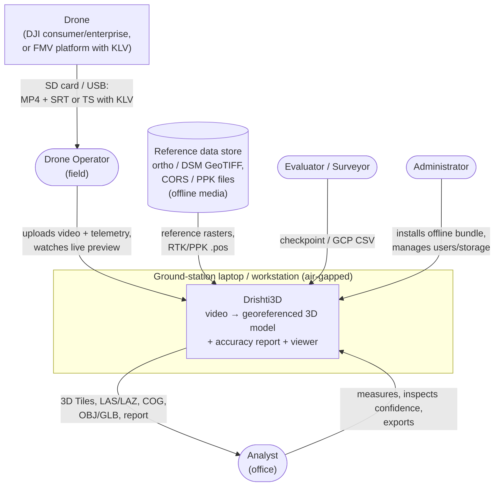

**No arrows leave the ground station**: there is no internet, cloud, map-tile or licence-server dependency at runtime (NFR-SEC-01). Data enters and leaves only on removable media under operator control.

---

## 3. Level 2 — Containers

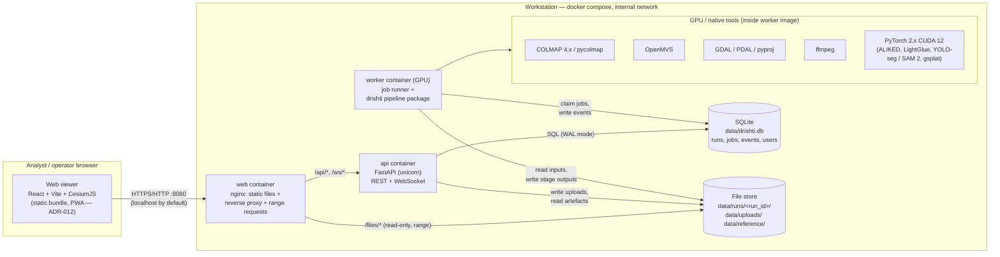

| Container | Technology | Responsibility | Scaling unit |
|---|---|---|---|
| **web** | nginx + static React/Vite/CesiumJS build | Serve SPA, 3D Tiles and COGs with HTTP range requests, proxy API/WS | 1 |
| **api** | Python 3.11, FastAPI, uvicorn, SQLAlchemy/SQLModel | Auth, run CRUD, chunked uploads, artefact listing, report, WebSocket progress fan-out | 1 (stateless; state in SQLite + files) |
| **worker** | CUDA 12 base image, Python 3.11, `drishti` package, COLMAP, OpenMVS, GDAL/PDAL, ffmpeg, PyTorch | Claim queued jobs, run stages S0–S9 and P, emit progress events, write checkpoints | 1 per GPU (see §12) |
| **SQLite** | File DB, WAL mode | Job queue, run metadata, event log, users, audit | — |
| **File store** | Host bind-mount `./data` (encrypted volume) | Inputs, run directories, reference rasters, model weights | — |

The CLI (`drishti …`) uses the **same pipeline package** directly, without API or DB, writing the same run directory. The server is therefore an optional convenience layer; the run directory is the source of truth (ADR-009).

---

## 4. Level 3 — Pipeline components and artefacts

### 4.1 Stage graph

```mermaid
flowchart LR
  IN[/"video + SRT/KLV<br/>+ optional inputs"/]
  S0["S0 Ingest & Sync<br/>drishti.ingest"]
  S1["S1 Keyframe Selection<br/>drishti.frames"]
  S2["S2 Dynamic Masking & Semantics<br/>drishti.masking"]
  S3["S3 Pose Estimation (SfM)<br/>drishti.sfm"]
  S4["S4 Georeferencing & Anchoring<br/>drishti.georef"]
  S5["S5 Dense Reconstruction & Mesh<br/>drishti.dense"]
  S6["S6 Completion & Classification<br/>drishti.completion"]
  S7["S7 Photoreal Layer (optional)<br/>drishti.splat"]
  S8["S8 Export & Tiling<br/>drishti.export"]
  S9["S9 QA & Confidence<br/>drishti.qa"]
  P["P Live Preview<br/>drishti.preview"]

  IN --> S0
  S0 -- "telemetry.csv<br/>timesync.json<br/>video_info.json" --> S1
  S0 -- "decoded frames +<br/>GPS (stream)" --> P
  S1 -- "01_frames/images/*.jpg<br/>keyframes.csv" --> S2
  S1 --> S3
  S2 -- "02_masks/dynamic/*.png<br/>semantic/*.png" --> S3
  S3 -- "sparse/0 (COLMAP)<br/>poses.csv" --> S4
  S3 -. "SfM velocity →<br/>refine time offset" .-> S0
  S4 -- "transform.json<br/>georef sparse model<br/>anchoring.json" --> S5
  S5 -- "dense.ply, mesh,<br/>textured OBJ,<br/>dsm.tif, ortho.tif" --> S6
  S2 -- "semantic labels" --> S6
  S6 -- "classified.laz<br/>lod2 + inferred flags<br/>dtm.tif" --> S8
  S8 -- "LAZ, COG, OBJ/GLB,<br/>3D Tiles" --> S9
  S4 -- "before/after<br/>placements" --> S9
  S9 -- "accuracy.json,<br/>confidence.tif,<br/>report.html/pdf" --> OUT[/"Delivery bundle"/]
  S8 --> OUT
  S9 -. "after S9 (background)" .-> S7
  S7 -- "splat GLB / tiles<br/>(display only)" --> OUT
```

Critical path for NFR-PERF-01: **S0 → S1 → S2 → S3 → S4 → S5 → S6 → S8 → S9**. **P** runs in parallel from the start; **S7** runs after S9 and never blocks delivery (FR-SPL-04).

### 4.2 Component responsibilities

| Stage | Module | Inputs | Outputs (in run dir) | Key sub-components | Owner |
|---|---|---|---|---|---|
| S0 | `drishti.ingest` | video, SRT/KLV, optional files | `00_ingest/video_info.json`, `telemetry.csv`, `timesync.json`, `overlay_mask.png`, `inputs.json` | `video.py` (ffprobe/ffmpeg), `srt.py`, `klv.py` (klvdata), `timesync.py` | R1 / R2 (sync) |
| S1 | `drishti.frames` | video, telemetry | `01_frames/images/*.jpg`, `keyframes.csv`, `blur.csv` | `keyframes.py` (flow parallax), `blur.py` (var-of-Laplacian) | R1 |
| S2 | `drishti.masking` | keyframes | `02_masks/dynamic/*.png`, `semantic/*.png`, `stats.json` | `detector.py` (YOLO-seg), `segmenter.py` (SAM 2, sky) | R4 |
| S3 | `drishti.sfm` | keyframes, masks, priors, intrinsics | `03_sfm/database.db`, `sparse/0/*.bin`, `poses.csv`, `sfm_report.json` | `colmap_runner.py`, `priors.py`, `rolling_shutter.py` | R1 |
| S4 | `drishti.georef` | sparse model, telemetry, RTK/PPK, GCP, ref ortho/DSM | `04_georef/transform.json`, `anchoring.json`, `sparse_geo/`, `poses_geo.csv` | `align.py` (robust Umeyama), `register.py` (ortho/DSM), `corrections.py`, `crs.py` | R2 |
| S5 | `drishti.dense` | georef model, keyframes, masks | `05_dense/scene.mvs`, `dense.ply`, `mesh_refined.ply`, `textured/`, `rasters/dsm.tif`, `rasters/ortho.tif` | `openmvs_runner.py`, `rasters.py` (PDAL/GDAL) | R3 |
| S6 | `drishti.completion` | dense cloud, mesh, semantics | `06_completion/classified.laz`, `dtm.tif`, `lod2/buildings.geojson`, `lod2/inferred.ply` | `classify.py`, `lod2.py` | R3 / R4 |
| S7 | `drishti.splat` | keyframes, georef poses, dense init | `07_splat/splat.ply`, `splat.glb` | `train.py` (gsplat) | R3 |
| S8 | `drishti.export` | S5/S6 outputs | `08_export/…` (LAZ, COG, OBJ, GLB, tiles, bundle) | `las.py`, `cog.py`, `gltf.py`, `tiles3d.py` | R3 |
| S9 | `drishti.qa` | exports, checkpoints, reference DSM, S4 placements | `09_qa/accuracy.json`, `confidence.tif`, `report.html`, `report.pdf` | `accuracy.py`, `doming.py`, `confidence.py`, `report.py` | R2 |
| P | `drishti.preview` | frame stream + telemetry | `preview/tiles/{z}/{x}/{y}.webp`, `preview/latest.json` | `mosaic.py` | R5 / R1 |

### 4.3 Orchestration inside the worker

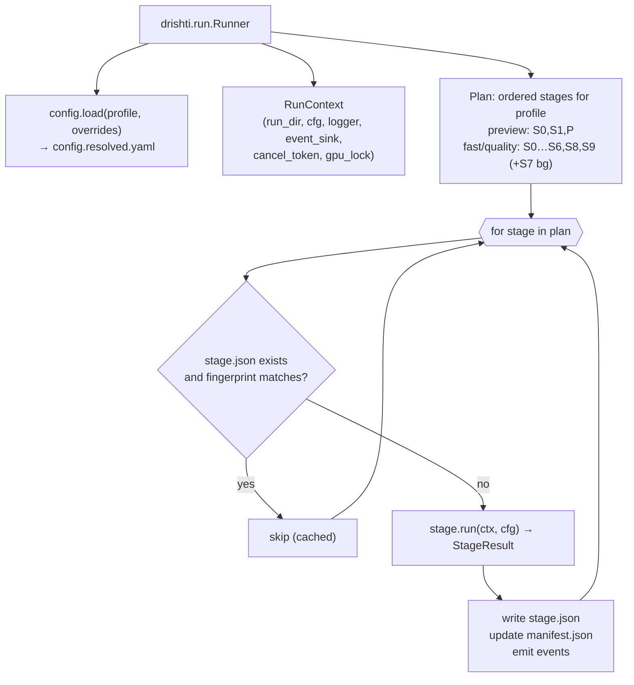

Every stage implements the same protocol (see [`08-data-formats-and-interfaces.md` §10](08-data-formats-and-interfaces.md#10-python-module-interfaces)):

```python
class Stage(Protocol):
    id: str                      # "S0" … "S9", "P"
    name: str                    # "ingest", "frames", …
    requires: tuple[str, ...]    # upstream stage ids
    def fingerprint(self, ctx: RunContext) -> str: ...
    def run(self, ctx: RunContext, cfg: StageConfig) -> StageResult: ...
```

---

## 5. Runtime views (sequence diagrams)

### 5.1 Upload → process → progress → view

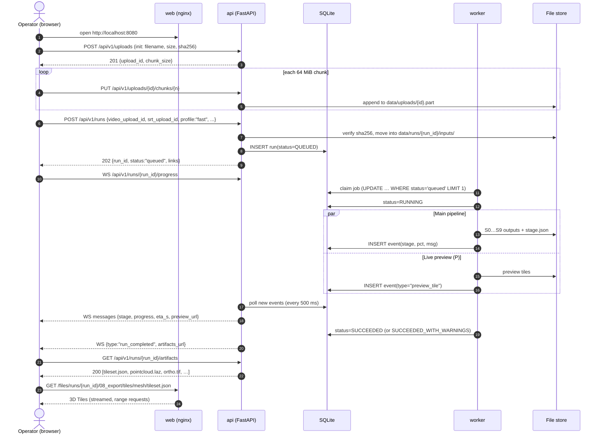

### 5.2 Live preview (P)

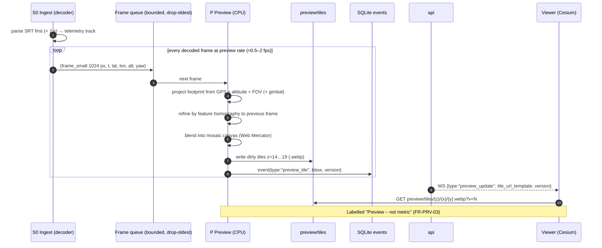

Design notes:

- P starts as soon as the **first bytes** of the video are available on disk (the API streams chunks to disk), so the 60 s target (NFR-PERF-02) is not blocked by full upload of a multi-GB file when the container supports progressive decoding (MP4 with `moov` at the start, or TS). For MP4 files with `moov` at the end, preview starts after upload completes; the UI shows the upload progress instead.
- P uses **CPU only** and a bounded queue, so it can never slow S1–S3 (FR-PRV-04). Published CPU mosaicking reaches ~2.3 fps ([ISPRS Annals 2025](https://isprs-annals.copernicus.org/articles/X-2-W2-2025/65/2025/)), which is enough.

### 5.3 Post-hoc checkpoint upload

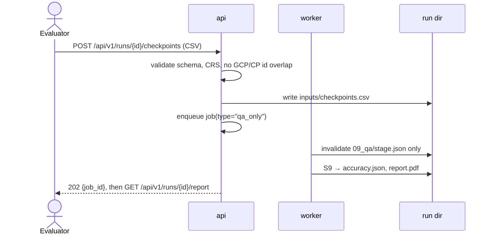

---

## 6. Deployment view

### 6.1 Topology

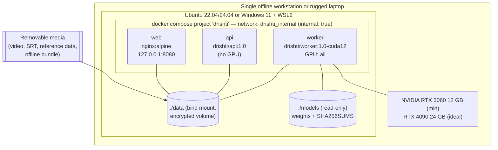

### 6.2 Reference hardware (charter §8)

| Profile | GPU | RAM | Disk | Expected use |
|---|---|---|---|---|
| Minimum | RTX 3060 12 GB | 64 GB | 1 TB NVMe | Development, degraded finale timing |
| Ideal | RTX 4090 24 GB | 64 GB | 1 TB NVMe | Finale demo, NFR-PERF targets |
| Field | Rugged laptop, RTX 4080/4090 Laptop (12–16 GB) | 64 GB | 2 TB NVMe | Ground-station use (NFR-PORT-02) |

### 6.3 Compose sketch

```yaml
# docker/compose.yaml (sketch — full file in 10-setup-and-repo-structure.md)
name: drishti
networks:
  internal:
    internal: true          # no egress (NFR-SEC-01)
services:
  web:
    image: drishti/web:1.0
    ports: ["127.0.0.1:8080:80"]   # localhost only by default (NFR-SEC-02)
    volumes: ["../data:/data:ro"]
    networks: [internal]
    depends_on: [api]
  api:
    image: drishti/api:1.0
    environment:
      DRISHTI_DATA: /data
      DRISHTI_DB: /data/drishti.db
    volumes: ["../data:/data"]
    networks: [internal]
  worker:
    image: drishti/worker:1.0-cuda12
    environment:
      DRISHTI_DATA: /data
      DRISHTI_MODELS: /models
      DRISHTI_OFFLINE: "1"         # hard-fail on any attempted download
    volumes: ["../data:/data", "../models:/models:ro"]
    networks: [internal]
    deploy:
      resources:
        reservations:
          devices: [{ driver: nvidia, count: all, capabilities: [gpu] }]
```

> Note: with `internal: true`, Docker does not publish ports from that network. The `web` service is therefore attached to an additional host-only bridge in the full compose file; only `web` is reachable, and only from `127.0.0.1`. See [`10-setup-and-repo-structure.md`](10-setup-and-repo-structure.md).

### 6.4 Air-gapped installation

| Step | Artefact | Verification |
|---|---|---|
| 1 | `drishti-offline-1.0.tar` = `docker save` of web, api, worker images | `sha256sum -c` |
| 2 | `models/` (ALIKED, LightGlue, YOLO-seg / SAM 2 weights, camera calibration library) | `models/SHA256SUMS`; licence file per weight |
| 3 | `basemap/` low-resolution offline basemap tiles for the viewer (optional) | Checksums |
| 4 | `docker load -i …` → `docker compose up -d` | `GET /api/v1/health` returns `offline: true` |
| 5 | Create admin user: `docker compose exec api drishti-admin create-user --role admin` | Login works |

---

## 7. Run directory layout

Each run has one self-contained directory. Nothing outside it is needed to reproduce, audit or deliver the run (ADR-009).

```
data/
├── drishti.db                     # SQLite (jobs, events, users, audit)
├── uploads/                       # in-flight chunked uploads (*.part)
├── reference/                     # shared reference ortho/DSM, CORS files
└── runs/
    └── <run_id>/                  # e.g. 20261018-104207-a3f9c1
        ├── manifest.json          # run record: inputs+hashes, stages, metrics, decisions
        ├── config.resolved.yaml   # fully merged config actually used
        ├── inputs/                # video, srt/klv, rtk.pos, gcp.csv, checkpoints.csv, ref rasters (hard-links or copies)
        ├── logs/
        │   ├── run.jsonl          # structured log, all stages
        │   ├── events.jsonl       # progress events (mirror of DB)
        │   └── tools/             # raw stdout/stderr of colmap, openmvs, pdal…
        ├── 00_ingest/   stage.json video_info.json telemetry.csv timesync.json overlay_mask.png
        ├── 01_frames/   stage.json images/*.jpg keyframes.csv blur.csv
        ├── 02_masks/    stage.json dynamic/*.png semantic/*.png stats.json
        ├── 03_sfm/      stage.json database.db sparse/0/{cameras,images,points3D,rigs,frames}.bin poses.csv sfm_report.json
        ├── 04_georef/   stage.json transform.json anchoring.json sparse_geo/ poses_geo.csv registration/
        ├── 05_dense/    stage.json scene.mvs dense.ply mesh_refined.ply textured/ rasters/{dsm,ortho}.tif
        ├── 06_completion/ stage.json classified.laz dtm.tif lod2/{buildings.geojson,inferred.ply}
        ├── 07_splat/    stage.json splat.ply splat.glb           # optional, display-only
        ├── 08_export/
        │   ├── stage.json
        │   ├── pointcloud/ <run_id>.laz
        │   ├── mesh/       model.obj model.mtl textures/ model.glb offset.json
        │   ├── tiles/      mesh/tileset.json  pointcloud/tileset.json  splat/tileset.json
        │   ├── rasters/    ortho.tif dsm.tif dtm.tif confidence.tif
        │   └── bundle/     <run_id>.zip SHA256SUMS
        ├── 09_qa/       stage.json accuracy.json report.html report.pdf plots/ residuals.csv
        └── preview/     latest.json tiles/{z}/{x}/{y}.webp
```

Ordering note: S8 writes the LAS `conf_class`/`confidence` attributes from S5/S6 view statistics; S9 then computes `confidence.tif` and the accuracy report, publishes `confidence.tif` into `08_export/rasters/`, and only then is the delivery bundle (`08_export/bundle/`) sealed with checksums.

`stage.json` (per stage) records `status`, `fingerprint`, `started_at`, `finished_at`, `duration_s`, `outputs[]` with SHA-256, `metrics{}`, `warnings[]`. `manifest.json` aggregates all `stage.json` files plus inputs and summary metrics. Schemas: [`08-data-formats-and-interfaces.md` §6](08-data-formats-and-interfaces.md#6-run-manifest-schema).

---

## 8. Job state machine

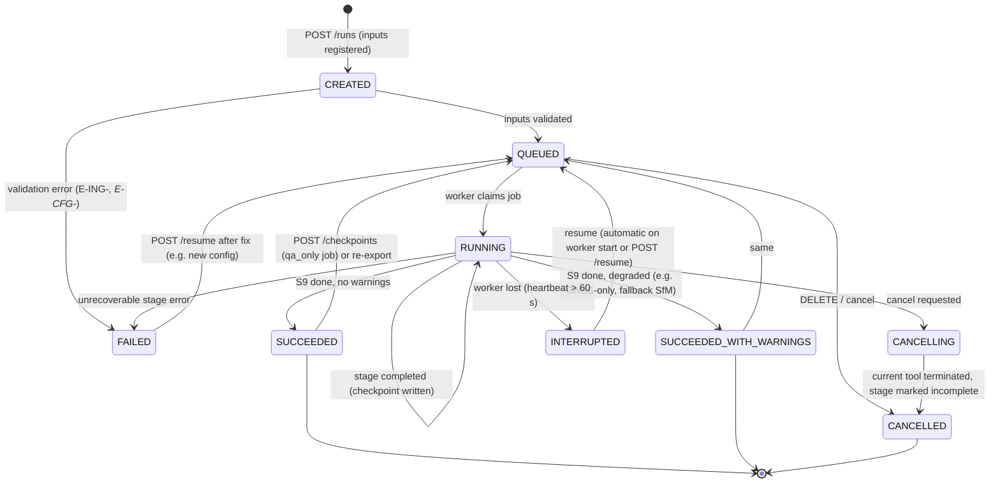

| State | Meaning | Worker holds GPU? |
|---|---|---|
| CREATED | Row exists, inputs being verified | No |
| QUEUED | Waiting for a worker | No |
| RUNNING | A stage is executing; `current_stage` set; heartbeat every 10 s | Yes (per-GPU lock) |
| CANCELLING | Cancel token set; worker terminating child processes | Yes |
| SUCCEEDED / SUCCEEDED_WITH_WARNINGS | Deliverables complete; S7 may still run as a separate background job | No |
| FAILED | Error code recorded in run and manifest | No |
| INTERRUPTED | Worker disappeared (crash, power loss) | No |
| CANCELLED | Terminal | No |

---

## 9. Error handling and resumability

### 9.1 Principles

1. **Stage atomicity.** A stage writes into `<stage_dir>.tmp/` and renames to `<stage_dir>/` only on success, then writes `stage.json`. A crash leaves only a `.tmp` directory, which is deleted on resume.
2. **Fingerprint-based idempotency.** `fingerprint = sha256(stage code version ‖ stage-relevant config subtree ‖ upstream output hashes)`. If `stage.json.fingerprint` matches, the stage is skipped. Changing, say, `dense.resolution_level` invalidates S5 and everything downstream, but not S0–S4.
3. **Fail soft where the product is still honest.** Degraded modes produce complete deliverables with explicit flags; only errors that would make outputs wrong or empty fail the run.
4. **External tools are sandboxed.** COLMAP/OpenMVS/PDAL run as subprocesses with timeouts, captured logs and exit-code mapping.

### 9.2 Degradation ladder

| Failure | Detection | Fallback | Resulting flag |
|---|---|---|---|
| No / unreadable telemetry | S0 parse errors > 50 % | Relative-only reconstruction (arbitrary scale warned; scale from altitude if available) | `placement_tier = "none"` |
| Time-sync not observable (hover, straight constant speed) | Cross-correlation peak ratio < threshold | Use offset 0 ± 0.5 s; widen GPS σ | warning W-SYNC-01 |
| SAM 2 too slow / OOM | Stage timer / CUDA OOM | Detector-only masks | warning W-MSK-01 |
| Global mapper registers < 70 % | `sfm_report.json` | Split into sub-scenes; else DPVO local poses + GPS | `sfm_mode = "fallback"` |
| Ortho/DSM registration fails (low inliers) | Inlier ratio, residual checks | Keep GNSS-only Sim(3); try GCP / RTK if present | `placement_tier = "gnss_only"` |
| OpenMVS OOM | Exit code / dmesg | Retry once at `resolution_level + 1` | warning W-DNS-01 |
| S6 LoD2 fitting fails | Exception | Skip completion; classification only | warning W-CMP-01 |
| S7 fails | Any | Ignored for deliverables | warning W-SPL-01 |
| < 30 checkpoints | Count | Report with n and ASPRS warning | warning W-QA-01 |
| Disk full | Pre-flight check + ENOSPC | Fail fast before S5 | error E-SYS-02 |

Error and warning codes are catalogued in [`08-data-formats-and-interfaces.md` §9.4](08-data-formats-and-interfaces.md#94-error-model).

### 9.3 Resume semantics

- `drishti run … --resume` or `POST /api/v1/runs/{id}/resume` restarts the plan; completed stages with matching fingerprints are skipped.
- On worker start-up, any run in `RUNNING` whose heartbeat is stale is moved to `INTERRUPTED` and re-queued automatically (configurable).
- `--from S5` forces re-execution from a stage (invalidates it and downstream).

---

## 10. Logging and telemetry

"Telemetry" here means **local** operational metrics. Nothing is sent off the machine (NFR-SEC-06).

| Channel | Format | Location | Consumer |
|---|---|---|---|
| Structured log | JSON Lines: `ts, level, run_id, stage, event, msg, fields` | `runs/<id>/logs/run.jsonl` | Debugging, report appendix |
| Tool logs | Raw stdout/stderr | `runs/<id>/logs/tools/<stage>_<tool>.log` | Debugging COLMAP/OpenMVS |
| Progress events | `{run_id, seq, ts, type, stage, pct, eta_s, msg, data}` | SQLite `events` + `logs/events.jsonl` | WebSocket, UI |
| Stage metrics | JSON in `stage.json.metrics` | Run dir | Manifest, benchmark, report |
| Resource samples | GPU util/mem (NVML), RSS, disk every 5 s | `logs/resources.jsonl` | Benchmark (NFR-PERF-04/05) |
| Audit log | JSONL: user, action, target, ts, ip | `data/audit.jsonl` (append-only) | Admin (NFR-SEC-05) |

Log levels: `DEBUG` (off by default), `INFO`, `WARNING` (degradations, always surfaced in report), `ERROR`. Each warning code shown in the UI links to its remedy text.

---

## 11. Security architecture

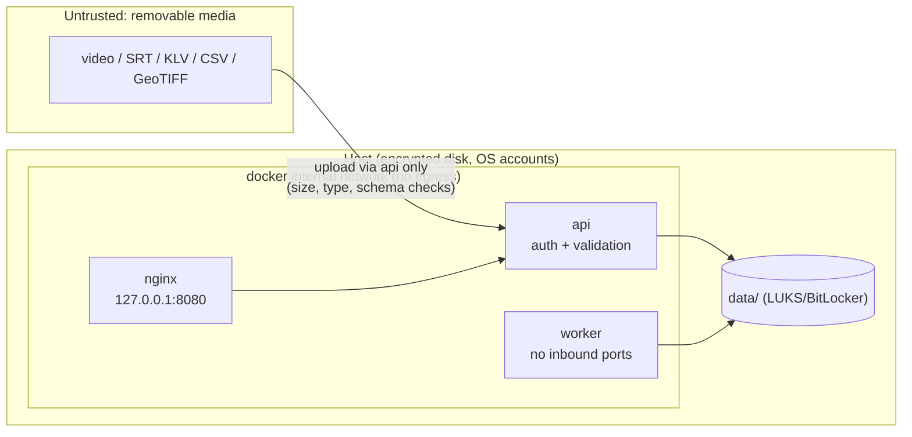

| Concern | Control | Requirement |
|---|---|---|
| Network egress | Docker `internal: true` network; no DNS; `DRISHTI_OFFLINE=1` makes model/tile loaders raise on any URL; firewall rule recommended on host | NFR-SEC-01, NFR-OFF-* |
| Exposure | nginx bound to `127.0.0.1`; LAN mode requires admin flag + TLS with local CA certificate | NFR-SEC-02 |
| Authentication | Local users in SQLite, argon2id password hashes, session cookie (HttpOnly, SameSite=Strict) or bearer API token for CLI/automation | NFR-SEC-03 |
| Authorisation | Roles: `admin` (users, delete any), `operator` (create/cancel runs), `analyst` (view, measure, export) | FR-API-07 |
| Input handling | Magic-byte + `ffprobe` checks, size limits, filename sanitisation, parsing in worker (not api) with timeouts; GeoTIFF read via GDAL with `GDAL_HTTP_*` disabled | NFR-SEC-07 |
| Data at rest | Deployment requires full-disk encryption; run deletion removes directory and DB rows; optional secure-wipe | NFR-SEC-04 |
| Supply chain | Pinned image digests, SBOM (syft) per image, weight checksums, licence register | NFR-LIC-*, NFR-OFF-02 |
| Frontend | CSP `default-src 'self'`; no external fonts/CDNs; Cesium ion token unset; local basemap only | NFR-SEC-06 |
| Audit | Append-only JSONL of logins, uploads, exports, deletions | NFR-SEC-05 |
| Regulatory | Data ≤ 1 m stays on-premise (DST 2021); exports are explicit, logged user actions | C-01, C-07 |

---

## 12. Scalability

### 12.1 Long videos — split-merge

For clips beyond the keyframe budget, or when the global mapper detects multiple components, S3 segments the trajectory:

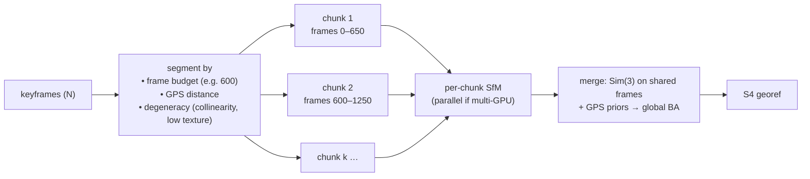

- Overlap default 50 keyframes (≈ 50 s at 1 fps; estimate). Merge residual gate: overlap camera-centre RMS ≤ 2× chunk reprojection-derived precision, else re-segment.
- This follows the "sub-scene GNSS-constrained SfM" idea for long strips ([MDPI Remote Sensing 18(14):2321](https://www.mdpi.com/2072-4292/18/14/2321)) and the chunk-then-align pattern used by GeoFF3D and VGGT-Long.
- S5 dense reconstruction is tiled spatially (OpenMVS scene split by ground tiles), then meshes are merged; rasters are mosaicked with GDAL.

### 12.2 Multi-GPU and multi-run

| Scenario | Mechanism |
|---|---|
| 1 GPU, several runs | FIFO queue in SQLite; one worker holds the GPU lock; P runs on CPU for queued runs only if CPU budget allows |
| N GPUs, one long run | Worker spawns per-chunk S3 and per-tile S5 subprocesses pinned with `CUDA_VISIBLE_DEVICES` |
| N GPUs, several runs | `docker compose up --scale worker=N` with one GPU each (`device_ids`) |
| S7 splats | Separate low-priority job; pre-empted by any new metric run |

Horizontal scale beyond one host (e.g. a server room) is possible because workers only need the shared `data/` volume and the SQLite DB; beyond ~4 workers SQLite write contention suggests moving to PostgreSQL (future, ADR-006 consequence).

---

## 13. Architecture decision records

Each ADR: context → decision → consequences. Status is *Accepted* unless noted. New ADRs are appended; superseded ADRs are kept and marked.

### ADR-001 · COLMAP 4.x global mapper as the primary pose solver

- **Context.** We need robust, accurate, fast poses from ~600–1,200 keyframes of a single strip. Options: incremental COLMAP, COLMAP global mapper (GLOMAP merged), learned SLAM (DROID-SLAM, MASt3R-SLAM, DPVO), feed-forward (VGGT, MapAnything, GeoFF3D). A 2026 benchmark found MASt3R-SLAM/DROID-SLAM drift ~0.53–0.58 % horizontally on short nadir flights but vertical RMSE > 100 m in 29 of 34 long runs, and ~30 GB GPU memory ([arXiv 2608.18632](https://arxiv.org/html/2608.18632)). GLOMAP is "orders of magnitude faster" than incremental SfM at comparable accuracy ([arXiv 2407.20219](https://arxiv.org/html/2407.20219v2)); COLMAP 4.x adds GPS/gravity priors, ALIKED/LightGlue and GPU BA ([COLMAP releases](https://github.com/colmap/colmap/releases)).
- **Decision.** Primary: COLMAP 4.x global mapper with ALIKED + LightGlue, GPS and gravity priors, fixed intrinsics, rolling-shutter model. Fallback: DPVO (< 3 GB) for local poses; feed-forward models only after licence clearance.
- **Consequences.** BSD licence, well understood, metric BA residuals available for QA. We must engineer priors, pair selection and split-merge ourselves. Feed-forward speedups are forgone in the default path.

### ADR-002 · Classical MVS geometry (OpenMVS) is the metric product

- **Context.** 3DGS geometry is "generally slightly lower than traditional photogrammetry", especially with small or low-resolution datasets ([ISPRS Archives 2026](https://isprs-archives.copernicus.org/articles/XLVIII-2-W12-2026/143/2026/isprs-archives-XLVIII-2-W12-2026-143-2026.pdf)); city-scale GS mesh benchmarks use 1 m voxels.
- **Decision.** All measurements, rasters and exports derive from OpenMVS dense cloud and mesh, rasterised with PDAL/GDAL.
- **Consequences.** Reliable metrics; OpenMVS is AGPL-3.0, isolated as a subprocess (ADR-008). Texture quality is lower than a splat; addressed by ADR-003.

### ADR-003 · Gaussian splatting is display-only

- **Context.** Splats look photoreal and CesiumJS supports `KHR_gaussian_splatting` since 1.139 (March 2026), but measure worse and take long to train.
- **Decision.** S7 is optional, runs after S9 in the background, and is labelled non-metric; measurement tools are disabled on the splat layer.
- **Consequences.** No risk of splat artefacts contaminating accuracy claims; the critical path stays within 15 min.

### ADR-004 · Absolute anchoring by ortho/DSM registration

- **Context.** Consumer GNSS error is a near-rigid shift (Zhang et al. 2019: Z mean 3.93 m, SD 0.18 m). Defence systems (Vantor Raptor, Edgybees) reach metre-level accuracy by registering to prior reference data. RTK/PPK is ideal but optional in the PS.
- **Decision.** S4 applies anchors in order of availability and quality: RTK/PPK priors → GCP(s) → reference ortho/DSM registration → CORS/GAGAN-corrected track → GNSS-only. Registration estimates a translation (+ small rotation/scale) from our ortho/DSM to the reference, with inlier and residual gates.
- **Consequences.** Meets ≤ 1 m CE90 target when reference data exist; accuracy inherits reference data accuracy (recorded in report). Requires a reference-data acquisition plan (OI-04 in `03`).

### ADR-005 · Offline Docker compose deployment

- **Context.** DST 2021 localisation, NTRO security posture, air-gapped ground stations, finale reliability.
- **Decision.** Ship three images (web, api, worker) + models + optional basemap as an offline bundle; compose with an internal network; `DRISHTI_OFFLINE=1`.
- **Consequences.** Reproducible installs; large bundle (tens of GB, estimate); updates via new bundle only.

### ADR-006 · FastAPI + SQLite job runner instead of Celery/Redis

- **Context.** One workstation, 1–2 GPUs, a handful of concurrent runs. Celery + Redis/RabbitMQ adds services, ports and failure modes.
- **Decision.** FastAPI for API/WebSocket; a job table in SQLite (WAL) claimed atomically by worker processes; events table polled by the API.
- **Consequences.** Minimal moving parts, easy backup (one file). Limited to a few workers; migration path to PostgreSQL if multi-host is ever needed.

### ADR-007 · CesiumJS + OGC 3D Tiles for the viewer

- **Context.** Need a georeferenced globe, streaming of large meshes/point clouds, measurement, and future splat support. 3D Tiles is an OGC standard (2019) implemented natively in CesiumJS (Apache-2.0).
- **Decision.** React + Vite + CesiumJS; 3D Tiles 1.1 for mesh and point cloud; COG rasters as imagery layers; ion disabled, local basemap.
- **Consequences.** Standard, interoperable outputs; offline configuration of Cesium needs care (no default ion imagery/terrain).

### ADR-008 · Licence policy

- **Context.** NTRO is a defence/intelligence user. Some weights are non-commercial (SuperPoint original, DUSt3R/MASt3R, original VGGT); VGGT-1B-Commercial explicitly excludes military use ([VGGT GitHub](https://github.com/facebookresearch/vggt)). Several core tools are AGPL-3.0 (OpenMVS, ODM, Ultralytics).
- **Decision.** Default build uses only permissively licensed or explicitly allowed weights (ALIKED preferred over SuperPoint; SAM 2 Apache-2.0). AGPL tools are invoked as separate processes and listed. CI fails if a weight without an approved licence entry is packaged.
- **Consequences.** Some state-of-the-art models are unavailable by default; deployment decision on AGPL is documented for NTRO.

### ADR-009 · Run directory is the source of truth

- **Context.** CLI and server must produce identical results; evaluators must audit runs.
- **Decision.** All stage I/O is file-based under `data/runs/<run_id>/`; SQLite holds only queue/index/event data that can be rebuilt from run directories.
- **Consequences.** Easy to copy/deliver a run; stage caching and resumability are simple. Slight I/O overhead versus in-memory passing.

### ADR-010 · Process in projected UTM, deliver with explicit datums

- **Context.** Metric computations in geographic coordinates are error-prone; India spans UTM zones 42N–47N; heights may be ellipsoidal or orthometric.
- **Decision.** Internally use WGS 84 / UTM zone of scene centroid (EPSG:326zz) with ellipsoidal heights; deliver orthometric heights (EGM2008 default, EGM96 option) with compound CRS; 3D Tiles in ECEF.
- **Consequences.** Clean metric maths; datum conversions centralised in `georef/crs.py` and tested.

### ADR-011 · Fixed (pre-calibrated) intrinsics on single strips

- **Context.** Self-calibration on near-parallel images causes doming (metre-level in simulation, ~0.2 m real; fixing K1 gives ~10× reduction — James & Robson 2014).
- **Decision.** Use calibration library or supplied intrinsics and keep them fixed; only focal length may be refined within ±2 % when no calibration exists, and distortion is never freed on strips.
- **Consequences.** Requires a camera-calibration library for common drones (R6 task); unknown cameras get a doming warning.

### ADR-012 · One offline-first web app (PWA) as the only client

- **Context.** Users include field operators on rugged tablets, analysts at workstations and commanders who may only have a phone ([09 §1](09-viewer-and-ui.md)). All heavy compute runs in the GPU worker on the ground station; the client only needs WebGL 2 for CesiumJS. Options: web app + PWA, native mobile app, desktop wrapper (Tauri or Electron). A weighted matrix (offline, GPU access, dev speed, team skills, 3D performance, deployability on NTRO hardware, security) scored web + PWA 445/500, Electron 390, Tauri 360, native mobile 220 ([07 §2.1](07-tech-stack.md)).
- **Decision.** Build one React + TypeScript + CesiumJS single-page app, served by the `web` container (nginx, `127.0.0.1:8080`, §6.3). It has a responsive tablet layout and is installable as a PWA (vite-plugin-pwa / Workbox). A phone gets a read-only viewer (no upload or run control; permissions still enforced by server roles). No native mobile app. A Tauri desktop wrapper around the same bundle is future work; Electron is rejected (bundle size, unpatched Chromium on air-gapped hosts).
- **Consequences.** One codebase and nothing to install on clients. Installing the PWA on a tablet over the LAN needs LAN mode with TLS and a local CA the tablet trusts (§11); without it the app still works as a normal page, without offline caching. The service worker must never cache mutations or authenticated error responses, and needs a prompt-to-update flow ([07 §3.13.5](07-tech-stack.md)). The CSP of §11 gains the worker and blob sources CesiumJS needs.

---

## 14. Risks and technical debt

| Risk | Impact | Mitigation |
|---|---|---|
| No reference ortho/DSM available for finale site | Anchored accuracy unreachable | Support single GCP / CORS; ask NTRO; carry Bhuvan/SoI data if permitted |
| COLMAP 4.x API churn | Build breaks | Pin version and image digest |
| OpenMVS time exceeds budget on 4K | NFR-PERF-01 missed | `fast` uses reduced resolution level and tiled dense; profile early (M2) |
| SQLite lock contention | UI lag | WAL mode, short transactions, event batching |
| Cesium offline config regressions | Blank globe offline | Offline E2E test in CI with network disabled |
| AGPL obligations in deployment | Legal | ADR-008 isolation, documented for sponsor |

---

## Related documents

- [00-project-charter.md](00-project-charter.md)
- [01-problem-statement.md](01-problem-statement.md)
- [02-solution-overview.md](02-solution-overview.md)
- [03-requirements.md](03-requirements.md)
- [04-system-architecture.md](04-system-architecture.md)
- [05-pipeline-design.md](05-pipeline-design.md)
- [06-georeferencing-and-accuracy.md](06-georeferencing-and-accuracy.md)
- [07-tech-stack.md](07-tech-stack.md)
- [08-data-formats-and-interfaces.md](08-data-formats-and-interfaces.md)
- [09-viewer-and-ui.md](09-viewer-and-ui.md)
- [10-setup-and-repo-structure.md](10-setup-and-repo-structure.md)
- [11-testing-and-evaluation.md](11-testing-and-evaluation.md)
- [12-flight-and-data-capture-guide.md](12-flight-and-data-capture-guide.md)
- [13-project-plan.md](13-project-plan.md)
- [14-demo-and-pitch.md](14-demo-and-pitch.md)
- [15-research-and-references.md](15-research-and-references.md)
- [16-glossary.md](16-glossary.md)
