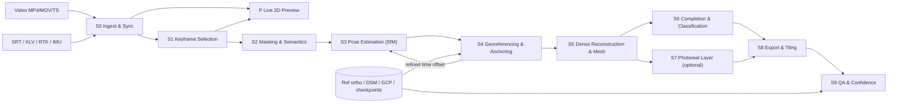
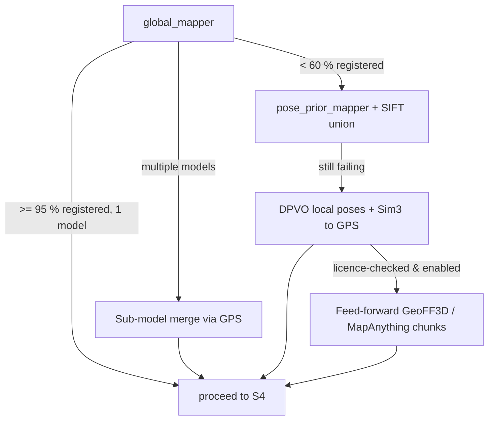
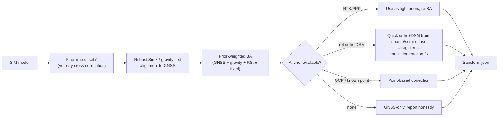
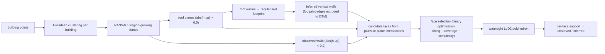
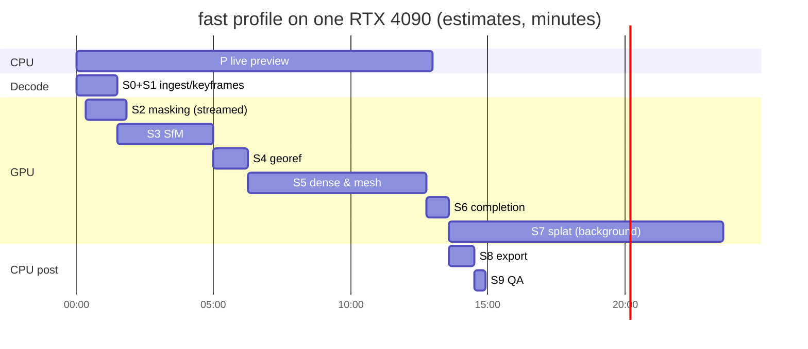

# 05 · Pipeline Design

> **Purpose:** stage-by-stage engineering specification of the Drishti3D pipeline (S0–S9 + P): what each stage consumes and produces, the exact algorithm, parameters per profile, tool calls, failure modes, time budget and quality gates — detailed enough to implement from.
>
> **Status:** Draft v1.0 · 2026-09-30 · Owners: R1 (S1–S3, orchestration), R2 (S0 sync, S4, S9), R3 (S5–S8), R4 (S2, classification)

---

## 0. How to read this document

- Stage IDs, module names, profile names and targets come from [`00-project-charter.md`](00-project-charter.md) and are never renamed here.
- Every **time figure** in this document is an **engineering estimate to be measured** on the reference workstation (RTX 4090 24 GB, 64 GB RAM, NVMe), not a sourced benchmark. For the minimum GPU (RTX 3060 12 GB) multiply GPU-bound stages by roughly 1.8–2.5× (also an estimate).
- Every **tool flag** is written against COLMAP 4.x, OpenMVS 2.x, PDAL 2.x and GDAL 3.x. Option names moved between COLMAP 3.x and 4.x, so the runner (`drishti.sfm.colmap_runner`) must validate each flag against `colmap <command> -h` at start-up and fail loudly on unknown options.
- Research numbers are cited to the sources collected in `reports/Single pass drone 3D reconstruction.md` and `research_notes/`. Formulas and derivations marked **(ours)** are our own engineering derivations, not sourced results.
- Everything georeferencing-specific (time sync maths, rolling shutter model, Umeyama, BA priors, anchoring, CE90/LE90) is specified in full in [`06-georeferencing-and-accuracy.md`](06-georeferencing-and-accuracy.md); this document only states how those algorithms are wired into the pipeline.

### 0.1 Reference input used for budgets

| Item | Value |
|---|---|
| Clip | 10 min, 3840×2160, 29.97 fps, H.264/H.265, ≈17,982 frames |
| Telemetry | DJI `.SRT`, one entry per frame (≈30 Hz) |
| Flight | single pass, 80–120 m AGL, 5–12 m/s, gimbal nadir or 20–30° forward-oblique |
| Output area | ≈3–6 km path × 150–250 m swath (≈0.5–1.5 km²) |

### 0.2 End-to-end data flow



The only loop is S4 → S3: the fine time offset and the anchoring transform are fed back into one final prior-weighted bundle adjustment (§S4.1 step 3). There is no other backwards dependency, which keeps the job runner a simple DAG.

### 0.3 Run folder layout (artefacts)

All artefacts of one run live in `data/runs/<run_id>/`. The canonical layout is [`04-system-architecture.md` §7](04-system-architecture.md#7-run-directory-layout); file schemas are specified in [`08-data-formats-and-interfaces.md`](08-data-formats-and-interfaces.md). The tree below follows 04 and adds a few stage-internal intermediates used in this document (`frame_index.parquet`, `02_masks/mvs/`, `align_report.json`, `dtm_raw.tif`, `doming.json`, `train_report.json`, `lod2/lod2.cityjson`).

```
data/runs/<run_id>/
├── manifest.json                 # run record (08 §6)
├── config.resolved.yaml          # resolved config (profile + overrides)
├── inputs/                       # input files (hard-links or copies)
├── logs/                         # run.jsonl, events.jsonl, tools/ (raw tool stdout/stderr)
├── 00_ingest/  stage.json  video_info.json  telemetry.csv  frame_index.parquet  timesync.json  overlay_mask.png
├── 01_frames/  stage.json  images/*.jpg  keyframes.csv  blur.csv
├── 02_masks/   stage.json  dynamic/*.png  mvs/*.png  semantic/*.png  stats.json
├── 03_sfm/     stage.json  database.db  sparse/0/{cameras,images,points3D,rigs,frames}.bin  poses.csv  sfm_report.json
├── 04_georef/  stage.json  transform.json  anchoring.json  align_report.json  sparse_geo/  poses_geo.csv  registration/
├── 05_dense/   stage.json  scene.mvs  dense.ply  mesh_refined.ply  textured/  rasters/{dsm,ortho,dtm_raw}.tif
├── 06_completion/ stage.json  classified.laz  dtm.tif  lod2/{buildings.geojson,inferred.ply,lod2.cityjson}
├── 07_splat/   stage.json  splat.ply  splat.glb  train_report.json        # optional, display-only
├── 08_export/  stage.json  pointcloud/<run_id>.laz  mesh/{model.obj,model.mtl,textures/,model.glb,offset.json}
│               tiles/{mesh,pointcloud,splat}/tileset.json  rasters/{ortho,dsm,dtm,confidence}.tif  bundle/
├── 09_qa/      stage.json  accuracy.json  residuals.csv  doming.json  report.html  report.pdf  plots/
└── preview/    latest.json  tiles/{z}/{x}/{y}.webp
```

---

## S0 · Ingest & Sync — `drishti.ingest`

**Goal.** Decode the video once, parse every available telemetry source, attach a GNSS/altitude/attitude sample to every frame, detect burnt-in overlays and scene cuts, and produce a **coarse** video↔telemetry time offset (fine offset is refined in S4).

**Inputs.** `--video` (MP4/MOV/TS, 1080p/4K), `--srt` (DJI SRT) or embedded KLV (MISB ST 0601 in STANAG 4609 TS), optional `--rtk` (PPK/RTK positions), `--imu`, `--intrinsics` (calibration YAML), flight log CSV.

**Outputs.** `video_info.json` (codec, resolution, fps, rotation, duration, pts timebase), `telemetry.csv` (one row per telemetry sample: `t_tel`, lat, lon, h_ellip, rel_alt, abs_alt, gimbal yaw/pitch/roll, focal/zoom, ISO/shutter, source), `frame_index.parquet` (one row per decoded frame: `frame_idx`, `pts_s`, interpolated telemetry at `pts_s + δ_coarse`, cut flag), `timesync.json` (δ_coarse, method, confidence), `overlay_mask.png`.

### S0.1 Algorithm

1. **Probe** with `ffprobe -show_streams -show_format -of json` → fps (use `avg_frame_rate` *and* per-frame `pts_time`; never assume constant frame rate), rotation side-data, KLV data PID.
2. **Decode** with NVDEC in one pass, emitting two streams: full-resolution frames into a short ring buffer (for S1 to pick from) and a downscaled 960-px-wide grey stream for analysis:
   ```bash
   ffmpeg -hwaccel cuda -hwaccel_output_format cuda -i flight.mp4 \
     -filter_complex "[0:v]split=2[full][ana];[ana]scale_cuda=960:-2,hwdownload,format=nv12[a]" \
     -map "[full]" -f rawvideo pipe:3  -map "[a]" -f rawvideo pipe:4
   ```
   (Implemented with PyAV/`ffmpeg` pipes; CPU fallback `-hwaccel none`.)
3. **Parse telemetry**
   - *DJI SRT*: regex parser tolerant to model variants (`[latitude: …] [longitude: …] [rel_alt: … abs_alt: …]`, `GPS(lon,lat,alt)` legacy form, `FrameCnt`, `DiffTime`). SRT formats vary by model, as ODM's per-model fixes show ([ODM releases](https://github.com/OpenDroneMap/ODM/releases)); keep a fixture per model in `tests/`. SRT times are local with no timezone ([ScienceDirect 2025](https://www.sciencedirect.com/science/article/abs/pii/S2352938525003544)) — we never use the wall-clock field for sync, only `FrameCnt`/subtitle index and cue start time relative to video start.
   - *KLV*: demux the data PID (`ffmpeg -map 0:d -c copy -f data klv.bin`), decode with `klvdata` (MISB ST 0601 tags 13/14/15 sensor lat/lon/alt, 5/6/7 platform heading/pitch/roll, 18/19 sensor relative azimuth/elevation, 2 precision timestamp) ([PyPI klvdata](https://pypi.org/project/klvdata/)). Map KLV microsecond timestamps to video PTS via the TS PCR.
   - *RTK/PPK*: `.pos` (RTKLIB) or CSV with GPS time; flag `rtk_quality` (fix/float/single). Mark per sample.
4. **Height normalisation** — convert every height to WGS84 ellipsoidal `h` (see [06 §2](06-georeferencing-and-accuracy.md)). Default vertical source for SRT is `h_i = h_takeoff + rel_alt_i` (barometric, smooth), with `h_takeoff` estimated as described in 06 §2.4; `abs_alt` is stored but not trusted.
5. **Clean & resample** — convert lat/lon/h → local ENU (origin = trajectory centroid, double precision). Reject samples with speed > 30 m/s or acceleration > 8 m/s² (Hampel filter, window 1 s, 3·MAD). Fit a cubic smoothing spline per axis (smoothing chosen by GCV) so any time can be queried: $\mathbf{g}(t)$, $\dot{\mathbf{g}}(t)$.
6. **Overlay (OSD/HUD) mask** — pixels whose temporal standard deviation over the whole clip (sampled every 30th analysis frame) is < 2 grey levels while the median scene flow is > 3 px are static overlays → `overlay_mask.png` (dilated 5 px). Also run OCR-free text detection (MSER) on the first 100 frames to catch semi-transparent overlays.
7. **Shot-cut detection** — HSV histogram χ² distance between consecutive analysis frames; a cut is a distance > 6× rolling median. Segments shorter than 3 s are dropped; each segment becomes a separate SfM "sequence" (S3 treats them as potentially separate models).
8. **Coarse time offset δ_coarse** — before SfM exists we cannot use camera velocity, so we use image-derived **ground-speed proxy**: median sparse optical flow magnitude $m(t)$ on the analysis stream (px/frame). For near-nadir flight, $m(t) \approx f\,v(t)/H(t)$, so $m(t)\,H(t)/f$ is proportional to GNSS ground speed. Maximise normalised cross-correlation (NCC, scale-invariant, so $f$ need not be known):
   $$\hat\delta_{\text{coarse}} = \arg\max_{\delta\in[-2,2]\,\text{s}} \operatorname{NCC}\big(m(t)\,H(t),\; \|\dot{\mathbf g}_{xy}(t+\delta)\|\big)$$
   Step 1 frame, parabolic sub-frame refinement around the peak. If the peak NCC < 0.5 (constant-speed flight gives a flat correlation), set δ_coarse = 0 and mark `unobservable_coarse`. The fine estimate using SfM camera velocity is done in S4 ([06 §5](06-georeferencing-and-accuracy.md)).
9. **Interpolate** telemetry to every frame PTS at `pts + δ_coarse` → `frame_index.parquet`.

```python
# drishti/ingest/timesync.py  (coarse)
def coarse_offset(flow_mag, agl, t_frames, gnss_spline, search=2.0, fps=29.97):
    proxy = flow_mag * agl                      # ∝ ground speed (units irrelevant, NCC is scale-free)
    best = None
    for k in range(int(-search*fps), int(search*fps)+1):
        d = k / fps
        v = np.linalg.norm(gnss_spline.derivative()(t_frames + d)[:, :2], axis=1)
        c = ncc(highpass(proxy), highpass(v))   # high-pass: remove mean speed, keep accelerations
        best = max(best, (c, d)) if best else (c, d)
    c0, d0 = best
    d_ref = parabolic_peak(ncc_curve, d0)       # sub-frame
    return d_ref, c0
```

### S0.2 Parameters

| Parameter | preview | fast | quality |
|---|---|---|---|
| Analysis stream width | 640 px | 960 px | 1280 px |
| Telemetry outlier filter (Hampel window / k) | 1 s / 3 | 1 s / 3 | 1 s / 3 |
| Coarse sync search range | ±2 s | ±2 s | ±3 s |
| Min cut-segment length | 3 s | 3 s | 3 s |
| Overlay detection | on | on | on |
| HW decode | NVDEC | NVDEC | NVDEC |

### S0.3 Failure modes & fallbacks

| Failure | Detection | Fallback |
|---|---|---|
| No SRT/KLV at all | no telemetry rows | Run relative-only; S4 must anchor to ref ortho/DSM or GCPs; report says "no GNSS" |
| SRT of unknown dialect | parser yields < 90 % of frames | Try all dialect regexes; fall back to `exiftool -ee` embedded track; else as above |
| SRT count ≠ frame count | ratio test | Map by cue start time, not index |
| Variable frame rate | pts deltas vary > 1 % | Use per-frame pts everywhere |
| GNSS jumps (multipath) | Hampel outliers > 5 % | Down-weight in S4 (Huber), mark segment |
| Zoom/focal changes | `focal_len`/`dzoom` changes | Split into camera groups (separate intrinsics) in S3 |

### S0.4 Quality checks

- Telemetry coverage ≥ 95 % of frames; monotonic time; median GNSS rate ≥ 1 Hz.
- Speed profile plausible (0–25 m/s); altitude span reported.
- `timesync.json.confidence` = peak NCC and peak sharpness (second-derivative); logged, not gating.

---

## S1 · Keyframe Selection — `drishti.frames`

**Goal.** Reduce ≈18 k frames to a few hundred to ~1.5 k sharp, well-spaced keyframes that give enough overlap and parallax for SfM/MVS, without spending compute on redundant frames. Evidence: video sampled at one frame per 2.5 s matched a photo flight (building-boundary RMSE 1.1–2.7 cm vs 1.3–2.8 cm), and accuracy degraded at 4 s and 5.5 s ([Remote Sens. 2021, 13(14), 2745](https://doi.org/10.3390/rs13142745), abstract-level numbers).

**Inputs.** Analysis stream + ring buffer from S0, `frame_index.parquet`, `overlay_mask.png`.
**Outputs.** `01_frames/images/kf_000123.jpg` (full res, JPEG q=95, EXIF GPS written for tool interoperability), `keyframes.csv` (frame_idx, pts, reason, sharpness, parallax, predicted overlap), `blur.csv` (all frames: sharpness, flow stats).

### S1.1 Overlap / parallax trigger

Track ~1,500 Shi–Tomasi corners on the analysis frame with pyramidal Lucas–Kanade (`cv2.calcOpticalFlowPyrLK`, forward–backward check < 1 px), re-seeding when fewer than 40 % survive. Let $K$ be the last keyframe and $t$ the current frame. Define

$$m_t = \operatorname{median}_j \big\|\mathbf u_j^{t} - \mathbf u_j^{K}\big\|,\qquad r_t = \frac{m_t}{D_\parallel}$$

where $D_\parallel$ is the image extent along the dominant flow direction (image height for forward flight with a landscape frame). For a nadir camera at height $H$ moving at ground speed $v$ with focal length $f$ (px), the image displacement between frames $\Delta t$ apart is $f v \Delta t / H$, so the frame-to-frame **forward overlap** is $o = 1 - r_t$. **(ours)** The keyframe interval that yields a target overlap $o^\*$ is

$$\Delta t_{\text{kf}} = \frac{(1-o^\*)\,D_\parallel\,H}{f\,v}.$$

*Worked example (ours):* 4K, HFOV ≈ 82° → $f \approx 1920/\tan 41^\circ \approx 2209$ px; $D_\parallel = 2160$ px, $H = 100$ m, $v = 10$ m/s, $o^\* = 0.85$ → $\Delta t_{\text{kf}} \approx 0.15·2160·100/(2209·10) \approx 1.47$ s → ≈ 410 keyframes per 10 min — the same regime as the 1-frame-per-2.5-s result above.

We additionally require a minimum **triangulation angle** between consecutive keyframes using the telemetry baseline $B$ and height above ground $H$: $\theta \approx B/H \ge \theta_{\min}$ (radians). With oblique gimbals the median flow proxy is dominated by the near field; the $\theta$ test prevents over-sampling in that case.

**Keyframe rule** — frame $t$ becomes a *candidate* when any of:

1. $r_t \ge 1 - o^\*$ (overlap reached), **and** $\theta_t \ge \theta_{\min}$;
2. surviving-track fraction $< \rho_{\min}$ (appearance change, e.g. yaw turn) — forces connectivity;
3. $t - t_K \ge \Delta t_{\max}$ (hover / slow flight safety net);

and is blocked when $t - t_K < \Delta t_{\min}$ or when the inter-frame motion is **rotation-only** (homography fits flow with median residual < 0.5 px **and** telemetry baseline < 0.5 m) — pure rotation adds no triangulable parallax.

### S1.2 Blur rejection with per-window adaptive threshold

Sharpness = variance of the Laplacian on the grey analysis frame, overlay pixels excluded:

$$S_t = \operatorname{Var}\big(\nabla^2 I_t\big) = \frac{1}{|\Omega|}\sum_{\mathbf x\in\Omega}\big(\nabla^2 I_t(\mathbf x) - \overline{\nabla^2 I_t}\big)^2$$

$S$ depends strongly on scene texture (fields vs. town), so a global threshold fails. We use a **sliding window** $W$ (default 2 s ≈ 60 frames) centred on $t$, with median $\tilde S_W$ and MAD:

$$\text{sharp}(t) \iff S_t \ge \max\Big(\tau_{\text{abs}},\; \tilde S_W - k\cdot 1.4826\cdot\operatorname{MAD}_W,\; \alpha\cdot P_{90}(S_W)\Big)$$

with $k = 1.5$, $\alpha = 0.6$ (fast). $\tau_{\text{abs}}$ is a very low floor (e.g. 15 on 8-bit 960-px frames) used only to reject fully smeared frames; if *every* frame in a window fails (water, fog, night), the sharpest one is kept and flagged `low_texture_window`.

**Selection:** when a candidate is triggered at $t$, we choose the **sharpest sharp frame** in $[t - \epsilon, t + \epsilon]$ ($\epsilon$ = 0.25 s) from the ring buffer, which is why S0 keeps full-res frames in a lookahead buffer of ≈ 1 s.

```python
def select_keyframes(stream, cfg):
    K = None; out = []
    for t, ana, flow in stream:                       # ana = grey 960px frame
        S[t] = lap_var(ana, mask=~overlay)
        if K is None: K = pick_sharpest(t, t + cfg.eps); out.append(K); continue
        r, surv = median_disp(flow, K) / D_par, surviving_fraction(flow, K)
        theta = baseline(K, t) / agl(t)
        dt = time(t) - time(K)
        if dt < cfg.dt_min or rotation_only(flow, K): continue
        if (r >= 1 - cfg.overlap and theta >= cfg.theta_min) or surv < cfg.rho_min or dt >= cfg.dt_max:
            cand = [u for u in window(t - cfg.eps, t + cfg.eps) if is_sharp(u, S, cfg)]
            K = max(cand, key=S.get) if cand else flag_low_texture(argmax_S(window(t - cfg.eps, t + cfg.eps)))
            out.append(K); reset_tracks(K)
    return out
```

### S1.3 Parameters

| Parameter | preview | fast | quality |
|---|---|---|---|
| Target forward overlap $o^\*$ | 0.60 | 0.85 | 0.90 |
| Min triangulation angle $\theta_{\min}$ | — | 1.0° | 0.7° |
| Surviving-track floor $\rho_{\min}$ | 0.3 | 0.5 | 0.6 |
| $\Delta t_{\min}$ / $\Delta t_{\max}$ | 1.0 / 5 s | 0.3 / 3 s | 0.2 / 2 s |
| Blur window $W$, $k$, $\alpha$ | 2 s, 2.0, 0.5 | 2 s, 1.5, 0.6 | 2 s, 1.0, 0.7 |
| Sharpest-in-window search $\epsilon$ | 0.25 s | 0.25 s | 0.4 s |
| Expected keyframes / 10 min (estimate) | 150–300 | 400–900 | 900–1,800 |
| Hard cap on keyframes | 400 | 1,200 | 3,000 |
| Keyframe output resolution | 1280 px | full (3840) | full (3840) |

### S1.4 Failure modes & fallbacks

- **Hovering / orbiting in place** → rotation-only filter plus $\Delta t_{\max}$ keeps a trickle of frames; SfM uses them for connectivity only.
- **Fast yaw spins** → track loss forces keyframes (rule 2); frames with heavy rotational blur are rejected by the window rule.
- **Hard cap exceeded** (very slow long clip) → raise $o^\*$ threshold down by 0.02 steps and rerun selection on stored scores (cheap; no re-decode).

### S1.5 Quality checks

- Achieved median predicted overlap between consecutive keyframes within ±0.05 of $o^\*$.
- Fraction of keyframes flagged `low_texture_window` < 10 % (else warn: expect SfM gaps).
- Keyframe count and gaps > $\Delta t_{\max}$ listed in the run log.

---

## S2 · Dynamic Masking & Semantics — `drishti.masking`

**Goal.** Produce per-keyframe binary masks that remove features/pixels which would corrupt SfM and MVS (moving objects, sky, overlays, water, the drone's own parts), and per-keyframe semantic label maps that S6 lifts onto the 3D model.

**Inputs.** `01_frames/images`, `overlay_mask.png`.
**Outputs.** `02_masks/dynamic/*.png` (0 = ignore for feature extraction, COLMAP mask convention: black pixels ignored), `02_masks/mvs/*.png` (OpenMVS mask, label image), `02_masks/semantic/*.png` (uint8 class ids), `stats.json` (per-class pixel fractions per frame).

### S2.1 Mask classes

| Class id | Class | SfM mask | MVS mask | Texture | Semantic label to S6 |
|---|---|---|---|---|---|
| 0 | background / static | keep | keep | keep | from segmenter |
| 1 | **vehicle** (car, truck, bus, bike) | **ignore** | **ignore** | keep\* | vehicle (masked) |
| 2 | **person** | ignore | ignore | keep\* | person (masked) |
| 3 | boat / animal | ignore | ignore | keep\* | other |
| 4 | **sky** (oblique frames only) | ignore | ignore | ignore | — |
| 5 | **water** | ignore | ignore (filled in S6) | keep | water |
| 6 | **overlay / HUD** | ignore | ignore | ignore | — |
| 7 | drone parts (props, gear) | ignore | ignore | ignore | — |
| 8 | building | keep | keep | keep | building |
| 9 | road / paved | keep | keep | keep | road |
| 10 | vegetation | keep (down-weighted) | keep | keep | vegetation |
| 11 | ground / bare | keep | keep | keep | ground |

\*Parked vehicles are static in a single pass and are legitimate geometry for measurement, but they are masked anyway because a single pass cannot tell parked from slowly moving (DroneSplat's video-tracked global masking addresses exactly this risk — [arXiv 2503.16964](https://arxiv.org/abs/2503.16964)). Texture keeps them so the mesh looks right; their surface is marked *inferred* ground in S6.

### S2.2 Algorithm

1. **Instance detection/segmentation** of classes 1–3 with a YOLO-seg model on each keyframe at 1280 px (Ultralytics, AGPL — acceptable for the hackathon per charter; record weights licence in [07](07-tech-stack.md)). Confidence ≥ 0.35.
2. **Temporal consistency (quality profile)**: SAM 2 video predictor seeded with YOLO boxes, propagated across keyframes to fill missed detections and sharpen boundaries (SAM 2 is Apache-2.0). SAM 2 is a compute bottleneck on large scenes ([DroneSplat](https://arxiv.org/abs/2503.16964)), so `fast` uses YOLO masks dilated by 8 px only.
3. **Semantic segmentation** (classes 4, 5, 8–11) with a licence-clean aerial segmentation model owned by R4 (fine-tuned on permissively licensed aerial data — licence of both dataset and weights recorded in 07). Classical backstops: sky = top-connected, low-gradient, high-brightness region in frames with gimbal pitch > −60°; vegetation prior = excess-green index $\text{ExG} = 2g - r - b$ on chromaticity-normalised RGB.
4. **Drone-parts mask**: static region detected as in the overlay step, but only at image borders; plus user-supplied static mask in config.
5. **Compose** masks: `sfm_mask = ~(dyn ∪ sky ∪ water ∪ overlay ∪ parts)`, dilated 4 px (fast). Write as PNG named `<image_name>.png` in `02_masks/dynamic/` (COLMAP `--ImageReader.mask_path` expects `image.jpg.png`).
6. **Residual masking later**: dynamic objects missed here appear as high-residual regions in MVS depth-consistency (S5) and in GS training (S7 robust loss); those are flagged, not re-masked.

### S2.3 Parameters

| Parameter | preview | fast | quality |
|---|---|---|---|
| Runs? | no | yes | yes |
| Detector input size | — | 1280 | 1600 |
| Detector confidence | — | 0.35 | 0.25 |
| SAM 2 propagation | — | off | on |
| Mask dilation (SfM / MVS) | — | 8 / 4 px | 6 / 3 px |
| Semantic model resolution | — | 1024 | full / tiled |

### S2.4 Failure modes & fallbacks

- **Water-dominant frames** (> 60 % water): mask kills most features → S3 may break; keep ≥ 10 % border strip unmasked if it contains shoreline; accept model split.
- **Night/IR (thermal)**: RGB-trained detectors fail; switch to `thermal` mode — skip semantics, only overlay + detector trained for thermal if available; flag run.
- **Over-masking** (> 70 % of pixels masked in > 20 % of frames) → warn; reduce dilation.

### S2.5 Quality checks

- `stats.json`: per-class mean fraction; sanity limits (sky only in oblique frames).
- Visual QA strip (every 20th keyframe with mask overlay) rendered into the S9 report appendix.

---

## S3 · Pose Estimation (SfM) — `drishti.sfm`

**Goal.** Recover accurate camera poses and a sparse point cloud for all keyframes, in a metric, gravity-aware local frame, with intrinsics that do **not** drift into the doming mode, and with rolling shutter modelled when it matters.

**Inputs.** Keyframes, SfM masks, `frame_index.parquet` (priors), calibration YAML if supplied.
**Outputs.** `03_sfm/database.db`, `03_sfm/sparse/<k>/` (one folder per connected model), `sfm_report.json` (registered %, reprojection error, track stats, per-image prior residuals, intrinsics used).

### S3.1 Camera model & intrinsics strategy

| Situation | COLMAP camera model | Refinement |
|---|---|---|
| Pre-calibrated (checkerboard or previous convergent flight) — **preferred** | `OPENCV` (fx, fy, cx, cy, k1, k2, p1, p2) | **all intrinsics fixed** |
| Known camera type, no calibration | `OPENCV` initialised from our per-model table (focal from SRT `focal_len`/35 mm eq.) | refine f only in quality BA with prior; **k1/k2 fixed** |
| Unknown camera | `SIMPLE_RADIAL` | refine f, k1 **only if** ≥ 10 % oblique/altitude-varied frames; else f only |
| Wide-angle/fisheye action camera | `OPENCV_FISHEYE` | pre-calibration mandatory |

Rationale: self-calibrating BA on near-parallel nadir images cannot recover radial distortion and produces metre-scale doming in simulation and ≈0.2 m in a real test; fixing K1 to a doming-free value gave a ten-fold reduction ([James & Robson 2014](https://discovery.ucl.ac.uk/id/eprint/1443475/1/esp3609.pdf)). Details and the doming derivation in [06 §7](06-georeferencing-and-accuracy.md). Video modes may crop/scale the sensor, so a **stills** calibration is not valid for **video** — calibrate in the same video mode (see [12](12-flight-and-data-capture-guide.md)).

### S3.2 Features and matching

- **Features:** ALIKED (`ALIKED_N16ROT`, max 4,096 kp/img fast, 8,192 quality) with **LightGlue** matching — native in COLMAP 4.x ([COLMAP releases](https://github.com/colmap/colmap/releases)). **Licence note:** SuperPoint weights are non-commercial (Magic Leap licence), so SuperPoint is never the default; ALIKED code/weights and the ALIKED-LightGlue weights must have their licences recorded in [07](07-tech-stack.md) before the final build. **Fallback:** GPU SIFT (patent expired; always licence-clean).
- **Pairs:** union of
  1. **Sequential** matching with quadratic overlap and loop detection (loop detection is almost idle on a single pass but catches the start/end of an out-and-back or orbit),
  2. **Spatial** matching from GNSS priors (catches frames that are close in space but far in time, and bridges SfM gaps).

```bash
# 1. features (masks honoured; single camera per video segment)
colmap feature_extractor \
  --database_path 03_sfm/database.db --image_path 01_frames/images \
  --ImageReader.mask_path 02_masks/dynamic \
  --ImageReader.camera_model OPENCV --ImageReader.single_camera_per_folder 1 \
  --ImageReader.camera_params "$FX,$FY,$CX,$CY,$K1,$K2,$P1,$P2" \
  --FeatureExtraction.type ALIKED_N16ROT \
  --FeatureExtraction.max_image_size 2048 --FeatureExtraction.use_gpu 1

# 2a. sequential pairs (+ loop detection with vocabulary tree)
colmap sequential_matcher --database_path 03_sfm/database.db \
  --SequentialMatching.overlap 15 --SequentialMatching.quadratic_overlap 1 \
  --SequentialMatching.loop_detection 1 \
  --SequentialMatching.loop_detection_period 10 \
  --SequentialMatching.vocab_tree_path models/vocab_tree_aliked.bin \
  --FeatureMatching.type ALIKED_LIGHTGLUE --FeatureMatching.use_gpu 1

# 2b. spatial pairs from GNSS priors written into the database (see S3.3)
colmap spatial_matcher --database_path 03_sfm/database.db \
  --SpatialMatching.ignore_z 0 --SpatialMatching.max_num_neighbors 30 \
  --SpatialMatching.max_distance 120 \
  --FeatureMatching.type ALIKED_LIGHTGLUE
```

> Option names (`FeatureExtraction.type`, `FeatureMatching.type`, value strings) follow COLMAP 4.x; confirm against the installed binary — the runner checks this at start-up.

### S3.3 Priors written before mapping

For every keyframe $i$ we write into the database `pose_priors` table (via `pycolmap`):

- **Position prior** $\mathbf g_i$ in local ENU metres (not WGS84 — keeps BA numerics well-conditioned), with covariance $\Sigma_i = \operatorname{diag}(\sigma_h^2, \sigma_h^2, \sigma_v^2)$: consumer GNSS $\sigma_h = 1.5$ m, $\sigma_v = 3$ m (baro-derived $\sigma_v$ relative = 0.5 m); RTK fix 0.03/0.05 m; float 0.3/0.5 m.
- **Gravity prior** from gimbal pitch/roll (the gimbal is stabilised to the horizon, so the camera's gravity direction in the camera frame is known to ≈1–2°, estimate). COLMAP 4.x supports gravity priors ([COLMAP releases](https://github.com/colmap/colmap/releases)); where the binary does not expose it for our path, our own BA (S3.5) adds it.

### S3.4 Mapping

1. **Global mapper** (GLOMAP merged into COLMAP; "orders of magnitude faster" than incremental at comparable accuracy and fine with sequential video — [arXiv 2407.20219](https://arxiv.org/html/2407.20219v2)):
   ```bash
   colmap global_mapper --database_path 03_sfm/database.db \
     --image_path 01_frames/images --output_path 03_sfm/sparse
   ```
   with intrinsic refinement disabled per S3.1 (the global mapper's BA options equivalent to `ba_refine_focal_length 0`, `ba_refine_extra_params 0`, `ba_refine_principal_point 0`).
2. **Quality profile / fallback:** `colmap pose_prior_mapper` (incremental mapper with position priors) using `--prior_position_std_x/y/z` and `--use_robust_loss_on_prior_position 1`, with `--Mapper.ba_refine_focal_length 0 --Mapper.ba_refine_extra_params 0`. Slower but more robust in weak-texture corridors.
3. **Sub-scene segmentation for long strips** — split the keyframe sequence into overlapping chunks of ≈ 250 keyframes (50 overlap) when the path is > 2 km or the global mapper returns multiple components. Each chunk is solved and GNSS-constrained independently, then merged (S3.7). This follows the "sub-scene-based GNSS-constrained SfM" idea for long corridors ([MDPI Remote Sensing 18(14):2321](https://www.mdpi.com/2072-4292/18/14/2321), snippet-level).

### S3.5 Prior-weighted refinement BA with rolling shutter (ours; `drishti.sfm.priors`, `rolling_shutter.py`)

After mapping we run our own bundle adjustment in `pyceres` on the pycolmap reconstruction. Cost (full derivation in [06 §10](06-georeferencing-and-accuracy.md)):

$$E = \sum_{i,j}\rho_{\text{H}}\!\left(\frac{\|\pi_{\text{RS}}(\mathbf K,\mathbf R_i,\mathbf C_i,\mathbf v_i,\boldsymbol\omega_i,\tau;\mathbf X_j) - \mathbf x_{ij}\|^2}{\sigma_{px}^2}\right) + \sum_i \rho_{\text{H}}\!\left(\mathbf r_i^{\top}\Sigma_i^{-1}\mathbf r_i\right) + \lambda_g\sum_i\|\mathbf R_i^{\top}\mathbf e_z \times \hat{\mathbf u}_i\|^2$$

with the GNSS residual $\mathbf r_i = s\,\mathbf R_w\mathbf C_i + \mathbf t_w + \mathbf R_i^{\top}\boldsymbol\ell - (\mathbf g(t_i + \delta) - \mathbf b)$ (Sim(3) world transform, lever arm $\boldsymbol\ell$, time offset $\delta$, per-flight GNSS bias $\mathbf b$ held constant unless an anchor exists).

**Rolling-shutter projection** $\pi_{\text{RS}}$: row $r$ of image $i$ is exposed at $t_i + \tau\,(r - h/2)/h$; first-order pose at that instant: $\mathbf C_i(r) = \mathbf C_i + \mathbf v_i\,\Delta t_r$, $\mathbf R_i(r) = \exp([\boldsymbol\omega_i]_\times\Delta t_r)\mathbf R_i$, solved with one fixed-point iteration on $r$ (the projected row depends on the pose). $\mathbf v_i,\boldsymbol\omega_i$ are initialised by finite differences of neighbouring keyframe poses and given weak priors. Readout $\tau$: from our per-camera table when known (e.g. Phantom 2 Vision+ ≈ 74 ms, Inspire 1 ≈ 30 ms — [Vautherin et al. 2016](https://isprs-annals.copernicus.org/articles/III-3/139/2016/isprs-annals-III-3-139-2016.pdf); ODM keeps a similar table — [ODM releases](https://github.com/OpenDroneMap/ODM/releases)), else estimated as one global parameter with prior 30 ± 15 ms (estimate).

**When enabled:** predicted RS shift $\Delta_{px} \approx f\,v\,\tau / H > 0.5$ px (see [06 §6](06-georeferencing-and-accuracy.md)). At 8 m/s, 70 m, Vautherin measured ≈10 px (Phantom 2) and ≈4 px (Inspire 1) — so for consumer drones it is almost always on in `fast`/`quality`.

### S3.6 Parameters

| Parameter | preview | fast | quality |
|---|---|---|---|
| Runs? | no | yes | yes |
| Feature type | — | ALIKED_N16ROT | ALIKED_N16ROT (+SIFT union on failure) |
| Max image size for features | — | 2048 | 3840 |
| Max keypoints / image | — | 4,096 | 8,192 |
| Sequential overlap (quadratic) | — | 15 (yes) | 25 (yes) |
| Loop detection | — | on, period 10 | on, period 5 |
| Spatial matcher neighbours / max dist | — | 30 / 120 m | 50 / 200 m |
| Mapper | — | global | global → pose_prior_mapper if < 95 % registered |
| Intrinsics | — | fixed | fixed (f refined with prior only if uncalibrated) |
| GNSS prior σ_h / σ_v (consumer) | — | 1.5 / 3.0 m | 1.5 / 3.0 m |
| Gravity prior weight λ_g (σ ≈) | — | 2° | 1° |
| Rolling-shutter model | — | on if Δpx > 0.5 | on if Δpx > 0.3 |
| Sub-scene chunk / overlap | — | 250 / 50 kf | 400 / 80 kf |
| Robust loss (reproj / prior) | — | Huber 1 px / Huber 2σ | Cauchy 1 px / Huber 2σ |

### S3.7 Failure modes & fallbacks



- **SfM breaks into multiple models** (typical at water, uniform fields, fog). Merge procedure:
  1. Align each sub-model $k$ independently to GNSS with the robust Sim(3)/gravity-first alignment of [06 §9](06-georeferencing-and-accuracy.md) (needs ≥ 20 frames and ≥ 30 m of path; otherwise the chunk is dropped and flagged).
  2. **Bridge**: re-match the last/first 20 keyframes of adjacent models with relaxed spatial matching (`max_distance` 2×, LightGlue filter threshold lowered) and add dense matches from a learned dense matcher if licence-clean; if inlier matches ≥ 50, merge with `colmap model_merger` then `bundle_adjuster`.
  3. If no visual bridge exists, keep models separate in one world frame (both GNSS-aligned); the gap is rendered empty and listed in the report. COLMAP 4.2 multi-component global mapping handles part of this natively ([COLMAP releases](https://github.com/colmap/colmap/releases)).
- **Low texture** (sand, snow, crops): lower ALIKED detection threshold, raise keyframe density (S1 $o^\*$ + 0.05), add SIFT union; accept partial models.
- **Water**: masked in S2; SfM covers shores; S6 fills water with a flat plane at median shoreline height, flagged *inferred*.
- **Night / IR**: CLAHE pre-processing, SIFT (more robust on thermal than learned features trained on RGB — estimate), lower resolution; expect lower accuracy; report flags `night_ir`.
- **Pose fallback 1 — DPVO** (< 3 GB GPU, the most practical learned VO in the nadir UAV benchmark, but it drifted 5.75 % on the DJI flights — [arXiv 2608.18632](https://arxiv.org/html/2608.18632)): run on the keyframes (or 10 fps subsample) for local relative poses, then Sim(3)-align per 30-s window to GNSS, then triangulate with COLMAP `point_triangulator` using fixed poses, then our prior BA. **Licence check required** before it ships.
- **Pose fallback 2 — feed-forward (GeoFF3D, MapAnything)**: GeoFF3D feeds GPS translations into the network, predicts poses and point maps in a gravity-aligned metric frame, processes ~2,000 images in ~5 min and is stated stable on near-collinear trajectories ([arXiv 2608.28288](https://arxiv.org/abs/2608.28288)); MapAnything accepts optional intrinsics/poses ([arXiv 2509.13414](https://arxiv.org/abs/2509.13414)). **Both licences are unverified** — disabled by default (`sfm.fallback_feedforward: false`) until R2 records the licence in [07](07-tech-stack.md). VGGT-1B-Commercial is **forbidden** (excludes military use); DUSt3R/MASt3R/original VGGT are non-commercial and never shipped as default.
- **Degenerate straight strip** (roll about track unobservable) is not a failure of S3 but of alignment; handled by gravity priors in S3.5 and gravity-first alignment in S4.

### S3.8 Quality checks (gate to S4)

| Check | Pass | Warn |
|---|---|---|
| Registered keyframes | ≥ 95 % | 80–95 % |
| Mean reprojection error | ≤ 1.0 px | 1.0–1.5 px |
| Mean track length | ≥ 4 | 3–4 |
| Median triangulation angle | ≥ 2° | 1–2° |
| GNSS residual RMS after Sim(3) (consumer) | ≤ 3 m horizontal | 3–6 m |
| Number of models | 1 | 2–3 (merged) |

---

## S4 · Georeferencing & Anchoring — `drishti.georef`

**Goal.** Place the SfM model in the world: WGS84 → projected UTM (output CRS), removing scale, rotation and — as far as the available anchors allow — the GNSS bias. This is the core differentiator; the full theory is in [`06-georeferencing-and-accuracy.md`](06-georeferencing-and-accuracy.md).

**Inputs.** `03_sfm/sparse`, `telemetry.csv`, optional `--rtk`, `--ref-ortho`, `--ref-dsm`, `--gcp`.
**Outputs.** `transform.json` (Sim(3) local→ENU, ENU origin, output CRS WKT, time offset δ, lever arm, applied anchor corrections with uncertainties), `sparse_geo/` (georeferenced COLMAP model), `align_report.json`, `anchoring.json`.

### S4.1 Algorithm



1. **Fine time offset** $\hat\delta$: cross-correlate GNSS velocity with SfM camera-centre velocity (after a provisional Sim(3)), search ±2 s around δ_coarse, sub-frame parabolic refinement, then a 1-D golden-section refinement of the Sim(3) residual over δ ([06 §5](06-georeferencing-and-accuracy.md)).
2. **Robust alignment**: RANSAC over minimal non-collinear triplets + Huber IRLS Umeyama; if the path is near-collinear (second singular value ratio < 0.05) switch to **gravity-first 5-DoF** (known up-vector, solve yaw + scale + translation) ([06 §8–9](06-georeferencing-and-accuracy.md)). Subsample GNSS to ≈ 1 Hz to reduce the effect of temporally correlated errors.
3. **Final BA** with GNSS priors at $t_i + \hat\delta$, lever arm, gravity priors and RS (S3.5 cost), intrinsics still fixed.
4. **Anchoring** in ranked order (RTK/PPK → CORS/GAGAN-corrected → ref ortho/DSM registration → single known point/GCP → GNSS-only). Ortho/DSM registration runs on a *quick* DSM/ortho made from the sparse cloud plus a low-resolution OpenMVS pass (`--resolution-level 3`), so S5 already produces products in the final frame. If S5's full DSM later disagrees with the quick one by > 0.3 m median, registration is re-run on the full DSM and products are transformed (rigid transform only — cheap).
5. **CRS**: internal frame ENU at trajectory centroid; outputs in `EPSG:326zz` (UTM zone of centroid, India spans zones 42N–47N) with ellipsoidal heights, plus an orthometric (EGM2008) variant for rasters (compound CRS `EPSG:326zz+3855`). PROJ geoid grids are bundled for offline use.

### S4.2 Parameters

| Parameter | preview | fast | quality |
|---|---|---|---|
| Runs? | GNSS footprints only | yes | yes |
| Fine δ search / step | — | ±2 s / 1 frame | ±3 s / 1 frame + golden section |
| GNSS subsample for alignment | — | 1 Hz | 1 Hz |
| RANSAC iterations / inlier threshold | — | 1,000 / 3σ Mahalanobis | 5,000 / 3σ |
| Collinearity switch (σ₂/σ₁) | — | 0.05 | 0.05 |
| Lever arm | — | from camera table (default 0) | from config (measured) |
| Ortho registration GSD | — | 0.5 m | reference GSD (≥ 0.1 m) |
| DSM registration | — | height-offset (median) | trimmed point-to-plane ICP (6-DoF + scale lock) |

### S4.3 Failure modes & fallbacks

- **δ unobservable** (constant speed, straight line): along-track bias and δ are indistinguishable; keep δ = δ_coarse, inflate along-track uncertainty in report; the anchor absorbs it ([06 §5.4](06-georeferencing-and-accuracy.md)).
- **Reference ortho too old / different season**: registration inlier ratio < 20 % → try gradient-orientation (edge) images and mutual information; if still failing, drop the anchor and report GNSS-only.
- **DSM registration pulled by changed buildings/vegetation**: use only S6-style ground/road points (quick SMRF on semi-dense cloud) for height offset.
- **RTK float / jumps**: per-sample σ from quality flag; Huber loss.

### S4.4 Quality checks

- Post-BA GNSS residual: mean (≈ bias) and SD (≈ noise) per axis, reported separately (the Zhang-style decomposition — [Zhang et al. 2019](https://esurf.copernicus.org/preprints/esurf-2019-2/esurf-2019-2.pdf)).
- Scale factor vs. baro-altitude consistency: $|s_{\text{GNSS}}/s_{\text{baro}} - 1| < 0.5\,\%$ (baro heights give an independent vertical scale when altitude varies).
- Anchor residuals and inlier counts; anchor *vs.* GNSS translation difference (expected 1–5 m for consumer GNSS).

---

## S5 · Dense Reconstruction & Mesh — `drishti.dense`

**Goal.** Metric dense point cloud, watertight-enough mesh, texture, and the raster products DSM, DTM and orthomosaic — all in the georeferenced frame from S4. MVS, not Gaussian splatting, is the measurement layer: 3DGS geometry is "generally slightly lower than traditional photogrammetry", especially with small or low-resolution inputs ([ISPRS Archives 2026](https://isprs-archives.copernicus.org/articles/XLVIII-2-W12-2026/143/2026/isprs-archives-XLVIII-2-W12-2026-143-2026.pdf)).

**Inputs.** `04_georef/sparse_geo`, undistorted keyframes, MVS masks.
**Outputs.** `scene.mvs`, `dense.ply` (with per-point confidence, view count), `mesh_refined.ply` (unrefined mesh when `RefineMesh` is off), `textured/` (textured OBJ/MTL/atlas), `rasters/dsm.tif`, `rasters/ortho.tif`, preliminary `rasters/dtm_raw.tif` / `rasters/dtm.tif` (S6 publishes the final `06_completion/dtm.tif`).

### S5.1 Algorithm and commands

```bash
# 0. undistort into a local-ENU-shifted COLMAP model (coordinates near origin → float-safe)
colmap image_undistorter --image_path 01_frames/images --input_path 04_georef/sparse_geo \
  --output_path 05_dense/undist --output_type COLMAP --max_image_size 2560

# 1. import
InterfaceCOLMAP -i 05_dense/undist -o 05_dense/scene.mvs --image-folder 05_dense/undist/images

# 2. densify (fast profile shown)
DensifyPointCloud 05_dense/scene.mvs -o 05_dense/dense.mvs \
  --resolution-level 1 --max-resolution 2560 --min-resolution 640 \
  --number-views 5 --number-views-fuse 3 \
  --estimate-colors 2 --estimate-normals 2 \
  --filter-point-cloud 1 --mask-path 02_masks/mvs --ignore-mask-label 0 \
  --cuda-device 0

# 3. mesh (Delaunay + graph-cut)
ReconstructMesh 05_dense/dense.mvs -o 05_dense/mesh.mvs \
  --min-point-distance 1.5 --free-space-support 1 \
  --remove-spurious 20 --remove-spikes 1 --close-holes 30 --smooth 2 --decimate 0.5

# 4. refine (quality profile only)
RefineMesh 05_dense/mesh.mvs -o 05_dense/mesh_ref.mvs \
  --resolution-level 1 --min-resolution 640 --max-views 8 \
  --scales 2 --scale-step 0.8 --max-face-area 16 --cuda-device 0

# 5. texture (global + local seam levelling)
TextureMesh 05_dense/mesh.mvs -o 05_dense/mesh_textured.mvs \
  --resolution-level 1 --decimate 0.5 --cost-smoothness-ratio 0.1 \
  --global-seam-leveling 1 --local-seam-leveling 1 \
  --texture-size-multiple 0 --patch-packing-heuristic 3 --empty-color 0 \
  --export-type obj
```

> Flag names from OpenMVS 2.x `--help`; the runner validates them. `--ignore-mask-label` semantics differ by version — verify that masked pixels are excluded (unit test with a synthetic mask).

**Rasters (PDAL + GDAL):**

```jsonc
// s5 pipeline: dense.ply → cleaned LAS → DSM, DTM (heights WGS84-ellipsoidal; S8 also writes an EGM2008 variant)
[
  "05_dense/dense.ply",
  {"type": "filters.transformation", "matrix": "<ENU→UTM 4x4 from transform.json>"},
  {"type": "filters.outlier", "method": "statistical", "mean_k": 12, "multiplier": 2.5},
  {"type": "filters.range", "limits": "Classification![7:7]"},
  {"type": "filters.smrf", "slope": 0.15, "window": 18, "threshold": 0.5, "scalar": 1.25},
  {"type": "writers.las", "filename": "05_dense/dense_ground.laz", "a_srs": "EPSG:32643",
   "compression": "laszip", "extra_dims": "all"},
  {"type": "writers.gdal", "filename": "05_dense/rasters/dsm.tif", "resolution": 0.25,
   "output_type": "max", "window_size": 3, "data_type": "float32", "nodata": -9999},
  {"type": "filters.range", "limits": "Classification[2:2]"},
  {"type": "writers.gdal", "filename": "05_dense/rasters/dtm_raw.tif", "resolution": 0.5,
   "output_type": "idw", "window_size": 6}
]
```

```bash
gdal_fillnodata.py -md 40 -si 2 05_dense/rasters/dtm_raw.tif 05_dense/rasters/dtm.tif      # interpolate under buildings
gdal_translate -of COG -co COMPRESS=DEFLATE -co PREDICTOR=3 05_dense/rasters/dsm.tif 08_export/rasters/dsm.tif
```

**Orthomosaic (ours):** orthographic rendering of the textured mesh (true ortho — buildings do not lean) with an OpenGL/EGL offscreen renderer (`moderngl`) tile by tile at the ortho GSD, with the DSM as depth; pixels whose best texture view has incidence > 60° are marked low-confidence in an alpha/quality band. Fallback: PDAL `writers.gdal` of RGB point colours (`dimension: Red/Green/Blue`, `output_type: mean`) for a point-based ortho.

UTM EPSG code (`32643` above) is computed from the centroid; the example is a placeholder.

### S5.2 Parameters

| Parameter | preview | fast | quality |
|---|---|---|---|
| Runs? | no | yes | yes |
| Undistort max size | — | 2560 | 3840 |
| Densify `--resolution-level` | — | 1 (of 2560) ≈ 1280 px | 0 (full) |
| `--number-views` / `--number-views-fuse` | — | 5 / 3 | 8 / 3 |
| ReconstructMesh `--decimate` | — | 0.5 | 1.0 |
| RefineMesh | — | off | on (2 scales) |
| TextureMesh `--resolution-level` | — | 1 | 0 |
| DSM / ortho GSD | — | 0.25 m / 0.10 m | 2× ground GSD / 1× GSD |
| DTM GSD | — | 0.5 m | 0.25 m |
| SMRF slope / window / threshold | — | 0.15 / 18 m / 0.5 m | tuned per terrain class |

### S5.3 Failure modes & fallbacks

- **GPU OOM** in densify on 12 GB: automatic retry with `--resolution-level +1` and `--max-resolution 1920`; for > 1,000 images split the scene by the S3 chunks (OpenMVS `--sub-scene-area`/scene splitting, or run per chunk and merge clouds in PDAL `filters.merge`).
- **Holes at water / specular roofs**: expected; S6 fills water; roofs completed by LoD2.
- **Texture seams/colour jumps** from auto-exposure drift: seam levelling on; quality profile adds per-image affine colour normalisation before texturing (same model as S7).
- **Very long runtime** (budget overrun > 30 %) → job runner downgrades remaining S5 steps to `resolution-level 2` and logs `degraded_quality`.

### S5.4 Quality checks

- Completeness: fraction of the GNSS-footprint (swath polygon from S0/P) covered by DSM cells with data ≥ 90 % (charter target).
- Dense point confidence histogram; fraction with ≥ 3 views.
- DSM vs. sparse SfM points (independent): median |Δz| < 2 × GSD.
- Mesh manifoldness, face count, texture atlas count logged.

---

## S6 · Completion & Classification — `drishti.completion`

**Goal.** Label the dense point cloud (ground, building, road, vegetation, vehicle/person, water, other), and complete under-observed structures with **metric**, plane-based LoD2 building models — every synthesised surface flagged **inferred**.

**Inputs.** `dense.ply`, `dsm.tif`, `dtm.tif`, per-keyframe semantics, camera poses.
**Outputs.** `classified.laz` (ASPRS LAS classes + `conf_class` extra dim), `06_completion/dtm.tif` (final DTM), `lod2/buildings.geojson`, `lod2/inferred.ply` (inferred surfaces), `lod2/lod2.cityjson`, water polygons.

### S6.1 Semantic classification (ours: multi-view label fusion + geometric rules)

1. **Label transfer.** For each dense point $\mathbf X$, project into its visible keyframes (visibility from OpenMVS view lists), read the 2D semantic label and softmax score, and fuse:
   $$P(c\mid\mathbf X) \propto \prod_{v\in V(\mathbf X)} \big(p_v(c)\big)^{w_v},\qquad w_v = \cos\alpha_v\cdot\frac{1}{1 + d_v/d_0}$$
   ($\alpha_v$ incidence angle, $d_v$ distance; log-domain sum in practice).
2. **Geometric features** (Open3D/PDAL): height above ground $\text{HAG} = z - \text{DTM}(x,y)$ (`filters.hag_nn`), local planarity/scatter from PCA eigenvalues $\lambda_1\ge\lambda_2\ge\lambda_3$ (planarity $(\lambda_2-\lambda_3)/\lambda_1$, scatter $\lambda_3/\lambda_1$), normal verticality, ExG.
3. **Rules to resolve / override** (fast; a trained point classifier is future work — PTv3/RandLA-Net figures on SensatUrban are inconsistent across sources, so we do not rely on them — [notes](../research_notes/Single%20pass%20drone%203D%20reconstruction/neural_rendering_and_scene_challenges.md)):
   - ground: SMRF ground ∧ HAG < 0.3 m; road = ground ∧ 2D-label road.
   - building: HAG > 2.5 m ∧ planarity > 0.6 ∧ (2D-label building ∨ cluster area > 20 m²).
   - vegetation: HAG > 0.5 m ∧ (scatter > 0.1 ∨ ExG > 0.1).
   - water: 2D-label water ∧ |normal·up| > 0.95 ∧ low MVS confidence.
   - vehicle/person: 2D-label (these points are few because of masking).
4. **Water fill**: water polygons from the fused label raster; surface = horizontal plane at the median elevation of the shoreline ring (ground points within 2 m of the polygon edge); tagged *inferred*.

### S6.2 LoD2 building completion (City3D / PolyFit style)



1. **Clustering**: DBSCAN on building points ($\varepsilon$ = 1.0 m, min 50 pts) → one cluster per building.
2. **Plane extraction**: iterative RANSAC (`open3d.geometry.PointCloud.segment_plane`, distance 0.15 m, 3 points, 1,000 iterations) removing inliers until < 5 % remain or plane support < 100 points; refine each plane by least squares on inliers; merge planes with normal angle < 5° and offset < 0.2 m.
3. **Footprint**: project roof points to 2D, α-shape (α = 1.5 m), Douglas–Peucker (0.3 m), snap edges to the building's dominant orientations (histogram of edge angles, ±10°).
4. **Inferred walls**: City3D infers missing vertical walls from roof planes by assuming roofs connect to the ground through vertical walls ([arXiv 2201.10276](https://arxiv.org/abs/2201.10276)); we add a vertical plane through every footprint edge, bottom at the DTM height.
5. **Face selection**: PolyFit-style — generate candidate faces by pairwise plane intersections; select a subset $x_f\in\{0,1\}$ minimising
   $$E = \lambda_{\text{fit}}\Big(1 - \sum_f \frac{\text{support}(f)}{N}\,x_f\Big) + \lambda_{\text{cov}}\sum_f \frac{\text{uncovered}(f)}{\text{area}(f)}\,x_f + \lambda_{\text{cx}}\sum_{e}\text{sharp}(e)$$
   subject to manifold/watertight edge constraints; solved as a MILP with SCIP or CBC (open-source solvers). PolyFit alone assumes a complete set of planar primitives; City3D's inferred vertical planes relax that.
6. **Flagging**: face $f$ is **observed** if the fraction of its area within 0.3 m of a dense point exceeds 50 %; otherwise **inferred**. Inferred faces get `conf_class = inferred`, a hatched style in the viewer, and are excluded from default measurement snapping (user can opt in).
7. **Fallback for non-planar / complex buildings** (domes, temples, industrial): keep the MVS mesh; only mark missing facades as holes (no inference).

### S6.3 Parameters

| Parameter | preview | fast | quality |
|---|---|---|---|
| Runs? | no | yes (classification + LoD2 roofs/walls) | yes (+ PolyFit selection) |
| Label fusion max views/point | — | 5 | 12 |
| Building HAG threshold | — | 2.5 m | 2.5 m |
| RANSAC distance / min support | — | 0.20 m / 150 | 0.12 m / 80 |
| Face selection | — | extrusion (roof planes + walls, no MILP) | MILP (SCIP/CBC), 60 s timeout per building |
| Observed-face coverage threshold | — | 50 % | 50 % |

### S6.4 Failure modes & QA

- Trees overhanging roofs pollute planes → vegetation removal before plane fitting; minimum planarity.
- MILP timeout → fall back to extrusion model for that building.
- QA: per-building RMS point-to-plane distance of observed faces (< 0.2 m fast); percentage of building surface area inferred (reported in S9).

---

## S7 · Photoreal Layer (optional) — `drishti.splat`

**Goal.** Photoreal 3D Gaussian Splatting layer for *viewing only*, trained in the background from the same georeferenced poses. Never used for measurements.

**Inputs.** Undistorted keyframes + poses (`04_georef/sparse_geo`), `dense.ply` (initialisation), MVS masks.
**Outputs.** `splat.ply`, `splat.glb` (glTF `KHR_gaussian_splatting`, optionally SPZ-compressed), `train_report.json`.

### S7.1 Algorithm

1. Initialise Gaussians from `dense.ply` voxel-downsampled (0.15 m fast), colours from points.
2. Train with **gsplat** (Apache-2.0), poses **fixed** (they are already georeferenced; pose refinement would break alignment with the mesh), masked pixels excluded from the loss.
3. **Exposure compensation** per image (PGSR style): $\hat I_i = \exp(a_i)\,I_i^{\text{render}} + b_i$ with learnable scalars $a_i, b_i$ ([PGSR](https://arxiv.org/html/2406.06521v2)); absorbs auto-exposure drift, which in a minutes-long pass matters more than sun-angle change.
4. Robust loss (trimmed L1 on the worst 5 % residuals per batch) to suppress remaining transients (SpotLessSplats/RobustNeRF idea — [arXiv 2406.20055](https://arxiv.org/pdf/2406.20055)).
5. Export to glTF with `KHR_gaussian_splatting` and build a splat 3D Tiles set with LOD (CesiumJS ≥ 1.139 supports it — [radiancefields.com](https://radiancefields.com/cesium-brings-khr_gaussian_splatting-support-to-cesiumjs-and-unreal-engine); [Cesium blog](https://cesium.com/blog/2026/04/27/3d-gaussian-splats-lod/)).

### S7.2 Parameters

| Parameter | preview | fast | quality |
|---|---|---|---|
| Runs? | no | background, after S5 (optional flag) | yes |
| Iterations | — | 7,000 | 30,000 |
| Training resolution | — | 1/4 (≈ 960 px) | 1/2 (≈ 1920 px) |
| Densification | — | default gsplat, max 3 M Gaussians | max 8 M |
| Exposure compensation | — | on | on |
| Pose refinement | — | **off** | **off** |

**Failure / QA:** held-out every 10th keyframe → PSNR/SSIM in `train_report.json`; if VRAM insufficient, train per S3 chunk and concatenate tiles. Viewer marks the splat layer "visual only — measurements disabled".

---

## S8 · Export & Tiling — `drishti.export`

**Goal.** Write every deliverable in standard formats and a streamable 3D Tiles set for CesiumJS.

**Outputs** (all in `08_export/`, names per [04 §7](04-system-architecture.md#7-run-directory-layout) and [08 §7](08-data-formats-and-interfaces.md#7-output-formats)): `pointcloud/<run_id>.laz` (LAS 1.4, point format 7, CRS WKT incl. vertical, extra dims `confidence`, `conf_class`, `n_views`, `tri_angle_deg`), `mesh/model.glb` (local ENU) + `mesh/model.obj`/`model.mtl`/`textures/` (UTM-shifted, with `mesh/offset.json`), `tiles/mesh/tileset.json` (3D Tiles 1.1 mesh), `tiles/pointcloud/tileset.json` (py3dtiles), `tiles/splat/tileset.json`, `rasters/dsm.tif`, `rasters/dtm.tif`, `rasters/ortho.tif` (COGs; `rasters/confidence.tif` is published here by S9), `lod2.cityjson` (+ optional CityGML), `bundle/` (sealed after S9).

### S8.1 3D Tiles tiling algorithm (ours)

1. Work in local ENU (float32-safe); the tileset root carries the ENU→ECEF 4×4 `transform` at the ENU origin.
2. Build a **quadtree** over the mesh XY extent: split a node while its face count > 100 k (fast) or its extent > 64 m; leaf tiles contain full-resolution faces.
3. For each internal node: merge children geometry, **quadric-error decimate** to ≈ 25 % faces (Open3D `simplify_quadric_decimation`), bake a downscaled texture atlas (½ per level).
4. `geometricError` of a node = max Hausdorff distance between its simplified mesh and the leaf geometry beneath it (sampled); leaves = 0; root = diagonal/10.
5. Write each node as `.glb` (Draco compression optional; KTX2 textures optional), with per-vertex `_CONFIDENCE` attribute and feature ids via `EXT_mesh_features` / `EXT_structural_metadata` (class, confidence_class, inferred flag).
6. `refine: "REPLACE"`; bounding volumes as oriented boxes in ENU.
7. Point cloud: `py3dtiles convert pointcloud/<run_id>.laz --out tiles/pointcloud --srs_in <EPSG> --srs_out 4978`. Alternative mesh tiler: ODM's `obj2tiles` (licence to verify in [07](07-tech-stack.md)).

### S8.2 Parameters

| Parameter | preview | fast | quality |
|---|---|---|---|
| Outputs | preview tiles only | all | all + CityGML |
| Max faces per tile | — | 100 k | 200 k |
| Draco / KTX2 | — | on / off | on / on |
| COG compression | — | DEFLATE, pred 3 | DEFLATE, pred 3 |
| LAZ | — | yes | yes |

**QA:** validate `tileset.json` with the 3D Tiles validator; `gdalinfo` checks COG layout and CRS; LAS header CRS and bounds; round-trip test: sample 100 vertices from the GLB tiles, transform to UTM, compare with `pointcloud/<run_id>.laz` nearest points (< 1 cm).

---

## S9 · QA & Confidence — `drishti.qa`

**Goal.** Measure and report accuracy and confidence honestly: absolute (checkpoints → RMSE, bias vs noise, CE90/LE90), relative (length errors), doming, completeness, and a per-point/per-face confidence map. Full method in [06 §13–15](06-georeferencing-and-accuracy.md).

**Inputs.** All products, `--checkpoints` (CSV, ≥ 30 per ASPRS Ed. 2), optional reference DSM/LiDAR, stage reports.
**Outputs.** `accuracy.json`, `residuals.csv` (per-checkpoint residuals), `doming.json`, `plots/`, `confidence.tif` (published to `08_export/rasters/confidence.tif`) + per-point classes, `report.html`, `report.pdf`.

### S9.1 Algorithm

1. **Checkpoint residuals**: for each checkpoint, horizontal position measured on the ortho (automatic target detection for painted targets; manual picking UI otherwise), height sampled from the DSM (bilinear) or the dense cloud (median of points within 0.2 m). Residual $\mathbf e_k = \hat{\mathbf p}_k - \mathbf p_k$.
2. **Statistics**: per axis mean $\mu$, SD $\sigma$, RMSE; $\text{RMSE}_H$, CE90, LE90 (formula-based and empirical 90th percentile); bias-vs-noise split; bootstrapped 95 % CI.
3. **Relative accuracy**: every checkpoint pair distance (or tape/total-station lengths) → length error % distribution.
4. **Doming test**: DSM − reference DSM on ground-class cells → remove plane (bias + tilt) → fit low-order polynomial in along/across-track coordinates → peak-to-valley deformation (target ≤ 0.2 m over 1 km, charter).
5. **Confidence map**: per-point σ from track/view geometry → classes *observed-high*, *observed-low*, *inferred* → raster `confidence.tif` and LAS extra dim.
6. **Report** rendering (Jinja2 → HTML; WeasyPrint → PDF) using the layout in [06 §15](06-georeferencing-and-accuracy.md).

### S9.2 Parameters

| Parameter | preview | fast | quality |
|---|---|---|---|
| Runs? | minimal (GNSS-only notice) | yes | yes |
| Min checkpoints for "ASPRS-style" label | — | 30 | 30 |
| Bootstrap resamples | — | 1,000 | 10,000 |
| Doming polynomial order | — | 2 | 3 |
| Confidence σ thresholds (high / low) | — | see 06 §14 | see 06 §14 |

**Failure mode:** fewer than 30 checkpoints → report still produced but labelled "indicative, n = k < 30"; no checkpoints → only internal metrics (GNSS residual decomposition, relative consistency) and an explicit "absolute accuracy not verified" banner.

---

## P · Live Preview (parallel) — `drishti.preview`

**Goal.** Show a georeferenced 2D mosaic in the viewer ≤ 60 s after upload starts and update it at ≥ 1–2 Hz while the 3D pipeline runs. Incremental CPU mosaicking at ≈ 2.3 fps is demonstrated in the literature ([ISPRS Annals 2025](https://isprs-annals.copernicus.org/articles/X-2-W2-2025/65/2025/)); we do not claim live 3D.

**Inputs.** Stream of preview keyframes (S1 in `preview` settings, running concurrently with the main S1), telemetry from S0.
**Outputs.** XYZ web tiles `preview/tiles/{z}/{x}/{y}.webp` (EPSG:3857), `preview/latest.json`, WebSocket tile-update events.

### P.1 Algorithm (ours)

1. **GNSS footprint prior.** For each preview frame, project the four image corners through the camera model using GNSS position, height above ground (rel_alt + takeoff offset; or DSM if a reference DSM is loaded), gimbal pitch/roll and heading, intersecting a horizontal ground plane → initial ground homography $\mathbf H_i^{\text{gnss}}$ (image → local ENU plane).
2. **Pairwise registration.** ORB (2,000 kp, 1024-px frames; licence-clean and CPU-fast) + ratio test + RANSAC homography between frame $i$ and its 3 nearest previous frames (by GNSS). Keep pairs with ≥ 40 inliers.
3. **Sliding-window least squares.** Unknowns: per-frame 2D similarity $\mathbf S_i$ (4 DoF) correcting its GNSS footprint, over the last $N = 30$ frames (older frames frozen):
   $$\min_{\{\mathbf S_i\}} \sum_{(i,j)}\sum_{k}\rho\big(\|\mathbf S_i\mathbf H_i^{\text{gnss}}\mathbf x_k^{i} - \mathbf S_j\mathbf H_j^{\text{gnss}}\mathbf x_k^{j}\|^2\big) + \lambda\sum_i \|\mathbf S_i - \mathbf I\|_{\Sigma_{\text{gnss}}}^2$$
   The prior keeps the mosaic georeferenced (no unbounded drift); the pairwise term removes seams. Solved with a few Gauss–Newton iterations (SciPy `least_squares`, Huber).
4. **Warp & blend.** Warp each frame into Web-Mercator tiles at zoom $z = \lceil \log_2(\frac{2\pi R \cos\varphi}{256\cdot \text{GSD}_{\text{preview}}})\rceil$ (capped at 20); feather blending with distance-to-border weights; newer, sharper frames win ties.
5. **Publish** changed tiles; the viewer overlays them on the base map with a "PREVIEW – not metric" badge.
6. **Hand-over.** When S5 finishes, the viewer switches the 2D layer to `08_export/rasters/ortho.tif`.

### P.2 Parameters

| Parameter | preview | fast | quality |
|---|---|---|---|
| Preview frame rate | 1–2 fps | 1 fps | 1 fps |
| Frame size | 1024 px | 1024 px | 1024 px |
| Window size N | 30 | 30 | 30 |
| Preview GSD | ≈ 0.3–0.5 m | same | same |
| CPU threads | 4 | 2 (leave CPU for S1–S3) | 2 |

**Failure modes:** oblique frames (pitch > −60°) — project only the lower 60 % of the image (far field too stretched); no GNSS — pure pairwise mosaic in an arbitrary frame, badge "not georeferenced"; plane assumption breaks on hilly terrain — acceptable for preview; a loaded reference DSM improves it.

**QA:** time to first tile (target ≤ 60 s), seam residual median (px), mean GNSS correction magnitude per frame.

---

## 10. End-to-end time budget (10-min 4K clip, `fast` profile)

> **All numbers are estimates to be measured** (M2/M3 milestones). "Wall" accounts for overlap between stages. RTX 4090 column is the design point; RTX 3060 column is a rough multiplier estimate.

| Stage | Work (estimate) | RTX 4090 wall | RTX 3060 wall | Overlaps with |
|---|---|---|---|---|
| S0 Ingest & Sync | NVDEC decode 18 k frames at ≈ 300 fps + analysis | 1.0–1.5 min | 1.5–2.5 min | S1, P |
| S1 Keyframes | flow + Laplacian on 960-px stream (in decode pass) | (in S0) | (in S0) | S0 |
| P Live preview | CPU mosaic, 1 fps | (parallel, first tile ≤ 60 s) | same | S0–S5 |
| S2 Masking | YOLO-seg ≈ 20–30 ms/kf × 600 kf | 0.3–0.5 min | 0.6–1.0 min | S1 tail (streamed) |
| S3 SfM | ALIKED extract 600 kf ≈ 0.5 min; LightGlue ≈ 10–15 k pairs ≈ 1–1.5 min; global mapper ≈ 1 min; prior+RS BA ≈ 0.5 min | 3–4 min | 5–7 min | — |
| S4 Georef & anchor | δ + alignment < 10 s; quick DSM/ortho + registration ≈ 1 min; final BA ≈ 0.3 min | 1–1.5 min | 1.5–2.5 min | — |
| S5 Dense & mesh | undistort 0.3; densify 3–4; mesh 0.7; texture 1–1.5; rasters+ortho 0.7 | 6–7 min | 10–14 min | — |
| S6 Completion | classification + extrusion LoD2 | 0.7–1 min | 1–1.5 min | S7 |
| S7 Splat (optional) | 7 k iterations | 8–15 min (background, not in budget) | 15–30 min | S6, S8, S9 |
| S8 Export & tiling | LAZ, COGs, 3D Tiles | 0.8–1 min | 1–1.5 min | S7 |
| S9 QA & report | stats + report render | 0.3–0.5 min | 0.5 min | S7 |
| **Total (excl. S7)** | | **≈ 13–15 min** (target ≤ 15) | ≈ 22–30 min | |

`quality` profile (full-res densify, RefineMesh, 1.2–1.8 k keyframes, MILP LoD2, 30 k splat iterations): estimated 60–120 min on RTX 4090 — no time limit per charter. `preview`: first tile ≤ 60 s, full preview mosaic within ≈ 1× clip duration (real-time-ish upload-rate bound).

**Budget levers** if measurement shows overrun (in order): lower keyframe overlap 0.85 → 0.80; densify `--resolution-level 2`; features at 1600 px; skip ortho true-render in favour of point ortho; texture at `--resolution-level 2`.

## 11. Parallelism and GPU scheduling

- **One GPU, many stages.** The job runner (server, SQLite-backed — see [04](04-system-architecture.md)) treats the GPU as a resource with a **VRAM budget semaphore**. Each stage declares `gpu_mem_gb` (estimates: S0 NVDEC 1, S2 3, S3 features/matching 6, S3 BA 2–4, S5 densify 8–10 (fast)/20 (quality), S7 8–14, S8 0). A stage starts only if its declared memory fits the free budget; S5 densify and S7 training are declared **exclusive**.
- **Streaming producers/consumers.** S0 → S1 → S2 → S3-feature-extraction run as a pipeline over a bounded queue of keyframes (queue length 64); S3 matching starts only when extraction completes (sequential + spatial pairs need all features).
- **CPU work in parallel.** P (preview) and S0 telemetry processing run on CPU threads pinned away from the decoder; S8 tiling and S9 report run on CPU while S7 trains on the GPU.
- **NVDEC vs CUDA.** Decoding uses the dedicated NVDEC engine, so it overlaps with CUDA work (S2) at little cost.
- **Two GPUs** (if available): S7 is pinned to GPU 1, everything else to GPU 0.
- **Checkpointing.** Every stage writes its outputs atomically (`*.tmp` → rename) and a `stage.json` with input hashes; a rerun skips completed stages whose input hashes match (enables fast iteration and crash recovery during the 36-h finale).
- **Timeouts.** Each stage has a soft budget (above) and a hard timeout (3× budget) after which the fallback path is taken, so one command always ends with *some* product.



## 12. Configuration keys (excerpt)

Profiles live in `configs/{preview,fast,quality}.yaml` and override `configs/default.yaml`. Key names used above:

```yaml
frames:   {overlap_target: 0.85, theta_min_deg: 1.0, rho_min: 0.5, dt_min_s: 0.3, dt_max_s: 3.0,
           blur: {window_s: 2.0, k_mad: 1.5, alpha_p90: 0.6, abs_floor: 15}, max_keyframes: 1200}
masking:  {detector_conf: 0.35, sam2_propagate: false, dilate_sfm_px: 8, dilate_mvs_px: 4}
sfm:      {features: aliked_n16rot, max_image_size: 2048, max_kp: 4096, seq_overlap: 15,
           loop_detection: true, spatial_neighbors: 30, spatial_max_dist_m: 120,
           mapper: global, intrinsics: fixed, gnss_sigma_h: 1.5, gnss_sigma_v: 3.0,
           gravity_sigma_deg: 2.0, rolling_shutter: auto, rs_readout_ms: null,
           chunk_size: 250, chunk_overlap: 50, fallback_dpvo: true, fallback_feedforward: false}
georef:   {sync_search_s: 2.0, gnss_subsample_hz: 1.0, ransac_iters: 1000, collinear_ratio: 0.05,
           lever_arm_m: [0, 0, 0], anchor_order: [rtk, cors, ortho_dsm, gcp, gnss]}
dense:    {resolution_level: 1, max_resolution: 2560, number_views: 5, refine_mesh: false,
           dsm_gsd_m: 0.25, dtm_gsd_m: 0.5, ortho_gsd_m: 0.10}
completion: {lod2: extrusion, ransac_dist_m: 0.20, observed_cov: 0.5}
splat:    {enabled: false, iterations: 7000, exposure_comp: true}
qa:       {min_checkpoints: 30, bootstrap: 1000, doming_order: 2}
```

---

## Related documents

- [00-project-charter.md](00-project-charter.md) — single source of truth (stages, targets, tech)
- [01-problem-statement.md](01-problem-statement.md)
- [02-solution-overview.md](02-solution-overview.md)
- [03-requirements.md](03-requirements.md)
- [04-system-architecture.md](04-system-architecture.md) — job runner, services, GPU resource model
- [06-georeferencing-and-accuracy.md](06-georeferencing-and-accuracy.md) — full maths for S0 sync, S3.5 BA, S4, S9
- [07-tech-stack.md](07-tech-stack.md) — versions and licences of every tool and weight named here
- [08-data-formats-and-interfaces.md](08-data-formats-and-interfaces.md) — schemas of every artefact listed here
- [09-viewer-and-ui.md](09-viewer-and-ui.md) — how layers, confidence and preview are shown
- [10-setup-and-repo-structure.md](10-setup-and-repo-structure.md)
- [11-testing-and-evaluation.md](11-testing-and-evaluation.md) — how the time budgets and quality gates are measured
- [12-flight-and-data-capture-guide.md](12-flight-and-data-capture-guide.md) — oblique gimbal, calibration in video mode, checkpoints
- [13-project-plan.md](13-project-plan.md)
- [14-demo-and-pitch.md](14-demo-and-pitch.md)
- [15-research-and-references.md](15-research-and-references.md)
- [16-glossary.md](16-glossary.md)
