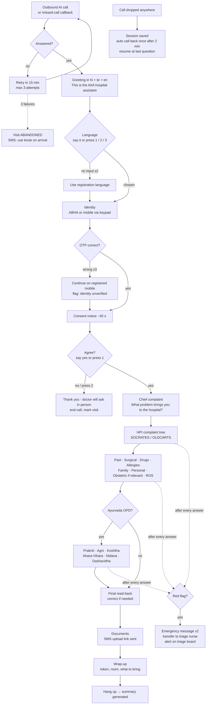
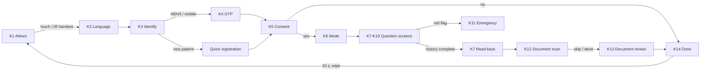
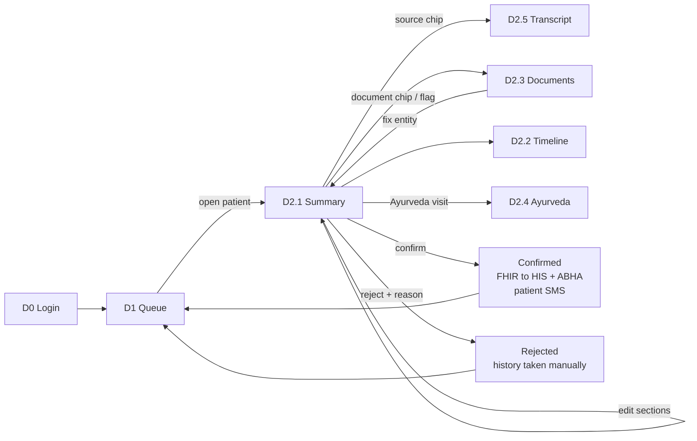
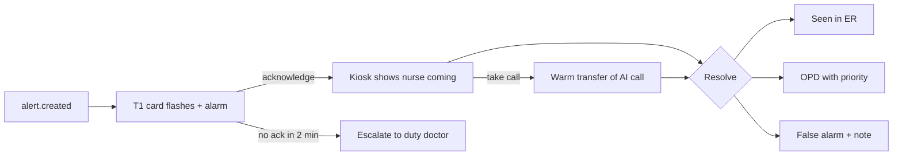

# 05 · Wireframes & UX Document — MediKiosk

Every screen of every app, the phone-call "screen" (voice flow), and the design rules behind them.
Related: [01-idea.md](01-idea.md) · [06-folder-structure.md](06-folder-structure.md) · [07-conversation-design.md](07-conversation-design.md) · [09-data-model-and-api.md](09-data-model-and-api.md)

> Wireframes are low-fidelity ASCII. On the kiosk, every label appears **in the patient's selected language**; English is used here for readability. Native-language text in this document is **to be verified by native speakers**. Indic characters may break ASCII alignment — that is expected.

---

## 1. Design principles (low-literacy, elderly, first-time users)

| # | Principle | Rule we follow |
|---|---|---|
| D1 | **Voice on every screen** | Every kiosk screen auto-plays its prompt in the chosen language; 🔊 "play again" is always visible |
| D2 | **Icons first, minimal text** | Every option = large icon + 1–3 words. No paragraphs. No medical jargon ("heart racing", not "palpitations") |
| D3 | **One question per screen** | Never two questions at once; never scroll on kiosk screens |
| D4 | **Big targets** | Touch targets ≥ **64 px** (primary buttons ≥ 96 px tall), ≥ 16 px gap between targets |
| D5 | **Big text** | Kiosk fonts ≥ **24 px**; question text 36 px; high contrast (≥ 7:1 for body text) |
| D6 | **Always know where you are** | Progress dots + section name ("About your pain · 3 of 9") |
| D7 | **Help is one tap away** | Big 🆘 **Help** button on every screen → rings staff buzzer / shows "A helper is coming" |
| D8 | **Forgiving** | ◀ **Back** on every question; "I don't know" is always a valid answer; nothing is final until read-back |
| D9 | **No surprise timeouts** | Idle → spoken + visual warning with 30 s countdown before the session is cleared |
| D10 | **Consistent colour meaning** | **Green = yes / continue**, **Red = no / emergency**, Amber = warning, Blue = information. Colour is never the *only* signal (icon + word too) |
| D11 | **Two ways to answer** | Every question can be answered by speaking (handset/mic) **or** tapping; phone calls use speech **or** keypad |
| D12 | **Privacy visible** | 🔒 line on attract/consent screens; screen clears automatically at the end |
| D13 | **Doctor UI = density & speed** | Dashboards are the opposite of the kiosk: dense, keyboard-friendly, everything within one screen, sources one click away |

---

## 2. Design tokens

### 2.1 Colours

| Token | Hex | Use |
|---|---|---|
| `--bg` | `#FAFAF7` | App background (warm off-white, less glare than pure white) |
| `--surface` | `#FFFFFF` | Cards, panels |
| `--text` | `#1A1A1A` | Primary text (contrast ≈ 17:1 on `--bg`) |
| `--text-muted` | `#5F6368` | Secondary text (dashboards only) |
| `--border` | `#D0D4D9` | Dividers, card borders |
| `--primary` | `#0B6E4F` | Brand, primary actions, progress |
| `--yes` | `#1B873F` | Yes / confirm / continue |
| `--no` | `#C62828` | No / cancel |
| `--emergency` | `#D50000` | Red-flag screens, alert cards (with flashing border) |
| `--warning` | `#F9A825` | Abnormal lab, low-confidence data |
| `--info` | `#1565C0` | Information, links, source chips |
| `--ayurveda` | `#E07A1F` | Ayurveda-mode accent (saffron) |
| `--vata` / `--pitta` / `--kapha` | `#7E8FC7` / `#E4572E` / `#4C9F70` | Prakriti bars |

Dark mode: dashboards only (doctor/triage night shifts) — same tokens with inverted surfaces. Kiosk stays light for daylight readability.

### 2.2 Typography

Font family: **Noto Sans** + **Noto Sans Devanagari** + **Noto Sans Telugu** (+ Noto Sans Tamil) — one family, consistent look across scripts.

| Style | Kiosk | Mobile upload | Dashboard |
|---|---|---|---|
| Display | 48 / 56 px bold | 32 px | — |
| Question / H1 | 36 / 44 px semibold | 24 px | 22 px |
| Body | 28 px | 18 px | 14–15 px |
| Label / button | 24 px (minimum) | 18 px | 13–14 px |
| Caption | 20 px (only non-essential) | 14 px | 12 px |

Indic scripts get **+10 % line height** (tall ascenders/matras).

### 2.3 Spacing, radius, elevation

| Token | Value |
|---|---|
| Spacing scale | 4 · 8 · 12 · 16 · 24 · 32 · 48 · 64 px |
| Radius | 8 px (inputs) · 16 px (cards) · 24 px (kiosk big buttons) · full (pills, chips) |
| Kiosk primary button | min 96 px height, min 280 px width |
| Kiosk option card | min 200 × 200 px, icon 96 px |
| Elevation | 1 (cards) · 2 (dialogs) · emergency cards use border, not shadow |

### 2.4 Icon set

| Group | Icons |
|---|---|
| Answers | ✔ yes, ✘ no, ❓ don't know, ⏭ skip, ◀ back, 🔊 play again, 🎤 speak, 🆘 help |
| Body parts (body map + chips) | head, eyes, ears, nose, throat, neck, chest, heart, upper abdomen, lower abdomen, back, lower back, arm (L/R), hand, hip, knee (L/R), leg, foot, skin, genitals (discreet), whole body |
| Symptoms | pain, fever (thermometer), cough, breathlessness, vomiting, diarrhoea, constipation, dizziness, headache, sweating, heart racing, fainting, swelling, itching/rash, burning urine, bleeding, weakness, no appetite, poor sleep, weight loss |
| Pain faces | 0–10 faces in 6 steps (0, 2, 4, 6, 8, 10) — custom-drawn set (do not copy licensed pain-face scales) |
| Duration | clock (hours), sun (days), calendar-week, calendar-month, calendar-year |
| Habits | cigarette/beedi, chewing tobacco, alcohol, veg thali, non-veg, tea/coffee, walking, bed/sleep |
| Documents | prescription, lab report, discharge summary, X-ray/scan, other |
| Identity | ABHA card, mobile phone, new person, QR code |
| Ayurveda | body frame thin/medium/broad, flame (Agni), bowel icons (hard/normal/loose), sun/snow (climate) |

---

## 3. Screen inventory

| ID | Screen | File | Channel |
|---|---|---|---|
| K1 | Attract (idle) | `frontend/src/apps/kiosk/screens/AttractScreen.tsx` | Kiosk |
| K2 | Language | `frontend/src/apps/kiosk/screens/LanguageScreen.tsx` | Kiosk |
| K3 | Identify | `frontend/src/apps/kiosk/screens/IdentifyScreen.tsx` | Kiosk |
| K4 | OTP | `frontend/src/apps/kiosk/screens/OtpScreen.tsx` | Kiosk |
| K5 | Consent | `frontend/src/apps/kiosk/screens/ConsentScreen.tsx` | Kiosk |
| K6 | Answer mode | `frontend/src/apps/kiosk/screens/ModeScreen.tsx` | Kiosk |
| K7 | Question (generic, incl. read-back variant) | `frontend/src/apps/kiosk/screens/QuestionScreen.tsx` | Kiosk |
| K8 | Pain scale | `frontend/src/apps/kiosk/screens/PainScaleScreen.tsx` | Kiosk |
| K9 | Body map | `frontend/src/apps/kiosk/screens/BodyMapScreen.tsx` | Kiosk |
| K10 | Duration picker | `frontend/src/apps/kiosk/screens/DurationPicker.tsx` | Kiosk |
| K11 | Emergency | `frontend/src/apps/kiosk/screens/EmergencyScreen.tsx` | Kiosk |
| K12 | Document scan | `frontend/src/apps/kiosk/screens/DocumentScanScreen.tsx` | Kiosk |
| K13 | Document review | `frontend/src/apps/kiosk/screens/DocumentReviewScreen.tsx` | Kiosk |
| K14 | Done | `frontend/src/apps/kiosk/screens/DoneScreen.tsx` | Kiosk |
| K-O | Idle-timeout overlay / Help overlay | `frontend/src/apps/kiosk/components/` | Kiosk |
| U1 | Upload page (4 states) | `frontend/src/apps/upload/pages/UploadPage.tsx` | Mobile web |
| D0 | Staff login | `frontend/src/apps/doctor/pages/LoginPage.tsx` | Doctor / nurse / admin |
| D1 | Doctor queue | `frontend/src/apps/doctor/pages/QueuePage.tsx` | Doctor |
| D2 | Patient page — tabs Summary · Timeline · Documents · Ayurveda · Transcript | `frontend/src/apps/doctor/pages/PatientPage.tsx` | Doctor |
| T1 | Triage alert board | `frontend/src/apps/triage/pages/AlertBoard.tsx` | Nurse |
| A1 | Metrics | `frontend/src/apps/admin/pages/MetricsPage.tsx` | Admin |
| V1 | Phone call voice flow | `backend/app/services/voice/` + ontology | Phone |

---

## 4. Kiosk screens (landscape, 1920 × 1080 touch display + handset)

Common frame on every kiosk screen after K2:

```
┌────────────────────────────────────────────────────────────────────────────────────────┐
│ 🏥 AIIA · MediKiosk        ● ● ● ○ ○ ○ ○ ○ ○   About your pain (3 of 9)     🔊   🆘 Help │  ← header bar
├────────────────────────────────────────────────────────────────────────────────────────┤
│                                                                                        │
│                               (screen content)                                         │
│                                                                                        │
├────────────────────────────────────────────────────────────────────────────────────────┤
│ ◀ Back                         🎤 Speak your answer                      ❓ Don't know │  ← action bar
└────────────────────────────────────────────────────────────────────────────────────────┘
```

---

### K1 · AttractScreen (idle)

```
┌────────────────────────────────────────────────────────────────────────────────────────┐
│ 🏥 AIIA · MediKiosk                                                     10:42   🆘 Help │
│                                                                                        │
│                     ┌────────────────────────────────────────────┐                     │
│                     │   (looping animation: hand touching screen  │                     │
│                     │    ↔ person lifting phone handset)          │                     │
│                     └────────────────────────────────────────────┘                     │
│                                                                                        │
│               Touch the screen or pick up the phone to begin                           │
│               स्क्रीन छुएँ या फ़ोन उठाएँ    ·    స్క్రీన్ తాకండి లేదా ఫోన్ ఎత్తండి                  │
│                                                                                        │
│        ┌──────────────────────────────┐        ┌──────────────────────────────┐        │
│        │   👆   TOUCH TO START         │        │   📞   PICK UP THE PHONE      │        │
│        └──────────────────────────────┘        └──────────────────────────────┘        │
│                                                                                        │
│   🔒 Your information is private. It is shared only with your doctor and hospital.     │
└────────────────────────────────────────────────────────────────────────────────────────┘
```

| Item | Detail |
|---|---|
| Purpose | Invite a passer-by; explain the two ways to start |
| Elements | Animation, trilingual instruction, two giant buttons, privacy line, Help |
| Voice prompt | Plays softly every 60 s **only when someone is detected nearby** (optional proximity sensor) or never (configurable, to avoid noise): EN "Touch the screen or pick up the phone to begin." · HI "शुरू करने के लिए स्क्रीन छुएँ या फ़ोन उठाएँ।" · TE "మొదలు పెట్టడానికి స్క్రీన్ తాకండి లేదా ఫోన్ ఎత్తండి." |
| Interactions | Tap anywhere → K2. Handset off-hook → K2 in voice mode (`channel = kiosk_voice`) |
| States | Offline banner "Service temporarily unavailable — please go to the registration counter" if `/health` fails |
| API | `GET /health` (poll 30 s) |

---

### K2 · LanguageScreen

```
┌────────────────────────────────────────────────────────────────────────────────────────┐
│ 🏥 AIIA · MediKiosk                                                          🆘 Help   │
│                                                                                        │
│            Choose your language  ·  अपनी भाषा चुनें  ·  మీ భాష ఎంచుకోండి                      │
│                                                                                        │
│    ┌────────────────────┐   ┌────────────────────┐   ┌────────────────────┐            │
│    │                    │   │                    │   │                    │            │
│    │      हिंदी           │   │      తెలుగు          │   │     English        │            │
│    │      Hindi   🔊    │   │      Telugu  🔊    │   │             🔊     │            │
│    └────────────────────┘   └────────────────────┘   └────────────────────┘            │
│                                                                                        │
│    ┌────────────────────┐                                                              │
│    │      தமிழ்  (soon)   │   ← greyed until Tamil content is ready [Stretch]            │
│    └────────────────────┘                                                              │
│                                                                                        │
│                  🎤 Or just say your language into the phone                           │
└────────────────────────────────────────────────────────────────────────────────────────┘
```

| Item | Detail |
|---|---|
| Purpose | Select session language (drives UI strings, audio, TTS, STT hint) |
| Voice prompt | Plays in all three languages in sequence: "For Hindi, touch Hindi…" · "हिंदी के लिए हिंदी छुएँ…" · "తెలుగు కోసం తెలుగు తాకండి…" |
| Interactions | Tap tile (each tile's 🔊 speaks its own name); speaking "Telugu"/"తెలుగు" into handset selects it (Saaras auto language-detect) |
| States | Default highlighted = hospital's regional language |
| API | none (stored in kiosk store; sent on session start) |

---

### K3 · IdentifyScreen

```
┌────────────────────────────────────────────────────────────────────────────────────────┐
│ 🏥 AIIA · MediKiosk        ● ○ ○ ○ ○ ○ ○ ○ ○   Who are you?                  🔊  🆘 Help │
├────────────────────────────────────────────────────────────────────────────────────────┤
│                         How would you like to identify yourself?                       │
│                                                                                        │
│   ┌──────────────────────┐  ┌──────────────────────┐  ┌──────────────────────┐         │
│   │   [ABHA card icon]   │  │   [QR icon]          │  │   [phone icon]       │         │
│   │   ABHA number        │  │   Scan ABHA card     │  │   Mobile number      │         │
│   └──────────────────────┘  └──────────────────────┘  └──────────────────────┘         │
│                                                                                        │
│                     ┌──────────────────────────────────────────┐                       │
│                     │  [new person icon]  I am new / no card    │                       │
│                     └──────────────────────────────────────────┘                       │
├────────────────────────────────────────────────────────────────────────────────────────┤
│ ◀ Back                                                                                 │
└────────────────────────────────────────────────────────────────────────────────────────┘

  After choosing "Mobile number" (same layout for ABHA with 14 digits, grouped 2-4-4-4):

│                        Type your mobile number                                         │
│                  ┌───┬───┬───┬───┬───┬───┬───┬───┬───┬───┐                             │
│                  │ 9 │ 8 │ 4 │ 5 │ _ │ _ │ _ │ _ │ _ │ _ │   🔊 reads digits back      │
│                  └───┴───┴───┴───┴───┴───┴───┴───┴───┴───┘                             │
│                         ┌─────┬─────┬─────┐                                            │
│                         │  1  │  2  │  3  │                                            │
│                         ├─────┼─────┼─────┤                                            │
│                         │  4  │  5  │  6  │     (keys 96 × 96 px)                      │
│                         ├─────┼─────┼─────┤                                            │
│                         │  7  │  8  │  9  │                                            │
│                         ├─────┼─────┼─────┤                                            │
│                         │  ⌫  │  0  │  ✔  │                                            │
│                         └─────┴─────┴─────┘                                            │
```

| Item | Detail |
|---|---|
| Purpose | Link the session to a patient (ABHA preferred; mobile OTP accepted; new registration allowed) |
| Voice prompt | EN "Do you have an ABHA card? Touch ABHA. Or touch Mobile to use your phone number." · HI "क्या आपके पास आभा कार्ड है? आभा छुएँ, या अपने मोबाइल नंबर के लिए मोबाइल छुएँ।" · TE "మీ దగ్గర ఆభా కార్డు ఉందా? ఆభా తాకండి, లేదా మొబైల్ నంబర్ కోసం మొబైల్ తాకండి." |
| Interactions | QR → camera opens, reads ABHA QR; digits read back aloud as typed; "I am new" → name + year of birth + gender + mobile (4 simple screens, voice-fillable) |
| States | Invalid number (shake + spoken "That number looks incomplete"); ABDM unavailable → auto-switch to mobile OTP with message |
| API | `POST /identity/abha/init` · `POST /identity/mobile/init` · `POST /patients` (new) |

---

### K4 · OtpScreen

```
┌────────────────────────────────────────────────────────────────────────────────────────┐
│ 🏥 AIIA · MediKiosk        ● ○ ○ ○ ○ ○ ○ ○ ○   Who are you?                  🔊  🆘 Help │
├────────────────────────────────────────────────────────────────────────────────────────┤
│                                                                                        │
│               We sent a 6-digit code to your phone  ******7890                         │
│                                                                                        │
│                     ┌────┐ ┌────┐ ┌────┐ ┌────┐ ┌────┐ ┌────┐                          │
│                     │ 4  │ │ 7  │ │ _  │ │ _  │ │ _  │ │ _  │                          │
│                     └────┘ └────┘ └────┘ └────┘ └────┘ └────┘                          │
│                                                                                        │
│                               [ numeric keypad as K3 ]                                 │
│                                                                                        │
│          Didn't get it?   ⟳ Send again (in 0:24)        📞 Call me with the code        │
├────────────────────────────────────────────────────────────────────────────────────────┤
│ ◀ Back                                                            🆘 Ask a helper      │
└────────────────────────────────────────────────────────────────────────────────────────┘
```

| Item | Detail |
|---|---|
| Purpose | Verify ABHA / mobile ownership |
| Voice prompt | EN "We sent a code to your phone. Please type the six numbers." · HI "आपके फ़ोन पर एक कोड भेजा गया है। कृपया छह अंक टाइप करें।" · TE "మీ ఫోన్‌కు ఒక కోడ్ పంపాము. దయచేసి ఆరు అంకెలు టైప్ చేయండి." |
| Interactions | Auto-submit on 6th digit; resend after 30 s; "call me with the code" = voice OTP (for patients who can't read SMS) |
| States | Wrong OTP (max 3) → "Ask a helper" + continue as *identity unverified* (flag shown to doctor) |
| API | `POST /identity/abha/confirm` or `POST /identity/mobile/confirm` |

---

### K5 · ConsentScreen

```
┌────────────────────────────────────────────────────────────────────────────────────────┐
│ 🏥 AIIA · MediKiosk        ● ● ○ ○ ○ ○ ○ ○ ○   Your permission            🔊  🆘 Help   │
├────────────────────────────────────────────────────────────────────────────────────────┤
│   ▶ ━━━━━━━━━━━━━━━━━━━━○──────────  0:28 / 0:45     (explanation playing)  🔊 Again   │
│                                                                                        │
│   We will ask about your health and read your old papers, only to help your doctor.    │
│                                                                                        │
│   ┌──────────────────────────────────────────────────────┬───────────────────────┐     │
│   │ 🗣  Ask me questions about my health     (needed)    │   ✔ YES               │     │
│   │ 📄  Read my old prescriptions & reports              │   ✔ YES   ✘ NO        │     │
│   │ 🏥  Share with my doctor & hospital records          │   ✔ YES   ✘ NO        │     │
│   │ 🆔  Save to my ABHA health record                    │   ✔ YES   ✘ NO        │     │
│   │ 🎙  Keep a voice recording of my answers (optional)  │   ✔ YES   ✘ NO        │     │
│   └──────────────────────────────────────────────────────┴───────────────────────┘     │
│                                                                                        │
│      ┌──────────────────────────────┐          ┌──────────────────────────────┐        │
│      │   ✔  I AGREE  (green)        │          │   ✘  NO, THANK YOU (red)      │        │
│      └──────────────────────────────┘          └──────────────────────────────┘        │
│   You can say "no" at any time. You can cancel later by SMS.  🔒                       │
└────────────────────────────────────────────────────────────────────────────────────────┘
```

| Item | Detail |
|---|---|
| Purpose | DPDP-compliant, granular, audio-explained consent (see [10-security-privacy.md](10-security-privacy.md)) |
| Voice prompt | 45 s notice in chosen language, then EN "Do you agree? Touch the green button or say yes." · HI "क्या आप सहमत हैं? हरा बटन छुएँ या 'हाँ' बोलें।" · TE "మీరు అంగీకరిస్తారా? ఆకుపచ్చ బటన్ తాకండి లేదా 'అవును' అని చెప్పండి." |
| Interactions | Defaults: history = required (if NO → polite exit), others default YES but individually switchable; recording defaults **NO**; "I agree" enabled only after the notice has played once (can skip after 10 s for returning patients) |
| States | "No, thank you" → message "No problem. The doctor will ask you in person." → K14 without history |
| API | `GET /consents/notice?lang=` · `POST /visits/{id}/consents` |

---

### K6 · ModeScreen

```
┌────────────────────────────────────────────────────────────────────────────────────────┐
│ 🏥 AIIA · MediKiosk        ● ● ○ ○ ○ ○ ○ ○ ○   How to answer              🔊  🆘 Help   │
├────────────────────────────────────────────────────────────────────────────────────────┤
│                        How would you like to answer the questions?                     │
│                                                                                        │
│     ┌───────────────────────────────────┐     ┌───────────────────────────────────┐    │
│     │                                   │     │                                   │    │
│     │        [person + handset]         │     │        [hand touching screen]     │    │
│     │                                   │     │                                   │    │
│     │   📞  TALK on the phone           │     │   👆  TOUCH the screen            │    │
│     │   (recommended)                   │     │                                   │    │
│     └───────────────────────────────────┘     └───────────────────────────────────┘    │
│                                                                                        │
│                  You can switch any time — just pick up or put down the phone.         │
└────────────────────────────────────────────────────────────────────────────────────────┘
```

| Item | Detail |
|---|---|
| Purpose | Choose voice (handset) or touch; both show the same question screens |
| Voice prompt | EN "Would you like to talk on the phone, or touch the screen?" · HI "क्या आप फ़ोन पर बात करना चाहेंगे या स्क्रीन छूना?" · TE "ఫోన్‌లో మాట్లాడతారా, లేక స్క్రీన్ తాకుతారా?" |
| Interactions | Skipped automatically if the patient started by lifting the handset; handset off-hook at any time switches to voice |
| API | `POST /visits/{id}/interview/sessions` (`channel: kiosk_voice | kiosk_touch`) · `POST /voice/webrtc/offer` (voice) |

---

### K7 · QuestionScreen (generic renderer)

**Single-choice variant** (`input_type: single_choice`, 2–6 options):

```
┌────────────────────────────────────────────────────────────────────────────────────────┐
│ 🏥 AIIA · MediKiosk        ● ● ● ● ○ ○ ○ ○ ○   About your pain (4 of 9)   🔊  🆘 Help   │
├────────────────────────────────────────────────────────────────────────────────────────┤
│                                                                                        │
│                What does the pain feel like?                               🔊          │
│                                                                                        │
│   ┌──────────────┐  ┌──────────────┐  ┌──────────────┐  ┌──────────────┐               │
│   │ [weight icon]│  │ [flame icon] │  │ [needle icon]│  │ [dull icon]  │               │
│   │   Heavy /    │  │   Burning    │  │   Sharp /    │  │   Dull ache  │               │
│   │   pressing   │  │              │  │   stabbing   │  │              │               │
│   └──────────────┘  └──────────────┘  └──────────────┘  └──────────────┘               │
│                                                                                        │
│   🎤 Listening…  "bharipan jaisa lagta hai"   → Heavy / pressing ✔   (voice mode)        │
├────────────────────────────────────────────────────────────────────────────────────────┤
│ ◀ Back                         🎤 Speak your answer                      ❓ Don't know │
└────────────────────────────────────────────────────────────────────────────────────────┘
```

**Multi-choice variant** (`multi_choice`): same grid, cards toggle with a ✔ corner badge, plus a large green **"Done ✔"** and a **"None of these"** card.

**Yes/No variant** (`yes_no`): two giant cards — green ✔ YES (left), red ✘ NO (right), ❓ Don't know in the action bar.

**Number / free-text variant**: keypad (numbers) or 🎤 "Tell me in your own words" with live transcript and **"Is this right? ✔ / Say again 🎤"**.

**Read-back variant** (end of each section):

```
│                Let me check I understood correctly:                        🔊          │
│   ┌──────────────────────────────────────────────────────────────────────────────┐     │
│   │  🫀 Pain in the chest, started suddenly 2 days ago                            │     │
│   │  ⚖ Feels heavy · spreads to left arm · 7 out of 10                            │     │
│   │  💧 With sweating                                                              │     │
│   └──────────────────────────────────────────────────────────────────────────────┘     │
│      ┌──────────────────────────────┐          ┌──────────────────────────────┐        │
│      │   ✔  YES, CORRECT            │          │   ✎  NO, CHANGE SOMETHING    │        │
│      └──────────────────────────────┘          └──────────────────────────────┘        │
```

| Item | Detail |
|---|---|
| Purpose | Render any ontology node (see question types in [07 §3](07-conversation-design.md)) |
| Elements | Header (progress, section), question text + 🔊, option cards (icon + label + keypad number hint on phone), live transcript strip in voice mode, action bar |
| Voice prompt | The node's pre-generated audio, e.g. `chest_pain.character`: EN "What does the pain feel like?" · HI "दर्द कैसा महसूस होता है?" · TE "నొప్పి ఎలా అనిపిస్తుంది?" |
| Interactions | Tap option → brief highlight (300 ms) → next; spoken answer → recognised option highlighted → auto-advance after 1 s unless patient taps ◀; "Don't know" stores `unknown` |
| States | Loading next question (skeleton, < 1.5 s); low confidence → "Did you mean *Heavy*? ✔ / ✘"; 2 failed attempts → voice off for this question, cards pulse; network error → retry banner, answers kept locally |
| API | `GET /interview/sessions/{sid}/question` · `POST /interview/sessions/{sid}/answers` · `POST /interview/sessions/{sid}/back` · WS `/ws/kiosk/{session_id}` (`interview.question`, `interview.progress`, `interview.escalated`) |

---

### K8 · PainScaleScreen

```
┌────────────────────────────────────────────────────────────────────────────────────────┐
│ 🏥 AIIA · MediKiosk        ● ● ● ● ● ● ○ ○ ○   About your pain (8 of 9)   🔊  🆘 Help   │
├────────────────────────────────────────────────────────────────────────────────────────┤
│                     How bad is the pain right now?                        🔊           │
│                                                                                        │
│      😀        🙂        😐        🙁        😣        😫                                   │
│   ┌─────┬─────┬─────┬─────┬─────┬─────┬─────┬─────┬─────┬─────┬─────┐                  │
│   │  0  │  1  │  2  │  3  │  4  │  5  │  6  │  7  │  8  │  9  │ 10  │                  │
│   └─────┴─────┴─────┴─────┴─────┴─────┴─────┴─────┴─────┴─────┴─────┘                  │
│    green ─────────────────────── amber ─────────────────────────── red                 │
│    No pain                                                    Worst pain possible      │
│                                                                                        │
│                        Selected:  7  😣  "Very bad"                                     │
├────────────────────────────────────────────────────────────────────────────────────────┤
│ ◀ Back                         🎤 Say a number 0 to 10                   ❓ Don't know │
└────────────────────────────────────────────────────────────────────────────────────────┘
```

| Item | Detail |
|---|---|
| Purpose | `scale_0_10` input for severity |
| Voice prompt | EN "From zero to ten, how bad is the pain? Zero means no pain, ten means the worst pain." · HI "0 से 10 में दर्द कितना है? 0 मतलब कोई दर्द नहीं, 10 मतलब सबसे ज़्यादा दर्द।" · TE "0 నుండి 10 లో నొప్పి ఎంత ఉంది? 0 అంటే నొప్పి లేదు, 10 అంటే చాలా ఎక్కువ నొప్పి." |
| Interactions | Tap a number or face; spoken number or word ("bahut zyada" → 8, confirmed) |
| API | `POST /interview/sessions/{sid}/answers` |

---

### K9 · BodyMapScreen

```
┌────────────────────────────────────────────────────────────────────────────────────────┐
│ 🏥 AIIA · MediKiosk        ● ● ● ○ ○ ○ ○ ○ ○   About your pain (1 of 9)   🔊  🆘 Help   │
├────────────────────────────────────────────────────────────────────────────────────────┤
│              Where is the pain? Touch the place on the body.            🔊             │
│                                                                                        │
│      [ FRONT ]  [ back ]                      Selected:                                │
│            ___                                ┌──────────────────────────┐             │
│           ( o )                               │ ✔ Chest — left side  ✘   │             │
│          __|_|__                              └──────────────────────────┘             │
│         /|█████|\     ← tapped region fills                                            │
│        / |     | \       with primary colour     Quick picks:                          │
│          |_____|                                 [Head] [Chest] [Stomach]              │
│           |   |                                  [Back] [Knee] [Whole body]            │
│           |   |                                                                        │
│          _|   |_                                  ┌───────────────┐                    │
│                                                  │   Done ✔       │                    │
│                                                  └───────────────┘                    │
├────────────────────────────────────────────────────────────────────────────────────────┤
│ ◀ Back                         🎤 Tell me where it hurts                 ❓ Don't know │
└────────────────────────────────────────────────────────────────────────────────────────┘
```

| Item | Detail |
|---|---|
| Purpose | `body_location` input (one or more regions, left/right) |
| Voice prompt | EN "Where is the pain? Touch the place on the body, or tell me." · HI "दर्द कहाँ है? शरीर पर जगह छुएँ, या बताइए।" · TE "నొప్పి ఎక్కడ ఉంది? శరీరం బొమ్మపై చోటు తాకండి, లేదా చెప్పండి." |
| Interactions | Tap regions (~30 regions front/back, mirrored L/R labels from the patient's perspective); quick-pick chips for common areas; genital region shown as a discreet generic "private area" chip |
| API | `POST /interview/sessions/{sid}/answers` (value: list of region codes) |

---

### K10 · DurationPicker

```
┌────────────────────────────────────────────────────────────────────────────────────────┐
│ 🏥 AIIA · MediKiosk        ● ● ● ● ○ ○ ○ ○ ○   About your pain (2 of 9)   🔊  🆘 Help   │
├────────────────────────────────────────────────────────────────────────────────────────┤
│                     Since when do you have this problem?                   🔊          │
│                                                                                        │
│    Quick:  [ Today ]  [ 2–3 days ]  [ About a week ]  [ About a month ]  [ Years ]     │
│                                                                                        │
│                     ┌─────┐                                                            │
│                     │  −  │     ┌──────────┐     ┌─────┐                               │
│                     └─────┘     │    2     │     │  +  │                               │
│                                 └──────────┘     └─────┘                               │
│                                                                                        │
│    [🕐 Hours]    [☀ Days ✔]    [📅 Weeks]    [🗓 Months]    [📆 Years]                  │
│                                                                                        │
│                               ┌────────────────────┐                                   │
│                               │    Done ✔           │   → "2 days"                     │
│                               └────────────────────┘                                   │
├────────────────────────────────────────────────────────────────────────────────────────┤
│ ◀ Back                         🎤 Say "two days"                         ❓ Don't know │
└────────────────────────────────────────────────────────────────────────────────────────┘
```

| Item | Detail |
|---|---|
| Purpose | `duration` input → `{value, unit}` |
| Voice prompt | EN "Since when do you have this problem?" · HI "यह तकलीफ़ कब से है?" · TE "ఈ సమస్య ఎప్పటి నుండి ఉంది?" |
| Interactions | Quick chips set approximate values (flagged `approximate: true`); spoken "do din", "rendu rojulu", "pichle Diwali se" (relative dates → LLM normalises, confirmed) |
| API | `POST /interview/sessions/{sid}/answers` |

---

### K11 · EmergencyScreen (red flag)

```
┌────────────────────────────────────────────────────────────────────────────────────────┐
│████████████████████████████████████████████████████████████████████████████████████████│
│██                                                                                    ██│
│██              ⚠   PLEASE DO NOT WAIT                                                ██│
│██                                                                                    ██│
│██         Your answers show you may need urgent care.                                ██│
│██         A nurse has been called and is coming to you now.                          ██│
│██                                                                                    ██│
│██         ➜ ➜ ➜   EMERGENCY  —  Ground floor, Gate 2   (arrow + floor map)            ██│
│██                                                                                    ██│
│██         Your token:  E-014            Kiosk: #3, Hall B                             ██│
│██                                                                                    ██│
│██         ┌─────────────────────────────┐                                            ██│
│██         │ 🆘 Nurse is on the way  ●●● │   (pulses until staff acknowledges)         ██│
│██         └─────────────────────────────┘                                            ██│
│██                                                           Staff: [ PIN to close ]  ██│
│████████████████████████████████████████████████████████████████████████████████████████│
└────────────────────────────────────────────────────────────────────────────────────────┘
```

| Item | Detail |
|---|---|
| Purpose | Stop the interview and route the patient to emergency care immediately |
| Voice prompt (repeated twice, not interruptible) | EN "Please do not wait. Your answers show you may need urgent care. A nurse is coming to you now. Please go to the emergency counter." · HI "कृपया इंतज़ार न करें। आपको तुरंत देखभाल की ज़रूरत हो सकती है। नर्स आपके पास आ रही हैं। कृपया इमरजेंसी काउंटर जाएँ।" · TE "దయచేసి వేచి ఉండకండి. మీకు వెంటనే చికిత్స అవసరం కావచ్చు. నర్స్ మీ దగ్గరికి వస్తున్నారు. దయచేసి ఎమర్జెన్సీ కౌంటర్‌కు వెళ్ళండి." |
| Interactions | No "back". Screen locks until staff PIN; staff buzzer/lamp on kiosk triggered; triage board alert created. RF-PSY-01 uses a calmer variant (see [07 §7](07-conversation-design.md)) |
| States | If triage acknowledges → text changes to "Nurse Priya is coming — 1 min" (name optional) |
| API | Pushed by WS `interview.escalated`; nurse side `POST /alerts/{id}/acknowledge` |

---

### K12 · DocumentScanScreen

```
┌────────────────────────────────────────────────────────────────────────────────────────┐
│ 🏥 AIIA · MediKiosk        ● ● ● ● ● ● ● ● ○   Your old papers            🔊  🆘 Help   │
├────────────────────────────────────────────────────────────────────────────────────────┤
│   Place one page under the camera, face up.               Pages scanned:               │
│   ┌──────────────────────────────────────────────┐        ┌──────┐ ┌──────┐ ┌──────┐  │
│   │   (live camera)                               │        │ p1 ✔ │ │ p2 ✔ │ │  +   │  │
│   │     ┌ ─ ─ ─ ─ ─ ─ ─ ─ ─ ─ ─ ─ ─ ─ ┐           │        └──────┘ └──────┘ └──────┘  │
│   │       page outline detected (green)            │                                    │
│   │     └ ─ ─ ─ ─ ─ ─ ─ ─ ─ ─ ─ ─ ─ ─ ┘           │   ✔ Auto-captures when steady       │
│   │   "Hold still… 3 · 2 · 1 ✔"                   │                                    │
│   └──────────────────────────────────────────────┘                                    │
│                                                                                        │
│   ┌────────────────────┐   ┌────────────────────┐   ┌────────────────────────────┐    │
│   │ 📸 Take photo       │   │ ➕ Next page         │   │ ✔ Done — I have no more     │    │
│   └────────────────────┘   └────────────────────┘   └────────────────────────────┘    │
│                                      I have no papers →  [ Skip ]                      │
└────────────────────────────────────────────────────────────────────────────────────────┘
```

| Item | Detail |
|---|---|
| Purpose | Capture prior prescriptions / reports (overhead document camera or kiosk webcam) |
| Voice prompt | EN "Do you have old prescriptions or reports? Place one page under the camera." · HI "क्या आपके पास पुरानी पर्चियाँ या रिपोर्ट हैं? एक पन्ना कैमरे के नीचे रखें।" · TE "మీ దగ్గర పాత ప్రిస్క్రిప్షన్లు లేదా రిపోర్టులు ఉన్నాయా? ఒక పేజీని కెమెరా కింద పెట్టండి." |
| Interactions | Edge detection + auto-capture; retake by tapping a thumbnail; max 20 pages; "Skip" if none; also shows QR "Send photos from your phone instead" (opens U1) |
| States | Too dark/blurry → spoken hint "Please hold the paper flat"; upload progress per page |
| API | `POST /visits/{id}/documents` (multipart, `source: kiosk_scan`) · WS `document.processed` |

---

### K13 · DocumentReviewScreen

```
┌────────────────────────────────────────────────────────────────────────────────────────┐
│ 🏥 AIIA · MediKiosk        ● ● ● ● ● ● ● ● ●   Your old papers            🔊  🆘 Help   │
├────────────────────────────────────────────────────────────────────────────────────────┤
│   We read your papers. Are these yours?                                                │
│                                                                                        │
│   ┌────────────────────────────────────────────────────────────────────┬───────────┐   │
│   │ [Rx icon]   Prescription · City Clinic · March 2026 · 3 medicines   │ ✔  ✘      │   │
│   │ [lab icon]  Lab report · Apollo Diagnostics · March 2026            │ ✔  ✘      │   │
│   │ [lab icon]  Lab report · … reading ◌◌◌                              │           │   │
│   └────────────────────────────────────────────────────────────────────┴───────────┘   │
│                                                                                        │
│   The doctor will check the details. You don't need to read anything.                 │
│                                                                                        │
│                  ┌──────────────────────────────┐                                      │
│                  │   ✔  CONTINUE                 │                                      │
│                  └──────────────────────────────┘                                      │
└────────────────────────────────────────────────────────────────────────────────────────┘
```

| Item | Detail |
|---|---|
| Purpose | Patient confirms ownership only (✘ removes a page scanned by mistake); clinical details are reviewed by the doctor, not the patient |
| Voice prompt | EN "We found a prescription from March 2026 and a lab report. Are these yours?" · HI "हमें मार्च 2026 की एक पर्ची और एक लैब रिपोर्ट मिली। क्या ये आपकी हैं?" · TE "మాకు మార్చి 2026 ప్రిస్క్రిప్షన్ మరియు ఒక ల్యాబ్ రిపోర్ట్ దొరికాయి. ఇవి మీవేనా?" |
| States | Still processing → rows show spinner; patient can continue (processing finishes in background) |
| API | `GET /visits/{id}/documents` · WS `document.processed` |

---

### K14 · DoneScreen

```
┌────────────────────────────────────────────────────────────────────────────────────────┐
│ 🏥 AIIA · MediKiosk                                                          🆘 Help   │
├────────────────────────────────────────────────────────────────────────────────────────┤
│                                    ✔                                                   │
│                          Thank you! All done.                                          │
│                                                                                        │
│             Your answers have been sent to the doctor.                                 │
│                                                                                        │
│                    ┌─────────────────────────────────┐                                 │
│                    │     Your token:   OPD-217        │                                 │
│                    │     Kayachikitsa OPD · Room 12   │                                 │
│                    │     About 25 minutes             │                                 │
│                    └─────────────────────────────────┘                                 │
│                                                                                        │
│             [ 🖨 Print my token ]        📱 Token also sent by SMS                      │
│                                                                                        │
│             This screen will clear in 10 seconds for your privacy.   ●●●●●○○○○○        │
└────────────────────────────────────────────────────────────────────────────────────────┘
```

| Item | Detail |
|---|---|
| Purpose | Close the loop, give next steps, wipe the session |
| Voice prompt | EN "Thank you. Your answers are with the doctor. Your token is OPD 217. Please wait near room 12." · HI "धन्यवाद। आपके जवाब डॉक्टर तक पहुँच गए हैं। आपका टोकन OPD 217 है। कृपया कमरा 12 के पास इंतज़ार करें।" · TE "ధన్యవాదాలు. మీ సమాధానాలు డాక్టర్‌కు పంపాము. మీ టోకెన్ OPD 217. దయచేసి 12వ గది దగ్గర వేచి ఉండండి." |
| Interactions | Auto-return to K1 after 10 s; kiosk store wiped; handset hang-up also ends |
| API | `POST /interview/sessions/{sid}/end` |

---

### K-O · Overlays (idle timeout & help)

```
        ┌──────────────────────────────────────────────┐
        │   ⏳  Are you still there?                     │
        │                                              │
        │   Touch anywhere to continue.                │
        │   Clearing in  0:27  for your privacy.        │
        │                                              │
        │   ┌──────────────────────┐                   │
        │   │  ✔  I'm here          │                   │
        │   └──────────────────────┘                   │
        └──────────────────────────────────────────────┘
```

- Idle 60 s on a question → overlay with spoken warning; 30 s later → session saved as *paused* (resumable by OTP within 2 h) and screen wiped.
- 🆘 Help → overlay "A helper is coming" + staff buzzer; interview pauses; helper can take over via a staff PIN (assisted mode — logged).

---

## 5. Mobile upload page (U1 · `UploadPage.tsx`, portrait ~390 × 844)

Opened from the SMS/WhatsApp link `https://…/upload/{token}`.

```
 State A: Landing                 State B: Capture                  State C: Uploading          State D: Done
┌──────────────────────────┐   ┌──────────────────────────┐   ┌──────────────────────────┐  ┌──────────────────────────┐
│ 🏥 AIIA Hospital    [తె▾] │   │ ◀  Add photos             │   │ Sending your papers…     │  │            ✔             │
│                          │   │                          │   │                          │  │                          │
│ Namaste Venkat 🙏         │   │ ┌──────────────────────┐ │   │ Rx_1.jpg   ██████████ ✔  │  │  Thank you, Venkat!      │
│                          │   │ │   (camera view)      │ │   │ Lab_1.jpg  ██████░░░░    │  │                          │
│ Please send photos of    │   │ │  ┌ ─ ─ ─ ─ ─ ─ ┐     │ │   │ Lab_2.jpg  ░░░░░░░░░░    │  │  3 papers received.      │
│ your old papers:         │   │ │  page detected      │ │   │                          │  │  The doctor will see     │
│                          │   │ │  └ ─ ─ ─ ─ ─ ─ ┘     │ │   │ Don't close this page.   │  │  them before your visit. │
│ [Rx] Prescriptions       │   │ └──────────────────────┘ │   │                          │  │                          │
│ [Lab] Lab reports        │   │                          │   │                          │  │  ➕ Add more papers       │
│ [DS] Discharge papers    │   │  ( 📸 )   🖼 Gallery      │   │                          │  │                          │
│ [X] Scan / X-ray reports │   │                          │   │                          │  │  🔒 Link expires in 23 h  │
│                          │   │  Added:  [p1][p2][p3] ✘  │   │                          │  │                          │
│ ┌──────────────────────┐ │   │                          │   │                          │  │                          │
│ │  📷 TAKE PHOTOS       │ │   │ ┌──────────────────────┐ │   │                          │  │                          │
│ └──────────────────────┘ │   │ │  ✔ SEND (3)          │ │   │                          │  │                          │
│ 🔒 Only for your doctor. │   │ └──────────────────────┘ │   │                          │  │                          │
│ 🔊 Listen                 │   │                          │   │                          │  │                          │
└──────────────────────────┘   └──────────────────────────┘   └──────────────────────────┘  └──────────────────────────┘
```

| Item | Detail |
|---|---|
| Purpose | Let smartphone users send documents from home or the waiting hall |
| Elements | Hospital name, first name only (no other PHI on page), language switcher, examples with icons, 🔊 listen button (reads the instructions), camera + gallery, thumbnails with remove ✘ |
| Voice prompt (🔊 button) | EN "Please take photos of your old prescriptions and reports, then press Send." · HI "कृपया अपनी पुरानी पर्चियों और रिपोर्ट की फ़ोटो लें, फिर 'भेजें' दबाएँ।" · TE "దయచేసి మీ పాత ప్రిస్క్రిప్షన్లు, రిపోర్టుల ఫోటోలు తీసి, 'పంపు' నొక్కండి." |
| Interactions | Client-side compression (max 2000 px), max 10 files × 10 MB, PDF allowed; retries on flaky networks (resumable per file) |
| States | **Expired/used link** → "This link has expired. Please ask at the registration desk or show your token at the kiosk." · **Offline** → "Waiting for network…" and auto-resume |
| API | `GET /upload/{token}` · `POST /upload/{token}/files` |

---

## 6. Staff apps (desktop 1440 × 900+, dense layout)

### D0 · LoginPage

```
┌──────────────────────────────────────────────────────────────┐
│                     🏥 MediKiosk · Staff                      │
│                                                              │
│          Email     [ dr.sharma@aiia.gov.in           ]       │
│          Password  [ ••••••••••••                    ]       │
│                                                              │
│          [        Sign in        ]                           │
│                                                              │
│          Role is detected from your account:                 │
│          doctor → Queue · nurse → Triage · admin → Metrics   │
│   🔒 Access is logged. Use only for patient care.             │
└──────────────────────────────────────────────────────────────┘
```

| Item | Detail |
|---|---|
| States | Wrong password (generic message, rate-limited); session expiry → redirect with "Signed out for security" |
| API | `POST /auth/login` · `POST /auth/refresh` · `GET /auth/me` |

---

### D1 · QueuePage (doctor)

```
┌────────────────────────────────────────────────────────────────────────────────────────────────────────┐
│ MediKiosk · Kayachikitsa OPD · Dr. Sharma            🔍 Search token/name     Today ▾   ● Live    ⏻   │
├────────────────────────────────────────────────────────────────────────────────────────────────────────┤
│ Filters: [All 42] [Summary ready 18] [In interview 9] [Waiting docs 4] [Seen 11]     Mode: [All ▾]      │
├──────┬──────────────────────┬──────────┬──────────────────────────┬──────────────────┬───────┬─────────┤
│Token │ Patient              │ Age/Sex  │ Chief complaint           │ Status           │ Flags │ Waiting │
├──────┼──────────────────────┼──────────┼──────────────────────────┼──────────────────┼───────┼─────────┤
│🚨E-014│ Venkat Rao           │ 58 M     │ Chest pain × 2 d          │ ESCALATED → ER   │ 🚨     │ 3 min   │
│ 217  │ Ramesh K             │ 45 M     │ Chest pain × 2 d          │ ✅ Summary ready  │ ⚠ 2   │ 12 min  │
│ 218  │ Sunita Devi   [AYU]  │ 62 F     │ Knee pain × 3 mo          │ ✅ Summary ready  │ ⚠ 1   │ 10 min  │
│ 219  │ Lakshmamma           │ 68 F     │ Knee pain, sugar          │ 🗣 Interview 60 %  │       │ 8 min   │
│ 220  │ Imran S              │ 31 M     │ Fever × 4 d               │ 📄 Reading docs   │       │ 6 min   │
│ 221  │ —                    │ —        │ —                         │ 📞 Call scheduled │       │ 2 min   │
└──────┴──────────────────────┴──────────┴──────────────────────────┴──────────────────┴───────┴─────────┘
  Keyboard: ↑/↓ select · Enter open · N next patient                           📞 phone 🖥 kiosk 📱 upload
```

| Item | Detail |
|---|---|
| Purpose | Today's patients for the doctor's department, ordered by priority then arrival |
| Elements | Status chips, flag counts (🚨 red flag, ⚠ abnormal labs/interactions), channel icon, `[AYU]` badge for Ayurveda mode, live indicator |
| Interactions | Click/Enter → D2 and `POST /visits/{id}/open`; emergency rows pinned on top with red background; new "Summary ready" rows fade in |
| States | Empty: "No patients yet today"; WS disconnected → amber "Reconnecting…" banner, falls back to polling |
| API | `GET /doctor/queue?department=` · WS `/ws/doctor?department=` (`visit.summary_ready`, `visit.updated`, `alert.created`) |

---

### D2 · PatientPage — header (all tabs)

```
┌────────────────────────────────────────────────────────────────────────────────────────────────────────┐
│ ◀ Queue   Ramesh K · 45 M · Token 217 · ABHA ramesh@abdm ✔ · Hindi · 📞 phone 09:12 · Allopathy          │
│ [ Summary ]  [ Timeline ]  [ Documents (3) ]  [ Ayurveda ]  [ Transcript ]                               │
├────────────────────────────────────────────────────────────────────────────────────────────────────────┤
│ 🚨 RF-CARD-01 raised 09:21 — chest pain + sweating + left-arm radiation · triage acknowledged 09:22 (Priya) │
└────────────────────────────────────────────────────────────────────────────────────────────────────────┘
```

### D2.1 · Summary tab

```
┌──────────────────────────────────────────────────────────────────────────────────┬─────────────────────┐
│ AI DRAFT v3 · generated 09:31 · sarvam-105b · prompt summary@1.2        [⟳ Regenerate]│ FLAGS               │
├──────────────────────────────────────────────────────────────────────────────────┤ 🚨 Red flag          │
│ CHIEF COMPLAINT                                                            ✎     │   RF-CARD-01 (ack'd) │
│ Chest pain for 2 days.                                     [🗣 09:14]            │ ⚠ HbA1c 9.2 % high   │
│                                                                                  │   Mar 2026 [📄 Lab]  │
│ HISTORY OF PRESENT ILLNESS                                                 ✎     │ ⚠ LDL 168 mg/dL high │
│ Sudden-onset, crushing left-sided chest pain radiating to the left arm,          │   [📄 Lab]           │
│ worse on exertion, relieved by rest, 7/10, with sweating.                        │                     │
│                                              [🗣 09:14] [🗣 09:16] [🗣 09:18]      │ UNVERIFIED           │
│                                                                                  │ ◌ 1 medicine name    │
│ PAST MEDICAL / SURGICAL                                                    ✎     │   low confidence     │
│ T2DM (2019), HTN (2021). No surgeries.     [🗣 09:19] [📄 Rx Nov 2024]            │   [📄 Rx Nov 2024]   │
│                                                                                  │                     │
│ DRUGS & ALLERGIES                                                          ✎     │ IDENTITY            │
│ Metformin 500 mg BD · Amlodipine 5 mg OD · Allergy: sulfonamides (rash)          │ ✔ ABHA verified      │
│ ~~~~~~~~~ (amber underline = from handwriting, confidence 0.62)                  │                     │
│                                                                                  │ CONSENTS            │
│ FAMILY HISTORY          Father — MI at 55.                                  ✎     │ ✔ history ✔ docs     │
│ PERSONAL HISTORY        Smoker 10/day × 15 yrs · occasional alcohol · mixed diet ✎│ ✔ HIS ✔ ABHA         │
│ REVIEW OF SYSTEMS       No fever, cough, urinary symptoms, weight loss       ✎     │ ✘ recording          │
│ PRIOR INVESTIGATIONS    HbA1c 9.2 % (Mar 2026, ↑) · LDL 168 (Mar 2026, ↑)    ✎     │                     │
├──────────────────────────────────────────────────────────────────────────────────┴─────────────────────┤
│ ⓘ AI-generated draft from patient-reported history and documents. Not a diagnosis. Verify before use.  │
│                        [ ✘ Reject… ]      [ 📋 Copy text ]      [ ✔ CONFIRM & SEND TO HIS / ABHA ]      │
└────────────────────────────────────────────────────────────────────────────────────────────────────────┘
```

| Item | Detail |
|---|---|
| Purpose | Read the complete history in ~30 s, correct it, confirm |
| Elements | Sections in standard order, ✎ inline edit per section, **source chips** (🗣 = interview turn time → opens Transcript at that turn; 📄 = document → opens Documents with the entity highlighted), amber underline for low confidence, flags sidebar, consent/identity status, disclaimer |
| Interactions | Edit → saves as `summary_edits` (audited), edited text marked "edited by Dr. Sharma"; Confirm → FHIR push + patient SMS; Reject requires reason; keyboard: E edit, C confirm |
| States | Summary not ready → progress ("Interview 60 % · 2 documents reading"); regenerated after new documents → "New information added" diff highlight |
| API | `GET /visits/{id}/summary` · `PATCH /visits/{id}/summary` · `POST /visits/{id}/summary/confirm` · `POST /visits/{id}/summary/reject` · `POST /visits/{id}/summary/generate` · `GET /visits/{id}/clinical-flags` |

### D2.2 · Timeline tab

```
┌────────────────────────────────────────────────────────────────────────────────────────────────────────┐
│ MEDICAL TIMELINE                                           Show: [✔ Diagnoses] [✔ Medicines] [✔ Labs]   │
├────────────────────────────────────────────────────────────────────────────────────────────────────────┤
│ 2026 ─┬─ 10 Sep  🗣 Today's interview — chest pain × 2 d  🚨                                            │
│       ├─ 14 Mar  📄 Lab (Apollo Diagnostics)   HbA1c 9.2 % ↑   LDL 168 ↑   Creatinine 1.0              │
│       └─ 02 Mar  📄 Rx (City Clinic)           Metformin 500 BD · Amlodipine 5 OD                       │
│ 2024 ─┬─ 18 Nov  📄 Rx (handwritten, Dr. ?)    Metformin 500 BD · ◌ "Atorva?" (low confidence)          │
│       └─ 05 Jun  📄 Lab                         HbA1c 8.1 % ↑                                            │
│ 2021 ─── ~       🗣 Reported: Hypertension diagnosed                                                    │
│ 2019 ─── ~       🗣 Reported: Type 2 diabetes diagnosed                                                  │
├────────────────────────────────────────────────────────────────────────────────────────────────────────┤
│ TRENDS   HbA1c:  8.1 (Jun 24) ──▶ 9.2 (Mar 26)  ↑ worsening            [mini line chart]              │
└────────────────────────────────────────────────────────────────────────────────────────────────────────┘
```

| Item | Detail |
|---|---|
| Purpose | Chronological view of documents + reported history; lab trends |
| Interactions | Click an event → Documents tab at that page; "~" = approximate date from interview |
| API | `GET /visits/{id}/timeline` |

### D2.3 · Documents tab (side-by-side viewer)

```
┌────────────────────────────────────────────────┬───────────────────────────────────────────────────────┐
│ [Rx Nov 2024 ▾]  page 1/1   🔍+ 🔍−  ⟳ rotate   │ EXTRACTED  · Prescription · 18 Nov 2024 ✎ · conf 0.71  │
│ ┌────────────────────────────────────────────┐ ├──────────────┬──────────┬────────┬───────┬──────────┤
│ │  (original image)                          │ │ Item          │ Dose     │ Freq   │ Conf  │ Verify   │
│ │   Dr. ___________  Reg. No. ____           │ ├──────────────┼──────────┼────────┼───────┼──────────┤
│ │   ┌──────────────────────┐ ← highlight     │ │ Metformin     │ 500 mg   │ BD     │ 0.93  │ ☐        │
│ │   │ Tab Glycomet 500 1-0-1│   of selected  │ │ (Glycomet)    │          │        │       │          │
│ │   └──────────────────────┘   entity        │ │ ◌ Atorva…?    │ 10 mg?   │ HS     │ 0.48  │ ☐  ✎     │
│ │   Tab Atorva 10  0-0-1                     │ │ Dx: T2DM      │          │        │ 0.88  │ ☐        │
│ │   Adv: diet, walk                          │ └──────────────┴──────────┴────────┴───────┴──────────┘
│ └────────────────────────────────────────────┘ │ OCR engine: sarvam-vision → claude-haiku-4-5 fallback │
│ Kind: [Prescription ▾]  Date: [18-11-2024]     │ [ Show raw OCR text ]      [ ✔ Mark all verified ]    │
└────────────────────────────────────────────────┴───────────────────────────────────────────────────────┘
```

| Item | Detail |
|---|---|
| Purpose | Doctor sees original next to what the AI read; fixes errors in seconds |
| Interactions | Hover/click a row → bounding box highlighted on image; ✎ edit entity; verify checkbox; change document kind/date |
| States | Processing → skeleton + "Reading…"; failed OCR → "Could not read — view image only" |
| API | `GET /visits/{id}/documents` · `GET /documents/{id}` · `PATCH /documents/{id}` · `PATCH /documents/{id}/entities/{eid}` |

### D2.4 · Ayurveda tab

```
┌────────────────────────────────────────────────────────────────────────────────────────────────────────┐
│ AYURVEDIC ASSESSMENT (patient-reported · AI-scored draft)                     Sunita Devi · 62 F · AYU  │
├──────────────────────────────────────────────┬─────────────────────────────────────────────────────────┤
│ PRAKRITI (constitution)                      │ DASHAVIDHA PARIKSHA                                      │
│ Vata  ███████████░░░░░░░░░  0.48             │ Prakriti      Vata-Kapha (self-report)          ✎        │
│ Pitta ████░░░░░░░░░░░░░░░░  0.20             │ Vikriti       Vata ↑ (joint pain, dryness)       ✎        │
│ Kapha ██████░░░░░░░░░░░░░░  0.32             │ Sara          ⚕ for physician examination   [ ▾ ]        │
│ → Vata-Kapha  (22 items · 2 "don't know")    │ Samhanana     Madhyama (self-report)            ✎        │
│                                              │ Pramana       156 cm · 68 kg · BMI 27.9                  │
│ AGNI      Vishama  (irregular appetite,      │ Satmya        Mixed                             ✎        │
│           bloating)                     ✎    │ Sattva        Madhyama                          ✎        │
│ KOSHTHA   Krura (hard stools, straining) ✎   │ Ahara Shakti  Avara (low)                       ✎        │
│                                              │ Vyayama Shakti Avara (breathless on 1 floor)    ✎        │
│ AHARA     Late dinner · cold water · curd    │ Vaya          Vriddha (62)                               │
│           at night · less water              │                                                          │
│ VIHARA    Day sleep · no exercise · sits long│ ASHTAVIDHA — for examination:                            │
│ NIDANA    Cold season worsens · Vata-aggr.   │ Nadi [   ] Jihva [   ] Shabda [   ] Sparsha [   ]       │
│           diet                               │ Drik [   ] Akriti [   ] Mala: hard, 1/2 days (reported)  │
│                                              │ Mutra: normal, nocturia ×1 (reported)                    │
├──────────────────────────────────────────────┴─────────────────────────────────────────────────────────┤
│ NAMASTE code suggestions (doctor selects):  [ Sandhigatavata — search… ]           [ Save assessment ]  │
└────────────────────────────────────────────────────────────────────────────────────────────────────────┘
```

| Item | Detail |
|---|---|
| Purpose | Ayurvedic history ready at a glance; examination-only fields clearly left for the physician |
| Interactions | Doctor fills ⚕ fields; can override AI-scored Prakriti/Agni/Koshtha; NAMASTE code search (doctor picks — never auto-assigned as a diagnosis) |
| States | Hidden (tab disabled) for allopathy-mode visits unless doctor enables it |
| API | `GET /visits/{id}/history` (`ayurveda` block) · `PATCH /visits/{id}/summary` |

### D2.5 · Transcript tab

```
┌────────────────────────────────────────────────────────────────────────────────────────────────────────┐
│ TRANSCRIPT · 📞 phone · Hindi · 09:12–09:24 (11 min) · 46 turns        Show: [Original] [English] [Both] │
├──────┬───────────────────────────────────────┬───────────────────────────────────────┬───────┬─────────┤
│ Time │ Question                               │ Answer                                │ Input │ Conf    │
├──────┼───────────────────────────────────────┼───────────────────────────────────────┼───────┼─────────┤
│09:14 │ दर्द कब शुरू हुआ? (When did it start?)  │ "parson achanak" (suddenly, 2 d ago)  │ 🎤    │ 0.91    │
│09:15 │ दर्द कैसा है? (What does it feel like?) │ "bhaari, dabaav jaisa" (heavy)        │ 🎤    │ 0.88    │
│09:16 │ क्या दर्द कहीं फैलता है?                │ "baayen haath mein" (left arm) 🚨      │ 🎤    │ 0.93    │
│09:17 │ Allergy to any medicine?               │ presses 1 → Yes · "sulpha" (sulfa)     │ ⌨ 🎤  │ 0.77    │
└──────┴───────────────────────────────────────┴───────────────────────────────────────┴───────┴─────────┘
  ▶ Audio available only when recording consent = yes
```

| API | `GET /interview/sessions/{sid}/transcript` |
|---|---|

---

### T1 · AlertBoard (triage nurse)

```
┌────────────────────────────────────────────────────────────────────────────────────────────────────────┐
│ MediKiosk · TRIAGE · Nurse Priya                     🔔 Sound ON    ● Live    Open: 2   Today: 7        │
├───────────────────────────────────────────┬─────────────────────────────────┬──────────────────────────┤
│ OPEN                                      │ ACKNOWLEDGED                    │ RESOLVED (today)          │
├───────────────────────────────────────────┼─────────────────────────────────┼──────────────────────────┤
│ ╔═══════════════════════════════════════╗ │ ┌─────────────────────────────┐ │ ✔ 08:40 Imran S — seen    │
│ ║ 🚨 EMERGENCY · 00:41 ago   (flashing) ║ │ │ 🚨 Ramesh K · 45 M · 217     │ │   in ER                   │
│ ║ Venkat Rao · 58 M · Token E-014       ║ │ │ RF-CARD-01 · ack 09:22       │ │ ✔ 08:05 Anita — false     │
│ ║ RF-CARD-01 Possible cardiac chest pain║ │ │ 📍 on phone → told to come   │ │   alarm (note)            │
│ ║ Evidence: chest pain · sweating ·     ║ │ │ [ Resolve ▾ ]                │ │                          │
│ ║ left-arm radiation                    ║ │ └─────────────────────────────┘ │                          │
│ ║ 📍 Kiosk #3, Hall B   (or 📞 on call)  ║ │                                 │                          │
│ ║ ☎ 98xxxxxx21                          ║ │                                 │                          │
│ ║ [ ✔ ACKNOWLEDGE ]  [ 📞 Take call ]    ║ │                                 │                          │
│ ╚═══════════════════════════════════════╝ │                                 │                          │
│ ┌───────────────────────────────────────┐ │                                 │                          │
│ │ 🟧 URGENT · 03:10 ago                 │ │                                 │                          │
│ │ Meena · 29 F · RF-URG-02 fever 5 d +  │ │                                 │                          │
│ │ vomiting · [ ✔ ACKNOWLEDGE ]          │ │                                 │                          │
│ └───────────────────────────────────────┘ │                                 │                          │
└───────────────────────────────────────────┴─────────────────────────────────┴──────────────────────────┘
  Resolve ▾ → Seen in ER · Sent to OPD with priority · False alarm (note required)
```

| Item | Detail |
|---|---|
| Purpose | No emergency waits in a queue |
| Elements | Kanban of alerts; emergency cards flash + audible alarm until acknowledged; location (kiosk number / on call), phone number (masked, tap to reveal = audited), evidence from the interview |
| Interactions | Acknowledge (stops alarm, kiosk shows "Nurse is coming"); **Take call** = warm transfer of the live AI call to the nurse's phone; Resolve with outcome; unacknowledged emergency > 2 min → escalates to duty doctor (config) |
| States | WS lost → full-screen amber "Connection lost — alerts may be delayed" + auto-reconnect + polling |
| API | WS `/ws/triage` (`alert.created`, `alert.updated`, `visit.priority_changed`) · `GET /alerts?status=open` · `POST /alerts/{id}/acknowledge` · `POST /alerts/{id}/resolve` |

---

### A1 · MetricsPage (admin)

```
┌────────────────────────────────────────────────────────────────────────────────────────────────────────┐
│ MediKiosk · ADMIN · Metrics                                  Range: [Today ▾]   Department: [All ▾]      │
├──────────────┬──────────────┬──────────────┬──────────────┬──────────────┬──────────────┬──────────────┤
│ Patients     │ Interviews   │ Avg interview│ Voice latency│ Red flags    │ Docs read    │ Doctor edits │
│ 1,284        │ 91 % done    │ 7 m 40 s     │ p90 1.3 s    │ 23 (2 FA)    │ 2,310 pages  │ 12 % sections│
├──────────────┴──────────────┴──────────────┴──────────────┴──────────────┴──────────────┴──────────────┤
│ [Hourly volume — bar chart]                         │ [Languages — hi 58 % · te 31 % · en 11 %]        │
│                                                     │                                                  │
│ [Completion funnel: registered → consent → CC →     │ [Channel — phone 64 % · kiosk 30 % · upload 6 %] │
│  full history → summary → confirmed]                │                                                  │
├─────────────────────────────────────────────────────┴──────────────────────────────────────────────────┤
│ AI SERVICE HEALTH   STT ● ok (conf avg 0.86) · LLM ● ok (p90 540 ms) · TTS ● ok · OCR ⚠ fallback 9 %    │
│ AUDIT               [ Search audit log → ]                                                              │
└────────────────────────────────────────────────────────────────────────────────────────────────────────┘
```

| Item | Detail |
|---|---|
| Purpose | Operations + evidence for the pitch (time saved, completion, safety) |
| API | `GET /admin/metrics?from=&to=` · `GET /admin/audit?entity=&actor=` |

---

## 7. Phone call "wireframe" (V1 · voice flow)

The phone call has no screen — this is its wireframe.



### 7.1 Keypad fallbacks on calls

| Question type | Speech | Keypad (DTMF) |
|---|---|---|
| Yes / No | "haan / nahi", "avunu / ledu" | 1 = Yes · 2 = No · 0 = Don't know |
| Single choice (≤ 9 options) | Say the option | Options read with numbers: "For heavy, press 1…" |
| Multi choice | Say all that apply | One at a time, then # = done |
| Number / OTP / ABHA / mobile | Allowed, but keypad **preferred** | Digits + # |
| Scale 0–10 | Say a number | Press 0–9 (10 = * ) |
| Duration | "do din", "rendu vaaralu" | Number, then 1 hours · 2 days · 3 weeks · 4 months · 5 years |
| Free text | Speech only | 9 = skip (flagged for doctor) |
| Global | "repeat", "go back", "help" | * = repeat · 7 = back · 0 (hold) = talk to a person |

### 7.2 Call timing targets

| Part | Target |
|---|---|
| Greeting + language + identity + consent | ≤ 2 min |
| Chief complaint + HPI | 2–3 min |
| Other sections + ROS | 2–3 min |
| Ayurveda sets (if AYU) | +3–4 min |
| Read-back + wrap-up | ≤ 1 min |
| **Total** | **≈ 8 min (allopathy), ≈ 12 min (Ayurveda)** |

---

## 8. User flows

### 8.1 Kiosk flow



### 8.2 Doctor flow



### 8.3 Triage flow



---

## 9. Accessibility & localisation checklist

### Accessibility
- [ ] Every kiosk screen has an auto-played audio prompt and a 🔊 replay
- [ ] Touch targets ≥ 64 px, spacing ≥ 16 px; primary buttons ≥ 96 px tall
- [ ] Text ≥ 24 px on kiosk; contrast ≥ 7:1 body, ≥ 4.5:1 large text
- [ ] Colour never the only signal (icon + word + position: yes left/green, no right/red, everywhere)
- [ ] No time limits without spoken warning and a 30 s extension
- [ ] Back / Don't know on every question; nothing irreversible before read-back
- [ ] Handset volume control + hearing-aid-compatible handset; TTS speed 0.9 default, 0.8 "slow" option
- [ ] Works one-handed; key controls in lower two-thirds of the screen (wheelchair reach)
- [ ] Help button reachable on every screen; assisted mode for staff
- [ ] Dashboards keyboard-navigable, screen-reader labels (ARIA) on all controls
- [ ] Emergency screen readable from 3 m (≥ 64 px headline)

### Localisation
- [ ] All UI strings in `frontend/src/i18n/{en,hi,te}.json`; no hard-coded text
- [ ] Question text only from ontology YAML; audio pre-generated per language and version
- [ ] Numbers, dates spoken naturally per language ("parson", "ninna" / "monna")
- [ ] Noto fonts for each script; +10 % line height for Indic scripts; test long Telugu strings for overflow
- [ ] Icons culturally neutral (e.g. thali for diet, beedi as well as cigarette)
- [ ] Every translation reviewed by a native speaker and back-translated (see [07 §11](07-conversation-design.md))
- [ ] Language switchable mid-session without losing answers

---

## 10. Usability test plan (outline)

| Item | Plan |
|---|---|
| Participants | **5 elderly users (≥ 60)** incl. ≥ 2 who cannot read, ≥ 2 Telugu and ≥ 2 Hindi speakers, 1 with low vision or hearing loss; + 3 doctors, 1 nurse for staff apps |
| Setting | Hospital waiting area or simulated noisy room (recorded OPD noise at ~65–70 dB) |
| Consent | Written/verbal consent; synthetic health scenarios on cards (no real PHI required) |
| Patient tasks | T1 start the kiosk and choose language · T2 identify with mobile + OTP · T3 give consent · T4 answer the chest-pain scenario card by voice · T5 answer 3 questions by touch · T6 use Back to fix an answer · T7 scan 2 documents · T8 finish and read the token · (phone) T9 complete a 5-min call with keypad for numbers |
| Staff tasks | Doctor: find the summary, correct one wrong medicine, confirm (target < 60 s) · Nurse: acknowledge and resolve an alert |
| Metrics | Task success rate (target ≥ 80 % unaided), assistance requests per session, time per task, errors/backtracks, STT re-asks per question, System Usability Scale (SUS) — adapted & read aloud (target ≥ 70), patient comfort 1–5 smiley rating, doctor time-to-understand |
| Method | Think-aloud (in own language), observer notes, screen + call recording (with consent), short interview after |
| Output | Issue list ranked by severity → fixes before final demo; before/after numbers for the PPT |
