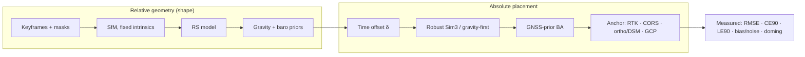
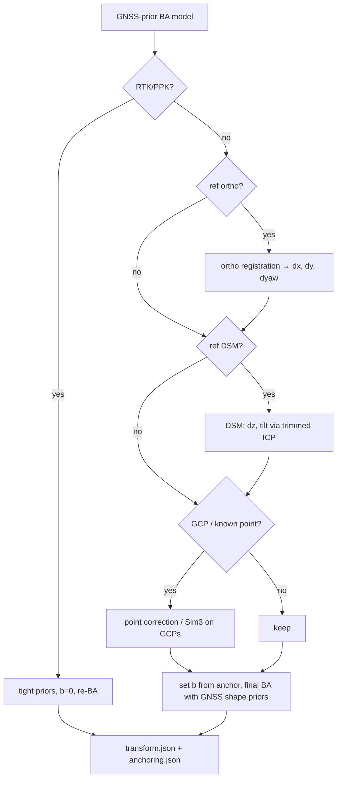

# 06 · Georeferencing and Accuracy

> **Purpose:** the maths, algorithms and reporting rules that turn a relative SfM model from one drone video pass into a **measured**, georeferenced product — Drishti3D's core differentiator (stages S0-sync, S3 priors, S4, S9).
>
> **Status:** Draft v1.0 · 2026-09-30 · Owner: R2 (Geo & Accuracy Lead), reviewers R1, R3

---

## 0. Conventions

- **Sourced numbers** carry a link to the source collected in `reports/Single pass drone 3D reconstruction.md` / `research_notes/…/georeferencing_and_accuracy.md`. Items that the research notes flag as abstract/snippet-level are marked *(snippet)*.
- **(ours)** marks a derivation, algorithm or number that is our own engineering work, not a published result. **(estimate)** marks a magnitude we expect but have not measured — every one of them is a test item in [`11-testing-and-evaluation.md`](11-testing-and-evaluation.md).
- Notation: bold lower-case = vector, bold upper-case = matrix; $\mathbf C_i$ camera centre, $\mathbf R_i$ world→camera rotation, $s$ scale, $t$ time, $\delta$ video↔telemetry time offset, $\mathbf g(t)$ GNSS antenna position, $\sigma$ standard deviation, $\mu$ mean (bias).
- Stage IDs and module names follow [`00-project-charter.md`](00-project-charter.md): S0 `drishti.ingest.timesync`, S3 `drishti.sfm.priors` / `rolling_shutter`, S4 `drishti.georef.{align,register,corrections,crs}`, S9 `drishti.qa.{accuracy,doming,confidence,report}`.

## 1. Why georeferencing is the core problem

The accuracy literature points to one controlling fact: **absolute error comes almost entirely from georeferencing, not from reconstruction.** Zhang et al. flew at 45 m with 16 checkpoints and on-board single-point GPS only: RMSE was **2.29 m horizontal and 3.93 m vertical**, but the vertical error had mean 3.927 m and standard deviation only **0.18 m** — the model's shape was nearly perfect and simply displaced. A GoPro showed the same: XY RMSE 1.53 m with SD 0.065 m. With **PPK and zero GCPs** the same study reached **XY 2.4 cm, Z 2.2 cm**, statistically equal to an 8-GCP solution ([Zhang et al. 2019](https://esurf.copernicus.org/preprints/esurf-2019-2/esurf-2019-2.pdf)).

A 2026 study built Gaussian splats directly from UAV video frames with GNSS metadata: 4.8 mm ICP RMS internal consistency, but **5.26 m CE90** absolute ([T&F 2026](https://www.tandfonline.com/doi/abs/10.1080/19479832.2026.2661679), snippet).

Consequences for Drishti3D:

1. **Relative** metrics (lengths, areas, volumes) are achievable from consumer GNSS; we report them separately.
2. **Absolute** ≤ 1 m needs one extra anchor (reference ortho/DSM, CORS/GAGAN, RTK/PPK, or a known point) — §11.
3. Single-pass video adds **systematic** errors (time offset, rolling shutter, doming, roll-about-track) that bend or tilt the model and are *not* removed by a rigid anchor — §5–8 remove them before anchoring.



---

## 2. Coordinate systems and heights

### 2.1 Frames used in the pipeline

| Frame | Definition | Used for |
|---|---|---|
| **WGS84 geographic 3D** (EPSG:4979) | lat φ, lon λ, ellipsoidal height h | telemetry storage, KLV, RTK |
| **ECEF** (EPSG:4978) | Earth-centred Cartesian, metres | 3D Tiles root transform |
| **Local ENU** | tangent plane at trajectory centroid $(\varphi_0,\lambda_0,h_0)$, metres, double precision | SfM priors, BA, alignment, all internal geometry |
| **UTM zone N** (EPSG:32642–32647 for India, zones 42N–47N) | projected E, N (m) + height | output rasters, LAS, reports |
| **Orthometric heights** | EGM2008 (EPSG:3855) or EGM96 (EPSG:5773) | output variant for users who expect "MSL" heights |

Rules (ours): (1) all internal maths in local ENU — COLMAP/Ceres on raw UTM (≈ 10⁶ m) coordinates lose float precision; (2) one output CRS per run, chosen from the centroid's UTM zone, even if the flight crosses a zone boundary; (3) every file carries its horizontal **and** vertical CRS explicitly; (4) PROJ geoid grids (e.g. `us_nga_egm08_25.tif`) are bundled in the Docker image so transforms work **offline** (charter principle 4).

ENU from ECEF: $\mathbf x_{\text{ENU}} = \mathbf R_{\text{ENU}}(\varphi_0,\lambda_0)\,(\mathbf x_{\text{ECEF}} - \mathbf x_{0,\text{ECEF}})$ with

$$\mathbf R_{\text{ENU}} = \begin{bmatrix} -\sin\lambda_0 & \cos\lambda_0 & 0\\ -\sin\varphi_0\cos\lambda_0 & -\sin\varphi_0\sin\lambda_0 & \cos\varphi_0\\ \cos\varphi_0\cos\lambda_0 & \cos\varphi_0\sin\lambda_0 & \sin\varphi_0 \end{bmatrix}.$$

(Implemented with `pyproj` pipelines `+proj=cart` and `+proj=topocentric`, never hand-rolled in production.)

### 2.2 Ellipsoidal vs orthometric heights

$$H_{\text{orthometric}} = h_{\text{ellipsoidal}} - N(\varphi,\lambda)$$

where $N$ is the geoid undulation from a geoid model (EGM96 or EGM2008). Over India $N$ is of the order of **several tens of metres** and varies across the country — so mixing $h$ and $H$ is a **tens-of-metres blunder**, far larger than every other error in this document. EGM96 and EGM2008 also differ from each other (up to metre level in rugged terrain — estimate); the run records which model was used. Checkpoints surveyed by Survey of India / CORS workflows may be delivered in orthometric heights on a national datum — the S9 loader requires the checkpoint file to declare its vertical datum and converts explicitly.

### 2.3 DJI telemetry height pitfalls

| Field | What it is (as far as we can establish) | Trust |
|---|---|---|
| `latitude`, `longitude` | consumer GNSS (single point, possibly SBAS) | horizontal: metre-level bias (§4) |
| `rel_alt` | height relative to the take-off point, barometer-dominated, smooth | **good for relative height** (short-term), drifts slowly |
| `abs_alt` | "absolute" altitude; reference surface (MSL/EGM96 vs ellipsoid, baro-fused vs GNSS) **varies by model/firmware** and no authoritative DJI specification was found | **do not trust without a per-model test** |
| `focal_len`, `dzoom` | lens focal length / digital zoom | used to split camera groups |
| gimbal yaw/pitch/roll (some models) | stabilised gimbal attitude | gravity prior, footprints |
| timestamp | local time, **no timezone** ([ScienceDirect 2025](https://www.sciencedirect.com/science/article/abs/pii/S2352938525003544)) | never used for sync |

SRT formats differ between DJI models ([ODM releases](https://github.com/OpenDroneMap/ODM/releases)), and no study measured SRT-to-exposure latency ([research notes §2 gaps](../research_notes/Single%20pass%20drone%203D%20reconstruction/georeferencing_and_accuracy.md)). For KLV (MISB ST 0601), sensor true altitude (MSL) and sensor ellipsoid height (HAE) are separate tags; prefer HAE when present.

### 2.4 Vertical strategy (ours)

$$h_i = h_{\text{takeoff}} + \texttt{rel\_alt}_i$$

with $h_{\text{takeoff}}$ from, in order of preference: (1) a user-supplied take-off point height, (2) RTK/PPK height, (3) reference DSM height at the take-off lat/lon (+ $N$ if the DSM is orthometric) plus the drone's standing height, (4) median over the flight of the GNSS ellipsoidal height minus `rel_alt` (when the source provides ellipsoidal heights), (5) `abs_alt` converted per the model table. The chosen source and its σ are written to `transform.json`. The vertical *bias* that remains is removed by anchoring (§11) or reported (§13).

---

## 3. Measurement model (ours)

The GNSS antenna position logged at telemetry time $t$ relates to the camera pose at exposure time as

$$\mathbf g\big(t_i + \delta\big) = \mathbf C_i^{w} + \mathbf R_i^{w\top}\boldsymbol\ell + \mathbf b(t_i) + \mathbf n_i,$$

$$\mathbf C_i^{w} = s\,\mathbf R_w\,\mathbf C_i + \mathbf t_w \quad (\text{Sim(3) from SfM frame to ENU})$$

- $\delta$: time offset between video PTS and telemetry clock (§5);
- $\boldsymbol\ell$: lever arm antenna→camera in the camera/body frame (Zhang et al. used 22.5 cm);
- $\mathbf b(t)$: slowly varying GNSS bias (multipath, ionosphere, orbit/clock) — nearly constant over a 10-min pass ([Zhang et al. 2019](https://esurf.copernicus.org/preprints/esurf-2019-2/esurf-2019-2.pdf) SDs are ≪ means);
- $\mathbf n_i$: fast noise, temporally correlated;
- image observations are additionally affected by rolling shutter (§6) and lens model error (§7).

Everything in S3–S4 is estimation of $(s,\mathbf R_w,\mathbf t_w,\delta,\boldsymbol\ell,\tau,\mathbf b)$ plus the SfM unknowns, with the observability caveats in §5.4 and §8.

---

## 4. Error budget

| # | Source | Typical magnitude (sourced unless marked) | Nature | Effect on product | Mitigation (stage) | Residual after mitigation (estimate) |
|---|---|---|---|---|---|---|
| 1 | **GNSS bias** (consumer, uncorrected) | 2.29 m H, 3.93 m V RMSE, Z SD only 0.18 m ([Zhang 2019](https://esurf.copernicus.org/preprints/esurf-2019-2/esurf-2019-2.pdf)) | near-rigid offset | absolute position | anchoring (S4 §11) | = anchor accuracy (0.03–1.5 m by option) |
| 2 | **GNSS noise** (time-varying) | per-fix metre-level (estimate); model residual SD 0.065 m XY (GoPro, Zhang) after SfM averaging | correlated noise | scale, rotation, strip bending | many fixes, 1-Hz subsampling, Huber, BA priors (S3/S4) | scale ≲ 0.1 % on long paths; see §12 |
| 3 | **Time offset × speed** | error = $v\delta$: 10 m/s × 100 ms = 1 m (ours); cm-level DG needs < 1 ms sync ([ResearchGate](https://www.researchgate.net/publication/311555608_Time_synchronization_of_consumer_cameras_on_Micro_Aerial_Vehicles), snippet) | along-track bias + distortion when speed changes | shift, local stretch | velocity cross-correlation (S0/S4, §5) | ≈ 0.05–0.2 m at 10 m/s (σ_δ ≈ 5–20 ms) |
| 4 | **Rolling shutter** | readout 74 ms (Phantom 2 Vision+), 30 ms (Inspire 1); ≈10 px / 4 px shift at 8 m/s, 70 m ([Vautherin 2016](https://isprs-annals.copernicus.org/articles/III-3/139/2016/isprs-annals-III-3-139-2016.pdf)) | systematic per image, speed-dependent | biased poses, checkpoint error | RS model in BA (S3.5, §6) | sub-pixel |
| 5 | **Lens calibration / doming** | metre-magnitude dome in simulation, ≈0.2 m real ([James & Robson 2014](https://discovery.ucl.ac.uk/id/eprint/1443475/1/esp3609.pdf)) | smooth low-order height deformation | DSM bowl | fixed pre-calibrated K, oblique frames (§7) | 10–100× reduction (J&R) → ≤ 0.2 m / km target |
| 6 | **Roll about track** (straight strip) | $\Delta z = w\,\varepsilon$: 0.5° × 100 m half-swath = 0.87 m (ours) | tilt | cross-track height ramp | gravity priors, gravity-first alignment, DSM anchoring (§8) | ≤ 0.1° → ≤ 0.2 m at 100 m |
| 7 | **Lever arm** | 0.1–0.3 m (22.5 cm in Zhang) | attitude-dependent offset | small bias | apply $\mathbf R_i^\top\boldsymbol\ell$ per image | mm–cm |
| 8 | **Compression / blur** | 0.3–1 px feature noise (estimate); 4K ≈ 8 MP vs 20 MP stills ([PhotoModeler](https://www.photomodeler.com/tip-47-extract-stills-from-video-for-photogrammetry/)) | noise | precision, completeness | sharpness keyframing, ALIKED | small vs other terms |
| 9 | **Height datum mix-up** | tens of metres (§2.2) | blunder | vertical | explicit CRS discipline | 0 (if tests pass) |
| 10 | **abs_alt semantics** | unknown, model-dependent | blunder/bias | vertical | rel_alt + take-off height (§2.4) | → absorbed by vertical anchor |
| 11 | **Checkpoint survey error** | RTK rover ≈ 2–3 cm (estimate) | noise in the *truth* | inflates measured RMSE | ASPRS: checkpoints ≥ 2× more accurate than product | combined per §13.1 |

**Take-away (ours):** after §5–8, the budget for an anchored product is dominated by the anchor (row 1) and the reference data; for GNSS-only it is dominated by the bias. That is why §11 ranks anchors and §13 reports bias and noise separately.

---

## 5. Video ↔ GNSS time-offset estimation

### 5.1 Why it matters (ours)

If telemetry lags the frames by $\delta$, the prior assigned to frame $i$ is $\mathbf g(t_i+\delta) \approx \mathbf g(t_i) + \mathbf v(t_i)\,\delta$. Error magnitude is $\|\mathbf v\|\,|\delta|$ — 1 m at 10 m/s and 100 ms, far above the < 1 ms needed for cm-level direct georeferencing ([ResearchGate](https://www.researchgate.net/publication/311555608_Time_synchronization_of_consumer_cameras_on_Micro_Aerial_Vehicles), snippet). DJI's own RTK airframes solve this in hardware with "TimeSync" ([DJI P4 RTK whitepaper](https://docs.djicdn.com/DJI+Enterprise/measurement-accuracy-dji-phantom-4-rtk-whitepaper-f[1].pdf)); plain SRT video has no such guarantee and its latency has never been publicly measured.

### 5.2 Estimator (ours)

After a provisional robust Sim(3) (§9) computed with $\delta_{\text{coarse}}$ from S0, SfM camera centres $\mathbf C_i^{w}$ are in ENU metres. Both trajectories are resampled to a common 10 Hz grid with smoothing splines, and differentiated:

$$\mathbf v_{\text{sfm}}(t) = \dot{\mathbf C}^{w}(t), \qquad \mathbf v_{\text{gnss}}(t) = \dot{\mathbf g}(t).$$

The time offset maximises the summed normalised cross-correlation of the **high-passed** velocity components (high-pass = subtract a 20-s moving average, so only accelerations, turns and altitude changes carry information):

$$\hat\delta = \arg\max_{\delta\in[\delta_c - \Delta,\,\delta_c+\Delta]} \sum_{a\in\{E,N,U\}} w_a\,\operatorname{NCC}\big(\tilde v_{\text{sfm},a}(t),\,\tilde v_{\text{gnss},a}(t+\delta)\big)$$

with $w_a \propto$ variance of $\tilde v_{\text{gnss},a}$, search half-width $\Delta$ = 2 s (fast) / 3 s (quality), step = one video frame (33.4 ms at 29.97 fps). NCC is invariant to residual scale error, so a slightly wrong provisional scale does not bias $\hat\delta$.

**Sub-frame refinement.** With correlation values $c_{-1}, c_0, c_{+1}$ at the best step $\delta_k$ and step $h$, fit a parabola:

$$\hat\delta = \delta_k + \frac{h}{2}\,\frac{c_{-1} - c_{+1}}{c_{-1} - 2c_0 + c_{+1}}.$$

**Final polish.** Golden-section search on $[\hat\delta - h, \hat\delta + h]$ minimising the robust Sim(3) residual $\sum_i \rho\big(\|\mathbf g(t_i+\delta) - (s\mathbf R\mathbf C_i + \mathbf t)\|\big)$ (Umeyama re-solved per evaluation; each costs < 1 ms). The polished $\hat\delta$ is then **fixed** in the final BA (§10); optionally (quality) $\delta$ is left free in the BA with a prior $\mathcal N(\hat\delta, \sigma_\delta^2)$.

### 5.3 Pseudocode

```python
def estimate_time_offset(C_sfm, t_kf, gnss_spline, delta_c, half=2.0, h=1/29.97):
    sim3 = robust_sim3(C_sfm, gnss_spline(t_kf + delta_c))           # §9
    Cw = sim3.apply(C_sfm)
    grid = np.arange(t_kf[0] + half, t_kf[-1] - half, 0.1)             # 10 Hz
    v_sfm = spline(t_kf, Cw).derivative()(grid)
    hp = lambda x: x - moving_average(x, 20.0, fs=10)
    deltas = delta_c + np.arange(-half, half + 1e-9, h)
    c = [sum(w[a] * ncc(hp(v_sfm[:, a]), hp(gnss_spline.derivative()(grid + d)[:, a]))
             for a in range(3)) for d in deltas]
    k = int(np.argmax(c)); d_hat = parabolic(deltas, c, k)
    d_hat = golden_section(lambda d: robust_sim3_cost(C_sfm, gnss_spline(t_kf + d)),
                           d_hat - h, d_hat + h, tol=1e-3)
    sharpness = -(c[k-1] - 2*c[k] + c[k+1]) / h**2                     # curvature → confidence
    return d_hat, c[k], sharpness
```

### 5.4 Observability and uncertainty (ours)

Linearising, the prior residual derivative w.r.t. $\delta$ is $\mathbf v_i$. A *constant* velocity changes all residuals by the same vector, which the alignment absorbs as a translation. Hence only the **variation** of velocity makes $\delta$ observable:

$$\sigma_\delta^2 \approx \frac{\sigma_g^2}{\sum_i \|\mathbf v_i - \bar{\mathbf v}\|^2}.$$

*Example:* $\sigma_g$ = 1 m effective noise, 60 effectively independent samples, velocity variation SD 2 m/s → $\sigma_\delta \approx 1/\sqrt{60\cdot 4} \approx 0.065$ s. A perfectly constant-speed straight line gives $\sigma_\delta\to\infty$: the time offset then equals an **along-track bias**, which is invisible to GNSS alignment but removed by an anchor (§11). The flight guide ([12](12-flight-and-data-capture-guide.md)) therefore asks for one gentle speed change or S-turn at the start of the pass — cheap observability.

**Gates:** peak NCC ≥ 0.6 and curvature above threshold → `observable`; else δ stays at δ_coarse (or 0) and the along-track σ in the report is inflated by $v_{\max}\cdot 0.2$ s (estimate).

---

## 6. Rolling shutter

### 6.1 Evidence

Pix4D's Vautherin et al. measured readout **≈ 74 ms on a Phantom 2 Vision+ (DJI: 73 ms) and ≈ 30 ms on an Inspire 1 (DJI: 33 ms)**; at 8 m/s and 70 m AGL this displaced image content by ≈10 px and ≈4 px; modelling RS removed systematic reprojection error and significantly improved checkpoint accuracy; global shutter was still better ([Vautherin et al. 2016](https://isprs-annals.copernicus.org/articles/III-3/139/2016/isprs-annals-III-3-139-2016.pdf)). Other reports cite planimetric 3.89 → 2.9 cm at 8 m/s and 30–60 % 3D improvement in blocks, 15–25 % in corridors (snippet-level). ODM ships per-model RS readout values for DJI Mini 3/4 Pro and Mavic 3 ([ODM releases](https://github.com/OpenDroneMap/ODM/releases)).

### 6.2 Model (ours, following the linearised form used in the literature)

Row $r$ (of $h$ rows) of image $i$ is exposed at

$$t_i(r) = t_i + \tau\left(\frac{r}{h} - \frac12\right)\qquad(\text{mid-exposure reference}),$$

and, to first order over the ≤ 0.1 s readout,

$$\mathbf C_i(r) = \mathbf C_i + \mathbf v_i\,\Delta t_r,\qquad \mathbf R_i(r) = \exp\!\big([\boldsymbol\omega_i]_\times\Delta t_r\big)\,\mathbf R_i,\qquad \Delta t_r = t_i(r) - t_i.$$

Projection: $\mathbf x = \pi\big(\mathbf K, \mathbf R_i(r)(\mathbf X - \mathbf C_i(r))\big)$. Because $r$ depends on the projection itself, we iterate: project with the global-shutter pose → read $r_0$ → project with pose at $r_0$ → $r_1$ (one or two iterations converge to sub-pixel). $\mathbf v_i$ and $\boldsymbol\omega_i$ are initialised from finite differences of neighbouring keyframe poses (keyframes ~1–1.5 s apart; the gimbal keeps $\boldsymbol\omega$ small) and refined with weak priors; $\tau$ is one global parameter per camera.

### 6.3 When to enable (ours)

Predicted image shift from translation and rotation during readout:

$$\Delta_{px} \approx \underbrace{\frac{f\,v\,\tau}{H}}_{\text{translation}} + \underbrace{f\,\|\boldsymbol\omega\|\,\tau}_{\text{rotation}}$$

*Example:* 4K, $f \approx 2209$ px, $v$ = 10 m/s, $H$ = 100 m, $\tau$ = 30 ms (assumed) → translation term ≈ 6.6 px; a 10°/s yaw adds $2209 \times 0.1745 \times 0.03 \approx 11.6$ px — **yaw during readout is worse than forward speed**. Rule: enable RS when $\Delta_{px} > 0.5$ px (fast) / 0.3 px (quality); in practice almost always on for consumer drones.

### 6.4 Getting τ

1. Per-camera table (Vautherin values, ODM table, our own measurements) — keyed by SRT/EXIF model and **video mode** (readout in video modes can differ from stills and cannot exceed the frame period; 4K30 ≤ 33 ms).
2. **Lab measurement (ours):** record in the flight's video mode while the gimbal yaws at a known constant rate $\omega$ past a vertical edge (pole, door frame). The edge appears slanted with horizontal shift $\Delta x$ px across the full image height: $\tau = \Delta x / (f\,\omega)$.
3. **Self-calibration in BA:** $\tau$ free with prior $30 \pm 15$ ms (estimate) — observable when speed and yaw rate vary (Vautherin note that drone velocity can even be estimated from the RS effect alone).

---

## 7. Intrinsics strategy and doming

### 7.1 The mechanism

James & Robson showed that self-calibrating bundle adjustment on near-parallel (nadir) image networks "will not be able to derive radial lens distortion accurately", producing a **dome/bowl DEM deformation**: metre-magnitude in simulation without control, ≈0.2 m in a real self-calibrated network (K1 = 2.2×10⁻⁶ mm⁻²). Adding a second set of flight lines at a different azimuth did **not** help much; varying pointing direction/altitude did; **20–30° oblique images cut DEM deformation by one to two orders of magnitude**; **fixing K1 to a doming-free value gave a ten-fold reduction** ([James & Robson 2014](https://discovery.ucl.ac.uk/id/eprint/1443475/1/esp3609.pdf)). Newer guidance: oblique images at 20–45° making up ≥ 10 % of the block ([Drones 2025, 9(6), 387](https://doi.org/10.3390/drones9060387), snippet). A pre-calibrated camera with GNSS-assisted orientation and **no GCPs** reached 5.9/3.3/7.0 cm (X/Y/Z) on a 1,200 × 180 m corridor ([Sensors 2018](https://www.ncbi.nlm.nih.gov/pmc/articles/PMC6163762/), snippet).

### 7.2 Why a wrong K1 makes a dome (ours, first-order)

Radial distortion in normalised image coordinates: $r_d = r(1 + k_1 r^2)$. A calibration error $\Delta k_1$ moves a point radially by $\delta r = \Delta k_1 r^3$. For a nadir camera at height $H$ above a ground point at planimetric distance $\rho$ from the nadir, $r = \rho/(H - z)$, so $\partial r/\partial z = r/(H-z)$. With parallel views, the adjustment can explain the radial error as a height change:

$$\delta z \approx \frac{\delta r}{\partial r/\partial z} = \Delta k_1\,r^2\,(H - z) \approx \Delta k_1\,H\,r^2 .$$

The error is **quadratic in image radius** — identical in every image — so over the block it integrates into a smooth quadratic surface: the dome. *Example:* $\Delta k_1$ = 0.005 (normalised), $H$ = 100 m, image-edge radius $r$ = 0.5 → $\delta z \approx 0.125$ m; a mis-estimate 4× larger gives 0.5 m. (Convert J&R's mm⁻² units: $k_{1,\text{norm}} = k_{1,\text{mm}}\,f_{\text{mm}}^2$.) Oblique or altitude-varied views give each ground point different $r$ and $H$, which breaks the ambiguity — that is why they work.

### 7.3 Our policy

| Step | Action |
|---|---|
| 1. Pre-calibrate (preferred) | Checkerboard/ChArUco in the **same video mode** (resolution, fps, FOV/crop, **EIS/dewarp settings**) — ≥ 30 views covering corners, tilted ±45°, OpenCV `calibrateCamera` with `OPENCV` model; accept if RMS < 0.3 px and a held-out-view reprojection < 0.5 px. Store `calib/<model>_<mode>.yaml` with covariance. |
| 2. In-flight calibration (alternative) | 60-s convergent orbit at 30–45° oblique over textured ground before the pass; self-calibrate full `OPENCV` model there; freeze for the pass. |
| 3. Single pass | **Fix** fx, fy, cx, cy, k1, k2, p1, p2 in all BAs (S3 flags `ba_refine_* = 0`). |
| 4. Uncalibrated fallback | Refine focal only (prior from SRT `focal_len`/EXIF, σ = 2 %), k1/k2 fixed at 0 or table values; refine k1 **only if** ≥ 10 % of keyframes are ≥ 20° oblique or altitude varies ≥ 20 % of AGL. |
| 5. Verify | Doming test (§13.5) on every real flight with reference DSM/LiDAR. |

Electronic image stabilisation that warps each frame differently invalidates any fixed model — the capture guide requires EIS off (or a documented, constant dewarp).

---

## 8. Strip degeneracy (roll about the track axis)

### 8.1 The problem (derived inference, flagged as such in the report)

For a straight pass the GNSS camera centres $\mathbf y_i$ are (nearly) **collinear**. In the similarity alignment (§9) the cross-covariance $\boldsymbol\Sigma_{xy} = \frac1N\sum_i (\mathbf y_i - \bar{\mathbf y})(\mathbf x_i - \bar{\mathbf x})^\top$ then has rank 1: with direction $\mathbf d$ of the line, $\boldsymbol\Sigma_{xy} \approx \sigma^2\,\mathbf d_y\mathbf d_x^\top$. Two singular values are ~0, so **any rotation about the track axis** fits the positions equally well. Rotation about the track is exactly the model's **cross-track tilt** — it produces a height ramp $\Delta z = w\,\varepsilon$ across a half-swath $w$ (0.5° at 100 m → 0.87 m). The same weakness exists inside BA when GNSS priors are the only absolute information. (The report notes this is a derived inference, not a sourced result.)

Degeneracy indicator: singular values $\sigma_1\ge\sigma_2\ge\sigma_3$ of the centred GNSS positions; `collinear` if $\sigma_2/\sigma_1 < 0.05$.

### 8.2 Remedies (in pipeline order)

1. **Gravity priors** from the gimbal (stabilised to the horizon; SRT pitch/roll where logged) or IMU: each camera's up-vector in the camera frame is known to ~1–2° (estimate) → gravity term in BA (§10) and **gravity-first alignment** (§9.3).
2. **Altitude variation** along the pass (even ±10 m) and **20–30° forward-oblique gimbal** add non-collinearity and also cure doming — asked for in [12](12-flight-and-data-capture-guide.md).
3. **Curved path / S-turn** at the start or end.
4. **DSM anchoring** (§11.3) directly measures cross-track tilt against the reference surface.
5. **Terrain-level prior** (weak, last resort): the mean normal of large flat ground (roads, fields) ≈ up; used only with low weight, never on hilly terrain.

The residual tilt after remedies is estimated from the BA covariance and reported as a cross-track height uncertainty.

---

## 9. Robust 7-DoF alignment (Umeyama + RANSAC + Huber)

### 9.1 Closed form (Umeyama 1991; derivation summarised)

Find $s, \mathbf R \in SO(3), \mathbf t$ minimising $E = \sum_i w_i\|\mathbf y_i - (s\mathbf R\mathbf x_i + \mathbf t)\|^2$ ($\mathbf x_i$ SfM centres, $\mathbf y_i$ GNSS ENU at $t_i+\delta$).

1. Setting $\partial E/\partial\mathbf t = 0$ gives $\mathbf t = \bar{\mathbf y} - s\mathbf R\bar{\mathbf x}$ with weighted means $\bar{\mathbf x} = \frac{\sum w_i\mathbf x_i}{W}$, $\bar{\mathbf y} = \frac{\sum w_i\mathbf y_i}{W}$.
2. Substituting, with centred $\mathbf x_i', \mathbf y_i'$: $E = \sum w_i\|\mathbf y_i'\|^2 - 2s\,\operatorname{tr}(\mathbf R^\top \mathbf M) + s^2\sum w_i\|\mathbf x_i'\|^2$, where $\mathbf M = \sum_i w_i \mathbf y_i'\mathbf x_i'^\top = W\boldsymbol\Sigma_{xy}$.
3. For any $s>0$, maximise $\operatorname{tr}(\mathbf R^\top\mathbf M)$ over rotations: with SVD $\boldsymbol\Sigma_{xy} = \mathbf U\mathbf D\mathbf V^\top$, the optimum is $\mathbf R = \mathbf U\mathbf S\mathbf V^\top$, $\mathbf S = \operatorname{diag}(1, 1, \det(\mathbf U)\det(\mathbf V))$ (the sign fix prevents reflections).
4. $\partial E/\partial s = 0$ gives $s = \dfrac{\operatorname{tr}(\mathbf D\mathbf S)}{\sigma_x^2}$, $\sigma_x^2 = \frac1W\sum w_i\|\mathbf x_i'\|^2$.

### 9.2 Robustification (ours)

- **Subsample** GNSS/keyframes to ≈ 1 Hz (consumer GNSS errors are temporally correlated; more samples add little information but more outliers).
- **RANSAC** over minimal sets of 3 correspondences, rejecting samples whose triangle area < 5 % of $(\text{path length})^2/100$ (near-collinear samples are degenerate); inlier if the Mahalanobis residual $\mathbf r^\top\Sigma^{-1}\mathbf r < 3^2$ with $\Sigma = \operatorname{diag}(\sigma_h^2,\sigma_h^2,\sigma_v^2)$.
- **IRLS with Huber** on the inliers: weights $w_i = \min\big(1, k/\|\mathbf r_i\|_\Sigma\big)$, $k = 1.345$, 10 iterations of weighted Umeyama.
- **Anisotropic polish**: Umeyama is isotropic; the final estimate is refined by Levenberg–Marquardt on $\sum_i \rho_H(\mathbf r_i^\top\Sigma^{-1}\mathbf r_i)$ over the 7 parameters (Ceres/SciPy), initialised from IRLS.

### 9.3 Gravity-first 5-DoF alignment for straight strips (ours)

When `collinear` (§8.1): first rotate the SfM frame so that its estimated up-vector $\hat{\mathbf u}$ (mean of per-camera gravity directions from gimbal pitch/roll, expressed in the SfM frame) maps to $\mathbf e_z$: $\mathbf R_g = \text{rot}(\hat{\mathbf u}\to\mathbf e_z)$. The remaining unknowns are yaw $\psi$, scale $s$, translation $\mathbf t$ — well-posed for a line that is not vertical. Solve yaw and scale by 2-D Umeyama on the horizontal components, then $t_z$ and optionally a separate vertical scale check against baro heights:

$$\min_{\psi,s,\mathbf t}\sum_i w_i\big\|\mathbf y_i - (s\,\mathbf R_z(\psi)\,\mathbf R_g\,\mathbf x_i + \mathbf t)\big\|_\Sigma^2 .$$

### 9.4 Pseudocode

```python
def robust_sim3(X, Y, Sigma, gravity_up=None, iters=1000, rng=np.random.default_rng(0)):
    X, Y = subsample_1hz(X, Y)
    collinear = sv_ratio(Y) < 0.05
    if collinear and gravity_up is not None:
        Rg = rot_a_to_b(gravity_up, [0, 0, 1])
        return gravity_first_5dof(Rg @ X.T, Y, Sigma) @ Rg        # §9.3
    best, best_inl = None, []
    for _ in range(iters):
        idx = rng.choice(len(X), 3, replace=False)
        if tri_area(Y[idx]) < area_min: continue
        T = umeyama(X[idx], Y[idx])
        inl = [i for i in range(len(X)) if mahal(Y[i] - T(X[i]), Sigma) < 9.0]
        if len(inl) > len(best_inl): best, best_inl = T, inl
    w = np.ones(len(best_inl))
    for _ in range(10):                                            # Huber IRLS
        T = umeyama(X[best_inl], Y[best_inl], w)
        r = np.array([np.sqrt(mahal(Y[i] - T(X[i]), Sigma)) for i in best_inl])
        w = np.minimum(1.0, 1.345 / np.maximum(r, 1e-9))
    return lm_refine_sim3(T, X[best_inl], Y[best_inl], Sigma, loss="huber")
```

---

## 10. GNSS as a soft prior in bundle adjustment

### 10.1 Cost function (ours; implemented in `pyceres` on the pycolmap reconstruction)

$$
\begin{aligned}
E(\Theta) =\;& \sum_{(i,j)\in\mathcal O} \rho_{1}\!\left(\frac{\big\|\pi_{\text{RS}}(\mathbf K,\mathbf R_i,\mathbf C_i,\mathbf v_i,\boldsymbol\omega_i,\tau;\mathbf X_j) - \mathbf x_{ij}\big\|^2}{\sigma_{px}^2}\right) &&\text{(reprojection)}\\
+\;& \sum_{i} \rho_{2}\!\left(\mathbf r_i^\top\Sigma_{g,i}^{-1}\mathbf r_i\right),\quad \mathbf r_i = \mathbf C_i + \mathbf R_i^\top\boldsymbol\ell + \mathbf b - \mathbf g(t_i+\delta) &&\text{(GNSS)}\\
+\;& \sum_i \frac{\|\mathbf R_i^{\top}\mathbf e_z\times \mathbf u_i^{\text{gimbal}}\|^2}{\sigma_{\text{grav}}^2} &&\text{(gravity)}\\
+\;& \sum_{(i,i+1)} \frac{\big((C_{i+1,z}-C_{i,z}) - (a_{i+1}-a_i)\big)^2}{\sigma_{\text{baro}}^2} &&\text{(baro increments)}\\
+\;& \sum_i \frac{\|\mathbf v_i - \mathbf v_i^{0}\|^2}{\sigma_v^2} + \frac{\|\boldsymbol\omega_i - \boldsymbol\omega_i^{0}\|^2}{\sigma_\omega^2} + \frac{(\tau-\tau_0)^2}{\sigma_\tau^2} + \frac{\|\boldsymbol\ell-\boldsymbol\ell_0\|^2}{\sigma_\ell^2} &&\text{(RS / lever priors)}
\end{aligned}
$$

Here the reconstruction is already in ENU (after §9), so the Sim(3) is absorbed into the poses. $\mathbf u_i^{\text{gimbal}}$ is the world up-vector expressed in camera $i$'s frame as predicted from gimbal pitch/roll; $a_i$ = `rel_alt`.

### 10.2 Weights (defaults; per-sample from quality flags)

| Term | σ (consumer GNSS) | σ (RTK fix) | Robust loss |
|---|---|---|---|
| Reprojection $\sigma_{px}$ | 1.0 px | 1.0 px | Huber 1 (fast) / Cauchy 1 (quality) |
| GNSS horizontal / vertical | 1.5 m / 3.0 m | 0.03 m / 0.05 m | Huber at 2σ |
| Gravity | 2° (fast) / 1° (quality) | same | none |
| Baro increment (consecutive keyframes) | 0.3 m (estimate) | — (RTK height better) | Huber |
| RS velocity priors | 1 m/s, 5°/s | same | none |
| Readout $\tau$ | 15 ms (unless table value: 2 ms) | same | none |
| Lever arm | 0.05 m (measured) | 0.01 m | none |

### 10.3 The bias term $\mathbf b$ (ours)

With consumer GNSS and no anchor, $\mathbf b$ is **not estimable** (it is indistinguishable from a translation of the whole model), so it is held at 0: the model lands where the GNSS says — biased by 2–4 m — and the report says so. When an anchor exists (§11), $\mathbf b$ is set to the anchor-derived offset $\hat{\mathbf b} = \overline{\mathbf g - \mathbf C^{\text{anchored}}}$ and held fixed; the GNSS term then continues to constrain **shape** (scale, bending) while the anchor fixes **position**. Treating $\mathbf b$ explicitly is what lets us use biased GNSS and an accurate anchor together without them fighting.

### 10.4 Gauge and conditioning

GNSS priors fix the 7-DoF gauge; no camera is held fixed. Intrinsics are constant parameter blocks. Points with track length < 2 or triangulation angle < 0.5° are excluded from BA (still kept for display). Solver: Ceres `SPARSE_SCHUR` (or `ITERATIVE_SCHUR` for > 2,000 images), 50 iterations, function tolerance 1e-6.

---

## 11. Absolute anchoring options (ranked)

| Rank | Anchor | What it fixes | Expected absolute accuracy | Source / basis | Availability for PS 26158 |
|---|---|---|---|---|---|
| a | **RTK / PPK** camera positions | translation, rotation, scale, bending | **2–5 cm** without GCPs: PPK XY 2.4 cm, Z 2.2 cm ([Zhang 2019](https://esurf.copernicus.org/preprints/esurf-2019-2/esurf-2019-2.pdf)); P4 RTK 1–3 cm H, 4–6 cm V (71 checkpoints, Z RMSE 5.58 cm — [PDF](https://pdfs.semanticscholar.org/5c9e/bad8e2cf3acf82d7a2a7ca7db2312f58b492.pdf), snippet). Our target for video: **≤ 0.10 m CE90** (charter) — video sync/RS add error vs stills (estimate) | sourced + target | optional PS input; RTK airframes' SRT (P4 RTK SRT supported by ODM) |
| b | **Survey of India CORS** (RTK/NRTK ±3 cm) / **GAGAN** SBAS (~1.5 m H, 2.5 m V) | CORS: as (a) when the drone or a PPK workflow uses it; GAGAN: reduces the GNSS bias | CORS: cm-level ([SoI CORS](https://cors.surveyofindia.gov.in/introduction.html)); GAGAN: **~1.5 m H / 2.5 m V** ([Wikipedia GAGAN](https://en.wikipedia.org/wiki/GPS-aided_GEO_augmented_navigation)) — alone does **not** meet ≤ 1 m | sourced | CORS free for govt/academia (~1,000+ stations); needs raw GNSS logs or NRTK-capable receiver — consumer drones usually lack raw logs. CORS is also how we survey **checkpoints/GCPs**. |
| c | **Registration to a reference orthophoto + DSM** | horizontal shift + yaw (ortho), vertical shift + tilt (DSM) | bounded by reference accuracy ⊕ registration error. Defence analogues: Edgybees 1–2 m to satellite imagery ([BAE GXP](https://www.geospatialexploitationproducts.com/third-party-solutions/edgybees/)); Vantor Raptor < 3 m ([Vantor](https://vantor.com/product/mission-solutions/raptor)). Ours: with a sub-metre ortho/DSM, **≤ 1 m CE90/LE90** target (charter); with SVAMITVA-class ortho (±5–12.5 cm spec) expected ≈ 0.2–0.5 m (estimate) | analogue + estimate | needs reference data loaded offline (`--ref-ortho`, `--ref-dsm`); our default "no-hardware" anchor |
| d | **Single known point / GCP** | translation (1 pt); + rotation/scale with ≥ 3 | Zhang: single GPS + 8 GCPs = 2.3 cm XY / 2.6 cm Z; PPK + 1 GCP = 2.3 / 2.9 cm. With consumer GNSS + 1 point: translation error ≈ point accuracy; residual rotation/scale error grows with distance — ≈ 0.1–0.5 m within 1 km (estimate, §12) | sourced + estimate | cheap: one surveyed/known feature (benchmark, road junction from a cadastral map) |
| e | **GNSS only** (fallback) | nothing absolute | ≈ **3.5 m CE90, 6.5 m LE90** (Zhang converted — derived); Mavic Pro: H "< 1 m" best, V "unacceptable" ([Elkhrachy 2021](https://www.sciencedirect.com/science/article/pii/S1110016821002544), snippet); GS-from-video 5.26 m CE90 ([T&F 2026](https://www.tandfonline.com/doi/abs/10.1080/19479832.2026.2661679)) | sourced | always; reported honestly as "expected ~3–7 m CE90" (charter) |

Anchors combine: e.g. (c) for horizontal and (d) for vertical. `georef.anchoring.order` in config (see [08](08-data-formats-and-interfaces.md); default `rtk, gcp, ref_ortho_dsm, corrected_track, gnss_only`) sets the order in which available anchors are *applied* — it differs from the ranking above, which is by expected accuracy of the correction source alone (a surveyed GCP beats GAGAN-level correction); the report lists every anchor used and its residuals.

### 11.1 RTK/PPK ingest

Positions (RTKLIB `.pos` or CSV, GPS time) → interpolate at $t_i + \delta$ (δ still estimated — RTK does not fix *video* sync) → GNSS term with σ from quality flag (fix 3/5 cm, float 30/50 cm, single → drop) → $\mathbf b = 0$ → final BA. Zhang et al. recommend one GCP anyway to catch PPK biases and false fixes; we treat any supplied GCP as a **check**, not a control, unless the check fails.

### 11.2 Reference orthophoto registration (ours)

```python
def register_ortho(our_ortho, ref_ortho, ref_gsd):
    A = resample(our_ortho, ref_ortho.crs, ref_gsd)                 # same CRS & GSD
    B = ref_ortho.window(A.bounds.buffer(50))                       # ±50 m search (GNSS bias)
    # 1. robust to season/illumination: gradient-orientation images + learned matches
    kA, kB, m = aliked_lightglue(grad_image(A), grad_image(B))      # fallback: SIFT on gradients
    S, inl = ransac_similarity_2d(kA[m], kB[m], thresh=2*ref_gsd, scale_bounds=(0.98, 1.02))
    if inl.ratio < 0.2:
        S = mi_register(A, B, init=identity, dof="translation+rotation")   # mutual information
    # 2. sub-pixel polish with ECC (NCC-like) on gradient images
    S = cv2_findTransformECC(grad_image(A), grad_image(B), init=S, motion=MOTION_EUCLIDEAN)
    return S, residual_stats(kA[inl], kB[inl], S)                    # dx, dy, dyaw, σ, n_inliers
```

- Masks: exclude water, vegetation (seasonal), vehicles, and our own low-confidence ortho cells.
- The 2-D similarity scale is **constrained** to ±2 %: the ortho corrects position/yaw; scale comes from GNSS/BA (and is checked against the fitted scale — disagreement > 0.5 % raises a warning).
- Uncertainty: $\sigma_{\text{reg}} \approx \text{RMS(inlier residuals)}/\sqrt{n_{\text{eff}}}$ plus the reference's own stated accuracy, root-sum-squared.

### 11.3 Reference DSM registration (ours)

1. After the horizontal correction, sample both DSMs on **stable ground** cells: our S6-style ground/road class ∧ slope < 15° ∧ not water.
2. **Vertical offset:** $\Delta z = \operatorname{median}(\text{DSM}_{\text{ref}} - \text{DSM}_{\text{ours}})$ (median = robust to changed buildings/vegetation); σ from the MAD.
3. **Tilt / full 6-DoF (quality):** trimmed point-to-plane ICP (Open3D `registration_icp` with Tukey loss, 70 % trimming) of our ground points to the reference DSM surface, with **scale locked** and rotation bounded to ±1°. The tilt about the track axis measured here is the direct cure for §8.
4. Reference-DSM resolution limits what can be estimated: a 30-m global DEM supports only a vertical offset (and only to its own accuracy — e.g. the Copernicus GLO-30 specification is < 4 m absolute vertical LE90; spec value, verify), which does **not** reach ≤ 1 m LE90; a LiDAR/photogrammetric DSM (SVAMITVA, municipal, earlier survey) does.

### 11.4 Known point / GCPs

GCP file (`--gcp gcp.csv`: id, E, N, h or H + CRS, σ) → locate in images (manual picking UI in the viewer or target detection) → triangulate with fixed poses → 3-D residuals → with 1 point: translation; 2 points: + yaw & scale check; ≥ 3 non-collinear: full Sim(3) by §9 with GCP σ; then optional BA with GCP observations. **Never** use the same points as checkpoints.

### 11.5 Anchoring pipeline



---

## 12. Scale accuracy analysis (ours)

Scale drives **relative** accuracy (length error %), so it is analysed separately from translation.

With model $\mathbf y_i = s\mathbf R\mathbf x_i + \mathbf t + \mathbf n_i$, $\mathbf n_i\sim\mathcal N(\mathbf 0,\sigma^2\mathbf I)$ independent and $\mathbf R$ known, the least-squares scale has relative variance

$$\frac{\operatorname{Var}(\hat s)}{s^2} \approx \frac{\sigma^2}{\sum_i\|\mathbf y_i - \bar{\mathbf y}\|^2} = \frac{\sigma^2}{N\,d_{\text{rms}}^2}.$$

For a straight path of length $L$ sampled uniformly, $d_{\text{rms}} = L/\sqrt{12}$, so

$$\sigma_s \approx \frac{\sqrt{12}\,\sigma}{L\sqrt{N_{\text{eff}}}}, \qquad N_{\text{eff}} \approx \frac{T}{2\tau_c}$$

where $T$ is the flight duration and $\tau_c$ the correlation time of the GNSS error (tens of seconds — estimate). **The constant bias does not enter** — only the time-varying part $\sigma$.

| Case | $L$ | $\sigma$ (time-varying) | $N_{\text{eff}}$ | $\sigma_s$ | Error on 100 m |
|---|---|---|---|---|---|
| 10-min pass at 5 m/s | 3,000 m | 2 m | 20 | 0.05 % | 5 cm |
| 10-min pass, milder noise | 3,000 m | 0.5 m | 20 | 0.013 % | 1.3 cm |
| 1-min clip | 300 m | 2 m | 10 | **0.73 %** | 73 cm |
| 1-min clip | 300 m | 0.5 m | 10 | 0.18 % | 18 cm |

The report's rough figure (≈ 0.1 % over 300 m with ~100 independent fixes) is the optimistic, uncorrelated case; correlated errors make short clips the weak spot. It is consistent with DJI's measured 0.1–0.3 % distance agreement for RTK stills ([DJI P4 RTK whitepaper](https://docs.djicdn.com/DJI+Enterprise/measurement-accuracy-dji-phantom-4-rtk-whitepaper-f[1].pdf)); Zhang's GoPro model residual SD of 0.065 m suggests the time-varying part after SfM averaging is small. **Implications:** (1) for short clips the charter's ≤ 0.5 % relative target needs an additional scale source — baro height changes (if altitude varies), a reference ortho (its similarity scale), a known length in the scene, or RTK; (2) S4 reports $\sigma_s$ and the S9 relative-accuracy section states which scale source was used.

---

## 13. Accuracy assessment and reporting

### 13.1 Protocol (ASPRS Positional Accuracy Standards, Edition 2, 2023)

Edition 2 uses **RMSE as the sole accuracy metric** (the 95 % confidence statistics were dropped), requires **≥ 30 checkpoints** (max 120 for very large areas), checkpoints **at least twice as accurate** as the product, and **folds checkpoint survey error into the reported product accuracy**; RMSE_H is the combined radial horizontal error ([LIDAR Magazine](https://lidarmag.com/2023/10/06/the-asprs-positional-accuracy-standards-edition-2/amp/); [ASPRS Ed. 2 main body](https://aagsmo.org/wp-content/uploads/2023/03/ASPRS_PosAcc_Edition2_MainBody.pdf)).

Our procedure:

1. **Checkpoints**: ≥ 30 well-distributed, *independent* (never used in processing) points surveyed with RTK against SoI CORS or a total station; include points **off the strip centreline** (both edges) and along the full length — otherwise tilt and doming go unmeasured. Painted targets sized ≥ 5× ortho GSD.
2. **Measure** each checkpoint on our products (§S9 in [05](05-pipeline-design.md)): E, N from the ortho, height from DSM/dense cloud.
3. **Residuals** $e_{x,k}, e_{y,k}, e_{z,k}$ = product − truth.
4. **Statistics**:
$$\mu_a = \frac1n\sum_k e_{a,k},\quad \sigma_a = \sqrt{\frac{1}{n-1}\sum_k (e_{a,k}-\mu_a)^2},\quad \text{RMSE}_a = \sqrt{\frac1n\sum_k e_{a,k}^2}\quad(a\in\{x,y,z\})$$
$$\text{RMSE}_H = \sqrt{\text{RMSE}_x^2 + \text{RMSE}_y^2}$$
5. **Checkpoint uncertainty** (Ed. 2 idea): $\text{RMSE}_{\text{product}} = \sqrt{\text{RMSE}_{\text{measured}}^2 + \text{RMSE}_{\text{checkpoint survey}}^2}$ — verify the exact expression and wording against the standard's text before the finale.

### 13.2 CE90 / LE90

NTRO-style evaluators expect CE90/LE90 ([Maxar accuracy whitepaper](https://dg-cms-uploads-production.s3.amazonaws.com/uploads/document/file/38/DG_ACCURACY_WP_V3.pdf)):

$$\text{LE90} = 1.6449\,\text{RMSE}_z,\qquad \text{CE90} \approx 2.1460\,\text{RMSE}_{x}\ (\text{RMSE}_x\approx\text{RMSE}_y) = 1.5175\,\text{RMSE}_H .$$

($2.1460/\sqrt2 = 1.5175$.) The circular factor is valid when $\min/\max$ of $\text{RMSE}_x,\text{RMSE}_y \ge 0.6$ ([uw-cryo/groundcontrol PR #30](https://github.com/uw-cryo/groundcontrol/pull/30)); outside that range we report per-axis values and the **empirical** CE90.

These factors assume **zero-mean** normal errors. When a bias dominates (GNSS-only), the formula and the true 90th percentile differ, so we always report both:

- **Formula-based** CE90/LE90 (the convention evaluators compute);
- **Empirical** CE90 = 90th percentile of $\sqrt{e_x^2+e_y^2}$, LE90 = 90th percentile of $|e_z|$, with bootstrap 95 % CI.

### 13.3 Bias-vs-noise decomposition

$$\text{RMSE}_a^2 = \mu_a^2 + \tfrac{n-1}{n}\sigma_a^2 \approx \mu_a^2 + \sigma_a^2 .$$

*Zhang check:* $\mu_z$ = 3.927 m, $\sigma_z$ = 0.18 m → $\sqrt{3.927^2 + 0.18^2}$ = 3.931 m = reported RMSE_Z — **99.8 % of the squared error is bias.** Our report shows, per axis, the fraction $\mu^2/\text{RMSE}^2$: high → "fixable by one anchor"; low → "noise/shape-limited". It also shows the **bias-removed** RMSE (= σ), which is the accuracy achievable after a perfect single-point anchor.

### 13.4 Relative accuracy

- **Length error:** for all checkpoint pairs (or tape/total-station lengths) with true length $\ell$ ≥ 10 m: $\varepsilon = (\hat\ell - \ell)/\ell$ → median, 90th percentile, and absolute error on 20-m lengths (charter: ≤ 0.5 %, ≤ 10 cm on 20 m).
- Truth noise matters for short lengths: $\sigma_\ell \approx \sqrt2\,\sigma_{\text{pt}}$ → 3-cm checkpoints give ≈ 4 cm (0.2 % of 20 m) of pure truth noise; use ≥ 50 m pairs for the headline % figure.
- **Area/volume** checks when a surveyed stockpile/footprint exists.

### 13.5 Doming test procedure

1. Reference surface: LiDAR (MARS-LVIG DJI L1 map — [IJRR](https://journals.sagepub.com/doi/abs/10.1177/02783649241227968)) or a reference DSM; our DSM resampled to the same grid.
2. Difference $d(x,y) = \text{DSM}_{\text{ours}} - \text{DSM}_{\text{ref}}$ on **stable ground** cells only (ground/road class, slope < 15°, not vegetation/buildings/water).
3. Express in strip coordinates: $u$ along-track, $v$ across-track.
4. Remove bias + tilt: fit and subtract a plane $a + b u + c v$ (reported separately — $c$ is the roll-about-track tilt).
5. Fit a low-order polynomial to the remainder: $d'(u,v) = \sum_{p+q\le k} \beta_{pq}u^pv^q$ ($k$ = 2 fast, 3 quality) by robust least squares.
6. **Doming metric** = peak-to-valley of the fitted $d'$ over the strip, and its profile across track (a dome/bowl shows as a parabola in $v$). Target ≤ 0.2 m over 1 km (charter).
7. Diagnostic run: repeat with **free** K1 to demonstrate the effect of our fixed-intrinsics policy (before/after chart for the pitch).

### 13.6 Evaluation datasets

MARS-LVIG (21 downward sequences, 80–130 m, RTK poses + L1 LiDAR map) is the public stand-in for a single pass; UseGeo provides GT depth/LiDAR; UAVD4L provides an RTK/GCP-aligned mesh + DSM for testing registration to a prior model ([report](../reports/Drishti3D_Research_Report.pdf)). Plus one real green-zone flight with ≥ 30 RTK checkpoints (M3). Details in [11](11-testing-and-evaluation.md).

---

## 14. Confidence and uncertainty per point

### 14.1 Per-point features

| Feature | Source | Meaning |
|---|---|---|
| $n_{\text{views}}$ | OpenMVS view list / COLMAP track length | redundancy |
| $\theta_{\max}$ | max angle between viewing rays | triangulation geometry |
| $\bar e_{\text{reproj}}$ | mean reprojection error (sparse) | consistency |
| NCC confidence | OpenMVS depth-map confidence | photometric agreement |
| $\sigma_{\mathbf X}$ | propagated covariance (below) | metric precision |
| support | S6 flags (LoD2 inferred, water fill, hole fill, DTM interpolation) | observed vs inferred |

### 14.2 Precision of a triangulated point (ours, first-order)

For each observing view $v$ with camera-frame point $\mathbf X_v = \mathbf R_v(\mathbf X - \mathbf C_v) = (X, Y, Z)^\top$, the Jacobian of the pinhole projection is

$$\mathbf J_v = \frac{f}{Z}\begin{bmatrix}1 & 0 & -X/Z\\ 0 & 1 & -Y/Z\end{bmatrix}\mathbf R_v,\qquad \boldsymbol\Sigma_{\mathbf X} \approx \sigma_{px}^2\Big(\sum_v \mathbf J_v^\top\mathbf J_v\Big)^{-1}.$$

$\sigma_{\mathbf X} = \sqrt{\lambda_{\max}(\boldsymbol\Sigma_{\mathbf X})}$ (worst direction — usually depth). Intuition: two views at depth $Z$ and ray angle $\theta$ give depth σ ≈ $Z\sigma_{px}/(f\sin\theta)$ — small angles (short baselines, single-strip facades) blow up $\sigma_{\mathbf X}$. Pose uncertainty is neglected here (sub-dominant after BA); it is added globally below.

**Absolute uncertainty** of a point: $\sigma_{\text{abs}}^2 = \sigma_{\mathbf X}^2 + \sigma_{\text{anchor}}^2 + (\sigma_s\,d)^2$ ($d$ = distance from the anchor/centroid) — shown in the viewer's measurement tooltip.

### 14.3 Mapping to confidence classes

| Class (charter) | Rule (fast defaults; tuned on MARS-LVIG) |
|---|---|
| **observed-high** | $n_{\text{views}} \ge 3$ ∧ $\theta_{\max} \ge 3°$ ∧ $\bar e_{\text{reproj}} \le 1$ px (where known) ∧ NCC ≥ 0.7 ∧ $\sigma_{\mathbf X} \le \max(0.10\ \text{m}, 2\cdot\text{GSD})$ |
| **observed-low** | observed ($n_{\text{views}} \ge 2$) but fails any observed-high test |
| **inferred** | no direct observation: LoD2 inferred faces (S6), water planes, mesh hole filling (`--close-holes`), DTM interpolation under buildings, masked-vehicle ground |

For **mesh faces**: class = worst class covering > 50 % of the face area (sampled points within 0.3 m); faces with no dense support → inferred. For **rasters** (`confidence.tif`): per cell, band 1 = class (majority), band 2 = continuous $\sigma_{\mathbf X}$ (m). Viewer colours (Okabe–Ito, colour-blind safe): observed-high blue `#0072B2`, observed-low orange `#E69F00`, inferred reddish-purple `#CC79A7` with 45° hatch (see [09](09-viewer-and-ui.md) and [18 §4.3](18-design-system.md)).

```python
def classify_point(p, gsd, cfg):
    if p.inferred_flag: return "inferred"
    if p.n_views < 2:   return "inferred"
    sigma = sigma_X(p.X, p.views, cfg.sigma_px)                 # §14.2
    high = (p.n_views >= 3 and p.theta_max_deg >= 3 and p.ncc >= 0.7
            and (p.reproj is None or p.reproj <= 1.0)
            and sigma <= max(0.10, 2 * gsd))
    return "observed-high" if high else "observed-low"
```

**Validation (ours):** on MARS-LVIG, the RMS error vs LiDAR of *observed-high* points must be ≤ ½ that of *observed-low* points; otherwise thresholds are re-tuned. Reported in [11](11-testing-and-evaluation.md).

---

## 15. Accuracy report layout (`09_qa/report.html` / `.pdf`, `accuracy.json`)

| § | Section | Content |
|---|---|---|
| 1 | Summary card | product list; **absolute** CE90 / LE90 (formula + empirical); **relative** length error; doming P-V; completeness; confidence class shares; anchors used; "verified with n checkpoints" or "NOT verified" banner |
| 2 | Inputs & conditions | video (model, mode, fps), telemetry source, RTK/ref data, flight speed/AGL/gimbal, keyframes, profile, software versions + hashes |
| 3 | CRS | horizontal + vertical CRS, geoid model, ENU origin, take-off height source |
| 4 | Georeferencing chain | δ (value, σ, NCC, observable?), RS τ, lever arm, alignment (inliers, collinearity, scale σ), GNSS residual mean/SD per axis, anchors with residuals |
| 5 | Absolute accuracy table | per axis μ, σ, RMSE; RMSE_H; CE90/LE90 (formula, empirical, 95 % CI); bias share; bias-removed RMSE; **before-vs-after anchoring columns** |
| 6 | Checkpoint map & residual vectors | quiver plot on ortho; per-point table (appendix CSV) |
| 7 | Relative accuracy | length-error histogram, table of 20-m and ≥ 50-m pairs |
| 8 | Doming & tilt | across-track profile, fitted surface, P-V, tilt $c$ |
| 9 | Confidence & completeness | class map thumbnail, % area per class, % building surface inferred |
| 10 | Limitations | auto-generated from flags (δ unobservable, collinear strip, no anchor, < 30 checkpoints, night/IR, water) |

`accuracy.json` mirrors all numbers for the viewer and for automated regression tests (schema in [08](08-data-formats-and-interfaces.md)).

---

## 16. Worked numeric example (illustrative numbers, not a measurement)

**Scenario:** 10-min pass, 100 m AGL, 10 m/s, consumer DJI GNSS, 32 RTK checkpoints (2 cm), reference ortho 0.25 m and LiDAR-derived DSM available. Residual statistics chosen to be *plausible* given Zhang et al.; the computation is exact.

**Before anchoring (GNSS-only)** — $\mu = (1.20, -1.80, 3.90)$ m, $\sigma = (0.25, 0.30, 0.20)$ m:

| Quantity | Computation | Value |
|---|---|---|
| RMSE_x | $\sqrt{1.20^2 + 0.25^2}$ | 1.226 m |
| RMSE_y | $\sqrt{1.80^2 + 0.30^2}$ | 1.825 m |
| RMSE_z | $\sqrt{3.90^2 + 0.20^2}$ | 3.905 m |
| RMSE_H | $\sqrt{1.226^2 + 1.825^2}$ | 2.198 m |
| CE90 (formula) | $1.5175 \times 2.198$ (axis ratio 0.67 ≥ 0.6 ✓) | **3.34 m** |
| LE90 (formula) | $1.6449 \times 3.905$ | **6.42 m** |
| Empirical CE90 (approx.) | $|\boldsymbol\mu_H| = 2.163$ m, spread ≈ 0.28 m → ≈ 2.163 + 1.28 × 0.28 | ≈ 2.5 m |
| Bias share (z) | $3.90^2/3.905^2$ | 99.7 % |

The formula overstates the 90th percentile because it assumes zero-mean errors — exactly why §13.2 reports both. Either way it fails the ≤ 1 m target, matching the ≈ 3.5 m CE90 / 6.5 m LE90 derived from Zhang.

**Time offset & RS (already applied above):** δ̂ = 0.183 s, σ_δ = 0.012 s → residual along-track ≈ 10 m/s × 0.012 s = 0.12 m. Without δ correction the along-track error would have been ≈ 1.8 m on top.

**After anchoring** (ortho registration: dx = −1.12 m, dy = +1.71 m, dyaw = 0.04°; DSM: dz = −3.82 m, cross-track tilt 0.21° removed) — $\mu = (0.10, -0.15, 0.20)$ m, $\sigma = (0.30, 0.30, 0.35)$ m:

| Quantity | Computation | Value |
|---|---|---|
| RMSE_x | $\sqrt{0.10^2 + 0.30^2}$ | 0.316 m |
| RMSE_y | $\sqrt{0.15^2 + 0.30^2}$ | 0.335 m |
| RMSE_z | $\sqrt{0.20^2 + 0.35^2}$ | 0.403 m |
| RMSE_H | $\sqrt{0.316^2 + 0.335^2}$ | 0.461 m |
| CE90 | $1.5175 \times 0.461$ | **0.70 m** ✓ (≤ 1 m) |
| LE90 | $1.6449 \times 0.403$ | **0.66 m** ✓ (≤ 1 m) |

The remaining σ (0.30–0.35 m) is dominated by the 0.25-m reference ortho and the DSM's own error — the next improvement would come from better reference data, a GCP, or RTK, not from the reconstruction.

**Relative:** 45 checkpoint pairs 50–400 m → median length error 0.08 %, 90th percentile 0.21 %; a 20.00 m tape-measured wall edge → 20.06 m (0.3 %, 6 cm) ✓. **Scale:** $L$ = 6,000 m (10 min × 10 m/s), $\sigma$ = 1 m, $N_{\text{eff}}$ = 20 → $\sigma_s = \sqrt{12}\cdot1/(6000\sqrt{20}) \approx 0.013$ %. **Doming:** P-V 0.09 m across a 200-m swath over 1 km (fixed intrinsics) vs 0.41 m in the free-K1 diagnostic run.

The pitch table therefore reads: **GNSS-only 3.3 m CE90 / 6.4 m LE90 → anchored 0.70 m CE90 / 0.66 m LE90; z-axis bias share 99.7 % → 25 %** ($0.20^2/0.403^2$; horizontal $0.0325/0.2125 \approx 15$ %) — each figure produced by S9 from checkpoints, not claimed.

---

## 17. Open items (must be resolved before the finale)

1. Measure DJI SRT latency and `abs_alt` semantics on the team's drone(s) (no public measurement exists).
2. Measure video-mode rolling-shutter readout (§6.4) for each drone used.
3. Verify ASPRS Ed. 2 checkpoint-error combination formula (§13.1) against the standard's text.
4. Confirm availability/licence of reference ortho/DSM for demo sites (offline, DST 2021 compliant).
5. Confirm GeoFF3D / MapAnything licences before enabling feed-forward fallbacks (affects S3 only).
6. Confirm the official PS 26158 evaluation criteria on sih.gov.in (charter §6 targets are our own).

---

## Related documents

- [00-project-charter.md](00-project-charter.md) — targets (CE90/LE90, doming, relative accuracy) and principles
- [01-problem-statement.md](01-problem-statement.md)
- [02-solution-overview.md](02-solution-overview.md)
- [03-requirements.md](03-requirements.md)
- [04-system-architecture.md](04-system-architecture.md)
- [05-pipeline-design.md](05-pipeline-design.md) — where each algorithm here runs (S0, S3.5, S4, S9) and its parameters per profile
- [07-tech-stack.md](07-tech-stack.md) — pyproj/PROJ grids, pyceres, Open3D, licences
- [08-data-formats-and-interfaces.md](08-data-formats-and-interfaces.md) — `transform.json`, `accuracy.json`, checkpoint/GCP CSV schemas
- [09-viewer-and-ui.md](09-viewer-and-ui.md) — confidence overlay, uncertainty tooltip, GCP picking
- [10-setup-and-repo-structure.md](10-setup-and-repo-structure.md)
- [11-testing-and-evaluation.md](11-testing-and-evaluation.md) — MARS-LVIG protocol, real-flight checkpoints, estimate verification
- [12-flight-and-data-capture-guide.md](12-flight-and-data-capture-guide.md) — oblique gimbal, altitude variation, S-turn for sync, calibration in video mode, checkpoint layout
- [13-project-plan.md](13-project-plan.md)
- [14-demo-and-pitch.md](14-demo-and-pitch.md) — before/after accuracy table
- [15-research-and-references.md](15-research-and-references.md)
- [16-glossary.md](16-glossary.md) — CE90, LE90, RMSE, ENU, geoid, rolling shutter, doming
