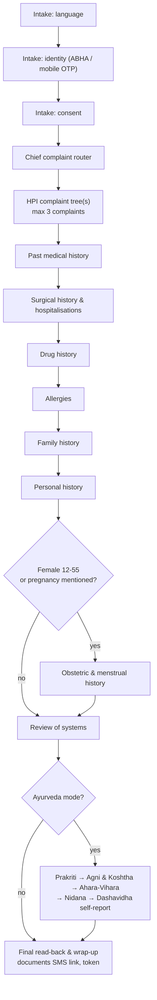
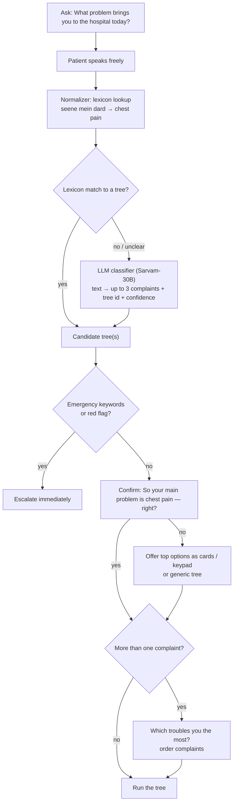
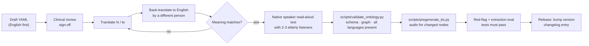

# 07 · Conversation & Clinical Design Document — MediKiosk

How the AI interviews a patient: section order, question types, the ontology file format, complaint trees, dialogue policies, red-flag rules, Ayurveda mode, the colloquial lexicon, sample calls and content governance.
Related: [03-architecture.md §4](03-architecture.md) · [05-wireframes.md](05-wireframes.md) · [06-folder-structure.md](06-folder-structure.md) · [08-ai-pipeline.md](08-ai-pipeline.md) · [11-testing-evaluation.md](11-testing-evaluation.md)

> ⚠ **Clinical safety notice.** All question banks, red-flag rules and Ayurveda scoring in this document are **design drafts written by the engineering team**. They **must be reviewed and signed off by qualified clinicians** (allopathic and Ayurvedic) before any real patient use. All Hindi/Telugu text is **to be verified by native speakers**.

---

## 1. Design goals

| Goal | How |
|---|---|
| Complete history | Every standard section is visited; required slots must be filled or explicitly marked `unknown` |
| Doctor-like reasoning | Complaint-specific trees (SOCRATES / OLDCARTS) with branches on answers |
| Short | ≈ 8 min allopathy, ≈ 12 min Ayurveda; skip irrelevant questions (`ask_if` / `skip_if`) |
| Safe | Red-flag rules after every answer; the AI never diagnoses or advises treatment |
| Understandable | One simple question at a time, everyday words, native language, read-back before moving on |
| Deterministic | Questions come from YAML written by clinicians — the LLM only interprets answers ([03 §4](03-architecture.md)) |

---

## 2. Interview structure

### 2.1 Section order



### 2.2 `flow.yaml` (section order per mode)

```yaml
# backend/ontology/flow.yaml
version: 1.0.0
modes:
  allopathy:
    - intake/language
    - intake/identity
    - intake/consent
    - complaints/_router          # decides which complaint tree(s) to run
    - hpi                          # placeholder → selected complaint trees
    - sections/past_history
    - sections/surgical_history
    - sections/drug_history
    - sections/allergies
    - sections/family_history
    - sections/personal_history
    - sections/obstetric_history   # file-level ask_if: female 12–55 or pregnancy mentioned
    - sections/review_of_systems
    - wrapup
  ayurveda:
    extends: allopathy
    insert_before: wrapup
    add:
      - ayurveda/prakriti
      - ayurveda/agni_koshtha
      - ayurveda/ahara_vihara
      - ayurveda/nidana
      - ayurveda/dashavidha
department_modes:                  # department → mode
  kayachikitsa: ayurveda
  panchakarma: ayurveda
  shalya_tantra: ayurveda
  general_medicine: allopathy
  orthopaedics: allopathy
time_budget_minutes: { allopathy: 8, ayurveda: 12, hard_cap: 15 }
```

### 2.3 Time budget and shortening rules

| Section | Target | If running over the hard cap |
|---|---|---|
| Intake | ≤ 2 min | — (never shortened) |
| Chief complaint + HPI | 2–3 min | Secondary complaints get only onset/duration/severity |
| Past, surgical, drugs, allergies | 1.5 min | Never skip allergies and current drugs |
| Family, personal | 1 min | Keep tobacco/alcohol; drop occupation details |
| ROS | 1 min | Collapse to one question "Any other problem in your body?" |
| Ayurveda sets | 3–4 min | Prakriti short form (12 items) |
| Read-back + wrap-up | ≤ 1 min | — |

---

## 3. Question types

| `input_type` | Example | Voice | Phone keypad (DTMF) | Kiosk touch | Stored value |
|---|---|---|---|---|---|
| `yes_no` | "Do you smoke?" | "haan / nahi", "avunu / ledu" | 1 yes · 2 no · 0 don't know | Green ✔ / red ✘ cards | `true` / `false` / `"unknown"` |
| `single_choice` | "Sudden or slow?" | Say the option (synonyms in YAML + lexicon) | Option numbers read aloud | Icon cards (2–6) | option `value` |
| `multi_choice` | "Any of these: sweating, breathlessness…" | Say all that apply; "none" | One key at a time, `#` = done | Toggle cards + Done | list of values |
| `number` | "How many cigarettes a day?" | Numbers in words ("das", "padi") | Digits + `#` | Keypad | number |
| `duration` | "Since when?" | "do din", "rendu vaaralu", "since Diwali" | Number, then unit key 1–5 | DurationPicker | `{value, unit, approximate}` |
| `scale_0_10` | Pain severity | "saat", "edu", "very bad" → confirm | 0–9, `*` = 10 | PainScaleScreen | 0–10 |
| `body_location` | "Where is the pain?" | "left side of chest", "mokalu" | Region menu (≤ 9 common regions) | BodyMapScreen | list of region codes |
| `free_text` | "What did the doctor say last time?" | Free speech → transcript + LLM summary | `9` = skip | 🎤 or on-screen keyboard (staff-assisted) | text + extracted entities |
| `date` | "When was your last period?" | "15 days ago", "last month" | DDMMYY digits | Calendar / relative chips | ISO date + `approximate` |

All types accept **"I don't know"** (`allow_unknown: true` by default) and **"repeat"**/**"go back"**.

---

## 4. Ontology YAML format

Files live in `backend/ontology/` ([06 §3](06-folder-structure.md)) and are validated by `scripts/validate_ontology.py` against `ontology/schema.json`.

### 4.1 Node fields

| Field | Required | Description |
|---|---|---|
| `id` | ✔ | `<tree>.<slot>` — e.g. `chest_pain.onset` (unique across ontology) |
| `section` | ✔ | One of the `history_section` enum values ([09 §3](09-data-model-and-api.md)) |
| `ask` | ✔ | Question text per language `{en, hi, te, ta?}` — short, spoken style |
| `ask_short` | – | Shorter re-ask variant per language |
| `input_type` | ✔ | See §3 |
| `options` | for choice types | List of `{value, label{…}, icon, dtmf, synonyms{hi:[…], te:[…], en:[…]}}` |
| `slot` | ✔ | History key written on answer: `<section>.<tree>.<field>` e.g. `hpi.chest_pain.onset` |
| `value_type` | – | `string`, `number`, `bool`, `list`, `duration`, `date`, `region_list` |
| `validation` | – | `{min, max, unit, required}` |
| `extraction_hint` | – | Extra guidance for the LLM extractor (never shown to patient) |
| `next` | – | Default next node id (or `end` for the tree) |
| `branches` | – | Ordered list `[{if: <expr>, goto: <node_id>}]` — first match wins, else `next` |
| `ask_if` / `skip_if` | – | Expression deciding whether to ask this node at all |
| `red_flag_check` | – | Rule IDs to evaluate **immediately** after this node (all rules also run after every answer) |
| `emergency_keywords` | – | Words that trigger an immediate rule check even inside free text (e.g. "behosh", "spruha") |
| `readback` | – | Template per language used in the section read-back |
| `allow_unknown` / `allow_skip` | – | Defaults `true` / `false` |
| `max_reask` | – | Default `2` (then keypad / touch options) |
| `audio_version` | ✔ | Integer; bump when `ask` text changes → audio regenerated (`chest_pain.onset.v2.mp3`) |

**Expression language** (small, safe, evaluated by our own parser — no `eval`):
`slot == value` · `slot != value` · `slot in [a, b]` · `slot contains value` · `slot any_of [a, b]` · `slot > n` · `and` · `or` · `not` · `patient.gender` · `patient.age` · `visit.mode`.

### 4.2 Full example — `complaints/chest_pain.yaml` (SOCRATES)

```yaml
# backend/ontology/complaints/chest_pain.yaml
tree: chest_pain
version: 1.2.0
framework: SOCRATES
entry: chest_pain.site
reviewed_by: []            # clinician sign-off goes here before release
nodes:

  - id: chest_pain.site
    section: hpi
    input_type: body_location
    slot: hpi.chest_pain.site
    ask:
      en: "Where exactly is the pain? Show me on the picture, or tell me."
      hi: "दर्द ठीक कहाँ है? चित्र पर दिखाइए या बताइए।"
      te: "నొప్పి సరిగ్గా ఎక్కడ ఉంది? బొమ్మపై చూపించండి లేదా చెప్పండి."
    extraction_hint: "Map to region codes: chest_left, chest_center, chest_right, upper_abdomen, back, whole_chest."
    next: chest_pain.onset
    audio_version: 1

  - id: chest_pain.onset
    section: hpi
    input_type: single_choice
    slot: hpi.chest_pain.onset
    ask:
      en: "Did the pain start suddenly, or slowly?"
      hi: "दर्द अचानक शुरू हुआ या धीरे-धीरे?"
      te: "నొప్పి ఒక్కసారిగా మొదలైందా, లేక కొంచెం కొంచెం గా వచ్చిందా?"
    options:
      - value: sudden
        icon: bolt
        dtmf: "1"
        label: { en: "Suddenly", hi: "अचानक", te: "ఒక్కసారిగా" }
        synonyms: { hi: ["achanak", "ek dum"], te: ["okkasariga", "hatthaathuga"] }
      - value: gradual
        icon: trend-up
        dtmf: "2"
        label: { en: "Slowly", hi: "धीरे-धीरे", te: "కొంచెం కొంచెం గా" }
        synonyms: { hi: ["dheere dheere"], te: ["konchem konchem ga", "nemmadiga"] }
    next: chest_pain.duration
    audio_version: 2

  - id: chest_pain.duration
    section: hpi
    input_type: duration
    slot: hpi.chest_pain.duration
    ask:
      en: "Since when do you have this pain?"
      hi: "यह दर्द कब से है?"
      te: "ఈ నొప్పి ఎప్పటి నుండి ఉంది?"
    validation: { required: true }
    next: chest_pain.character
    audio_version: 1

  - id: chest_pain.character
    section: hpi
    input_type: single_choice
    slot: hpi.chest_pain.character
    ask:
      en: "What does the pain feel like?"
      hi: "दर्द कैसा महसूस होता है?"
      te: "నొప్పి ఎలా అనిపిస్తుంది?"
    options:
      - { value: pressure, icon: weight, dtmf: "1",
          label: { en: "Heavy / pressing", hi: "भारीपन / दबाव", te: "బరువుగా / నొక్కినట్టు" },
          synonyms: { hi: ["bhaari", "dabaav", "koi baitha ho"], te: ["baruvuga", "nokkinattu", "pattesinattu"] } }
      - { value: burning, icon: flame, dtmf: "2",
          label: { en: "Burning", hi: "जलन", te: "మంట" },
          synonyms: { hi: ["jalan"], te: ["manta"] } }
      - { value: sharp, icon: needle, dtmf: "3",
          label: { en: "Sharp / stabbing", hi: "चुभन", te: "గుచ్చినట్టు" },
          synonyms: { hi: ["chubhan", "sui jaisa"], te: ["guchinattu", "podichinattu"] } }
      - { value: dull, icon: dull, dtmf: "4",
          label: { en: "Dull ache", hi: "हल्का दर्द", te: "మందమైన నొప్పి" } }
    next: chest_pain.radiation
    audio_version: 1

  - id: chest_pain.radiation
    section: hpi
    input_type: multi_choice
    slot: hpi.chest_pain.radiation
    ask:
      en: "Does the pain spread anywhere — to the arm, jaw, neck or back?"
      hi: "क्या दर्द कहीं और फैलता है — बाँह, जबड़ा, गर्दन या पीठ में?"
      te: "నొప్పి ఇంకెక్కడికైనా పాకుతుందా — చేయి, దవడ, మెడ లేదా వీపుకి?"
    options:
      - { value: left_arm,  icon: arm-left,  dtmf: "1", label: { en: "Left arm",  hi: "बायाँ हाथ", te: "ఎడమ చేయి" } }
      - { value: right_arm, icon: arm-right, dtmf: "2", label: { en: "Right arm", hi: "दायाँ हाथ", te: "కుడి చేయి" } }
      - { value: jaw_neck,  icon: jaw,       dtmf: "3", label: { en: "Jaw / neck", hi: "जबड़ा / गर्दन", te: "దవడ / మెడ" } }
      - { value: back,      icon: back,      dtmf: "4", label: { en: "Back",      hi: "पीठ", te: "వీపు" } }
      - { value: none,      icon: cross,     dtmf: "5", label: { en: "Does not spread", hi: "कहीं नहीं", te: "ఎక్కడికీ లేదు" } }
    red_flag_check: [RF-CARD-01]
    next: chest_pain.associated
    audio_version: 1

  - id: chest_pain.associated
    section: hpi
    input_type: multi_choice
    slot: hpi.chest_pain.associated
    ask:
      en: "Along with the pain, do you have any of these: sweating, breathlessness, vomiting, heart racing, or fainting?"
      hi: "दर्द के साथ क्या इनमें से कुछ होता है: पसीना, साँस फूलना, उल्टी, धड़कन तेज़ होना, या बेहोशी?"
      te: "నొప్పితో పాటు ఇవి ఏమైనా ఉన్నాయా: చెమటలు, ఆయాసం, వాంతులు, గుండె దడ, లేదా స్పృహ తప్పడం?"
    options:
      - { value: sweating,     icon: sweat,   dtmf: "1", label: { en: "Sweating",      hi: "पसीना",      te: "చెమటలు" } }
      - { value: dyspnoea,     icon: lungs,   dtmf: "2", label: { en: "Breathlessness", hi: "साँस फूलना", te: "ఆయాసం" } }
      - { value: vomiting,     icon: vomit,   dtmf: "3", label: { en: "Vomiting",      hi: "उल्टी",       te: "వాంతులు" } }
      - { value: palpitations, icon: heart,   dtmf: "4", label: { en: "Heart racing",  hi: "धड़कन तेज़",   te: "గుండె దడ" } }
      - { value: syncope,      icon: faint,   dtmf: "5", label: { en: "Fainting",      hi: "बेहोशी",      te: "స్పృహ తప్పడం" } }
      - { value: none,         icon: cross,   dtmf: "6", label: { en: "None of these", hi: "कुछ नहीं",    te: "ఏమీ లేవు" } }
    red_flag_check: [RF-CARD-01, RF-CARD-02]
    next: chest_pain.timing
    audio_version: 1

  - id: chest_pain.timing
    section: hpi
    input_type: single_choice
    slot: hpi.chest_pain.timing
    ask:
      en: "Is the pain there all the time, or does it come and go?"
      hi: "दर्द हर समय रहता है या आता-जाता है?"
      te: "నొప్పి ఎప్పుడూ ఉంటుందా, లేక వచ్చి పోతుందా?"
    options:
      - { value: constant,     dtmf: "1", icon: line,  label: { en: "All the time", hi: "हर समय", te: "ఎప్పుడూ" } }
      - { value: intermittent, dtmf: "2", icon: wave,  label: { en: "Comes and goes", hi: "आता-जाता है", te: "వచ్చి పోతుంది" } }
    branches:
      - { if: "hpi.chest_pain.timing == intermittent", goto: chest_pain.episode_length }
    next: chest_pain.exacerbating
    audio_version: 1

  - id: chest_pain.episode_length
    section: hpi
    input_type: duration
    slot: hpi.chest_pain.episode_length
    ask:
      en: "Each time it comes, how long does it last?"
      hi: "हर बार दर्द कितनी देर रहता है?"
      te: "ప్రతిసారి నొప్పి ఎంతసేపు ఉంటుంది?"
    next: chest_pain.exacerbating
    audio_version: 1

  - id: chest_pain.exacerbating
    section: hpi
    input_type: multi_choice
    slot: hpi.chest_pain.exacerbating
    ask:
      en: "What makes the pain worse?"
      hi: "किस चीज़ से दर्द बढ़ता है?"
      te: "దేని వల్ల నొప్పి ఎక్కువ అవుతుంది?"
    options:
      - { value: exertion,    dtmf: "1", icon: walk,  label: { en: "Walking / work", hi: "चलने या मेहनत से", te: "నడిస్తే / పని చేస్తే" } }
      - { value: deep_breath, dtmf: "2", icon: lungs, label: { en: "Deep breath",   hi: "गहरी साँस लेने से", te: "గట్టిగా ఊపిరి తీసుకుంటే" } }
      - { value: food,        dtmf: "3", icon: plate, label: { en: "After food",    hi: "खाने के बाद",     te: "భోజనం తర్వాత" } }
      - { value: lying_down,  dtmf: "4", icon: bed,   label: { en: "Lying down",    hi: "लेटने पर",         te: "పడుకుంటే" } }
      - { value: pressing,    dtmf: "5", icon: hand,  label: { en: "Pressing the chest", hi: "दबाने पर",      te: "నొక్కితే" } }
      - { value: nothing,     dtmf: "6", icon: cross, label: { en: "Nothing",       hi: "कुछ नहीं",         te: "ఏమీ లేదు" } }
    branches:
      - { if: "hpi.chest_pain.character == burning and hpi.chest_pain.exacerbating contains food", goto: chest_pain.acid_symptoms }
    next: chest_pain.relieving
    audio_version: 1

  - id: chest_pain.acid_symptoms
    section: hpi
    input_type: yes_no
    slot: hpi.chest_pain.sour_belching
    ask:
      en: "Do you get sour water or burning in the throat?"
      hi: "क्या खट्टी डकार या गले में जलन होती है?"
      te: "పుల్లటి త్రేన్పులు లేదా గొంతులో మంట వస్తుందా?"
    next: chest_pain.relieving
    audio_version: 1

  - id: chest_pain.relieving
    section: hpi
    input_type: multi_choice
    slot: hpi.chest_pain.relieving
    ask:
      en: "What makes the pain better?"
      hi: "किस चीज़ से दर्द कम होता है?"
      te: "దేని వల్ల నొప్పి తగ్గుతుంది?"
    options:
      - { value: rest,           dtmf: "1", icon: sit,    label: { en: "Rest",            hi: "आराम से",         te: "విశ్రాంతి" } }
      - { value: antacid,        dtmf: "2", icon: bottle, label: { en: "Gas/acidity medicine", hi: "गैस की दवा",  te: "గ్యాస్ మందు" } }
      - { value: sitting_forward,dtmf: "3", icon: lean,   label: { en: "Sitting forward", hi: "आगे झुककर बैठने से", te: "ముందుకు వంగి కూర్చుంటే" } }
      - { value: nothing,        dtmf: "4", icon: cross,  label: { en: "Nothing helps",   hi: "कुछ नहीं",         te: "ఏదీ తగ్గించదు" } }
    next: chest_pain.severity
    audio_version: 1

  - id: chest_pain.severity
    section: hpi
    input_type: scale_0_10
    slot: hpi.chest_pain.severity
    ask:
      en: "From zero to ten, how bad is the pain? Zero means no pain, ten means the worst pain."
      hi: "0 से 10 में दर्द कितना है? 0 मतलब कोई दर्द नहीं, 10 मतलब सबसे ज़्यादा दर्द।"
      te: "0 నుండి 10 లో నొప్పి ఎంత ఉంది? 0 అంటే నొప్పి లేదు, 10 అంటే చాలా ఎక్కువ నొప్పి."
    validation: { min: 0, max: 10 }
    next: chest_pain.previous_episodes
    audio_version: 1

  - id: chest_pain.previous_episodes
    section: hpi
    input_type: yes_no
    slot: hpi.chest_pain.previous_episodes
    ask:
      en: "Have you had this kind of pain before?"
      hi: "क्या पहले भी ऐसा दर्द हुआ है?"
      te: "ఇంతకు ముందు కూడా ఇలాంటి నొప్పి వచ్చిందా?"
    branches:
      - { if: "hpi.chest_pain.previous_episodes == true", goto: chest_pain.previous_evaluation }
    next: end
    audio_version: 1

  - id: chest_pain.previous_evaluation
    section: hpi
    input_type: free_text
    slot: hpi.chest_pain.previous_evaluation
    ask:
      en: "Did a doctor check it? What did they tell you?"
      hi: "क्या किसी डॉक्टर ने देखा था? उन्होंने क्या बताया?"
      te: "అప్పుడు డాక్టర్ చూశారా? ఏమని చెప్పారు?"
    extraction_hint: "Extract prior diagnoses (e.g. 'heart problem', 'gas'), tests (ECG, echo, angiography), treatments."
    allow_skip: true
    next: end
    audio_version: 1

readback:
  en: "You said: pain in the {site}, started {onset} {duration} ago, feels {character}, spreads to {radiation}, with {associated}, {severity} out of 10. Is that right?"
  hi: "आपने बताया: {site} में दर्द, {duration} पहले {onset} शुरू हुआ, {character} जैसा, {radiation} तक फैलता है, साथ में {associated}, 10 में से {severity}। क्या यह सही है?"
  te: "మీరు చెప్పింది: {site} లో నొప్పి, {duration} క్రితం {onset} మొదలైంది, {character} గా ఉంది, {radiation} కి పాకుతుంది, దానితో పాటు {associated}, 10 లో {severity}. ఇది సరైనదేనా?"
```

### 4.3 Full example — `complaints/generic.yaml` (OLDCARTS fallback)

Used when the chief complaint doesn't match a specific tree. `{complaint}` is filled with the patient's own words (normalised).

```yaml
# backend/ontology/complaints/generic.yaml
tree: generic
version: 1.0.0
framework: OLDCARTS
entry: generic.onset
nodes:
  - id: generic.onset
    section: hpi
    input_type: single_choice
    slot: hpi.generic.onset
    ask:
      en: "Did the {complaint} start suddenly, or slowly?"
      hi: "{complaint} अचानक शुरू हुआ या धीरे-धीरे?"
      te: "{complaint} ఒక్కసారిగా మొదలైందా, లేక కొంచెం కొంచెం గా వచ్చిందా?"
    options:
      - { value: sudden,  dtmf: "1", icon: bolt,     label: { en: "Suddenly", hi: "अचानक", te: "ఒక్కసారిగా" } }
      - { value: gradual, dtmf: "2", icon: trend-up, label: { en: "Slowly", hi: "धीरे-धीरे", te: "కొంచెం కొంచెం గా" } }
    next: generic.location
    audio_version: 1

  - id: generic.location
    section: hpi
    input_type: body_location
    slot: hpi.generic.location
    skip_if: "cc.type in [fever, weakness, weight_loss]"     # whole-body complaints
    ask:
      en: "Where in your body do you feel it?"
      hi: "यह शरीर में कहाँ महसूस होता है?"
      te: "ఇది శరీరంలో ఎక్కడ అనిపిస్తుంది?"
    next: generic.duration
    audio_version: 1

  - id: generic.duration
    section: hpi
    input_type: duration
    slot: hpi.generic.duration
    ask:
      en: "Since when do you have this problem?"
      hi: "यह तकलीफ़ कब से है?"
      te: "ఈ సమస్య ఎప్పటి నుండి ఉంది?"
    validation: { required: true }
    next: generic.character
    audio_version: 1

  - id: generic.character
    section: hpi
    input_type: free_text
    slot: hpi.generic.character
    ask:
      en: "Tell me in your own words — how does it feel?"
      hi: "अपने शब्दों में बताइए — यह कैसा लगता है?"
      te: "మీ మాటల్లో చెప్పండి — ఇది ఎలా అనిపిస్తుంది?"
    extraction_hint: "Extract quality descriptors, associated symptoms mentioned, and any emergency keywords."
    emergency_keywords: { hi: ["behosh", "khoon", "saans nahi"], te: ["spruha", "raktham", "oopiri aadatam ledu"] }
    next: generic.aggravating
    audio_version: 1

  - id: generic.aggravating
    section: hpi
    input_type: free_text
    slot: hpi.generic.aggravating
    ask:
      en: "What makes it worse?"
      hi: "किस चीज़ से यह बढ़ता है?"
      te: "దేని వల్ల ఇది ఎక్కువ అవుతుంది?"
    allow_skip: true
    next: generic.relieving
    audio_version: 1

  - id: generic.relieving
    section: hpi
    input_type: free_text
    slot: hpi.generic.relieving
    ask:
      en: "What makes it better? Have you taken any medicine for it?"
      hi: "किस चीज़ से आराम मिलता है? क्या इसके लिए कोई दवा ली है?"
      te: "దేని వల్ల తగ్గుతుంది? దీనికి ఏమైనా మందు వేసుకున్నారా?"
    allow_skip: true
    next: generic.timing
    audio_version: 1

  - id: generic.timing
    section: hpi
    input_type: single_choice
    slot: hpi.generic.timing
    ask:
      en: "Is it there all the time, or does it come and go?"
      hi: "यह हर समय रहता है या आता-जाता है?"
      te: "ఇది ఎప్పుడూ ఉంటుందా, లేక వచ్చి పోతుందా?"
    options:
      - { value: constant,     dtmf: "1", label: { en: "All the time", hi: "हर समय", te: "ఎప్పుడూ" } }
      - { value: intermittent, dtmf: "2", label: { en: "Comes and goes", hi: "आता-जाता है", te: "వచ్చి పోతుంది" } }
    next: generic.severity
    audio_version: 1

  - id: generic.severity
    section: hpi
    input_type: scale_0_10
    slot: hpi.generic.severity
    ask:
      en: "From zero to ten, how much does it trouble you?"
      hi: "0 से 10 में यह कितना परेशान करता है?"
      te: "0 నుండి 10 లో ఇది మిమ్మల్ని ఎంత బాధపెడుతుంది?"
    next: end
    audio_version: 1

readback:
  en: "You said: {complaint} for {duration}, started {onset}, {severity} out of 10. Is that right?"
  hi: "आपने बताया: {duration} से {complaint}, {onset} शुरू हुआ, 10 में से {severity}। क्या यह सही है?"
  te: "మీరు చెప్పింది: {duration} నుండి {complaint}, {onset} మొదలైంది, 10 లో {severity}. ఇది సరైనదేనా?"
```

### 4.4 Other complaint trees (question outlines)

| Tree file | Questions (in order) | Red-flag hooks |
|---|---|---|
| `fever.yaml` | Duration · how high (measured? number) · pattern (continuous / comes with chills / evening) · chills/rigors · body ache · headache · cough/cold · burning urine · loose motions/vomiting · rash · bleeding (gums, nose, spots) · recent travel / others at home with fever · medicines taken · drowsiness or confusion · neck stiffness · urine output reduced | RF-NEURO-04, RF-SEPSIS-01, RF-URG-02 |
| `abdominal_pain.yaml` | Site (body map) · onset · duration · character (colicky / burning / dull) · radiation (back, groin, shoulder) · relation to food · vomiting (blood?) · stools (loose, black, blood) · constipation · fever · urine burning · jaundice (yellow eyes) · last period / pregnancy (ask_if female 12–55) · severity · fainting | RF-GI-01, RF-GI-02, RF-OBS-01 |
| `joint_pain.yaml` | Which joints (body map, multi) · one side or both · onset · duration · swelling · redness/warmth · morning stiffness (> 30 min?) · worse with movement or rest · injury/fall · difficulty walking/climbing · fever · previous treatment · severity | RF-BLEED-01 (trauma), RF-URG-03 (hot swollen joint + fever) |
| `cough_breathlessness.yaml` | Cough duration · dry or with phlegm (colour) · blood in sputum · fever · night sweats · weight loss · breathlessness: at rest / walking / climbing · wheeze · worse lying flat · chest pain · smoking · TB contact or past TB · swelling of legs | RF-RESP-01, RF-CARD-01, RF-URG-04 (blood in sputum) |
| `headache.yaml` | Site · onset (sudden "worst ever"?) · duration · character · pattern (daily, attacks) · with vomiting · vision changes · weakness/numbness · fever · neck stiffness · head injury · worse in morning / on bending · BP history · painkiller use · severity | RF-NEURO-01, RF-NEURO-02, RF-NEURO-04 |
| `_router.yaml` | Not a tree — see §5 | — |

### 4.5 Standard sections (question outlines)

| File | Questions |
|---|---|
| `past_history.yaml` | "Has a doctor ever told you that you have…" multi-choice: diabetes (sugar) · high BP · heart disease · asthma/COPD · TB · thyroid · kidney disease · liver disease/jaundice · epilepsy/fits · stroke/paralysis · cancer · mental health condition · other (free text) → for each yes: since when · on treatment? regular? |
| `surgical_history.yaml` | Any operation ever? → what (free text) · when · where · any hospital admission in last 2 years (why) · blood transfusion ever |
| `drug_history.yaml` | Taking any medicines daily? → names (say / read from strip; kiosk: show strip to camera) · dose/times · regular or missed · Ayurvedic / home remedies / supplements · painkillers often · steroids · blood thinners (ask explicitly) |
| `allergies.yaml` | Allergy or reaction to any medicine? → which · what happened (rash / swelling / breathing trouble) · food or other allergies |
| `family_history.yaml` | In parents/brothers/sisters/children: diabetes · BP · heart attack (at what age) · stroke · cancer (type) · TB · mental illness · similar illness to yours |
| `personal_history.yaml` | Occupation · diet (veg / non-veg / egg) · tobacco (smoke: cigarette/beedi; chew: gutkha/khaini) — amount & years · alcohol — how often · sleep (hours, trouble sleeping) · appetite · bowel & bladder habits · exercise/walking · stress at home/work · (optional) marital status |
| `obstetric_history.yaml` | `ask_if: patient.gender == F and patient.age >= 12 and patient.age <= 55` · last period date · regular cycles · possibly pregnant now? · number of pregnancies / children · heavy bleeding / pain with periods · (ask_if age ≥ 45) periods stopped? |
| `review_of_systems.yaml` | Quick yes/no per system, skipping systems already covered in HPI: General (fever, weight loss, tiredness) · Eyes/ENT · Heart (chest pain, palpitations, leg swelling) · Lungs (cough, breathlessness) · Stomach (vomiting, loose motions, constipation, blood in stool) · Urine (burning, frequency, blood) · Brain/nerves (headache, fits, weakness, numbness) · Joints/muscles · Skin (rash, itching) · Mood ("In the last 2 weeks, have you felt low or lost interest in things?" → if yes, gentle follow-up incl. safety question → RF-PSY-01) |

---

## 5. Chief-complaint router



| Rule | Detail |
|---|---|
| Max complaints | 3. Primary gets the full tree; others get the short version (onset, duration, severity, key red-flag questions) |
| Unknown complaint | `generic.yaml` with the patient's words as `{complaint}` |
| "Everything hurts" / vague | Ask "Which part troubles you most?" with body map / top-10 symptom cards |
| Follow-up visit | If a previous visit exists: "Last time you came for knee pain. Is this visit for the same problem?" |
| Output | `cc` history items: text as said, normalised term, SNOMED code, duration |

---

## 6. Dialogue policies

| Situation | Policy |
|---|---|
| **Read-back** | At the end of each section (not each question): short summary + "Is that right?" → "No" lets the patient say what to change; the engine re-asks only the affected node |
| **Not understood** | Re-ask with `ask_short` (1st) → offer options explicitly (2nd) → switch to keypad/touch options for this question (after `max_reask = 2`) → if still unclear, store `unclear` + transcript and move on (doctor sees it flagged) |
| **"I don't know"** | Always accepted → `unknown`; for required safety slots (allergies, current medicines) ask once more with examples, then accept |
| **Silence** | 6 s → repeat short version · 12 s → "You can also press a number on your phone" · 20 s → "Are you still there? Press any key." · 30 s → offer call-back; end with session saved |
| **Barge-in** | Patient speech stops TTS immediately. Exceptions: consent notice first 10 s and emergency messages (not interruptible) |
| **Patient asks a question** | Detect question intent → if about the process, answer from a fixed FAQ ("How long will this take?" → "About 8 minutes"); if medical, use the no-advice reply below |
| **"What do I have?" / advice requests** | Never diagnose or advise. EN "I'm not able to tell what the illness is. The doctor will examine you and explain. I'm only noting your problems so the doctor understands quickly." · HI "मैं बीमारी नहीं बता सकता/सकती। डॉक्टर आपकी जाँच करके समझाएँगे। मैं सिर्फ़ आपकी तकलीफ़ें लिख रहा/रही हूँ ताकि डॉक्टर जल्दी समझ सकें।" *(gender-neutral phrasing to be chosen by native speakers, e.g. passive form)* · TE "నేను వ్యాధి ఏమిటో చెప్పలేను. డాక్టర్ మిమ్మల్ని పరీక్షించి వివరిస్తారు. డాక్టర్ త్వరగా అర్థం చేసుకోవడానికి మీ సమస్యలను మాత్రమే నమోదు చేస్తున్నాను." |
| **Medicine questions** ("Should I keep taking my tablet?") | "Please continue as your doctor told you until you meet the doctor today" + note for doctor |
| **Elderly pacing** | TTS speed 0.9 (0.8 on request "slowly"), 400 ms pause between sentences, VAD end-of-speech 1.2 s for age ≥ 60 |
| **Empathy** | One short phrase per section at most, never scripted-sounding: "I'm sorry you're in pain." · HI "यह सुनकर दुख हुआ कि आपको दर्द है।" · TE "మీకు నొప్పిగా ఉన్నందుకు బాధగా ఉంది." · Thanks after hard answers (tobacco, alcohol, mood) without judgement |
| **Sensitive topics** | Obstetric, sexual, mental health, substance use: preface "These questions help the doctor; you can say 'skip'." Skip allowed except safety questions |
| **Language switch** | Patient may answer in a mix (Hinglish/Tenglish) — accepted. Saying "Hindi mein bolo" switches TTS language; answers kept |
| **Third party answering** (caregiver) | Ask at start: "Are you the patient, or helping the patient?" → store `interview_sessions.respondent = attendant` + `respondent_relation`, phrase questions in third person where templates exist |
| **Numbers** | Keypad preferred for ABHA/mobile/OTP; spoken numbers normalised ("dedh" = 1.5, "dhai" = 2.5, "padi" = 10) and read back |
| **Contradictions** | Validator detects (e.g. "no medicines" then names one) → one gentle check: "Earlier you said no medicines, now Metformin — do you take Metformin?" |
| **Dropped call** | Resume: "Welcome back. We were talking about your medicines." → continue at last node |
| **Abuse / distress** | Stay calm, offer human transfer; RF-PSY-01 language takes priority |

---

## 7. Red-flag rules

> These rules are **engineering drafts**. Every rule's trigger logic, severity and message **must be reviewed and signed off by a clinician** (and re-reviewed on every change). The red-flag test suite in [11-testing-evaluation.md](11-testing-evaluation.md) must pass at **100 %** before any release.

### 7.1 Emergency rules

| ID | Name | Trigger logic (any match fires) | Severity | Action | Message |
|---|---|---|---|---|---|
| **RF-CARD-01** | Possible cardiac chest pain | `cc` or ROS has chest pain **and** (`associated` any_of [dyspnoea, sweating] **or** `radiation` any_of [left_arm, right_arm, jaw_neck]) | emergency | Stop interview · alert triage · transfer call / kiosk emergency screen | MSG-ER |
| **RF-CARD-02** | Syncope with cardiac features | fainting/near-fainting **and** (chest pain **or** palpitations) | emergency | same | MSG-ER |
| **RF-RESP-01** | Severe breathlessness | breathlessness **at rest**, or patient reports cannot speak full sentences / lips turning blue; or STT detects very short breathless utterances + breathlessness slot (LLM safety net) | emergency | same | MSG-ER |
| **RF-NEURO-01** | Stroke signs (FAST) | **sudden** face drooping, arm/leg weakness on one side, slurred speech, or sudden loss of vision — onset within last 24 h or ongoing | emergency | same (time-critical wording) | MSG-STROKE |
| **RF-NEURO-02** | Thunderclap headache | headache onset `sudden` **and** described as worst ever / reaches maximum within a minute | emergency | same | MSG-ER |
| **RF-NEURO-03** | Seizure | seizure happening now, first-ever seizure, or seizure today | emergency | same | MSG-ER |
| **RF-NEURO-04** | Possible meningitis/encephalitis | fever **and** (neck stiffness **or** confusion/drowsiness) | emergency | same | MSG-ER |
| **RF-GI-01** | GI bleeding | vomiting blood **or** black tarry stools **or** large blood in stools | emergency | same | MSG-ER |
| **RF-GI-02** | Acute abdomen | abdominal pain severity ≥ 8 **and** (rigid/board-like abdomen reported **or** fainting **or** unable to stand) | emergency | same | MSG-ER |
| **RF-OBS-01** | Pregnancy emergency | pregnant or possibly pregnant **and** (vaginal bleeding **or** severe abdominal pain **or** fits) | emergency | same | MSG-ER |
| **RF-BLEED-01** | Uncontrolled bleeding / major trauma | bleeding that won't stop, or accident/fall/assault with head injury, severe pain or deformity | emergency | same | MSG-ER |
| **RF-ALLERGY-01** | Anaphylaxis | swelling of face/lips/tongue/throat **and** breathing difficulty (or after a new medicine/sting) | emergency | same | MSG-ER |
| **RF-PSY-01** | Suicide / self-harm risk | patient expresses thoughts of ending life, self-harm intent or plan (any language, any section) | emergency | Calm message · warm transfer to nurse/counsellor · **never end the call abruptly** | MSG-PSY |
| **RF-SEPSIS-01** | Possible sepsis | high fever **and** (confusion/drowsiness **or** very low / no urine for 12 h **or** breathlessness) | emergency | same | MSG-ER |
| **RF-ENDO-01** | Diabetic emergency | known diabetes **and** (confusion **or** fainting **or** reported very low sugar symptoms — sweating, shaking, drowsy **or** very high sugar with vomiting/drowsiness) | emergency | same | MSG-ER |
| **RF-TOX-01** | Poisoning / bite | swallowed poison/pesticide, medicine overdose, or snake/scorpion/dog bite today | emergency | same | MSG-TOX |

### 7.2 Urgent rules (priority in queue, no interruption)

| ID | Trigger | Action |
|---|---|---|
| RF-URG-01 | Chest pain without emergency features, age ≥ 40 | Visit priority `urgent`; triage card (orange) |
| RF-URG-02 | Fever > 5 days, or fever with persistent vomiting | `urgent` |
| RF-URG-03 | Hot, red, swollen joint with fever | `urgent` |
| RF-URG-04 | Blood in sputum | `urgent` |
| RF-URG-05 | Pain severity ≥ 8 (any site) without emergency features | `urgent` |
| RF-URG-06 | Pregnant patient (any complaint) | `urgent` |
| RF-URG-07 | Low mood + hopelessness without self-harm intent | `urgent` + doctor note |

### 7.3 Patient messages (templates)

| Key | English | Hindi *(verify)* | Telugu *(verify)* |
|---|---|---|---|
| **MSG-ER** | "Please do not wait. Your answers show you may need urgent care. If you are at the hospital, go to the Emergency counter now — a nurse has been told. If you are at home, call 108 now." | "कृपया इंतज़ार न करें। आपके जवाबों से लगता है कि आपको तुरंत इलाज की ज़रूरत हो सकती है। अगर आप अस्पताल में हैं तो अभी इमरजेंसी काउंटर जाएँ — नर्स को बता दिया गया है। अगर आप घर पर हैं तो अभी 108 पर कॉल करें।" | "దయచేసి వేచి ఉండకండి. మీ సమాధానాల ప్రకారం మీకు వెంటనే చికిత్స అవసరం కావచ్చు. మీరు ఆసుపత్రిలో ఉంటే ఇప్పుడే ఎమర్జెన్సీ కౌంటర్‌కు వెళ్ళండి — నర్స్‌కు తెలియజేశాము. మీరు ఇంట్లో ఉంటే ఇప్పుడే 108కి కాల్ చేయండి." |
| **MSG-STROKE** | MSG-ER + "Every minute matters. Note the time the problem started." | MSG-ER + "हर मिनट ज़रूरी है। समस्या शुरू होने का समय याद रखें।" | MSG-ER + "ప్రతి నిమిషం ముఖ్యం. సమస్య మొదలైన సమయాన్ని గుర్తుపెట్టుకోండి." |
| **MSG-TOX** | MSG-ER + "Take the medicine or poison packet with you. For a bite, keep the bitten part still. Do not try home remedies." | MSG-ER + "दवा या ज़हर का पैकेट साथ ले जाएँ। काटने पर उस हिस्से को हिलाएँ नहीं। घरेलू उपाय न करें।" | MSG-ER + "మందు లేదా విషం ప్యాకెట్‌ను తీసుకెళ్ళండి. కాటు అయితే ఆ భాగాన్ని కదలించకండి. ఇంటి వైద్యం చేయకండి." |
| **MSG-PSY** | "Thank you for telling me. You are not alone, and help is available right now. I am connecting you to a nurse. You can also call Tele-MANAS on 14416, free, any time." | "मुझे बताने के लिए धन्यवाद। आप अकेले नहीं हैं, मदद अभी मिल सकती है। आपको अभी नर्स से जोड़ा जा रहा है। आप कभी भी टेली-मानस 14416 पर मुफ़्त कॉल कर सकते हैं।" | "నాకు చెప్పినందుకు ధన్యవాదాలు. మీరు ఒంటరి కాదు, సహాయం ఇప్పుడే అందుబాటులో ఉంది. మిమ్మల్ని ఇప్పుడే నర్స్‌తో కలుపుతున్నాము. మీరు ఎప్పుడైనా టెలి-మానస్ 14416 కి ఉచితంగా కాల్ చేయవచ్చు." |

Emergency messages are played **twice**, slowly, and are not interruptible. On the kiosk, [K11 EmergencyScreen](05-wireframes.md) is shown.

### 7.4 `red_flags.yaml` format

```yaml
# backend/ontology/red_flags.yaml
version: 0.3.0
status: draft                     # draft | clinically_reviewed
reviewed_by: []                   # [{name, qualification, date}]
rules:
  - id: RF-CARD-01
    name: Possible cardiac chest pain
    severity: emergency
    when:
      all:
        - any: ["cc.types contains chest_pain", "ros.chest_pain == true"]
        - any:
            - "hpi.chest_pain.associated any_of [dyspnoea, sweating]"
            - "hpi.chest_pain.radiation any_of [left_arm, right_arm, jaw_neck]"
    also_match_keywords:          # free-text safety net (lexicon-normalised)
      en: ["chest pain and sweating", "pain going to left arm"]
      hi: ["seene mein dard aur pasina", "baayen haath mein dard"]
      te: ["chaati noppi chematalu", "edama chethi ki noppi"]
    action: [stop_interview, alert_triage, transfer_call, kiosk_emergency_screen]
    message: MSG-ER
    tests: [redflags.jsonl#card-01-*]   # must exist in data/eval_sets/redflags.jsonl

  - id: RF-PSY-01
    name: Suicide or self-harm risk
    severity: emergency
    when:
      any:
        - "ros.self_harm_thoughts == true"
        - "intent.self_harm == true"        # set by the LLM safety-net classifier on any free text
    action: [pause_interview, alert_triage, warm_transfer, keep_line_open]
    message: MSG-PSY
```

### 7.5 Fail-safe policy

1. Rules run **after every answer**, on the full slot set (not just the current node).
2. Evaluation order: deterministic rules → keyword safety net → LLM safety-net classifier ("does this answer suggest an emergency?") on free text. **Any** positive = fire. The LLM can add alerts but can **never** cancel a rule.
3. If the rule engine or classifier errors or times out → **treat as a potential emergency** and alert triage (nurse can mark false alarm).
4. `unknown`/`unclear` answers on a red-flag question → ask once more explicitly; still unclear → **urgent** priority and flag for the triage nurse.
5. Every fired rule logs evidence (slots + transcript snippets) in `red_flag_alerts.evidence`.
6. False alarms are acceptable; **misses are not**. Target sensitivity 100 % on the test suite; specificity is tuned only after sensitivity holds.

---

## 8. Ayurveda mode

Enabled when `visit.mode == ayurveda` (from `flow.yaml → department_modes`). Adds ≈ 3–4 minutes.

> The questionnaire below is a **design draft**. The final item set and scoring must be **adapted from established instruments (e.g. CCRAS / AIIA Prakriti assessment tools) with Ayurveda clinician review**. MediKiosk's scores are a **self-report screening aid for the physician**, not a validated Prakriti determination.

### 8.1 Prakriti questionnaire (≈ 22 items)

Framing rule: Prakriti reflects **lifelong nature**, so every item is asked as *"Since childhood / usually, not only now…"* — current changes belong to Vikriti.

| # | Domain | Vata option | Pitta option | Kapha option |
|---|---|---|---|---|
| 1 | Body frame | Thin, light | Medium, muscular | Broad, heavy |
| 2 | Weight | Hard to gain | Gains and loses easily | Gains easily, hard to lose |
| 3 | Skin | Dry, rough | Warm, oily, rashes/pimples | Smooth, moist, cool |
| 4 | Hair | Dry, frizzy, thin | Fine, early greying/thinning | Thick, oily, wavy |
| 5 | Eyes | Small, dry | Sharp, reddish, light-sensitive | Large, calm |
| 6 | Appetite | Irregular | Strong, irritable if hungry | Steady/low, can skip meals |
| 7 | Thirst | Variable | High | Low |
| 8 | Sweating | Little | Heavy, with odour | Moderate |
| 9 | Sleep | Light, interrupted | Moderate, sound | Deep, long, heavy |
| 10 | Bowel (usual) | Dry, hard, tendency to constipation | Loose, frequent | Regular, heavy |
| 11 | Body temperature | Cold hands/feet | Feels warm | Cool, steady |
| 12 | Climate preference | Dislikes cold & wind | Dislikes heat | Dislikes cold & damp |
| 13 | Energy / stamina | Bursts, tires quickly | Intense, moderate | Steady, high endurance |
| 14 | Walking / activity | Quick, restless | Purposeful | Slow, steady |
| 15 | Speech | Fast, talkative | Sharp, precise | Slow, soft |
| 16 | Temperament under stress | Anxious, worried | Irritable, angry | Calm, withdrawn |
| 17 | Learning & memory | Learns fast, forgets fast | Sharp, good memory | Learns slowly, remembers long |
| 18 | Decisions | Changes mind often | Quick, decisive | Slow, deliberate |
| 19 | Joints | Cracking, prominent | Loose, flexible | Well-padded, strong |
| 20 | Taste preference | Sweet, sour, salty, warm food | Sweet, bitter, cold food | Pungent, bitter, light food |
| 21 | Voice | Weak, hoarse | Sharp, loud | Deep, pleasant |
| 22 | Illness tendency | Pain, gas, dryness | Acidity, inflammation, fever | Cold, cough, heaviness |

- Input: `single_choice` with 3 pictorial cards + "don't know"; phone: 1/2/3.
- **Scoring (draft):** V, P, K = count of choices / answered items → proportions (e.g. V 0.48, P 0.20, K 0.32). Label = dominant dosha if ≥ 0.45 and ≥ 0.10 above the next; dual (e.g. "Vata-Kapha") if the top two are within 0.10 and both ≥ 0.30; "Sama/balanced" if all within 0.10. `don't know` on > 5 items → label "insufficient data".
- **Short form** (time pressure): items 1, 2, 3, 6, 9, 10, 12, 13, 16, 17, 20, 22.

### 8.2 Agni (digestive fire)

| Question | Options → points |
|---|---|
| Is your hunger at regular times each day? | Regular → Sama +1, Tikshna +1 · Irregular → Vishama +2 · Rarely hungry → Manda +2 |
| How strong is your hunger? | Normal → Sama +2 · Very strong, can't miss a meal → Tikshna +2 · Low → Manda +2 · Varies → Vishama +1 |
| How do you feel after meals? | Light, fine → Sama +2 · Bloating/gas → Vishama +2 · Burning/acidity → Tikshna +2 · Heavy/sleepy → Manda +2 |
| How long until you feel hungry again? | 4–6 h → Sama +1 · < 3 h → Tikshna +2 · > 8 h → Manda +2 · Unpredictable → Vishama +2 |
| Belching / gas? | Often → Vishama +1 · Sour belching → Tikshna +1 · Heavy belching → Manda +1 |

**Rule:** highest total = Agni type; tie → report both, doctor decides. Types: **Sama** (balanced), **Vishama** (irregular), **Tikshna** (sharp/intense), **Manda** (slow).

### 8.3 Koshtha (bowel nature)

| Question | Options → points |
|---|---|
| How often do you pass stools? | 1–2×/day → Madhyama +2 · > 2×/day → Mridu +2 · Once in 2+ days → Krura +2 |
| Stool type (pictorial) | Soft/formed → Madhyama +1 · Loose → Mridu +2 · Hard/pellets → Krura +2 |
| Straining? | No → Mridu +1 · Sometimes → Madhyama +1 · Often → Krura +2 |
| Effect of milk / ghee / hot water | Causes loose motion easily → Mridu +2 · Mild effect → Madhyama +1 · No effect → Krura +2 |
| Laxative use | Never → Mridu +1 · Occasionally → Madhyama +1 · Regularly / strong ones needed → Krura +2 |

Types: **Mridu** (soft), **Madhyama** (moderate), **Krura** (hard/difficult).

### 8.4 Ahara-Vihara (diet & lifestyle)

| Ahara (diet) | Vihara (lifestyle) |
|---|---|
| Meal times (regular? late dinner after 9 pm?) | Wake-up and sleep time |
| Veg / non-veg / egg; frequency | Day-time sleep (after lunch?) |
| Spicy, oily, fried food — how often | Exercise / walking / yoga — minutes per day |
| Packaged/processed food, bakery items | Work type (sitting / standing / heavy labour / night shifts) |
| Water intake (glasses/day), cold water / fridge | Screen time late at night |
| Curd at night, milk with salty/sour food (viruddha ahara) | Suppressing natural urges (urine, stool, sneezing) — *vega dharana* |
| Tea / coffee (cups/day) | Stress, worry, anger (self-rated) |
| Eating when not hungry / overeating | Seasonal routine changes |

### 8.5 Nidana (causative factors)

Asked after HPI in Ayurveda mode: "What do you think started or worsens this problem?" (free text) + prompts: food (which), season/weather, overwork, travel, lack of sleep, emotional stress, injury, new medicine. Extracted as `ayurveda.nidana[]`.

### 8.6 Dashavidha Pariksha — capture map

| Parameter | Captured by | Stored as |
|---|---|---|
| Prakriti | Questionnaire §8.1 | proportions + label |
| Vikriti | Current symptoms mapped to dosha indicators (rule table, draft) | `vikriti_indicators[]` |
| Sara | ⚕ **for physician examination** (only hint questions: skin lustre, hair, strength self-rating) | `for_physician_examination` |
| Samhanana | Self-report build (3 pictures) | label |
| Pramana | Height + weight (kiosk: entered / measured; phone: reported) → BMI | numbers |
| Satmya | Habituation questions (diet types tolerated, climate, habits) | label |
| Sattva | 3–4 simple items (coping with stress, courage, patience) | avara / madhyama / pravara |
| Ahara Shakti | Appetite + quantity + digestion (reuses Agni answers) | avara / madhyama / pravara |
| Vyayama Shakti | "Can you walk 1 km / climb 2 floors without stopping?" | avara / madhyama / pravara |
| Vaya | Age from ABHA/registration → bala / madhyama / vriddha | label |

### 8.7 Ashtavidha Pariksha — examination-only items

| Item | Kiosk/phone role |
|---|---|
| Nadi (pulse) | ⚕ physician only |
| Mutra (urine) | Self-report: frequency, night urination, colour, burning |
| Mala (stool) | Self-report: from Koshtha questions |
| Jihva (tongue) | ⚕ physician only *(future: optional tongue photo at kiosk, doctor-reviewed)* |
| Shabda (voice) | ⚕ physician only |
| Sparsha (touch) | ⚕ physician only |
| Drik (eyes) | ⚕ physician only |
| Akriti (build) | Partly from Samhanana/Pramana; ⚕ physician confirms |

---

## 9. Lexicon (colloquial → canonical)

### 9.1 Format

```yaml
# backend/ontology/lexicon/hi.yaml
language: hi
version: 0.2.0
status: needs_native_review
entries:
  - phrase: ["chakkar", "चक्कर", "chakkar aana", "सिर घूमना"]
    canonical: dizziness
    snomed: "404640003"
    note: "May mean vertigo or light-headedness → ask follow-up: room spinning or feeling faint?"
  - phrase: ["ghabrahat", "घबराहट"]
    canonical: [anxiety, palpitations]
    ambiguous: true              # triggers a clarifying question
    clarify: "Do you mean your heart beats fast, or you feel worried/uneasy?"
```

### 9.2 Example mappings (all **to be verified by native speakers**)

| Lang | Colloquial (romanised) | Script | Canonical term |
|---|---|---|---|
| hi | chakkar aana | चक्कर आना | dizziness (clarify vertigo vs faint) |
| hi | jalan | जलन | burning sensation |
| hi | ghabrahat | घबराहट | anxiety / palpitations (ambiguous) |
| hi | saans phoolna | साँस फूलना | breathlessness |
| hi | khansi | खांसी | cough |
| hi | bukhar | बुखार | fever |
| hi | ulti | उल्टी | vomiting |
| hi | dast / loose motion | दस्त | diarrhoea |
| hi | kabz | कब्ज़ | constipation |
| hi | sar dard | सिर दर्द | headache |
| hi | pet dard | पेट दर्द | abdominal pain |
| hi | seene mein dard | सीने में दर्द | chest pain |
| hi | ghutno mein dard | घुटनों में दर्द | knee pain |
| hi | sugar / madhumeh | मधुमेह | diabetes mellitus |
| hi | BP high | — | hypertension |
| hi | gas / acidity | गैस / एसिडिटी | dyspepsia / heartburn |
| hi | kamzori | कमज़ोरी | weakness / fatigue |
| hi | sujan | सूजन | swelling |
| hi | khujli | खुजली | itching |
| hi | peshab mein jalan | पेशाब में जलन | dysuria |
| hi | neend nahi aati | नींद नहीं आती | insomnia |
| hi | bhookh nahi lagti | भूख नहीं लगती | loss of appetite |
| hi | haath-pair sunn | हाथ-पैर सुन्न | numbness |
| hi | behoshi | बेहोशी | syncope |
| hi | dhadkan tez | धड़कन तेज़ | palpitations |
| te | kallu tiragadam | కళ్ళు తిరగడం | dizziness |
| te | noppi | నొప్పి | pain |
| te | chaati noppi / gunde noppi | ఛాతి నొప్పి / గుండె నొప్పి | chest pain |
| te | jwaram | జ్వరం | fever |
| te | daggu | దగ్గు | cough |
| te | aayasam | ఆయాసం | breathlessness |
| te | vaanthulu | వాంతులు | vomiting |
| te | virechanalu / motions | విరేచనాలు | diarrhoea |
| te | malabaddakam | మలబద్ధకం | constipation |
| te | tala noppi | తలనొప్పి | headache |
| te | kadupu noppi | కడుపు నొప్పి | abdominal pain |
| te | mokalla noppi | మోకాళ్ళ నొప్పి | knee pain |
| te | sugar / madhumeham | మధుమేహం | diabetes mellitus |
| te | manta | మంట | burning sensation |
| te | neerasam | నీరసం | weakness / fatigue |
| te | vaapu | వాపు | swelling |
| te | durada | దురద | itching |
| te | mootram lo manta | మూత్రంలో మంట | dysuria |
| te | nidra pattadam ledu | నిద్ర పట్టడం లేదు | insomnia |
| te | aakali ledu | ఆకలి లేదు | loss of appetite |
| te | timmirlu | తిమ్మిర్లు | numbness / tingling |
| te | spruha tappadam | స్పృహ తప్పడం | syncope |
| te | gunde dada | గుండె దడ | palpitations |
| en (code-mix) | gas trouble | — | dyspepsia |
| en (code-mix) | BP low | — | hypotension (check RF) |
| en (code-mix) | sugar low / sugar down | — | hypoglycaemia symptoms → RF-ENDO-01 check |

### 9.3 Number & time words (normaliser)

| Lang | Examples |
|---|---|
| hi | ek 1 · do 2 · teen 3 · dedh 1.5 · dhai 2.5 · das 10 · parson (2 days ago / after) · kal (yesterday / tomorrow → resolve by tense) · hafta (week) · mahina (month) · saal (year) |
| te | okati 1 · rendu 2 · moodu 3 · padi 10 · ninna (yesterday) · monna (day before yesterday) · vaaram (week) · nela (month) · samvatsaram / edadi (year) |

---

## 10. Sample dialogues

### 10.1 Telugu — chest pain that triggers RF-CARD-01 (phone call)

Patient: **Venkat Rao, 58**, general medicine OPD. *(Telugu lines to be verified by native speakers; English gloss in italics.)*

| # | Speaker | Line | Engine |
|---|---|---|---|
| 1 | AI | నమస్తే, నేను AIIA ఆసుపత్రి సహాయకుడిని. మీ భాష ఎంచుకోండి — తెలుగుకు 2 నొక్కండి. *(Namaste, this is the AIIA hospital assistant. Choose your language — press 2 for Telugu.)* | `intake.language` |
| 2 | Patient | *presses 2* | `language = te` |
| 3 | AI | *(identity via mobile + OTP, consent notice)* … మీరు అంగీకరిస్తే 1 నొక్కండి లేదా "అవును" అని చెప్పండి. | `intake.consent` |
| 4 | Patient | అవును. *(Yes.)* | consents recorded |
| 5 | AI | మీరు ఆసుపత్రికి ఏ సమస్యతో వస్తున్నారు? *(What problem brings you to the hospital?)* | `complaints/_router` |
| 6 | Patient | రెండు రోజుల నుండి ఛాతిలో నొప్పి ఉంది సార్. *(Chest pain for two days, sir.)* | lexicon: ఛాతి నొప్పి → chest_pain |

```json
{ "cc.types": ["chest_pain"], "cc.text": "ఛాతిలో నొప్పి", "hpi.chest_pain.duration": { "value": 2, "unit": "day" }, "confidence": 0.93 }
```

| # | Speaker | Line | Engine |
|---|---|---|---|
| 7 | AI | అయితే మీ ముఖ్య సమస్య ఛాతి నొప్పి — సరేనా? *(So your main problem is chest pain — right?)* | router confirm |
| 8 | Patient | అవును. | → `chest_pain` tree; duration already filled → skipped |
| 9 | AI | నొప్పి సరిగ్గా ఎక్కడ ఉంది? *(Where exactly is the pain?)* | `chest_pain.site` |
| 10 | Patient | ఎడమ వైపు, ఇక్కడ మధ్యలో. *(Left side, here in the middle.)* | `site = [chest_left, chest_center]` |
| 11 | AI | నొప్పి ఒక్కసారిగా మొదలైందా, లేక కొంచెం కొంచెం గా వచ్చిందా? | `chest_pain.onset` |
| 12 | Patient | ఒక్కసారిగా వచ్చింది, పని చేస్తుంటే. *(Suddenly, while working.)* | `onset = sudden`, bonus slot `exacerbating += exertion` |
| 13 | AI | నొప్పి ఎలా అనిపిస్తుంది? బరువుగా, మంటగా, గుచ్చినట్టుగా? | `chest_pain.character` |
| 14 | Patient | ఎవరో నొక్కినట్టు బరువుగా ఉంది. *(Heavy, like someone pressing.)* | `character = pressure` (0.9) |
| 15 | AI | నొప్పి ఇంకెక్కడికైనా పాకుతుందా — చేయి, దవడ, మెడ లేదా వీపుకి? | `chest_pain.radiation` |
| 16 | Patient | ఎడమ చేయికి పాకుతుంది, చెమటలు కూడా పడుతున్నాయి. *(It spreads to the left arm, and I'm sweating too.)* | extractor fills two slots |

```json
{
  "hpi.chest_pain.radiation": ["left_arm"],
  "hpi.chest_pain.associated": ["sweating"],
  "confidence": 0.92,
  "red_flag_check": "RF-CARD-01 → MATCH (chest_pain + radiation left_arm + sweating)"
}
```

| # | Speaker | Line | Engine |
|---|---|---|---|
| 17 | AI | *(slow, not interruptible, played twice)* దయచేసి వేచి ఉండకండి. మీ సమాధానాల ప్రకారం మీకు వెంటనే చికిత్స అవసరం కావచ్చు. మీరు ఇంట్లో ఉంటే ఇప్పుడే 108కి కాల్ చేయండి. మిమ్మల్ని ఇప్పుడు నర్స్‌తో కలుపుతున్నాము. *(Please don't wait… call 108 if at home. Connecting you to a nurse now.)* | MSG-ER · `alert.created` → triage board · warm transfer |
| 18 | Nurse | *(joins call)* Venkat Rao garu, where are you right now? … | human takes over; visit `EMERGENCY_ESCALATED`, token E-014 |

Result: triage alert with evidence in < 3 s of answer 16; the partial history (CC, site, onset, character, radiation, sweating) is already on the doctor/ER screen.

### 10.2 Hindi — knee pain, Ayurveda mode, completes normally (kiosk handset)

Patient: **Sunita Devi, 62**, Kayachikitsa OPD (`mode = ayurveda`). *(Hindi lines to be verified by native speakers.)* Intake done.

| # | Speaker | Line | Engine |
|---|---|---|---|
| 1 | AI | आप अस्पताल किस तकलीफ़ के लिए आई/आए हैं? *(gender-neutral wording to be finalised)* *(What problem brings you here?)* | router |
| 2 | Patient | घुटनों में दर्द है, तीन महीने से। चलने में बहुत दिक्कत होती है। | lexicon → `joint_pain`; duration 3 months |
| 3 | AI | कौन-से घुटने में — दाएँ, बाएँ, या दोनों? | `joint_pain.joints` (body map on screen) |
| 4 | Patient | दोनों में, बाएँ में ज़्यादा। | `joints = [knee_left, knee_right]`, `dominant = knee_left` |
| 5 | AI | क्या घुटनों में सूजन या लाली है? | `joint_pain.swelling` |
| 6 | Patient | थोड़ी सूजन रहती है, लाली नहीं। | `swelling = mild`, `redness = false` |
| 7 | AI | सुबह उठने पर जकड़न कितनी देर रहती है? | `joint_pain.morning_stiffness` |
| 8 | Patient | दस-पंद्रह मिनट। | `morning_stiffness = {value: 12, unit: minute, approximate: true}` |
| 9 | AI | चलने से दर्द बढ़ता है या आराम करने से? | `joint_pain.pattern` |
| 10 | Patient | चलने से, सीढ़ी चढ़ने में सबसे ज़्यादा। ठंड में और बढ़ जाता है। | `worse_with = [walking, stairs]`, Nidana candidate `cold_season` |
| 11 | AI | 0 से 10 में दर्द कितना है? | severity |
| 12 | Patient | छह। | `severity = 6` |
| 13 | AI | *(read-back)* आपने बताया: तीन महीने से दोनों घुटनों में दर्द, बाएँ में ज़्यादा, हल्की सूजन, चलने और सीढ़ी पर बढ़ता है, 10 में से 6। क्या यह सही है? | section read-back |
| 14 | Patient | हाँ, सही है। | `confirmed = true` |
| … | | *(past, drugs, allergies, family, personal, ROS — 3 min)* | |
| 20 | AI | अब कुछ सवाल आपकी प्रकृति के बारे में — बचपन से आप कैसे रहे हैं। आपका शरीर पतला, मध्यम या भारी रहा है? | `prakriti.q1` (3 picture cards) |
| 21 | Patient | पतला ही रहा है। | `vata +1` |
| 22 | AI | आपकी त्वचा आम तौर पर रूखी, गर्म-तैलीय, या चिकनी-नम रहती है? | `prakriti.q3` |
| 23 | Patient | रूखी। सर्दियों में फट जाती है। | `vata +1` |
| … | | *(Prakriti short form, Agni, Koshtha, Ahara-Vihara)* | |
| 30 | AI | आपको शौच रोज़ होता है? | `koshtha.frequency` |
| 31 | Patient | दो दिन में एक बार, ज़ोर लगाना पड़ता है। | `krura +2`, `straining → krura +2` |
| 32 | AI | *(final read-back + wrap-up)* धन्यवाद। आपकी जानकारी डॉक्टर तक पहुँच गई है। आपका टोकन 218 है। पुरानी पर्चियाँ हों तो कैमरे के नीचे रखें। | wrap-up → K12 document scan |

Extracted Ayurveda block (excerpt):

```json
{
  "ayurveda": {
    "prakriti": { "vata": 0.48, "pitta": 0.20, "kapha": 0.32, "label": "Vata-Kapha", "items_answered": 12, "form": "short" },
    "vikriti_indicators": ["vata"],
    "agni": "vishama",
    "koshtha": "krura",
    "ahara": { "pattern": "late_dinner", "cold_water": true, "curd_at_night": true, "water_glasses": 4 },
    "vihara": { "day_sleep": true, "exercise_min_per_day": 0, "work": "sitting" },
    "nidana": ["cold_season", "vata_aggravating_diet"],
    "dashavidha": {
      "pramana": { "height_cm": 156, "weight_kg": 68, "bmi": 27.9 },
      "vaya": "vriddha",
      "vyayama_shakti": "avara",
      "ahara_shakti": "avara",
      "sara": "for_physician_examination"
    }
  }
}
```

No red flags fired; visit → `INTERVIEW_COMPLETE` → `SUMMARY_READY`. The doctor sees it on the Ayurveda tab ([05 D2.4](05-wireframes.md)).

---

## 11. Content governance

### 11.1 Roles

| Role | Responsibility |
|---|---|
| **Clinical content owner** (team member) | Drafts trees/sections in YAML, keeps the question catalogue, runs validation |
| **Clinical reviewer — allopathy** (faculty doctor) | Reviews questions, branching and red-flag rules; signs `reviewed_by` |
| **Clinical reviewer — Ayurveda** (AIIA / Ayurveda faculty) | Reviews Prakriti/Agni/Koshtha/Dashavidha items and scoring; NAMASTE mapping |
| **Native-language reviewers** (≥ 1 per language) | Translation, back-translation check, naturalness, dialect notes |
| **Engineering** | Schema, validator, audio pipeline, tests |

### 11.2 Workflow



### 11.3 Rules

| Topic | Rule |
|---|---|
| Versioning | Each YAML file has semver `version`; each node has `audio_version` (bump when `ask` changes in any language) |
| Audio | `scripts/pregenerate_tts.py` renders only nodes whose `audio_version` changed → `…/tts/<lang>/<node_id>.v<n>.mp3`; old files kept until the release is live |
| Validation | `scripts/validate_ontology.py`: JSON-schema check, every `goto`/`next` exists, no unreachable nodes, no cycles without exit, every language present, every `red_flag_check` ID exists in `red_flags.yaml`, DTMF keys unique per node, options ≤ 9 |
| CI | Validation + red-flag suite run on every PR touching `backend/ontology/` |
| Review gate | `status: clinically_reviewed` required on `red_flags.yaml` and complaint trees for any pilot with real patients |
| Style guide | ≤ 15 words per question; everyday words; one idea per question; no double negatives; avoid gendered verb forms addressing the patient where the language allows |
| Changelog | `backend/ontology/CHANGELOG.md` — what changed, why, who reviewed |
