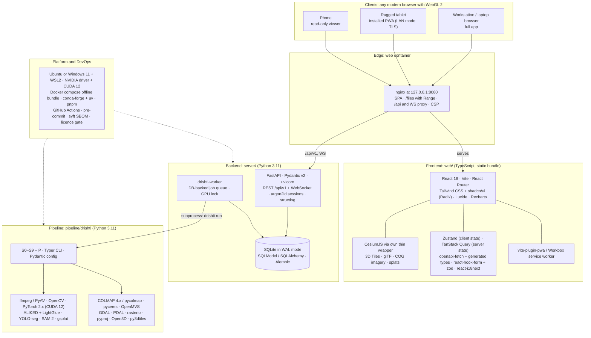
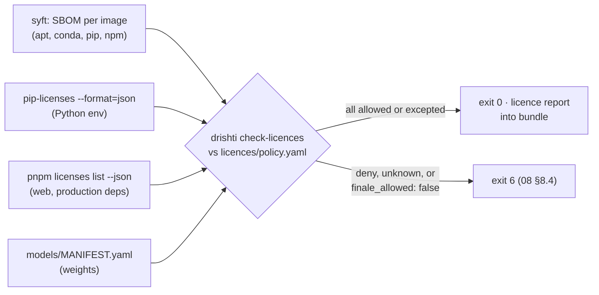

# 07 · Tech Stack

> **Purpose:** every component of Drishti3D, layer by layer: what it does, why we chose it, what we rejected, which version to use, its licence and who owns it. It records the **client platform decision** (one offline-first web app, installable as a PWA). It also holds the licence register the charter requires.
>
> **Status:** Draft v1.1 · 2026-09-30 · Owners: R1 Pipeline Lead (pipeline, server, DevOps), R5 Frontend Engineer (web stack, platform decision), R2 Geo & Accuracy Lead (licence register sign-off)

---

## 0. How to read this document

- **Source of truth.** [`00-project-charter.md`](00-project-charter.md) §8 fixes the technology decisions. This document explains and expands them. If the two ever disagree, the charter wins. Fix this file.
- **Section numbers are stable.** Other documents link to §3.13 (web layer), §4 (hardware) and §8 (licence register, datasets in §8.3). New material is added inside those sections or after §8. Do not renumber.
- **Versions.** We quote a version only when the charter or the research notes name one. Everywhere else the text says **"pin at implementation time"**. When you pin a version, record it in the lock files (§5.2) and, for native tools, in `docker/versions.env`.
- **Licences.** Anything marked **⚠ verify** was not confirmed against the upstream LICENSE file during research. R2 must check it and update the register (§8) before the idea-stage PPT, and again before the finale build.
- **Charter rule (§8):** *model weights whose licence excludes military use (e.g. VGGT-1B-Commercial), and non-commercial weights shipped as the default, are forbidden in the final build.*

### Licence traffic lights used below

| Mark | Meaning for the Drishti3D finale / NTRO build |
|---|---|
| 🟢 | Permissive (MIT, BSD, Apache-2.0, ISC, MPL-2.0, OFL-1.1, public domain). OK to ship. |
| 🟡 | Copyleft (GPL/AGPL/LGPL, Artistic/GPL dual). OK for the hackathon and for internal or offline government use. Record it and give NTRO a deployment note. It is **not** OK to hide modifications if the tool is ever offered as a network service. |
| 🟠 | Non-commercial or research-only. May be used for **experiments and benchmarks only**. Never the default, and never in the finale bundle. |
| 🔴 | Excludes military or defence use, or is otherwise incompatible with NTRO. **Forbidden**: not in the repo, not in the bundle, not in the demo. |
| ⚪ | Unknown. Treat as 🟠 until verified. |

### 0.1 Review of v1.0 (what this revision fixes)

| # | Gap or weakness found in v1.0 | Fixed in |
|---|---|---|
| G1 | No decision on the client platform (web, native mobile, desktop wrapper), although field tablets and phones are named users in [09 §1](09-viewer-and-ui.md) | §2.1 |
| G2 | Frontend was a list of "proposed" libraries. No router, UI kit, forms, PWA/offline caching, API-client generation or icons. The chart choice was left open, and one of its two candidates (uPlot) draws on canvas, which contradicts the stated "SVG, no canvas" reason | §3.13 |
| G3 | Backend was three rows. No ORM or migrations, job-claim design, auth libraries, logging library, WebSocket implementation or nginx rules for Range, caching and CSP | §3.12 |
| G4 | Libraries used in [05](05-pipeline-design.md) were missing: PyAV, pyarrow (`frame_index.parquet`), pyceres (S3.5 BA), moderngl (true ortho), a MILP solver (S6), Shapely/CityJSON tooling, 3D Tiles validator, Draco/KTX2 encoders, and the S2 semantic-segmentation model. exiftool is used as a runtime fallback in 05 S0.3 but was marked "dev only" | §3.1–§3.10, §3.15 |
| G5 | Pinning said `npm ci` / `package-lock.json`, with no conda lock, no Node LTS policy and no rule for pinning CI actions | §5 |
| G6 | Only weights were licence-checked. There was no SBOM or dependency licence scan | §5.5, §8.4 |
| G7 | The licence register lacked most web and server libraries, fonts and geoid grids | §8.1 |
| G8 | Broken cross-reference ("register (§11)") | §0 |
| G9 | No stack risk register and no "what changes for production" | §9, §10 |

---

## 1. Stack at a glance

### 1.1 Layered view



### 1.2 One-table summary

| Layer | Choice | Version policy | Licence | Owner role |
|---|---|---|---|---|
| Client delivery | **One web app** (SPA) served from the ground station; installable **PWA** on tablets; phone = read-only viewer; no native mobile app; Tauri wrapper = future work (§2.1) | n/a | — | R5 |
| Frontend language / framework / build | TypeScript (`strict`) · React 18 · Vite | React 18.x (charter, 09). TS and Vite: pin at implementation time in `pnpm-lock.yaml` | Apache-2.0 · MIT · MIT 🟢 | R5 |
| 3D engine | CesiumJS through our own thin wrapper (no Resium) | **≥ 1.139** if the splat layer is used; otherwise pin at implementation time | Apache-2.0 🟢 | R5 (tiles content: R3) |
| Routing · state | React Router · Zustand (client) · TanStack Query (server) | Pin at implementation time | MIT 🟢 | R5 |
| UI kit · icons · charts | Tailwind CSS + shadcn/ui on Radix primitives · Lucide · Recharts | Pin; shadcn components are vendored into the repo | MIT · MIT · ISC · MIT 🟢 | R5 |
| Forms · i18n · PWA | react-hook-form + zod · i18next/react-i18next (EN + HI) · vite-plugin-pwa (Workbox) | Pin at implementation time | MIT 🟢 | R5 |
| API client | openapi-typescript (types) + openapi-fetch, generated from `/api/v1/openapi.json` | Regenerated in CI; drift fails the build | MIT 🟢 | R5 (contract with R1) |
| Frontend QA | Vitest · React Testing Library · MSW · Playwright · axe-core · ESLint · Prettier | Pin at implementation time | MIT / Apache-2.0 / MPL-2.0 🟢 (dev only) | R5 |
| Edge | nginx (alpine image) | Image pinned by digest | BSD-2 🟢 | R1 |
| API | FastAPI · Pydantic v2 · uvicorn · Starlette WebSockets | `uv.lock` | MIT · MIT · BSD-3 🟢 | R1 (endpoints consumed by R5) |
| Persistence | SQLite (WAL) · SQLModel on SQLAlchemy 2.x · Alembic | `uv.lock`; SQLite from the base image | Public domain · MIT 🟢 | R1 |
| Jobs | DB-backed queue in `drishti-worker` (ADR-006), no broker | In-repo | Ours 🟢 | R1 |
| Auth · logging | Local users, argon2id (argon2-cffi), server-side sessions · structlog JSON Lines | `uv.lock` | MIT · MIT/Apache-2.0 🟢 | R1 |
| Pipeline language | Python 3.11 | 3.11.x | PSF 🟢 | R1 |
| CV / ML | OpenCV · PyTorch 2.x (CUDA 12) · ALIKED + LightGlue · YOLO-seg · SAM 2 · gsplat | Pin; CUDA wheel index in `docker/versions.env` | Apache/BSD 🟢 · YOLO **AGPL-3.0** 🟡 | R1 / R4 |
| SfM / MVS | COLMAP 4.x (global mapper) + pycolmap · OpenMVS | Tag or commit SHA in `docker/versions.env` | BSD-3 🟢 · **AGPL-3.0** 🟡 | R1 / R3 |
| Geo | GDAL 3.x · PDAL · PROJ/pyproj · rasterio · laspy · Open3D · py3dtiles | conda-forge, locked | MIT/BSD 🟢 · py3dtiles ⚪ | R2 / R3 |
| Host / containers | Ubuntu 22.04/24.04 or Windows 11 + WSL2 · NVIDIA driver + CUDA 12 · Docker + compose v2 + NVIDIA Container Toolkit | Base images pinned by digest | Apache-2.0 + NVIDIA EULA | R1 |
| Environments | conda-forge (micromamba) for binary geo stack · uv for pure Python · pnpm for web | `conda-lock.yml` · `uv.lock` · `pnpm-lock.yaml` | BSD/MIT/Apache 🟢 | R1 / R5 |
| CI and supply chain | GitHub Actions · pre-commit · syft (SBOM) · pip-licenses · `pnpm licenses` → `drishti check-licences` | Actions pinned by commit SHA | MIT/Apache 🟢 | R1, sign-off R2 |

---

## 2. Platform layer

### 2.1 Client platform decision

**Decision: one offline-first web app** (React + TypeScript + CesiumJS), served by nginx in Docker on the ground-station laptop or workstation at `127.0.0.1:8080`. It has a responsive tablet layout and can be **installed as a PWA**. A phone gets a **read-only viewer**. We build **no native mobile app**. An optional **Tauri** desktop wrapper is future work. Recorded as **ADR-012** in [04 §13](04-system-architecture.md#13-architecture-decision-records).

#### Options considered

| Option | What it would mean |
|---|---|
| **A. Web app + PWA** (chosen) | The same static bundle serves every device from the local nginx. Tablets on the ground-station LAN install it as a PWA. The phone layout hides run control. |
| B. Native mobile app | Kotlin/Swift, or React Native/Flutter. CesiumJS does not run natively, so the 3D view would be either a WebView (back to option A, with extra packaging) or a different engine (Cesium Native with Unreal/Unity). The pipeline still runs on the workstation. |
| C. Desktop wrapper: Tauri | The same SPA inside the OS WebView (WebView2 on Windows, WebKitGTK on Linux), with a small Rust shell. The server stays in Docker. |
| D. Desktop wrapper: Electron | The same SPA inside a bundled Chromium, with a Node main process. The server stays in Docker. |

#### Weighted decision matrix

Scores run from 1 (poor) to 5 (best). They are the team's engineering judgement, not measurements. Weight × score, summed; the maximum is 500.

| Criterion (weight) | Why it matters | A. Web + PWA | B. Native mobile | C. Tauri | D. Electron |
|---|---|---|---|---|---|
| **Offline / air-gapped** (20) | DST 2021, NFR-SEC-01. No runtime downloads. | 4. Fully offline against the local server. The PWA caches the shell and pinned runs, but a live server is still needed for processing. | 3. The app works offline, but it is useless without the workstation. | 5. Assets bundled with the app | 5. Assets bundled with the app |
| **GPU access** (10) | Heavy GPU work runs in the worker. The client only needs WebGL 2 for 3D Tiles. | 4. WebGL 2 in every current browser | 3. Mobile GPU. No CesiumJS, so the engine would be rebuilt. | 4. Good on WebView2; WebKitGTK WebGL on Linux is weaker ⚠ verify | 4. Bundled Chromium, predictable |
| **Dev speed** (20) | About 10 weeks to the finale, with one frontend owner | 5. One codebase, Vite HMR, no packaging | 1. New codebase and toolchain, device testing, signing | 3. Rust toolchain, per-OS installers, WebView differences | 4. Mature, but packaging and auto-update work |
| **Team skills** (15) | R5 plus part-time help; the team knows React and TS | 5 | 1 | 3 | 4 |
| **3D performance** (15) | 1 km² meshes and multi-million-point clouds | 4. CesiumJS is the reference 3D Tiles client; the browser tab memory limit is managed with budgets (09 §9) | 3. Mobile thermal and memory limits | 3. Depends on the OS WebView ⚠ verify on Ubuntu | 4. Same as Chrome |
| **Deployability on NTRO hardware** (10) | Unknown client devices; locked-down government machines | 5. Nothing to install on clients; one Docker bundle on the host | 2. Sideloading APKs and MDM; iOS distribution needs an Apple programme | 3. Per-OS installer on every client; still needs the Docker backend | 3. Large installer per client (Chromium); still needs the backend |
| **Security** (10) | Accredited environment, minimal attack surface | 4. Single origin, CSP, localhost bind, browser sandbox. LAN mode needs TLS. | 3. More device types to harden; app-store trust chain not available offline | 4. Small shell, capability-based permissions | 2. Node in the main process, and a bundled Chromium that ages without updates on an air-gapped host |
| **Weighted total** | | **445** | 220 | 360 | 390 |

**Result:** option A wins clearly. Electron and Tauri only win on "offline", and there the gap is small because the server is local anyway.

#### What the decision implies

| Topic | Rule |
|---|---|
| Served from | nginx in the `web` container, `127.0.0.1:8080` by default (04 §6.3). No CDN, no external fonts. |
| Desktop / laptop | Full app. Chromium-based browsers and Firefox (current versions) are supported. The finale demo runs on Chromium. |
| Tablet | Responsive layout (09 §5: panels become drawers or bottom sheets under 1024 px). Touch targets ≥ 48 px. Installable as a PWA. |
| PWA prerequisite | Service workers need a **secure context**. `localhost` qualifies, but a tablet reaching the laptop over the LAN does not unless the server uses **LAN mode with TLS and a local CA** (04 §11). The tablet must trust that CA. Without TLS the app still works on the tablet as a normal web page, but it cannot be installed and has no offline cache. |
| Phone | **Read-only viewer**: missions list, 3D/2D view with a reduced point budget, layer toggles, saved measurements, accuracy report. Upload, run control and export are hidden. The server enforces permissions through roles (`analyst` accounts); hiding UI by screen size is never a security control. |
| Native mobile | Not built. Revisit only if NTRO requires device features the browser cannot provide. |
| Tauri | Future work (§10). It would reuse the same `web/dist` bundle and could hand local file paths to the server instead of uploading multi-GB videos. |
| Electron | Rejected: bundle size, and an unpatched Chromium on air-gapped hosts. |

### 2.2 Host platform and runtime

| Component | Purpose | Why chosen | Alternatives considered and why rejected | Version guidance | Licence |
|---|---|---|---|---|---|
| **Ubuntu 22.04 / 24.04 LTS** | Host OS for development and the finale | Every CV/photogrammetry tool builds and tests on it first. ODM 3.6.0 moved to an Ubuntu 24.04 base ([ODM releases](https://github.com/OpenDroneMap/ODM/releases)). | Windows native: COLMAP/OpenMVS builds are painful and paths break. macOS: no CUDA. | 22.04 or 24.04 LTS | Various, all free |
| **Windows 11 + WSL2** | Supported dev setup for team laptops | Uses the Windows NVIDIA driver with CUDA inside WSL2 Ubuntu. Same scripts as Linux. | Dual boot: works, but clumsy for the team | WSL2 with Ubuntu 22.04/24.04 | Proprietary host OS |
| **NVIDIA driver + CUDA 12.x** | GPU compute for COLMAP, OpenMVS, PyTorch, gsplat | The charter fixes CUDA 12. PyTorch, COLMAP and gsplat all ship CUDA 12 builds. | ROCm/HIP: COLMAP 4.2.0 added ROCm support ([COLMAP releases](https://github.com/colmap/colmap/releases)), but gsplat and the OpenMVS CUDA paths are NVIDIA-first. Rejected for the MVP. | CUDA 12.x. Pin the minor version at implementation time and match it to the PyTorch wheel. | NVIDIA EULA (driver, toolkit) |
| **Docker + docker compose + NVIDIA Container Toolkit** | Reproducible, **offline** deployment bundle | Charter §8: one bundle, `docker load`, runs air-gapped. ODM already ships an `opendronemap/odm:gpu` image used with `--gpus all` ([ODM GitHub](https://github.com/OpenDroneMap/ODM)). | Conda-only installs: not reproducible across machines. Singularity/Apptainer: fine on HPC, unfamiliar on laptops. | Docker Engine / Desktop current. Compose v2. | Apache-2.0 (Engine, Compose, Container Toolkit). Check the NVIDIA CUDA base image licence terms. |
| **Python 3.11** | Pipeline and server language | Charter §8. Supported by PyTorch 2.x, pycolmap, GDAL/PDAL on conda-forge. | 3.12: ODM moved to it, but some geo/ML wheels lag. Revisit after M2. | 3.11.x | PSF |
| **TypeScript + Node.js (active LTS)** | Web build toolchain (Node is **not** needed at runtime: nginx serves static files) | Charter §8. Vite needs a modern Node. | Plain JS: harder to refactor the measurement code safely | Node: the current **active LTS** line, pinned in `web/.nvmrc` and `package.json#engines`. Node 20 is past end-of-life (April 2026) ⚠ verify. TypeScript: pin at implementation time. | Node MIT · TS Apache-2.0 |
| **conda-forge (micromamba / Miniforge) + uv** | Python environment management | conda-forge gives GDAL/PDAL/PROJ binaries that match each other. uv resolves the pure-Python layer quickly and writes a lock file. The split is defined in §5.3. | pip-only: GDAL/PDAL wheels are fragile. Poetry: slower, and does not handle binary geo stacks. Pixi: promising conda+PyPI lock in one tool, but new to the team ⚠ revisit. | Pin at implementation time | BSD-3 (Miniforge, micromamba) · Apache-2.0/MIT (uv) |
| **pnpm** | Web package manager | Strict `node_modules` (no phantom deps), fast, content-addressed store that can be pre-filled for offline builds (`pnpm fetch`), deterministic `pnpm-lock.yaml`, built-in `pnpm licenses list` | npm: slower, flat `node_modules` hides undeclared deps. Yarn Berry: PnP breaks some tooling. | Pin with `package.json#packageManager` | MIT 🟢 |

---

## 3. Stage-by-stage components

### 3.1 S0 · Ingest & Sync (`drishti.ingest`)

| Component | Purpose | Why chosen | Alternatives and why rejected | Version | Licence |
|---|---|---|---|---|---|
| **ffmpeg / ffprobe** | Decode MP4/MOV/TS (H.264/H.265, NVDEC), read PTS timestamps, demux the KLV data PID from `.ts` | Universal. Handles every drone container. Gives exact per-frame PTS, which the time-sync step needs. | OpenCV `VideoCapture`: no reliable PTS and no data-stream demux. | Pin at implementation time. Use a build **without** `--enable-nonfree`. | LGPL-2.1 or GPL, depending on build flags 🟡. Ship an LGPL build. |
| **PyAV** | Python binding over libav for in-process frame and PTS access (05 S0.1 step 2) | Avoids parsing raw pipes for the analysis stream; same libav as the CLI | Raw `ffmpeg` pipes only: fine as fallback, clumsier timestamps | Pin at implementation time. Use a PyAV build linked against our LGPL ffmpeg (the PyPI wheels bundle their own FFmpeg ⚠ verify its flags). | BSD-3 🟢 (links LGPL FFmpeg 🟡) |
| **Own DJI SRT parser** (`ingest/srt.py`) | Parse per-frame lat/lon/alt/focal/gimbal/ISO/shutter from `.SRT` sidecars | The SRT format differs between DJI models. ODM needed several per-model fixes (Phantom 4 RTK in 3.2.0, Mavic 2 Zoom in 3.5.1, a telemetry fix in 3.6.2) ([ODM releases via Zenodo](https://zenodo.org/records/21909664)). Our own regex-based parser plus golden test files per model gives us control. SRT times are local with **no timezone** ([ScienceDirect 2025](https://www.sciencedirect.com/science/article/abs/pii/S2352938525003544)). | [DJI_SRT_Parser](https://github.com/JuanIrache/DJI_SRT_Parser) (JavaScript, wrong runtime). [dji-telemetry](https://pypi.org/project/dji-telemetry/) (Python). Use it as a **reference and cross-check**, not a hard dependency. | n/a (in-repo) | Ours. Reference parsers: ⚪ verify before copying any code. |
| **exiftool** | Fallback reader for telemetry embedded in the MP4 when no SRT dialect matches (05 S0.3) | Reads DJI embedded metadata tracks (`-ee`) | No Python equivalent covers DJI embedded tracks | Pin at implementation time. Called as a **separate process** in the worker image. | Perl Artistic-1.0 **or** GPL (dual) 🟡. We use it under the Artistic licence. ⚠ decide: bundle, or drop the fallback |
| **klvdata** | Decode MISB ST 0601 (UAS Datalink LS) and ST 0102 from STANAG 4609 transport streams | The only mature pure-Python KLV decoder with no dependencies ([PyPI](https://pypi.org/project/klvdata/), [paretech/klvdata](https://github.com/paretech/klvdata)). NTRO will expect FMV support (charter §4.4). | klv-parser, klvcms: smaller, less used. All4Gis fork: used in QGIS FMV context, same lineage. | Pin at implementation time. Maintenance status: ⚠ verify. | ⚪ verify (believed MIT) |
| **Time-offset estimator** (`ingest/timesync.py`) | Estimate the SRT↔frame offset by cross-correlating GPS velocity with flow/SfM velocity | For cm-level georeferencing at 10–30 m/s, sync must be better than 1 ms ([Rehak & Skaloud, via ResearchGate](https://www.researchgate.net/publication/311555608_Time_synchronization_of_consumer_cameras_on_Micro_Aerial_Vehicles)). No public measurement of DJI SRT latency exists. | Assume offset = 0 (what everyone else does). Rejected: this is a differentiator. | n/a | Ours (NumPy/SciPy BSD) 🟢 |
| **NumPy, SciPy, pandas** | Numerics, splines, interpolation, signal correlation | Standard | — | Pin at implementation time | BSD-3 🟢 |
| **pyarrow** | Write/read `00_ingest/frame_index.parquet` (one row per decoded frame) | Columnar, fast, typed; pandas-native | CSV: ~18 k rows × many columns is slow to reload in every stage | Pin at implementation time | Apache-2.0 🟢 |

### 3.2 S1 · Keyframe Selection (`drishti.frames`)

| Component | Purpose | Why chosen | Alternatives and why rejected | Version | Licence |
|---|---|---|---|---|---|
| **OpenCV (opencv-python-headless)** | Optical-flow parallax, variance-of-Laplacian blur score, shot-cut and overlay detection | Fast and CPU-friendly. Well understood. Research shows about one frame per 2.5 s matches still-photo accuracy, and denser sampling adds compute, not accuracy ([Remote Sens. 2021](https://doi.org/10.3390/rs13142745)). | Learned blur or quality models: optional R4 experiment, not the default. Fixed-fps sampling (ODM `--video-limit` 500): ignores blur and parallax. | 4.x. Pin at implementation time. | Apache-2.0 (OpenCV ≥ 4.5) 🟢 |

### 3.3 S2 · Dynamic Masking & Semantics (`drishti.masking`)

| Component | Purpose | Why chosen | Alternatives and why rejected | Version | Licence |
|---|---|---|---|---|---|
| **SAM 2** | Promptable and video-propagated masks for vehicles and people. DroneSplat-style tracking of temporarily parked vehicles ([arXiv 2503.16964](https://arxiv.org/abs/2503.16964)). | Apache-2.0 code **and** weights. Video propagation. | SAM v1: no video memory. DroneSplat reports SAM 2 is a compute bottleneck on large scenes, so run it only on keyframes. | Pin checkpoint (e.g. a small/base variant) at implementation time | Apache-2.0 🟢 |
| **Ultralytics YOLO-seg** | Fast class detector and segmenter (car, truck, person, bus) that produces prompts or masks | Fastest route to class-aware masks. Well documented. | Detectron2 Mask R-CNN (Apache-2.0 code, slower, weights ⚠ verify). RT-DETR variants from other codebases (⚠ verify licence). Kept as the **licence-clean fallback path** if NTRO rejects AGPL. | Pin at implementation time | **AGPL-3.0** (code **and** weights) 🟡. Fine for the hackathon. For deployment: open-source the whole service, buy an Ultralytics enterprise licence, or switch to SAM 2 + a permissive detector. |
| **Aerial semantic-segmentation model** (05 S2.2 step 3) | Classes sky, water, building, road, vegetation, ground per keyframe | Needed for S6 label fusion. Owned by R4. | Candidates must pass the licence gate for **both** code and weights **and** the training dataset. Many aerial segmentation datasets are research-only ⚠ verify; SegFormer's reference code is reported as non-commercial ⚠ verify. A torchvision segmentation architecture (BSD-3 code) fine-tuned on permissively licensed or our own labelled data is the safe default ⚠ verify weight terms. | Decide by M2; pin checkpoint | ⚪ until chosen (see W16) |
| **Sky / OSD overlay masks** | Remove sky (no stable features) and burned-in on-screen-display text | Simple colour/position heuristics (ExG, MSER) plus the segmenter | — | n/a | Ours 🟢 |

### 3.4 S3 · Pose Estimation (`drishti.sfm`)

| Component | Purpose | Why chosen | Alternatives and why rejected | Version | Licence |
|---|---|---|---|---|---|
| **COLMAP 4.x (global mapper = GLOMAP) + pycolmap** | Primary SfM: features, matching, global SfM, bundle adjustment, GPS and gravity priors | GLOMAP is "orders of magnitude faster" than incremental COLMAP at comparable accuracy and handles sequential video ([arXiv 2407.20219](https://arxiv.org/html/2407.20219v2)). It is now merged into COLMAP as the "global" mapper ([GLOMAP README](https://github.com/colmap/glomap/blob/main/README.md)). COLMAP 4.x adds GPS/gravity pose priors, ALIKED/LightGlue, rig support, and Caspar GPU bundle adjustment billed as 1–2 orders of magnitude faster (4.1.0). 4.2.0 adds multi-component global mapping and LoMa matching via ONNX ([COLMAP releases](https://github.com/colmap/colmap/releases)). | See the comparison in §6.1 | **4.x.** Latest seen in research: 4.2.1. Release dates on the fetched page were inconsistent, so **verify and pin at implementation time**. Standalone GLOMAP is unmaintained, so do not use it. | BSD-3 🟢 |
| **ONNX Runtime** (if required by the COLMAP build) | Inference backend for COLMAP's learned features/matchers (LoMa is ONNX-based in 4.2.0) | Comes with the COLMAP build options | — | Whatever the pinned COLMAP tag expects ⚠ verify | MIT 🟢 |
| **ALIKED** (default) | Learned local features | Permissive alternative to SuperPoint. Supported natively in COLMAP 4.x. | SIFT: robust but weaker under blur and compression (kept as the CPU/GPU fallback). DISK: ⚠ verify licence. | Pin at implementation time | ⚪ verify (believed BSD-3) |
| **SuperPoint** (experiments only) | Learned features for benchmarks | Well known, strong with LightGlue | **Weights are non-commercial** (Magic Leap licence) ([hloc notes](https://github.com/cvg/Hierarchical-Localization)). Never the default. | — | **Pretrained weights non-commercial 🟠.** Code licence depends on the reimplementation (⚠ verify). |
| **LightGlue** | Learned matcher (ALIKED+LightGlue) | Fast and accurate. Integrated in COLMAP 4.x ([arXiv 2306.13643](https://arxiv.org/abs/2306.13643)) | SuperGlue (non-commercial weights 🟠). LoMa (COLMAP 4.2 ONNX; licence ⚠ verify). | Pin at implementation time | Code Apache-2.0 🟢. Each **feature-specific weight** follows its own licence. Use the ALIKED-LightGlue weights. ⚠ verify |
| **Vocabulary tree for ALIKED** (`models/vocab_tree_aliked.bin`) | Loop detection in the sequential matcher (05 S3.2) | Required by `--SequentialMatching.loop_detection` | Build our own tree from public imagery (slow) | Matching the pinned COLMAP tag | ⚪ verify (distributed by COLMAP) |
| **pyceres** | Our prior-weighted bundle adjustment with GNSS, gravity and rolling-shutter terms (05 S3.5, 06 §10) | Python bindings to the same Ceres used by COLMAP; works on pycolmap reconstructions | GTSAM (below) for factor graphs; SciPy `least_squares`: too slow for thousands of cameras | Pin to the pycolmap/COLMAP tag | ⚪ verify (believed BSD-3) |
| **Rolling-shutter model** (`sfm/rolling_shutter.py`) | Per-row pose interpolation using a readout time | Rolling shutter displaces image content by about 10 px on a Phantom 2 at 8 m/s and 70 m. Modelling it removes systematic reprojection error ([Vautherin et al. 2016](https://isprs-annals.copernicus.org/articles/III-3/139/2016/isprs-annals-III-3-139-2016.pdf)). ODM ships per-model readout profiles (Mini 3, Mini 4 Pro, Mavic 3). | Ignore it (most teams do) | n/a | Ours 🟢 |
| **DPVO** (fallback) | Low-memory learned visual odometry when SfM fragments | **< 3 GB GPU**, the "most practical learned method" in the 2026 nadir-UAV benchmark ([arXiv 2608.18632](https://arxiv.org/html/2608.18632)) | DROID-SLAM and MASt3R-SLAM (~30 GB GPU, too heavy for a laptop). ORB-SLAM3 (GPLv3, CPU, loses tracking). | Pin at implementation time | ⚪ verify (believed MIT) |
| **GeoFF3D** (research fallback) | GPS-anchored feed-forward poses and point maps in a metric, Z-up frame | Closest published method to PS 26158. About 2,000 images in about 5 min. Stable on near-collinear paths ([arXiv 2608.28288](https://arxiv.org/abs/2608.28288)). | — | Pin a commit at implementation time | **⚪ to verify.** Blocked from the default until verified. |
| **MapAnything** (research) | Metric geometry that accepts intrinsics and pose inputs | Can take drone telemetry ([arXiv 2509.13414](https://arxiv.org/abs/2509.13414)) | — | — | **⚪ to verify** (code and weights may differ) |
| **VGGT** | Feed-forward reconstruction | Strong on small sets | Original checkpoint **non-commercial 🟠**. **VGGT-1B-Commercial excludes military use 🔴 FORBIDDEN** ([VGGT GitHub](https://github.com/facebookresearch/vggt)). | — | 🟠 / 🔴 |
| **π3 / Pi3X, Depth Anything 3** | Feed-forward pose and depth | Benchmarks only | — | — | **⚪ to verify** |
| **DUSt3R / MASt3R / MASt3R-SLAM** | Feed-forward pairwise pointmaps | Benchmarks only | CC BY-NC-SA ([slam notes](https://arxiv.org/abs/2312.14132)) | — | 🟠 |
| **Ceres Solver, GTSAM** (optional) | GNSS-aided bundle adjustment and factor-graph refinement | Ceres ships with COLMAP. GTSAM is used only if we add a pose-graph step with GPS and barometer factors. | GVINS/VINS-Fusion: need a raw synchronised IMU stream, which consumer video lacks ([VINS-Mono](https://arxiv.org/abs/1708.03852)). GPLv3. | Pin at implementation time | BSD-3 🟢 |

### 3.5 S4 · Georeferencing & Anchoring (`drishti.georef`)

| Component | Purpose | Why chosen | Alternatives and why rejected | Version | Licence |
|---|---|---|---|---|---|
| **Robust Umeyama 7-DoF** (own, NumPy) | Similarity alignment of SfM camera centres to GPS (Huber/RANSAC, about 1 Hz subsampling), gravity-first 5-DoF on collinear strips | Standard, fast, transparent. Consumer GNSS error is a near-rigid bias (Z mean 3.93 m, SD 0.18 m) ([Zhang et al. 2019](https://esurf.copernicus.org/preprints/esurf-2019-2/esurf-2019-2.pdf)). | COLMAP `model_aligner`: fine as a cross-check, but it has no robust weighting or time-offset handling | n/a | Ours 🟢 |
| **Ortho/DSM registration** (OpenCV + rasterio) | Register our orthophoto/DSM to a reference orthophoto/DSM to remove the bias (the Raptor/Edgybees pattern) | Anchors absolute position with no GCPs. This is our main differentiator. | Manual GCP clicking: slow, and not "without extensive GCPs" | n/a | Ours 🟢 |
| **pyproj (PROJ)** + bundled geoid grids | CRS transforms: WGS84 ↔ UTM ↔ ECEF, ellipsoid ↔ geoid (EGM2008/EGM96) | Reference implementation. Grids are shipped so PROJ never downloads (08 §3). | — | Pin at implementation time | MIT 🟢 · grids: see register #55 |
| **RTK/PPK/CORS/GAGAN ingest** | Read `.pos`/RINEX-derived positions and replace SRT GPS | Survey of India CORS gives ±3 cm ([SoI CORS](https://cors.surveyofindia.gov.in/introduction.html)). GAGAN gives about 1.5 m H / 2.5 m V. | RTKLIB (BSD-2 ⚠ verify) for our own PPK post-processing: optional tool, not bundled by default | Pin at implementation time | Ours 🟢. RTKLIB ⚪ |

### 3.6 S5 · Dense Reconstruction & Mesh (`drishti.dense`)

| Component | Purpose | Why chosen | Alternatives and why rejected | Version | Licence |
|---|---|---|---|---|---|
| **OpenMVS** | DensifyPointCloud → ReconstructMesh → RefineMesh → TextureMesh | Best open MVS + texturing quality/speed trade-off. Used inside ODM and by the strongest competitor repos. MVS geometry beats Gaussian-splat geometry ([ISPRS 2026](https://isprs-archives.copernicus.org/articles/XLVIII-2-W12-2026/143/2026/isprs-archives-XLVIII-2-W12-2026-143-2026.pdf)). | See §6.2 | Pin a release or commit at implementation time | **AGPL-3.0 🟡.** Called as a separate executable (process boundary). Write the deployment note for NTRO. |
| **PDAL** (+ python-pdal) | Point-cloud pipelines: outlier removal, SMRF ground classification, HAG, cropping, reprojection, LAS/LAZ writing, DSM gridding | Industry standard. Scriptable JSON pipelines. | Pure Open3D: no ground filter, no LAS writing | Pin at implementation time (conda-forge) | BSD-3 🟢 |
| **GDAL** | DSM/DTM/orthomosaic rasters, COG writing, warping, overviews, `gdal_fillnodata` | Industry standard. ODM 3.6.0 bundles GDAL 3.11.1. | — | 3.x. Pin at implementation time (conda-forge). | MIT/X 🟢 |
| **rasterio** | Pythonic GDAL raster I/O | Clean API for S4, S8 and S9 | — | Pin at implementation time (conda-forge, same GDAL) | BSD-3 🟢 |
| **Open3D** | Point-cloud and mesh utilities, ICP, RANSAC planes, DBSCAN, quadric decimation | Fast, well-documented Python API | trimesh (MIT) for light mesh I/O, used alongside Open3D | Pin at implementation time | MIT 🟢 |
| **moderngl** (headless EGL) | True-ortho rendering of the textured mesh, tile by tile (05 S5.1) | Small OpenGL wrapper; runs offscreen in the container | PDAL point-colour ortho (kept as fallback). Blender: GPL, heavy. | Pin at implementation time. Needs NVIDIA EGL libraries in the worker image ⚠ verify. | MIT 🟢 |

### 3.7 S6 · Completion & Classification (`drishti.completion`)

| Component | Purpose | Why chosen | Alternatives and why rejected | Licence |
|---|---|---|---|---|
| **PDAL SMRF + HAG + rules** | Ground / non-ground labels, height above ground | Deterministic and fast | Learned point-cloud segmentation: considered as a stretch, trained or validated on SensatUrban (licence ⚠ verify) | BSD-3 🟢 |
| **Open3D RANSAC + own LoD2 fitting** | Roof planes → vertical walls to ground (City3D-style), flagged *inferred* | Metric and explainable. City3D shows the approach ([arXiv 2201.10276](https://arxiv.org/abs/2201.10276)). | Diffusion completion (ReconFusion, CAT3D, Difix3D+): plausible but **non-metric**, rejected for measurement. City3D/City4CFD code: ⚠ verify licences before reuse. | MIT 🟢 |
| **Shapely** | Footprint α-shapes, simplification, snapping, GeoJSON geometry | Standard GEOS binding | Hand-written polygon code | BSD-3 🟢 |
| **MILP solver: SCIP (via PySCIPOpt) or CBC** | PolyFit-style face selection in the `quality` profile (05 S6.2 step 5) | Open-source solvers named in 05 | Gurobi/CPLEX: commercial licences, not offline-friendly | SCIP Apache-2.0 ⚠ verify version · PySCIPOpt MIT ⚠ verify · CBC EPL-2.0 ⚠ verify |
| **cjio** (CityJSON I/O) | Write and validate `lod2/lod2.cityjson` | Reference CityJSON tooling | Hand-written JSON: easy to get invalid files | ⚪ verify (believed MIT) |
| **Ortho semantic labels** (S2 masks projected) | road / vegetation / water / building hints | Reuses S2 outputs | — | as S2 |

### 3.8 S7 · Photoreal Layer (`drishti.splat`)

| Component | Purpose | Why chosen | Alternatives and why rejected | Licence |
|---|---|---|---|---|
| **gsplat** (nerfstudio) | CUDA 3D Gaussian splatting training with per-image exposure compensation. **Display only.** | Apache-2.0, fast, Python API ([gsplat](https://github.com/nerfstudio-project/gsplat)). CesiumJS 1.139 renders `KHR_gaussian_splatting` ([radiancefields.com](https://radiancefields.com/cesium-brings-khr_gaussian_splatting-support-to-cesiumjs-and-unreal-engine)). | Original Inria 3DGS code: research/non-commercial licence 🟠 (⚠ verify). NeRF: slower, worse at aerial scale. DroneSplat/PGSR: ideas borrowed, code licences ⚠ verify. | Apache-2.0 🟢 |

### 3.9 S8 · Export & Tiling (`drishti.export`)

| Component | Purpose | Why chosen | Alternatives and why rejected | Licence |
|---|---|---|---|---|
| **laspy + PDAL** | LAS 1.4 / LAZ with CRS WKT, classification codes, extra bytes | Standard | — | BSD-2 (laspy) · BSD-3 (PDAL) 🟢 |
| **GDAL COG driver** | Cloud-Optimised GeoTIFF ortho/DSM/DTM/confidence | Streams to the viewer with HTTP range requests, fully offline | Plain GeoTIFF: no internal tiling or overviews | MIT/X 🟢 |
| **Own quadtree mesh tiler** (`export/tiles3d.py`, 05 S8.1) + **trimesh / Open3D** | Textured mesh → 3D Tiles 1.1 with LOD, `EXT_mesh_features` / `EXT_structural_metadata` | Full control of geometric error, confidence attributes and inferred flags | obj2tiles (below) as a fallback | MIT 🟢 (libraries) |
| **gltf-transform (CLI) + Draco + KTX-Software (`toktx`)** | GLB optimisation: Draco/meshopt geometry compression, KTX2 textures | Mature, scriptable. **Build-time or worker-time Node CLI.** | FBX: proprietary SDK. Offer FBX only via an optional Blender CLI conversion (GPL tool, not bundled). | MIT · Apache-2.0 · Apache-2.0 🟢 |
| **py3dtiles** | LAS → 3D Tiles point clouds | Python-native ([CesiumGS resources](https://github.com/CesiumGS/3d-tiles/blob/main/RESOURCES.md)) | Cesium ion tiler: commercial SaaS, cloud. Rejected (offline, DST). | ⚪ verify (believed Apache-2.0) |
| **obj2tiles** (as used by ODM `--3d-tiles`) | Fallback textured mesh → 3D Tiles | Proven in ODM 3.6.1 (obj2tiles 1.4.0) | Writing our own tiler is the default; this is the escape hatch | ⚪ verify |
| **3d-tiles-validator** (CesiumGS, Node CLI) | Validate every `tileset.json` (05 S8.2 QA) | Official validator | Hand checks | Apache-2.0 🟢 (CI and worker QA) |

### 3.10 S9 · QA & Confidence (`drishti.qa`)

| Component | Purpose | Licence |
|---|---|---|
| NumPy/SciPy/pandas | RMSE_X/Y/Z, RMSE_H, CE90 = 2.146×RMSE_axis (≈1.5175×RMSE_H), LE90 = 1.6449×RMSE_Z, bias-vs-noise split, bootstrap CIs ([ASPRS Ed. 2 summary](https://lidarmag.com/2023/10/06/the-asprs-positional-accuracy-standards-edition-2/amp/)) | BSD 🟢 |
| matplotlib | Residual plots and doming profiles for the **PDF/HTML report** (the web app draws its own interactive charts, §3.13) | PSF-based 🟢 |
| Jinja2 + WeasyPrint | HTML → PDF accuracy report (self-contained, no external resources) | BSD-3 🟢 |
| CloudCompare (desktop, **not bundled**) | Manual cloud-to-cloud checks against LiDAR truth | GPL 🟡 (tool only) |

### 3.11 P · Live Preview (`drishti.preview`)

| Component | Purpose | Why chosen | Rejected |
|---|---|---|---|
| OpenCV (ORB, homography) + SciPy `least_squares` sliding window, GPS-seeded incremental mosaic; WebP tiles via OpenCV/Pillow | 2D preview within 60 s | CPU incremental mosaicking reaches about 2.3 fps ([ISPRS Annals 2025](https://isprs-annals.copernicus.org/articles/X-2-W2-2025/65/2025/)) | **OpenREALM**: alpha ROS1 code, last significant update around 2020, LGPL/GPLv3 ([GitHub](https://github.com/laxnpander/OpenREALM)). Porting it costs too much. |

### 3.12 Server layer (`server/`)

The server is a thin service layer around the pipeline (04 §1). The run directory stays the source of truth (ADR-009); SQLite holds only the queue, index, events, users and audit data.

#### 3.12.1 Components

| Component | Purpose | Why chosen | Alternatives and why rejected | Version | Licence |
|---|---|---|---|---|---|
| **FastAPI** (on Starlette) | REST `/api/v1` (08 §9), WebSocket progress, OpenAPI served offline at `/api/v1/docs` | Async, typed, auto OpenAPI, same language as the pipeline | Django (heavy, ORM we don't need). Flask (no native async or validation). Litestar: good, smaller community. | Pin at implementation time | MIT · Starlette BSD-3 🟢 |
| **Pydantic v2** + **pydantic-settings** | Request/response models, WebSocket event models, `DRISHTI_*` environment settings. The **same** Pydantic version validates the pipeline config (08 §4). | Rust core, fast; one validation library across server and pipeline | marshmallow / attrs: second validation stack | v2.x, pin at implementation time | MIT 🟢 |
| **uvicorn** (`[standard]`: uvloop, httptools, websockets) | ASGI server | Standard for FastAPI | Hypercorn: fine, less common. Gunicorn + workers: pointless, see below. | Pin; run with **one worker process** (the WebSocket fan-out and login throttle live in process; the API is light) | BSD-3 🟢 |
| **Starlette WebSockets** | `WS /api/v1/runs/{run_id}/progress` with `since_seq` replay (08 §9.3) | Native in FastAPI. Plain WebSocket keeps the browser client tiny. | Socket.IO: extra protocol and library on both sides. SSE: one-way only; subscribe/replay is simpler over WS. | — | BSD-3 🟢 |
| **SQLite** in WAL mode | Job queue, run index, events, users, sessions, audit index | Zero-ops, single file, works offline (ADR-006) | Postgres: a service to run; path kept for multi-host (§10) | The version in the base image; needs `RETURNING` support ⚠ verify ≥ the version that introduced it | Public domain 🟢 |
| **SQLModel** on **SQLAlchemy 2.x** + **Alembic** | Table models shared with Pydantic, migrations | SQLModel removes duplicate model definitions; SQLAlchemy Core is available for the claim query; Alembic keeps upgrades safe across bundles | Raw `sqlite3`: fine for the worker's hot path (allowed), but no migrations. Tortoise/Peewee: smaller ecosystems. | Pin at implementation time. Use **sync** sessions in `def` endpoints (run in the threadpool); async SQLite brings nothing here. | MIT 🟢 |
| **structlog** | JSON Lines logs with `ts, level, run_id, stage, event, msg` (04 §10); bridges stdlib `logging` so uvicorn and library logs share the format | Context variables bind `request_id`/`run_id` without passing loggers around | stdlib `logging` + custom formatter: more code. loguru: second logging model. | Pin at implementation time | MIT **or** Apache-2.0 🟢 |
| **argon2-cffi** | argon2id password hashing (NFR-SEC-03) | Reference binding; RFC 9106 profiles | bcrypt: fine, older. passlib: maintenance status ⚠. | Pin; tune cost so one hash takes ≲ 0.5 s on the finale laptop | MIT 🟢 |
| **python-multipart** | Multipart form for checkpoint CSV upload (08 §9.3) | Required by FastAPI for forms | — | Pin | Apache-2.0 🟢 |
| **httpx** + pytest | API tests (`TestClient`), contract tests against the OpenAPI snapshot | Standard with FastAPI | — | Pin | BSD-3 🟢 |
| **nginx** (`web` container) | Static SPA, `/files/runs/…` with HTTP Range, reverse proxy for `/api/*` and WebSocket, security headers | Fast static serving with native byte ranges; tiny image | Serving files from FastAPI: slower, ties up the API process. Caddy: good, but team knows nginx. | `nginx:alpine`, pinned by digest | BSD-2 🟢 |

#### 3.12.2 Job worker design (decision)

**Decision: a simple DB-backed queue in a separate worker process (`drishti-worker`), no broker.** This implements ADR-006 ([04 §13](04-system-architecture.md#adr-006--fastapi--sqlite-job-runner-instead-of-celeryredis)).

| Element | Design |
|---|---|
| Tables | `jobs(id, run_id, type, status, priority, lane, created_at, claimed_by, heartbeat_at, attempts, cancel_requested)` and `events(seq INTEGER PRIMARY KEY AUTOINCREMENT, run_id, ts, type, stage, payload_json)` |
| Job types and lanes | `ingest_check` (CPU lane), `run`, `qa_only`, `export` (GPU lane), `splat` (GPU lane, lowest priority, pre-emptible; 04 §12.2) |
| Claim (atomic) | `BEGIN IMMEDIATE; UPDATE jobs SET status='running', claimed_by=:w, heartbeat_at=:now WHERE id = (SELECT id FROM jobs WHERE status='queued' AND lane=:lane ORDER BY priority, created_at LIMIT 1) RETURNING *; COMMIT;` |
| Execution | The worker runs the pipeline as a **subprocess** (`drishti run --resume --out data/runs/<id> …`): the same code path as the CLI (ADR-009), crash isolation, and a clean kill of COLMAP/OpenMVS children via the process group |
| Progress | The pipeline appends events to `logs/events.jsonl`; the worker tails that file and inserts events into SQLite in small batches. One writer per worker keeps lock contention low. |
| Fan-out | One asyncio task in the API polls `events WHERE seq > :last` every 500 ms (04 §5.1) and pushes to subscribed WebSockets; clients replay with `since_seq` |
| Heartbeat and recovery | Heartbeat every 10 s; a `running` job with a heartbeat older than 60 s becomes `INTERRUPTED` and is re-queued on worker start (04 §8, §9.3) |
| Cancellation | API sets `cancel_requested`; the worker sends SIGTERM to the child process group, then SIGKILL after a grace period |
| GPU policy | One worker per GPU (`CUDA_VISIBLE_DEVICES`); inside a run, the VRAM-budget semaphore of 05 §11 decides which stages overlap |
| SQLite settings | `journal_mode=WAL`, `busy_timeout` of a few seconds, `synchronous=NORMAL`, `foreign_keys=ON`, short transactions |

| Rejected alternative | Why rejected |
|---|---|
| Celery (+ Redis/RabbitMQ) | Two more services in an air-gapped bundle; ADR-006 |
| RQ, arq | Need Redis |
| Dramatiq | Needs Redis or RabbitMQ |
| Huey with SQLite storage | Closest fit (no broker). Rejected because we would still hand-write GPU lanes, heartbeats, the 04 §8 state machine and resume-from-run-directory; the custom loop is about the same size and fully transparent. |
| FastAPI `BackgroundTasks` | Runs inside the API process: dies with it, no GPU isolation, no restart recovery |

#### 3.12.3 Authentication and sessions

| Item | Rule |
|---|---|
| Users | Local users in SQLite, roles `admin` / `operator` / `analyst` (04 §11). First admin via `drishti-admin create-user --role admin` (04 §6.4). |
| Passwords | argon2id (argon2-cffi). Login throttled per user and per client address. |
| Browser sessions | Random opaque token (not JWT) in a server-side `sessions` table; cookie `HttpOnly`, `SameSite=Strict`, `Secure` in LAN/TLS mode. Revocation = delete the row. |
| CSRF | `SameSite=Strict` plus an `Origin` check on every unsafe method |
| CLI / automation | Bearer API tokens, stored hashed, scoped to a role, revocable |
| `/files/*` | Same session. nginx asks the API through `auth_request` (an internal auth-check endpoint to add to 08 §9 when implemented). ⚠ verify the module is present in the pinned nginx image. |
| Rejected | JWT (revocation and key handling for no gain on one host). OAuth/Keycloak: another service; production option (§10). fastapi-users: more framework than we need. |

#### 3.12.4 nginx essentials (sketch)

```nginx
# docker/nginx.conf (sketch; final headers checked by the offline e2e test)
map $http_upgrade $connection_upgrade { default upgrade; '' close; }
server {
  listen 80;
  root /usr/share/nginx/html;
  client_max_body_size 80m;               # 64 MiB upload chunks (08 §9.3) + headroom
  include /etc/nginx/drishti-security-headers.conf;   # CSP etc., see note below

  location /            { try_files $uri /index.html; }          # SPA routes (09 §3)
  location = /index.html { add_header Cache-Control "no-cache"; include /etc/nginx/drishti-security-headers.conf; }
  location = /sw.js      { add_header Cache-Control "no-cache"; include /etc/nginx/drishti-security-headers.conf; }
  location /assets/      { add_header Cache-Control "public, max-age=31536000, immutable"; include /etc/nginx/drishti-security-headers.conf; }

  location /api/ {                         # REST + WebSocket
    proxy_pass http://api:8000;
    proxy_http_version 1.1;
    proxy_set_header Upgrade $http_upgrade;
    proxy_set_header Connection $connection_upgrade;
    proxy_request_buffering off;           # stream chunks to the API
    proxy_read_timeout 3600s;
  }
  location /files/runs/ {                  # 3D Tiles, COGs, preview tiles: byte ranges served natively
    auth_request /_auth;                   # internal subrequest to the API auth check
    alias /data/runs/;
    gzip off;                              # on-the-fly gzip would disable Range
    add_header Cache-Control "private, no-cache";
    include /etc/nginx/drishti-security-headers.conf;
  }
}
```

Notes:
- nginx `add_header` in a `location` **replaces** the server-level headers, so the security headers are kept in one include file and repeated where needed.
- CSP from 04 §11 (`default-src 'self'`) needs a few additions for CesiumJS, Radix and the service worker: `worker-src 'self' blob:`, `img-src 'self' data: blob:`, `connect-src 'self'` (covers same-origin WebSocket in current browsers ⚠ verify), inline style attributes (`style-src 'self' 'unsafe-inline'` or `style-src-attr`), and `'wasm-unsafe-eval'` if Draco/KTX2 WebAssembly decoders are used ⚠ verify against the pinned Cesium.
- MIME types to add: `model/gltf-binary` (`.glb`), `application/octet-stream` (`.b3dm`, `.pnts`, `.laz`), `image/tiff` (`.tif`), `image/webp`.

#### 3.12.5 API contract → TypeScript

1. `server/` exports its OpenAPI document to `server/openapi.json` with a script (no running server needed). WebSocket event models are added to `components.schemas` so one generator covers them.
2. `web/` runs `openapi-typescript` to produce `src/api/schema.d.ts`, used by `openapi-fetch` (typed `GET`/`POST` with no runtime codegen).
3. CI regenerates both files and fails on any diff (§5.4). Breaking changes bump `/api/v2` (08 §9.1).

### 3.13 Web layer (`web/`)

This section supersedes the "proposed" rows of [09 §8.1](09-viewer-and-ui.md) (stack table). Screens, component tree and folder layout stay in 09 §8.2.

#### 3.13.1 Components

| Concern | Choice | Why chosen | Alternatives and why rejected | Version | Licence |
|---|---|---|---|---|---|
| Language | **TypeScript**, `strict: true`, no `any` in measurement code (10 §7.2) | Refactor-safe geodesy and uncertainty code | Plain JS | Pin at implementation time | Apache-2.0 🟢 |
| Framework | **React 18** | Charter §8, 09 §8.1, team familiarity | Vue/Svelte: fine, but less team experience. React 19: stable; adopt only if a dependency requires it (§9, R15). | 18.x | MIT 🟢 |
| Build / dev server | **Vite** + `@vitejs/plugin-react`; Cesium static assets copied at build (`vite-plugin-static-copy`) and `CESIUM_BASE_URL` set | Fast HMR, simple config, code splitting per route | webpack: slower, more config. vite-plugin-cesium: thin wrapper, maintenance ⚠ verify; the copy approach is explicit. | Pin at implementation time | MIT 🟢 |
| 3D engine | **CesiumJS** | Native OGC 3D Tiles. `KHR_gaussian_splatting` in 1.139 (Mar 2026) and splat LOD in 3D Tiles (Apr 2026) ([Cesium blog](https://cesium.com/blog/2026/04/27/3d-gaussian-splats-lod/)). See §6.3. | Potree, iTowns (§6.3) | **≥ 1.139** if the splat layer is used; otherwise pin. **Never use Cesium ion at runtime.** | Apache-2.0 🟢 |
| Cesium integration | **Own thin wrapper** (`viewer/CesiumViewport.tsx`, `tilesets.ts`, `tools/*.ts`), **not Resium** | See §3.13.2 | Resium | — | Ours 🟢 |
| Routing | **React Router** (data router, `createBrowserRouter`) | URL scheme of 09 §3 with deep links; route-level code splitting keeps Cesium off non-viewer pages (09 §9) | TanStack Router: excellent typing, less familiar. Hash routing: ugly URLs; not needed because nginx falls back to `index.html`. | Pin at implementation time | MIT 🟢 |
| Client state | **Zustand** stores (viewer, layers, tools, measurements, UI) | Tiny; stores are readable and writable from Cesium event handlers outside React | Redux Toolkit: heavier. Jotai: fine, but atoms fit Cesium handlers less well. | Pin | MIT 🟢 |
| Server state | **TanStack Query** | Caching, retries, background refresh, reconnect handling; WebSocket events update the cache (`setQueryData`) | Hand-written fetch + context: more code for retries/reconnect. RTK Query: needs Redux. | Pin | MIT 🟢 |
| API client | **openapi-typescript** + **openapi-fetch** (§3.12.5); `api/ws.ts` wraps the native WebSocket with backoff and `since_seq` replay (09 §8.3) | Types generated from the server contract; zero runtime codegen | Orval / openapi-generator: heavier generated code | Pin | MIT 🟢 |
| UI kit | **Tailwind CSS** + **shadcn/ui** components built on **Radix UI** primitives (+ `class-variance-authority`, `clsx`, `tailwind-merge`) | See §3.13.3 | MUI, Chakra UI, Mantine, plain CSS modules | Pin; shadcn components are **copied into** `src/components/ui/` and reviewed like our code | MIT (Tailwind, shadcn/ui, Radix, clsx, tailwind-merge) · Apache-2.0 (cva ⚠ verify) 🟢 |
| Icons | **Lucide** (`lucide-react`) | Consistent stroke icons, tree-shaken per icon, default icon set of shadcn/ui | Material Icons (Apache-2.0): different visual language. Heroicons (MIT): smaller set. | Pin | ISC 🟢 |
| Charts | **Recharts** | See §3.13.4 | visx, Observable Plot, uPlot, ECharts | Pin | MIT 🟢 |
| Forms and validation | **react-hook-form** + **zod** (+ `@hookform/resolvers`) | New Mission, optional inputs, export dialog, settings, checkpoint upload. Uncontrolled inputs stay fast on tablets; zod schemas give typed, reusable client-side validation. The server (Pydantic) remains authoritative. | Formik: slower, less maintained ⚠. Hand-rolled state: error-prone. | Pin | MIT 🟢 |
| i18n | **i18next** + **react-i18next**, JSON bundles `en.json`, `hi.json`, namespaced keys (09 §13) | Standard; plural rules via `Intl`; lazy-loaded namespaces | FormatJS/react-intl: ICU-heavy, more setup | Pin | MIT 🟢 |
| Fonts | **Noto Sans** + **Noto Sans Devanagari**, self-hosted (e.g. via `@fontsource` packages) | Hindi rendering offline (09 §10, §13) | System fonts: Devanagari coverage varies by device | Pin | OFL-1.1 (fonts) · MIT (packages) 🟢 |
| Geodesy helpers | Cesium `EllipsoidGeodesic` + **proj4js** (UTM display) + **mgrs** (optional MGRS, 09 Q3) + local EGM2008 grid (09 §8.2) | Offline, small | Server round-trips for every coordinate pick | Pin | MIT ⚠ verify (proj4js, mgrs) · grid: register #55 |
| PWA / offline | **vite-plugin-pwa** (Workbox under the hood), `registerType: 'prompt'` | Generates the manifest and a precache service worker from the Vite build; strategies in §3.13.5 | Hand-written service worker: easy to get cache invalidation wrong | Pin | MIT 🟢 |
| Unit / component tests | **Vitest** + **React Testing Library** (+ `user-event`) + **MSW** for API mocks | Vite-native, fast; MSW mocks REST and WebSocket at the network layer | Jest: slower with ESM/Vite | Pin | MIT 🟢 |
| End-to-end and a11y | **Playwright** (Chromium, WebGL via SwiftShader; 11 §5) + **@axe-core/playwright** | Real browser, network interception for the offline guard (§5.4), per-page axe scans (11: 0 serious/critical) | Cypress: weaker multi-tab/offline control | Pin | Apache-2.0 · MPL-2.0 🟢 |
| Lint / format | **ESLint** (flat config) + **typescript-eslint** + `eslint-plugin-react-hooks` + `eslint-plugin-jsx-a11y`; **Prettier** (+ `prettier-plugin-tailwindcss`) | 10 §7.2 rules; a11y lint catches missing labels early | Biome: fast, but plugin coverage (react-hooks, jsx-a11y) differs ⚠ revisit | Pin | MIT (typescript-eslint BSD-2 ⚠ verify) 🟢 |

#### 3.13.2 Cesium integration: own wrapper, not Resium

| Criterion | Own thin wrapper (chosen) | Resium |
|---|---|---|
| Viewer lifecycle | One `Viewer` for the whole app (09 §9), created once in `CesiumViewport` and exposed through a small module and the Zustand viewer store | Declarative components mount and unmount Cesium objects with React; more re-render care needed |
| Measurement tools | Imperative controllers on `ScreenSpaceEventHandler` (09 §8.2 `ToolControllers`), unit-testable pure maths in `viewer/tools/` | Same controllers would be written imperatively anyway |
| New Cesium features | `KHR_gaussian_splatting`, `CustomShader` hatching (09 §7.2), `Cesium3DTileStyle` usable the day we upgrade | Wrappers can lag new Cesium releases; peer-dependency range must be checked on every Cesium bump ⚠ verify |
| Code size | ~a few hundred lines we own | Extra dependency and abstraction |
| Risk | We write the lifecycle code once | Less boilerplate for simple scenes |

Rule: React owns panels and HUD; Cesium owns the canvas. React never re-creates Cesium objects on render; tile sets are loaded and unloaded by `tilesets.ts` in response to store changes.

#### 3.13.3 UI kit: Tailwind CSS + shadcn/ui (Radix) vs alternatives

| Criterion | Tailwind + shadcn/ui (chosen) | MUI | Chakra UI | Plain CSS modules (09 v1.0) |
|---|---|---|---|---|
| Runtime cost | None: static CSS generated at build | Emotion CSS-in-JS runtime (default) | Emotion runtime | None |
| Theming with 09 §7.4 tokens | Tailwind theme maps directly onto the CSS variables (`--bg`, `--primary` …); dark default, high-contrast via `data-theme` | Theme object in JS, a second source of truth | Theme object in JS | CSS variables, fine |
| Accessibility | Radix primitives handle focus trapping, ARIA and keyboard for dialogs, menus, tabs, sliders | Good | Good | We would build dialogs, menus and focus traps ourselves |
| Look | Neutral, easy to make "field UI" (large targets, high contrast) | Strong Material look, fighting it costs time | Neutral | Neutral |
| Offline / supply chain | Components are vendored source in our repo; no CDN; one small set of npm deps | Large dependency tree | Medium tree; major-version API changes ⚠ | Minimal |
| Team speed | High: copy a component, adjust classes | High for standard admin UIs | High | Low for complex widgets |

Consequences: the shadcn CLI needs network access **at development time only**; the generated components are committed, so builds are offline. CSS modules remain allowed for the few Cesium overlay widgets that need hand-written CSS. The minimum 48 px touch target (09 U6) is a shared utility class.

#### 3.13.4 Charts: Recharts

Charts needed: frame-quality histogram and time-sync correlation (Ingest Check), bias-vs-noise, residual and length-error charts (Accuracy), doming and cross-section profiles (Viewer). All must work offline, be SVG (crisp in screenshots and projectors; no second WebGL/canvas context next to Cesium) and have a data-table alternative (09 §10).

| Library | Rendering | Fit | Verdict |
|---|---|---|---|
| **Recharts** | SVG | React components, declarative, good defaults, fast for R5 to build all six charts | ✅ **Chosen** |
| visx | SVG | Very flexible, but low-level: every axis and tooltip is our code | Rejected: time |
| Observable Plot | SVG | Concise grammar, great for scientific plots, but imperative DOM wrapped in `useEffect` | Kept as fallback if a chart gets too complex for Recharts |
| uPlot (listed in 09 v1.0) | **Canvas** | Very fast, but canvas contradicts the SVG requirement | Rejected |
| ECharts | Canvas/SVG | Heavy bundle | Rejected |

Mitigation for long series: profiles and correlation curves are down-sampled (e.g. LTTB) to ≤ 2,000 points before rendering (estimate, measure at M4). The PDF report uses matplotlib server-side (§3.10), so web charts are for interaction only.

#### 3.13.5 PWA and offline caching strategy

| Resource | Workbox strategy | Notes |
|---|---|---|
| App shell: `index.html`, hashed JS/CSS, fonts, icons, i18n JSON | **Precache** (build manifest with revisions) | Navigation fallback to `index.html`, **denylist** `/api/`, `/files/`. Updates use `registerType: 'prompt'`: a toast "New version available — reload", never an automatic reload mid-measurement. |
| Cesium `Workers/`, `Assets/`, `Widgets/` | **CacheFirst** runtime cache, primed on first viewer load | Too large to precache blindly; versioned by path so a Cesium upgrade changes URLs |
| `GET /api/v1/missions`, `/runs`, `/runs/{id}`, `/runs/{id}/artifacts`, `/runs/{id}/report?format=json` | **NetworkFirst**, 3 s timeout, fall back to cache | Lets a tablet show the last known state during a Wi-Fi drop. TanStack Query shows a "stale / offline" badge. |
| `POST`/`PUT`/`DELETE` (uploads, runs, measurements) | **NetworkOnly** | No background replay of mutations: an operator must see that a run was not started. Unsent measurement drafts stay in the Zustand store (per-device convenience only). |
| `WS …/progress`, `/api/v1/health` | Not cached | Live data only |
| `/files/runs/{id}/08_export/**` (tiles, COGs, GLB), `09_qa/accuracy.json` | **CacheFirst** only for runs the user **pins** ("Keep for offline viewing"); otherwise NetworkOnly | Sealed run outputs do not change (a re-export produces new files). Uses Workbox range-request support for cached responses ⚠ verify with COG readers. Pinned runs are capped (e.g. 2 GB total, estimate) and shown with `navigator.storage.estimate()`; the app asks for `navigator.storage.persist()`. |
| `/files/runs/{id}/preview/**` | NetworkOnly | Ephemeral, versioned tiles |
| Responses with `Set-Cookie`, `401`/`403` | Never cached | Avoids leaking one user's data to the next on a shared tablet; logout clears the runtime caches |

Browser storage quotas differ per browser and are small on some tablets ⚠ verify on the finale tablet (09 Q1). A kill switch (`/sw.js` served with `no-cache` that can unregister itself) is kept for recovery.

#### 3.13.6 Device tiers

| Tier | Breakpoint (Tailwind default) | Features | Cesium defaults (estimates, tune at M4) |
|---|---|---|---|
| Desktop / laptop | ≥ `lg` (1024 px) | Everything | point budget 3 M, `maximumScreenSpaceError` 16 (09 §9) |
| Tablet (PWA) | `md`–`lg` | Everything; panels become drawers/bottom sheets; touch mode 56 px primary actions | point budget ~1 M, SSE ~24 |
| Phone | < `md` | Read-only: missions, viewer, saved measurements, report | point budget ~0.5 M, SSE ~32, splats off by default |

### 3.14 Developer tooling (summary)

| Tool | Use | Licence |
|---|---|---|
| ruff (lint), black (format), mypy, pytest, pytest-cov | Python quality (10 §7.1). `ruff format` may replace black later; one formatter only. | MIT 🟢 |
| ESLint, Prettier, Vitest, RTL, MSW, Playwright, axe-core | Web quality (§3.13.1) | MIT / Apache-2.0 / MPL-2.0 🟢 |
| pre-commit | Runs the above plus hygiene hooks (§5.4) | MIT 🟢 |
| exiftool | Inspect EXIF/XMP, cross-check SRT; also the S0.3 runtime fallback (§3.1) | Artistic/GPL 🟡 |
| OpenDroneMap (Docker `opendronemap/odm:gpu`) | **M1 baseline** and fallback comparator | AGPL-3.0 🟡 |

### 3.15 Cross-cutting pipeline libraries

| Component | Purpose | Licence |
|---|---|---|
| **Typer** (on Click) | `drishti` CLI (08 §8): subcommands, typed flags, help text | MIT (Typer) · BSD-3 (Click) 🟢 |
| **Pydantic v2** | Config models (08 §4.1, unknown keys are errors) | MIT 🟢 |
| **PyYAML** | Config and camera YAML I/O | MIT 🟢 |
| **structlog** | Same JSON Lines format as the server (04 §10) | MIT/Apache-2.0 🟢 |
| **psutil**, **nvidia-ml-py** (NVML) | `logs/resources.jsonl` samples: RSS, CPU, disk, GPU memory (04 §10) | BSD-3 🟢 |
| **PyTorch 2.x + torchvision** (CUDA 12 wheels) | Runtime for learned models (S2, S3 fallbacks, S7) | BSD-3 🟢 |

---

## 4. Hardware specification

| Tier | GPU | CPU | RAM | Storage | Use |
|---|---|---|---|---|---|
| **Minimum (dev)** | NVIDIA RTX 3060 **12 GB** (charter minimum) | 6–8 cores | 32 GB (fast profile on short clips only). **64 GB** for full 10-min runs. | 1 TB NVMe | Development and unit/integration tests. `preview` and `fast` profiles on ≤ 5-min clips. |
| **Recommended (reference workstation)** | RTX 4090 **24 GB** (charter ideal) | 12–16 cores | **64 GB** | 1 TB NVMe + 2 TB data SSD/HDD | Reference for the ≤ 15-min target. Benchmarks, splat training, `quality` profile. |
| **Finale laptop** | RTX 4080/4090 **laptop** GPU, 12–16 GB VRAM | 8+ performance cores | **64 GB** | 2 TB NVMe (bundle about 30–60 GB plus runs) | 36-hour finale, offline. Also carry a spare laptop with the bundle pre-loaded. |
| **Client devices** (no GPU compute) | Any GPU with WebGL 2 | — | Browser tab budget ≤ 3 GB (09 §9) | PWA cache for pinned runs | Tablet: PWA. Phone: read-only viewer (§2.1). |

Notes:
- **ODM is RAM-hungry.** The community benchmark peaked at about 38–39 GB for 242 images at "ultra" quality ([ODM community](https://community.opendronemap.org/t/hardware-recommendations-cpu-cores-graphics-card-cuda-nvidia-memory-ram-storage/13705)). This is why the charter says 64 GB.
- Laptop GPUs throttle. Benchmark the finale laptop **on battery and on mains**, and always run on mains.
- The finale laptop must pass `drishti selftest --offline` with Wi-Fi **disabled**.
- A browser tab on the same laptop competes for GPU memory: on 12 GB cards, keep the viewer's point budget low while S5/S7 run (10 §11).

### 4.1 GPU memory per stage

| Stage | Tool | Expected VRAM | Source |
|---|---|---|---|
| S1 | OpenCV (CPU) | 0 | — |
| S2 | YOLO-seg / SAM 2 (small/base) | ~2–6 GB | *estimate, measure at M2* |
| S3 | COLMAP 4.x ALIKED+LightGlue, global mapper, GPU BA | ~4–10 GB for ~1,000 keyframes | *estimate, measure at M2* |
| S3 fallback | **DPVO** | **< 3 GB** | [arXiv 2608.18632](https://arxiv.org/html/2608.18632) (A100 40 GB testbed) |
| S3 (rejected for laptop) | DROID-SLAM / MASt3R-SLAM / VGGT-SLAM 2.0 | **~30 GB each** | [arXiv 2608.18632](https://arxiv.org/html/2608.18632) |
| S3 research | GeoFF3D | unknown. The hardware behind its 5-min figure is unverified. | [arXiv 2608.28288](https://arxiv.org/abs/2608.28288) |
| S5 | OpenMVS densify (CUDA) at medium resolution | ~4–8 GB | *estimate, measure* |
| S7 | gsplat | 6–20 GB depending on Gaussian count | *estimate, measure. Cap the count in the `fast` profile.* |
| P | Preview mosaic (CPU) | 0 | — |

> Rule: every stage must **run on 12 GB**. Stages that exceed that must degrade gracefully (smaller tiles, fewer Gaussians, lower resolution) and log a warning. They must not crash.

---

## 5. DevOps, packaging and version pinning

### 5.1 Container images

| Image | Build | Runtime base | Notes |
|---|---|---|---|
| `drishti/worker:<ver>-cuda12` | Multi-stage: a CUDA 12 **devel** stage compiles COLMAP 4.x and OpenMVS at the tags in `docker/versions.env` | CUDA 12 **runtime** Ubuntu image + micromamba env (from `conda-lock.yml`) + uv-installed pure-Python deps + `drishti` | GPU; contains ffmpeg (LGPL build), exiftool (if kept), NVIDIA EGL libs for moderngl ⚠ verify |
| `drishti/api:<ver>` | `uv sync --frozen` | Slim Python 3.11 image | **No GDAL, no CUDA**: parsing of untrusted rasters happens in the worker (04 §11) |
| `drishti/web:<ver>` | Node (active LTS) stage: `pnpm install --frozen-lockfile && pnpm build` | `nginx:alpine` with `docker/nginx.conf` | Static files only; no Node at runtime |

All base images are referenced **by digest**. Images run as non-root where the tools allow it.

### 5.2 Version pinning policy

| Item | Policy |
|---|---|
| Python (pure) | `pyproject.toml` ranges + **`uv.lock`** (exact, hashed). `uv sync --frozen` in CI and Docker. |
| Python (binary geo stack) | `environment.yml` ranges + **`conda-lock.yml`** (exact, per platform). Installed with micromamba. |
| Web | `package.json` ranges + **`pnpm-lock.yaml`**. `pnpm install --frozen-lockfile` only. `packageManager` field pins pnpm. |
| Node | `web/.nvmrc` + `engines` = current active LTS |
| COLMAP, OpenMVS | Built from a **tagged release or commit SHA** recorded in `docker/versions.env` |
| PyTorch / CUDA | One CUDA 12.x wheel index, recorded in `docker/versions.env` |
| Docker base images | Pinned by digest in the Dockerfiles |
| GitHub Actions | Third-party actions pinned by **commit SHA**, not tag |
| Model weights | `models/MANIFEST.yaml`: name, source URL, **SHA256**, licence, `finale_allowed: true/false`. `drishti check-licences` fails if a `finale_allowed: false` weight is referenced by a finale profile. |
| Our versions | App SemVer tags `v0.<milestone>.<patch>` (10 §7.3); REST path `/api/v1`; every JSON document has `schema_version` (08 §1) |
| Updates | Only on a `chore/deps-*` branch with the full golden-dataset test run (see [`11-testing-and-evaluation.md`](11-testing-and-evaluation.md)) |

### 5.3 Python environment split (conda-forge + uv)

| Owned by conda-forge (`environment.yml`) | Owned by uv (`pyproject.toml` / `uv.lock`) |
|---|---|
| python 3.11, gdal, pdal + python-pdal, proj + pyproj, rasterio, laspy (with LAZ backend), ffmpeg, exiftool | Everything else: numpy/scipy/pandas, OpenCV headless, PyTorch (CUDA wheel index), pycolmap (or source build, 10 §3.5), Open3D, FastAPI stack, structlog, Typer, … |

Rule: a package that links GDAL/PROJ/PDAL comes **only** from conda-forge. uv installs the rest into the conda env with `uv export --frozen > requirements.lock.txt` then `uv pip install --no-deps -r requirements.lock.txt`. The `api` image does not need the geo stack and uses plain `uv sync`.

### 5.4 CI and developer hooks

The workflows are defined in [11 §15](11-testing-and-evaluation.md) (`ci.yml`, `nightly.yml`, `gpu-manual.yml`, `release.yml`). This stack adds the following jobs and rules:

| Where | Check |
|---|---|
| `ci.yml` · python | micromamba env from `conda-lock.yml` + `uv` (replaces plain `pip install`), ruff, black `--check`, mypy, `pytest -m "not gpu and not slow and not data"` |
| `ci.yml` · web | `pnpm install --frozen-lockfile`, `tsc --noEmit`, ESLint, Prettier `--check`, Vitest, `pnpm build`, bundle budget (initial JS ≤ 500 kB gzipped excluding Cesium, 09 §9) |
| `ci.yml` · contract | Export OpenAPI → regenerate `web/src/api/schema.d.ts` → `git diff --exit-code` |
| `ci.yml` · licences | `pip-licenses`, `pnpm licenses list`, `drishti check-licences` (§5.5) |
| `nightly.yml` · e2e | Playwright against the built `web` + `api` images with a fixture run directory; **network guard** fails on any request that is not same-origin (catches Cesium ion and CDN calls, 04 §14); axe scan per screen; PWA shell loads with `context.setOffline(true)` |
| `release.yml` | Build images, `syft` SBOM per image (SPDX JSON), licence report, `drishti check-licences`, attach all to the release and to the offline bundle |
| `gpu-manual.yml` | Self-hosted GPU runner, `workflow_dispatch` only; never on pull requests from forks |
| pre-commit | ruff, black, mypy (changed files), ESLint, Prettier, `check-added-large-files`, `detect-private-key`, end-of-file/whitespace fixers, a guard that blocks weights and media files (10 §8) |

### 5.5 SBOM and licence scanning → `drishti check-licences`



- `licences/policy.yaml` lists **allowed** SPDX ids (🟢), **allowed with a deployment note** by package name (🟡: OpenMVS, Ultralytics, ODM, ffmpeg LGPL, exiftool), and **deny** patterns (non-commercial, CC-BY-NC*, "no military use", unknown).
- `license-checker` (npm) is the fallback if `pnpm licenses` output is not sufficient; the original package is unmaintained ⚠ verify, so prefer the pnpm built-in.
- Today 08 §8.3 specifies `check-licences` for weights only. Extending it to the dependency reports above is proposed here and must be added to 08 §8.3 when implemented.

### 5.6 Offline bundle contents

As in [10 §5.2](10-setup-and-repo-structure.md), plus: `sbom/*.spdx.json`, `licences/report.html` and the NTRO deployment note for every 🟡 component. The pnpm store and conda/uv caches used for the build are archived with each release tag so an image can be rebuilt without internet.

---

## 6. Comparison tables

### 6.1 SfM / pose-estimation options

| Option | Speed on 600–1,200 keyframes | Accuracy / robustness on a single pass | GPU | GPS priors | Licence | Verdict |
|---|---|---|---|---|---|---|
| **COLMAP incremental** | Slow. Grows super-linearly with images. | Most robust classical reference, but drifts on long strips | Features and BA | Yes (4.x) | BSD 🟢 | Fallback if the global mapper fragments |
| **COLMAP 4.x global (GLOMAP)** | "Orders of magnitude faster" than incremental ([arXiv 2407.20219](https://arxiv.org/html/2407.20219v2)) | Comparable to incremental. Handles sequential video. Multi-component mapping in 4.2.0. | Yes (+ Caspar GPU BA) | Yes (GPS and gravity) | BSD 🟢 | ✅ **Primary** |
| **ODM (OpenSfM inside)** | Hours: 242 images ultra took 62 min with GPU ([ODM community](https://community.opendronemap.org/t/hardware-recommendations-cpu-cores-graphics-card-cuda-nvidia-memory-ram-storage/13705)) | Good. Direct video + SRT ingest (500-frame default cap), rolling-shutter profiles. | Partial | Yes (`--gps-accuracy`) | AGPL 🟡 | ✅ **M1 baseline and comparator only** |
| **Learned SLAM** (DROID, MASt3R, DPVO) | Near real time | 0.53–0.58 % horizontal drift (DROID/MASt3R) on 1–2 km DJI flights. DPVO 5.75 %. **Vertical RMSE > 100 m in 29/34 long runs** ([arXiv 2608.18632](https://arxiv.org/html/2608.18632)). | DROID/MASt3R ~30 GB. DPVO < 3 GB. | No (post-hoc Sim(3)) | Mixed (⚠ verify) | DPVO as a **low-memory fallback** only |
| **Feed-forward** (GeoFF3D, MapAnything, VGGT, π3) | Minutes (GeoFF3D: ~2,000 images in ~5 min) | GeoFF3D F@5 0.848 vs 0.451 for a SLAM baseline on long UAVScenes. Stated stable on collinear paths. Off-the-shelf models "cannot fully replace SfM/MVS" ([arXiv 2507.14798](https://arxiv.org/abs/2507.14798)). | High, unverified | GeoFF3D and MapAnything: yes | GeoFF3D/MapAnything/π3/DA3 ⚪. VGGT 🟠/🔴. | Research track. **Enable only after the licence clears.** |

### 6.2 MVS / meshing options

| Option | Output | Quality | Speed | Licence | Verdict |
|---|---|---|---|---|---|
| **OpenMVS** | Dense cloud, mesh, refined mesh, **texture** | High. Good seam handling. | Fast with CUDA densify | AGPL 🟡 | ✅ **Primary** |
| COLMAP `patch_match_stereo` + fusion + Poisson/Delaunay | Dense cloud, untextured mesh | High depth quality | Slower. **No texturing.** | BSD 🟢 | Cross-check. Permissive fallback if AGPL is ever rejected (texturing would need extra work). |
| ODM (OpenMVS inside) | Everything + ortho/DSM | High | Slow overall (full pipeline) | AGPL 🟡 | Baseline only |
| Meshroom / AliceVision 2025.1.0 | Full pipeline + plugins | High | Slow. Heavy node graph. | MPL-2.0 🟢 | Rejected: integration cost |
| 3DGS / PGSR / CityGaussianV2 → TSDF mesh | Mesh from splats | Geometry "slightly lower than photogrammetry" ([ISPRS 2026](https://isprs-archives.copernicus.org/articles/XLVIII-2-W12-2026/143/2026/isprs-archives-XLVIII-2-W12-2026-143-2026.pdf)). City benchmarks use 1 m voxels. | Hours | Varies | Rejected for measurement. S7 display only. |
| Feed-forward dense pointmaps | Point maps | Up to +50 % completeness vs COLMAP on small sets, but low resolution (518 px) | Fast | ⚪/🟠 | Research: completeness booster for occluded areas, flagged |

### 6.3 Viewer options

| Criterion | **CesiumJS** | Potree | iTowns |
|---|---|---|---|
| Globe and geodesy | ✅ WGS84 globe, terrain, CRS handling | ❌ Local scene, no globe | ✅ Globe and planar views |
| 3D Tiles (OGC) | ✅ Native, reference implementation | ❌ Own octree format (converters exist) | ✅ Supported |
| Textured mesh (glTF) | ✅ | Limited | ✅ |
| Huge point clouds | Good (3D Tiles pnts) | ✅ Best in class | Good (Potree layer) |
| Gaussian splats | ✅ KHR_gaussian_splatting (1.139, Mar 2026) | ❌ | ❌ (not found) |
| Built-in measurement | Basic. We write distance/height/area/volume ourselves. | ✅ Rich measure and profile tools | Some |
| Offline (no cloud) | ✅ if Cesium ion is disabled and local imagery/terrain is used | ✅ | ✅ |
| Community and docs | Largest | Large (point-cloud niche) | Smaller (IGN France) |
| Licence | Apache-2.0 🟢 | ⚪ verify (believed BSD-2) | ⚪ verify (CeCILL-B/MIT) |
| **Verdict** | ✅ **Primary viewer** | Optional companion for LAZ inspection. Not in the MVP. | Rejected: smaller ecosystem, no splats |

### 6.4 Other decisions in this document

| Decision | Chosen | Rejected | Where argued |
|---|---|---|---|
| Client platform | Web app + PWA | Native mobile, Electron (Tauri = future) | §2.1 |
| Cesium integration | Own thin wrapper | Resium | §3.13.2 |
| UI kit | Tailwind + shadcn/ui (Radix) | MUI, Chakra UI, plain CSS modules | §3.13.3 |
| Charts | Recharts | visx, Observable Plot (fallback), uPlot, ECharts | §3.13.4 |
| Job queue | DB-backed queue in `drishti-worker` | Celery, RQ, arq, Dramatiq, Huey, BackgroundTasks | §3.12.2 |
| Sessions | Opaque server-side sessions | JWT, OAuth/Keycloak (production option) | §3.12.3 |
| Web package manager | pnpm | npm, Yarn Berry | §2.2 |

---

## 7. Things we deliberately do **not** use

| Rejected | Reason |
|---|---|
| Any cloud API at runtime (Cesium ion, Google/Mapbox tiles, hosted ML APIs, web fonts, CDNs) | Offline-first principle. DST 2021 localisation: data finer than 1 m H / 3 m V must be stored and processed in India ([DST guidelines](https://dst.gov.in/sites/default/files/Final%20Approved%20Guidelines%20on%20Geospatial%20Data.pdf)). |
| Native mobile apps, Electron | §2.1 |
| Message brokers (Redis, RabbitMQ) | ADR-006, §3.12.2 |
| Runtime CSS-in-JS UI kits (MUI, Chakra) | §3.13.3 |
| VGGT-1B-Commercial | 🔴 Excludes military use |
| Non-commercial weights as the default (SuperPoint, SuperGlue, DUSt3R/MASt3R, original VGGT) | 🟠 Charter §8 |
| OpenREALM | Abandoned ROS1 alpha code |
| NeRF pipelines | Slower than 3DGS. No measurement advantage. |
| Diffusion-based scene completion as geometry | Non-metric. Violates "flag, don't fake". |

---

## 8. Licence register

> Maintained by R2. Every row must be ✅ verified before the finale bundle is built. "Finale" means allowed in the offline bundle shown to NTRO. "Dev only" means used to build or test, never shipped.

### 8.1 Software

| # | Component | Role | Licence | Verified? | Finale? | Notes |
|---|---|---|---|---|---|---|
| 1 | COLMAP 4.x / pycolmap | S3 | BSD-3 | charter | ✅ | Includes GLOMAP |
| 2 | OpenMVS | S5 | AGPL-3.0 | charter | ✅ 🟡 | Separate process. NTRO deployment note. |
| 3 | OpenDroneMap (ODM) | baseline | AGPL-3.0 | [GitHub](https://github.com/OpenDroneMap/ODM) | ⚠ optional | Comparator image. Not required at runtime. |
| 4 | gsplat | S7 | Apache-2.0 | charter | ✅ | |
| 5 | SAM 2 (code) | S2 | Apache-2.0 | charter | ✅ | |
| 6 | Ultralytics YOLO (code) | S2 | AGPL-3.0 | charter | ✅ 🟡 | Enterprise licence or switch for deployment |
| 7 | LightGlue (code) | S3 | Apache-2.0 | ⚠ verify | ✅ | |
| 8 | ALIKED (code) | S3 | believed BSD-3 | ⚠ verify | ✅ if verified | |
| 9 | DPVO | S3 fallback | believed MIT | ⚠ verify | ✅ if verified | |
| 10 | CesiumJS | web | Apache-2.0 | charter | ✅ | ion disabled |
| 11 | FastAPI | server | MIT | charter | ✅ | |
| 12 | React | web | MIT | charter | ✅ | |
| 13 | Vite, TypeScript | web build | MIT, Apache-2.0 | ⚠ verify | dev only | Output bundle contains no Vite runtime |
| 14 | GDAL | S5/S8 | MIT/X | ✅ | ✅ | |
| 15 | PDAL | S5/S8 | BSD-3 | ✅ | ✅ | |
| 16 | Open3D | S5/S6 | MIT | ⚠ verify | ✅ | |
| 17 | pyproj / PROJ | S4 | MIT | ⚠ verify | ✅ | |
| 18 | rasterio | S4/S8 | BSD-3 | ⚠ verify | ✅ | |
| 19 | laspy | S8 | BSD-2 | ⚠ verify | ✅ | |
| 20 | py3dtiles | S8 | believed Apache-2.0 | ⚠ verify | ✅ if verified | |
| 21 | obj2tiles | S8 fallback | unknown | ⚠ verify | ⚪ | |
| 22 | klvdata | S0 | believed MIT | ⚠ verify | ✅ if verified | |
| 23 | DJI SRT parsers (DJI_SRT_Parser, dji-telemetry, etc.) | S0 reference | various | ⚠ verify | ❌ not bundled | Own parser shipped instead |
| 24 | ffmpeg | S0 | LGPL-2.1 build | ⚠ verify build flags | ✅ | No `--enable-nonfree`, no GPL-only codecs unless GPL is accepted |
| 25 | OpenCV | S1/S4/P | Apache-2.0 | ✅ | ✅ | |
| 26 | PyTorch, torchvision | ML | BSD-3 | ✅ | ✅ | |
| 27 | NumPy / SciPy / pandas | all | BSD-3 | ✅ | ✅ | |
| 28 | uvicorn / Pydantic v2 | server | BSD-3 / MIT | ⚠ verify | ✅ | |
| 29 | SQLite | server | Public domain | ✅ | ✅ | |
| 30 | Ceres / GTSAM | S3/S4 | BSD-3 | ⚠ verify | ✅ | |
| 31 | Jinja2 / WeasyPrint | S9 | BSD-3 | ⚠ verify | ✅ | |
| 32 | Potree | optional viewer | believed BSD-2 | ⚠ verify | ⚪ | Not in MVP |
| 33 | iTowns | rejected | CeCILL-B/MIT | ⚠ verify | — | |
| 34 | ORB-SLAM3, VINS-Fusion | benchmark | GPLv3 | [paper notes](https://arxiv.org/abs/2007.11898) | ❌ | Not bundled |
| 35 | OpenREALM | rejected | LGPL + GPLv3 (CUDA path) | [GitHub](https://github.com/laxnpander/OpenREALM) | ❌ | |
| 36 | Meshroom | rejected | MPL-2.0 | [manual](https://meshroom-manual.readthedocs.io/en/latest/about/licenses/licenses.html) | — | |
| 37 | Docker Engine / Compose, NVIDIA Container Toolkit | packaging | Apache-2.0 | ⚠ verify (Toolkit) | ✅ | |
| 38 | NVIDIA CUDA base images | packaging | NVIDIA licence | ⚠ verify redistribution terms | ✅ | Air-gap redistribution check |
| 39 | React Router | web | MIT | ⚠ verify | ✅ | |
| 40 | Zustand | web | MIT | ⚠ verify | ✅ | |
| 41 | TanStack Query | web | MIT | ⚠ verify | ✅ | |
| 42 | Tailwind CSS | web | MIT | ⚠ verify | ✅ | Build-time; only generated CSS ships |
| 43 | shadcn/ui (vendored components) | web | MIT | ⚠ verify | ✅ | Keep the licence notice with the copied code |
| 44 | Radix UI primitives | web | MIT | ⚠ verify | ✅ | |
| 45 | class-variance-authority / clsx / tailwind-merge | web | Apache-2.0 / MIT / MIT | ⚠ verify | ✅ | |
| 46 | Lucide (`lucide-react`) | web | ISC | ⚠ verify | ✅ | |
| 47 | Recharts | web | MIT | ⚠ verify | ✅ | Pulls in d3 submodules (ISC) |
| 48 | react-hook-form, @hookform/resolvers | web | MIT | ⚠ verify | ✅ | |
| 49 | zod | web | MIT | ⚠ verify | ✅ | |
| 50 | i18next, react-i18next | web | MIT | ⚠ verify | ✅ | |
| 51 | vite-plugin-pwa, Workbox | web | MIT | ⚠ verify | ✅ | Workbox runtime ships in the service worker |
| 52 | openapi-typescript (dev), openapi-fetch | web | MIT | ⚠ verify | ✅ | |
| 53 | proj4js, mgrs | web | believed MIT | ⚠ verify | ✅ if verified | |
| 54 | Noto Sans, Noto Sans Devanagari (+ @fontsource packages) | web | OFL-1.1 (+ MIT) | ⚠ verify | ✅ | Ship the OFL text |
| 55 | EGM2008 / EGM96 geoid grids (PROJ-data, web `public/geoid/`) | S4/S8/web | believed public domain (NGA) | ⚠ verify per file | ✅ if verified | |
| 56 | Vitest, React Testing Library, user-event, MSW | web tests | MIT | ⚠ verify | dev only | |
| 57 | Playwright | web tests | Apache-2.0 | ⚠ verify | dev only | |
| 58 | axe-core, @axe-core/playwright | web tests | MPL-2.0 | ⚠ verify | dev only | |
| 59 | ESLint, typescript-eslint, eslint plugins, Prettier | web lint | MIT (typescript-eslint BSD-2 ⚠) | ⚠ verify | dev only | |
| 60 | Node.js, pnpm | web build | MIT | ⚠ verify | dev only | Not in runtime images |
| 61 | Resium | rejected | believed MIT | — | — | §3.13.2 |
| 62 | Starlette | server | BSD-3 | ⚠ verify | ✅ | |
| 63 | SQLModel, SQLAlchemy, Alembic | server | MIT | ⚠ verify | ✅ | |
| 64 | pydantic-settings | server | MIT | ⚠ verify | ✅ | |
| 65 | structlog | server/pipeline | MIT or Apache-2.0 | ⚠ verify | ✅ | |
| 66 | argon2-cffi | server | MIT | ⚠ verify | ✅ | |
| 67 | python-multipart | server | Apache-2.0 | ⚠ verify | ✅ | |
| 68 | websockets, httptools, uvloop | server | BSD-3, MIT, MIT/Apache-2.0 | ⚠ verify | ✅ | uvicorn `[standard]` extras |
| 69 | httpx | server tests | BSD-3 | ⚠ verify | dev only | |
| 70 | nginx | edge | BSD-2 | ⚠ verify | ✅ | |
| 71 | PyAV | S0 | BSD-3 (links FFmpeg) | ⚠ verify | ✅ | Check the bundled FFmpeg build flags |
| 72 | pyarrow | S0+ | Apache-2.0 | ⚠ verify | ✅ | |
| 73 | pyceres | S3 | believed BSD-3 | ⚠ verify | ✅ if verified | |
| 74 | moderngl | S5 | MIT | ⚠ verify | ✅ | |
| 75 | Shapely | S6 | BSD-3 | ⚠ verify | ✅ | |
| 76 | cjio | S6/S8 | believed MIT | ⚠ verify | ✅ if verified | |
| 77 | SCIP + PySCIPOpt / CBC | S6 (quality) | Apache-2.0 + MIT / EPL-2.0 | ⚠ verify | ✅ if verified | EPL-2.0 is weak copyleft 🟡 if CBC is chosen |
| 78 | 3d-tiles-validator | S8 QA | Apache-2.0 | ⚠ verify | ✅ | |
| 79 | gltf-transform, Draco, KTX-Software | S8 | MIT, Apache-2.0, Apache-2.0 | ⚠ verify | ✅ | |
| 80 | trimesh | S8 | MIT | ⚠ verify | ✅ | |
| 81 | ONNX Runtime | S3 (via COLMAP, if built with it) | MIT | ⚠ verify | ✅ | |
| 82 | exiftool | S0 fallback, dev | Artistic-1.0 or GPL | ⚠ verify | 🟡 decide | Separate process; used under the Artistic licence |
| 83 | Typer, Click | CLI | MIT, BSD-3 | ⚠ verify | ✅ | |
| 84 | PyYAML | config | MIT | ⚠ verify | ✅ | |
| 85 | psutil, nvidia-ml-py | resource sampling | BSD-3 | ⚠ verify | ✅ | |
| 86 | matplotlib | S9 report | PSF-based | ⚠ verify | ✅ | |
| 87 | Miniforge / micromamba, conda-lock | env | BSD-3, MIT | ⚠ verify | dev only | Packages themselves are listed individually |
| 88 | uv | env | Apache-2.0 or MIT | ⚠ verify | dev only | |
| 89 | pre-commit, ruff, black, mypy, pytest | dev | MIT | ⚠ verify | dev only | |
| 90 | syft, grype | supply chain | Apache-2.0 | ⚠ verify | dev only | |
| 91 | pip-licenses, license-checker | supply chain | MIT, BSD-3 | ⚠ verify | dev only | |
| 92 | Tauri | future wrapper | MIT or Apache-2.0 | ⚠ verify | — | §2.1, §10 |
| 93 | Electron | rejected | MIT | — | — | §2.1 |

### 8.2 Model weights

| # | Weights | Licence | Status | Finale? |
|---|---|---|---|---|
| W1 | SAM 2 checkpoints | Apache-2.0 | charter | ✅ |
| W2 | Ultralytics YOLO-seg (COCO, and our fine-tunes of it) | AGPL-3.0 | charter | ✅ 🟡 (deployment note) |
| W3 | **ALIKED** | believed BSD-3 | ⚠ verify | ✅ **default** if verified |
| W4 | LightGlue for ALIKED | follows LightGlue repo | ⚠ verify | ✅ if verified |
| W5 | **SuperPoint** (+ its LightGlue weights) | **Non-commercial** (Magic Leap) | known | ❌ experiments only |
| W6 | SuperGlue | Non-commercial | known | ❌ |
| W7 | **VGGT-1B (original)** | **Non-commercial** | [VGGT GitHub](https://github.com/facebookresearch/vggt) | ❌ |
| W8 | **VGGT-1B-Commercial** | Commercial **excluding military use** | [VGGT GitHub](https://github.com/facebookresearch/vggt) | 🔴 **FORBIDDEN**: must not be downloaded into the repo or bundle |
| W9 | DUSt3R / MASt3R | CC BY-NC-SA | known | ❌ |
| W10 | MapAnything | **to verify** | ⚪ | ❌ until verified |
| W11 | π3 / Pi3X | **to verify** | ⚪ | ❌ until verified |
| W12 | Depth Anything 3 (DA3) | **to verify** | ⚪ | ❌ until verified |
| W13 | GeoFF3D / UAVFF3D | **to verify** | ⚪ | ❌ until verified |
| W14 | DPVO | ⚠ verify | ⚪ | ✅ if verified |
| W15 | Any fine-tuned in-house weight | Ours, trained only on data we are allowed to use; inherits the base weight's licence | — | ✅ with dataset licence recorded |
| W16 | S2 aerial semantic-segmentation model (§3.3) | **to choose** (code, weights and training data) | ⚪ | ❌ until chosen and verified |
| W17 | COLMAP vocabulary tree for ALIKED | follows COLMAP distribution ⚠ verify | ⚪ | ✅ if verified |

### 8.3 Datasets (for training and evaluation, not shipped)

| Dataset | Use | Licence |
|---|---|---|
| MARS-LVIG | S3/S4/S9 evaluation (RTK + L1 LiDAR truth) | ⚠ verify at [mars.hku.hk](https://mars.hku.hk/dataset.html) |
| UseGeo | Depth and point-cloud accuracy | ⚠ verify ([GitHub](https://github.com/3DOM-FBK/UseGeo)) |
| UAVD4L | Registration to a prior model | ⚠ verify ([GitHub](https://github.com/RingoWRW/UAVD4L)) |
| ODM sample data | Smoke tests | ⚠ verify per repo |
| SensatUrban | S6 semantics | ⚠ verify (typically research/non-commercial). Do **not** ship weights trained on it without checking. |
| Aerial segmentation sets for W16 | S2 semantics training | ⚠ verify each; many are research-only |

### 8.4 How the register is enforced

1. Every PR that adds a dependency or weight adds a row here (10 §7.3 PR checklist).
2. CI regenerates the dependency licence reports and runs `drishti check-licences` against `licences/policy.yaml` (§5.5).
3. R2 signs off the register before the idea-stage PPT and before the finale bundle; the signed report ships in the bundle.

---

## 9. Stack risks and mitigations

| # | Risk | Likelihood / impact | Mitigation | Owner |
|---|---|---|---|---|
| R1 | Cesium silently calls ion or a CDN (blank globe offline) | Medium / High | `Ion.defaultAccessToken` unset, `baseLayer: false`, CSP `default-src 'self'`, nightly network-guard e2e (§5.4) | R5 |
| R2 | Tablet or phone browser runs out of memory or storage quota on large tile sets | Medium / Medium | Device-tier budgets (§3.13.6), pinned-run cap, test on the actual finale tablet at M4 | R5 |
| R3 | Service worker serves a stale app after a bundle update | Medium / Medium | Hashed precache, `index.html`/`sw.js` `no-cache`, prompt-to-reload, self-unregistering kill switch | R5 |
| R4 | PWA not installable because LAN mode lacks TLS | Medium / Low | Documented local-CA procedure; the app still works as a normal page without install (§2.1) | R1 |
| R5 | AGPL obligations (OpenMVS, Ultralytics, ODM) block NTRO deployment | Medium / High | Process isolation (ADR-008); permissive fallbacks (COLMAP MVS, SAM 2 + permissive detector); deployment note | R2 |
| R6 | COLMAP 4.x option churn, pycolmap wheels without CUDA | High / Medium | Pin tag; runner validates flags at start-up (05 §0); build pycolmap from the same checkout (10 §3.5) | R1 |
| R7 | conda + uv environment drift ("works on my machine") | Medium / Medium | Ownership split (§5.3), both lock files, CI and images built only from locks | R1 |
| R8 | CUDA driver on NTRO hardware older than our runtime image needs | Low / High | Target the oldest driver the CUDA 12.x minor supports; `drishti selftest` reports the mismatch clearly | R1 |
| R9 | SQLite lock contention with several workers | Low / Medium | WAL, one writer per worker, batched event inserts, short transactions (ADR-006) | R1 |
| R10 | Frontend dependency sprawl (bundle size, licence noise) | Medium / Low | Bundle budget in CI, licence gate, vendored shadcn components instead of a full kit | R5 |
| R11 | One frontend owner is a bottleneck | High / Medium | Generated API types, shadcn components, charts limited to Recharts, phone tier kept read-only | R5, R1 |
| R12 | Browser upload of 10+ GB videos is slow or interrupted | Medium / Medium | Chunked resumable upload (08 §9.3); for very large files, copy to `data/` via USB and create the run from a server-local path (08 `POST /runs`) | R5 |
| R13 | Long profile or correlation series make Recharts slow | Low / Low | Down-sampling (§3.13.4); Observable Plot fallback | R5 |
| R14 | Node 20 (named in 10) is end-of-life | High / Low | Active LTS pinned in `.nvmrc`; aligned in 10 §2 | R5 |
| R15 | Ecosystem moves to React 19 and drops React 18 support in a library we need | Low / Medium | Pin versions; check peer dependencies before adding a library; upgrade only on a `chore/deps-*` branch | R5 |
| R16 | Service-worker or Cesium features blocked by the final CSP | Medium / Medium | CSP tested in the nightly e2e (§3.12.4 notes) | R1, R5 |

---

## 10. What we would change for production

| Area | Hackathon choice | Production change |
|---|---|---|
| Identity | Local users, argon2id, sessions | Integrate NTRO identity (LDAP/AD or PKI smart cards) or a local Keycloak; mutual TLS for LAN clients |
| Scale-out | SQLite + DB-backed queue, one host | PostgreSQL and a durable queue if multi-host is needed (04 §12.2, ADR-006 consequence) |
| Copyleft components | OpenMVS, Ultralytics under AGPL with a deployment note | Commercial licences or permissive replacements, decided with NTRO legal |
| Client | Web app + PWA | Optional **Tauri** desktop wrapper for field laptops (local file paths instead of uploads, desktop launcher); MDM-managed tablets with the local CA pre-installed |
| Supply chain | SBOM + licence report per release | Signed images and SBOMs verified offline (e.g. cosign ⚠ verify offline flow), offline vulnerability database scans (grype), reproducible builds |
| Hardening | Localhost bind, internal Docker network | TLS everywhere with HSTS, read-only root filesystems, rootless containers, seccomp/AppArmor profiles, host firewall rules as code |
| Assurance | Team review | Third-party security audit as required for government web applications (e.g. CERT-In-empanelled auditor ⚠ verify applicability), formal WCAG audit, professional Hindi review |
| Operations | Logs in run directories | Local metrics and dashboards (Prometheus/Grafana, offline), backup and retention policy for `data/` |
| Runtime versions | Python 3.11, React 18 | Move to newer Python and React lines after the golden-dataset regression passes |
| Rendering | WebGL 2 via CesiumJS | Adopt WebGPU when CesiumJS supports it in a stable release ⚠ verify |

---

## Related documents

- [00-project-charter.md](00-project-charter.md): single source of truth
- [01-problem-statement.md](01-problem-statement.md)
- [02-solution-overview.md](02-solution-overview.md)
- [03-requirements.md](03-requirements.md)
- [04-system-architecture.md](04-system-architecture.md): ADR-006 (job runner), ADR-012 (client platform)
- [05-pipeline-design.md](05-pipeline-design.md)
- [06-georeferencing-and-accuracy.md](06-georeferencing-and-accuracy.md)
- [08-data-formats-and-interfaces.md](08-data-formats-and-interfaces.md): API, CLI and config contracts
- [09-viewer-and-ui.md](09-viewer-and-ui.md): screens and component tree
- [10-setup-and-repo-structure.md](10-setup-and-repo-structure.md)
- [11-testing-and-evaluation.md](11-testing-and-evaluation.md): CI workflows (§15)
- [12-flight-and-data-capture-guide.md](12-flight-and-data-capture-guide.md)
- [13-project-plan.md](13-project-plan.md)
- [14-demo-and-pitch.md](14-demo-and-pitch.md)
- [15-research-and-references.md](15-research-and-references.md)
- [16-glossary.md](16-glossary.md)
