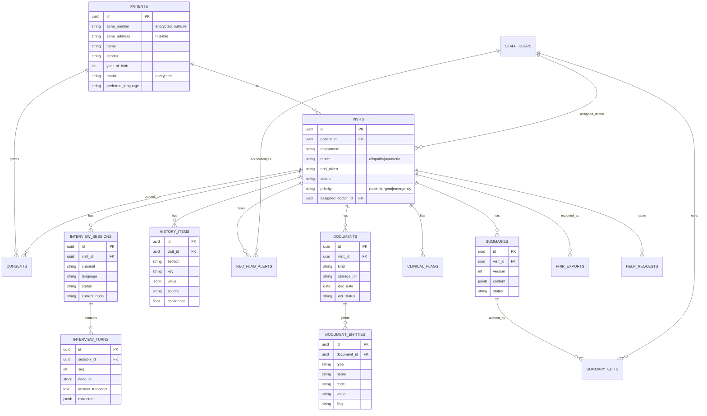

# 09 · Data Model & API Document — MediKiosk

Database schema, canonical history JSON, REST + WebSocket API, and FHIR mapping.
Related: [03-architecture.md](03-architecture.md) · [06-folder-structure.md](06-folder-structure.md) · [10-security-privacy.md](10-security-privacy.md)

---

## 1. Entity-relationship diagram



---

## 2. Tables

> Conventions: `id uuid PK default gen_random_uuid()`, `created_at timestamptz default now()`, `updated_at timestamptz`. 🔒 = encrypted at application level. PHI = personal health information.

### 2.1 `staff_users`
| Column | Type | Notes |
|---|---|---|
| id | uuid | PK |
| name | text | |
| email | citext unique | login |
| password_hash | text | bcrypt |
| role | enum `staff_role` | `doctor`, `nurse`, `registration`, `admin` |
| department | text | e.g. `kayachikitsa`, `general_medicine`, `orthopaedics` |
| is_active | bool | |

### 2.2 `patients`
| Column | Type | Notes |
|---|---|---|
| id | uuid | PK |
| abha_number | text 🔒 | 14-digit ABHA number, nullable |
| abha_address | text | e.g. `name@abdm`, nullable |
| name | text | |
| gender | enum | `M`, `F`, `O`, `U` |
| year_of_birth | int | (full DOB only if from ABHA) |
| mobile | text 🔒 | used for calls/SMS |
| mobile_hash | text | SHA-256 for lookup without decrypting |
| preferred_language | text | `hi`, `te`, `en`, … |
| address_district, address_state | text | optional |

### 2.3 `visits`
| Column | Type | Notes |
|---|---|---|
| id | uuid | PK |
| patient_id | uuid FK | |
| department | text | |
| mode | enum `visit_mode` | `allopathy`, `ayurveda` (from department) |
| opd_token | text | printed/SMS token |
| status | enum `visit_status` | see §3 |
| priority | enum | `routine`, `urgent`, `emergency` |
| channel_first | enum `channel` | where history started |
| assigned_doctor_id | uuid FK nullable | |
| scheduled_call_at | timestamptz nullable | |
| call_attempts | int | default 0 |

### 2.4 `consents`
| Column | Type | Notes |
|---|---|---|
| id | uuid | PK |
| patient_id, visit_id | uuid FK | |
| purpose | enum `consent_purpose` | `history_capture`, `call_recording`, `document_processing`, `share_with_his`, `link_abha` |
| granted | bool | |
| method | enum | `voice`, `dtmf`, `touch`, `otp` |
| language | text | language the notice was given in |
| given_by | enum | `patient`, `guardian` (minors / patients unable to consent) |
| guardian_relation | text nullable | e.g. `son`, `daughter`, `spouse`, `parent` |
| notice_version | text | version of consent text played |
| evidence_uri | text | MinIO URI of consent audio / screen log |
| granted_at, revoked_at | timestamptz | |

### 2.5 `interview_sessions`
| Column | Type | Notes |
|---|---|---|
| id | uuid | PK |
| visit_id | uuid FK | |
| channel | enum `channel` | `phone`, `webrtc`, `kiosk_voice`, `kiosk_touch` |
| language | text | |
| status | enum | `active`, `paused`, `completed`, `escalated`, `abandoned` |
| current_node | text | ontology node id |
| progress_pct | int | for kiosk progress bar |
| telephony_call_id | text | provider call SID |
| respondent | enum | `patient`, `attendant` (who is answering the questions) |
| respondent_relation | text nullable | attendant's relation to the patient |
| started_at, ended_at | timestamptz | |

### 2.6 `interview_turns`
| Column | Type | Notes |
|---|---|---|
| id | uuid | PK |
| session_id | uuid FK | |
| seq | int | order |
| node_id | text | e.g. `chest_pain.onset` |
| question_text | text | as asked (in session language) |
| answer_input | enum | `voice`, `dtmf`, `touch`, `text` |
| answer_transcript | text | raw STT / selected option |
| stt_confidence | float | |
| extracted | jsonb | LLM/parse output |
| extract_confidence | float | |
| reask_count | int | |
| confirmed | bool | confirmed in read-back |
| audio_uri | text nullable | only if `call_recording` consent |

### 2.7 `history_items` (the structured history — one row per fact)
| Column | Type | Notes |
|---|---|---|
| id | uuid | PK |
| visit_id | uuid FK | |
| section | enum `history_section` | `cc`, `hpi`, `past`, `surgical`, `drug`, `allergy`, `family`, `personal`, `obstetric`, `ros`, `ayurveda`, `vitals_reported` |
| key | text | slot key, e.g. `hpi.chest_pain.onset` (HPI keys include the complaint tree) |
| value | jsonb | typed value |
| display_text | text | English display for doctor |
| code_system | text nullable | `SNOMED`, `ICD10`, `LOINC`, `NAMASTE` |
| code | text nullable | |
| source | enum | `interview`, `document`, `doctor` |
| source_ref | uuid nullable | turn id / entity id |
| confidence | float | |
| status | enum | `active`, `superseded`, `rejected` |

### 2.8 `red_flag_alerts`
| Column | Type | Notes |
|---|---|---|
| id | uuid | PK |
| visit_id | uuid FK | |
| rule_id | text | `RF-CARD-01` |
| severity | enum | `emergency`, `urgent` |
| evidence | jsonb | slots that triggered it + transcript snippets |
| status | enum | `open`, `acknowledged`, `resolved`, `false_alarm` |
| raised_at | timestamptz | |
| acknowledged_by / at, resolved_by / at | | |
| resolution_note | text | |

### 2.9 `documents`
| Column | Type | Notes |
|---|---|---|
| id | uuid | PK |
| visit_id, patient_id | uuid FK | |
| kind | enum `document_kind` | `prescription`, `lab_report`, `discharge_summary`, `imaging_report`, `other` (auto-detected, editable) |
| source | enum | `upload_link`, `whatsapp`, `kiosk_scan`, `staff` |
| storage_uri | text | encrypted original |
| processed_uri | text | cleaned image |
| mime, pages | | |
| doc_date | date nullable | inferred |
| doc_date_confidence | float | |
| provider_name | text nullable | hospital/clinic/lab on the document |
| ocr_status | enum | `queued`, `processing`, `done`, `failed`, `needs_review` |
| ocr_text | text | |
| ocr_confidence | float | |
| ocr_engine | text | `sarvam-vision`, `claude-haiku-4-5`, … |

### 2.10 `document_entities`
| Column | Type | Notes |
|---|---|---|
| id | uuid | PK |
| document_id | uuid FK | |
| type | enum | `diagnosis`, `medication`, `lab_result`, `procedure`, `allergy`, `advice` |
| name | text | as written |
| normalized_name | text | e.g. generic drug name |
| code_system, code | text | |
| value, unit | text | lab value |
| ref_low, ref_high | numeric | |
| flag | enum | `normal`, `low`, `high`, `critical`, `unknown` |
| dose, frequency, duration, route | text | medications |
| entity_date | date | |
| confidence | float | |
| bbox | jsonb | location on image (for highlight) |
| verified | bool | doctor verified |

### 2.11 `clinical_flags`
| Column | Type | Notes |
|---|---|---|
| id | uuid | PK |
| visit_id | uuid FK | |
| type | enum | `abnormal_lab`, `drug_interaction`, `drug_allergy_conflict`, `duplicate_therapy` |
| severity | enum | `info`, `warning`, `critical` |
| title | text | "HbA1c 9.2 % (high)" |
| details | jsonb | entities involved, reference |

### 2.12 `summaries` & `summary_edits`
| `summaries` column | Type | Notes |
|---|---|---|
| id | uuid | PK |
| visit_id | uuid FK | |
| version | int | increments on regeneration |
| content | jsonb | `SummaryDocument` (see §4.2) |
| rendered_text | text | plain text for copy/print |
| generated_by | text | model id + prompt version |
| status | enum | `draft`, `confirmed`, `rejected` |
| confirmed_by / at | | |

| `summary_edits` column | Type | Notes |
|---|---|---|
| id | uuid | PK |
| summary_id | uuid FK | |
| editor_id | uuid FK | doctor |
| field_path | text | e.g. `sections.hpi.narrative` |
| old_value, new_value | jsonb | |
| edited_at | timestamptz | |

### 2.13 `fhir_exports` & `audit_logs`
| `fhir_exports` | Type | Notes |
|---|---|---|
| id, visit_id | uuid | |
| target | enum | `his`, `abdm` |
| bundle_uri | text | stored bundle JSON |
| status | enum | `pending`, `sent`, `failed` |
| response | jsonb | |
| attempts | int | |

| `audit_logs` | Type | Notes |
|---|---|---|
| id | bigserial | |
| at | timestamptz | |
| actor_type | enum | `staff`, `patient`, `system` |
| actor_id | text | |
| action | text | `read`, `create`, `update`, `delete`, `export`, `login` |
| entity, entity_id | text | |
| ip, user_agent | text | |
| details | jsonb | never contains PHI values |

### 2.14 `help_requests`
Raised when a patient presses **Help** on the kiosk (or says "help / staff" on a call).

| Column | Type | Notes |
|---|---|---|
| id | uuid | PK |
| visit_id | uuid FK nullable | null if the patient has not identified yet |
| session_id | uuid FK nullable | interview session |
| source | enum | `kiosk`, `phone`, `upload_page` |
| kiosk_id | text nullable | which kiosk (location shown to staff) |
| reason | text nullable | screen/node where help was requested |
| status | enum | `open`, `acknowledged`, `resolved` |
| raised_at, acknowledged_at, resolved_at | timestamptz | |
| handled_by | uuid FK nullable | staff user |

---

## 3. Enums

| Enum | Values |
|---|---|
| `visit_status` | `REGISTERED`, `CALL_SCHEDULED`, `INTERVIEW_IN_PROGRESS`, `INTERVIEW_COMPLETE`, `SUMMARY_READY`, `IN_CONSULTATION`, `CONFIRMED`, `CLOSED`, `EMERGENCY_ESCALATED`, `ABANDONED`, `CONSENT_DECLINED` (patient said no → no history captured; routine OPD consultation continues) |
| `channel` | `phone`, `webrtc`, `kiosk_voice`, `kiosk_touch`, `upload_link`, `whatsapp` |
| `visit_mode` | `allopathy`, `ayurveda` |
| `history_section` | `cc`, `hpi`, `past`, `surgical`, `drug`, `allergy`, `family`, `personal`, `obstetric`, `ros`, `ayurveda`, `vitals_reported` |
| `consent_purpose` | `history_capture`, `call_recording`, `document_processing`, `share_with_his`, `link_abha` |
| `document_kind` | `prescription`, `lab_report`, `discharge_summary`, `imaging_report`, `other` |
| `staff_role` | `doctor`, `nurse`, `registration`, `admin` |

---

## 4. Canonical JSON

### 4.1 `HistoryRecord` — assembled from `history_items` (input to summary + FHIR)

```json
{
  "visit_id": "vis_19c2",
  "patient": { "name": "Ramesh K", "gender": "M", "age": 45, "language": "hi", "abha_address": "ramesh@abdm" },
  "mode": "allopathy",
  "chief_complaints": [
    { "text": "Chest pain", "code": { "system": "SNOMED", "code": "29857009" }, "duration": { "value": 2, "unit": "day" } }
  ],
  "hpi": {
    "chest_pain": {
      "site": "left chest", "onset": "sudden", "character": "crushing",
      "radiation": ["left_arm"], "associated": ["sweating"],
      "timing": "intermittent", "exacerbating": ["exertion"], "relieving": ["rest"],
      "severity": 7
    }
  },
  "past_history": [
    { "condition": "Type 2 diabetes mellitus", "since_year": 2019, "code": { "system": "SNOMED", "code": "44054006" }, "source": "interview" },
    { "condition": "Hypertension", "since_year": 2021, "source": "document", "source_ref": "doc_88a1" }
  ],
  "surgical_history": [],
  "medications": [
    { "name": "Metformin", "brand": "Glycomet", "dose": "500 mg", "frequency": "BD", "source": "document" },
    { "name": "Amlodipine", "dose": "5 mg", "frequency": "OD", "source": "interview" }
  ],
  "allergies": [ { "substance": "Sulfonamides", "reaction": "rash", "source": "interview" } ],
  "family_history": [ { "relation": "father", "condition": "Myocardial infarction", "age_at_onset": 55 } ],
  "personal_history": {
    "tobacco": { "type": "cigarette", "per_day": 10, "years": 15 },
    "alcohol": "occasional", "diet": "mixed", "sleep": "disturbed", "occupation": "auto driver"
  },
  "ros": { "fever": false, "cough": false, "urinary": false, "weight_loss": false },
  "investigations": [
    { "test": "HbA1c", "loinc": "4548-4", "value": 9.2, "unit": "%", "ref_high": 5.7, "flag": "high", "date": "2026-03-14", "source_ref": "doc_91bf" }
  ],
  "ayurveda": null,
  "red_flags": [ { "rule_id": "RF-CARD-01", "severity": "emergency" } ],
  "clinical_flags": [ { "type": "abnormal_lab", "title": "HbA1c 9.2 % (high)" } ]
}
```

In Ayurveda mode, `ayurveda` is filled:
```json
"ayurveda": {
  "prakriti": { "vata": 0.25, "pitta": 0.45, "kapha": 0.30, "label": "Pitta-Kapha" },
  "vikriti_indicators": ["pitta"],
  "agni": "manda", "koshtha": "krura",
  "ahara": { "pattern": "irregular", "rasa_preference": ["katu", "lavana"] },
  "vihara": { "sleep": "late", "day_sleep": true, "exercise": "none" },
  "dashavidha": {
    "pramana": { "height_cm": 168, "weight_kg": 78, "bmi": 27.6 },
    "vaya": "madhyama", "ahara_shakti": "avara", "vyayama_shakti": "avara",
    "satmya": "mixed", "sattva": "madhyama",
    "sara": "for_physician_examination", "samhanana": "madhyama"
  },
  "nidana": ["excess spicy food", "night shifts"],
  "namaste_codes": []
}
```

### 4.2 `SummaryDocument` — what the doctor sees (stored in `summaries.content`)

```json
{
  "version": 3,
  "language": "en",
  "headline": "45 M · chest pain × 2 days · 🚨 red flag raised",
  "sections": [
    { "id": "cc",    "title": "Chief complaint", "text": "Chest pain for 2 days.", "fact_refs": ["hi_01"] },
    { "id": "hpi",   "title": "History of present illness",
      "text": "Sudden-onset, crushing left-sided chest pain radiating to the left arm, worse on exertion and relieved by rest, 7/10, with sweating.",
      "fact_refs": ["hi_02", "hi_03", "hi_04", "hi_05"] },
    { "id": "past",  "title": "Past medical / surgical", "text": "T2DM (2019), HTN (2021). No surgeries.", "fact_refs": ["hi_10", "hi_11"] },
    { "id": "drug",  "title": "Drugs & allergies", "text": "Metformin 500 mg BD, Amlodipine 5 mg OD. Allergy: sulfonamides (rash).", "fact_refs": [] },
    { "id": "family","title": "Family history", "text": "Father — MI at 55.", "fact_refs": [] },
    { "id": "personal","title": "Personal history", "text": "Smoker 10/day × 15 years; occasional alcohol; mixed diet; disturbed sleep.", "fact_refs": [] },
    { "id": "ros",   "title": "Review of systems", "text": "No fever, cough, urinary symptoms or weight loss.", "fact_refs": [] },
    { "id": "inv",   "title": "Prior investigations", "text": "HbA1c 9.2 % (Mar 2026, high).", "fact_refs": [] }
  ],
  "flags": [
    { "kind": "red_flag", "text": "Possible acute coronary syndrome pattern — triage alerted 09:21" },
    { "kind": "abnormal_lab", "text": "HbA1c 9.2 % (high)" }
  ],
  "unverified": ["Handwritten prescription 2024-11 — 1 medicine name low confidence"],
  "disclaimer": "AI-generated draft from patient-reported history and documents. Not a diagnosis. Verify before use."
}
```

---

## 5. REST API

Base URL: `/api/v1` · JSON · Auth: `Authorization: Bearer <JWT>` unless marked *public* (token-scoped).
OpenAPI docs auto-generated at `/api/docs`.

**Who can call an endpoint (principals):**

| Principal | What it is | How it authenticates |
|---|---|---|
| `doctor`, `nurse`, `registration`, `admin` | Staff users (`staff_role`) | Email + password → JWT |
| `kiosk-session` | One patient's session on a registered kiosk device | Kiosk device key → short-lived session JWT (wiped on finish/idle) |
| `voice` | Internal Voice Gateway service | Service token (internal network only) |
| `patient-otp` | A patient who has just verified mobile/ABHA OTP | Short-lived JWT (15 min) scoped to that patient only |
| `system` | Celery workers / internal jobs | Service token |
| *public (token)* | Upload page | Single-use signed upload token in the URL |
| provider (signed) | Telephony / ABDM callbacks | Provider signature verification |

### 5.1 Auth
| Method | Path | Role | Description |
|---|---|---|---|
| POST | `/auth/login` | public | email + password → access & refresh tokens |
| POST | `/auth/refresh` | public | refresh → new access token |
| GET | `/auth/me` | any staff | current user |

### 5.2 Patients & identity
| Method | Path | Role | Description |
|---|---|---|---|
| POST | `/patients` | registration, kiosk-session | create patient (new registration) |
| GET | `/patients/{id}` | doctor, nurse, registration | patient profile |
| GET | `/patients/search?mobile=&abha=` | registration | find existing patient |
| POST | `/identity/abha/init` | kiosk-session, voice | start ABHA verification → OTP sent `{ "abha": "91-1234-5678-9012" }` |
| POST | `/identity/abha/confirm` | kiosk-session, voice | OTP → verified profile, links/creates patient |
| POST | `/identity/mobile/init` / `confirm` | kiosk-session, voice | mobile-OTP identity (no ABHA) |

### 5.3 Visits
| Method | Path | Role | Description |
|---|---|---|---|
| POST | `/visits` | registration | create visit `{patient_id, department}` → token; optionally schedule call |
| GET | `/visits?status=&department=&date=` | staff | list |
| GET | `/visits/{id}` | staff | details incl. status, priority |
| PATCH | `/visits/{id}` | registration, nurse | update department, priority, assigned doctor |
| GET | `/visits/{id}/history` | doctor, nurse | `HistoryRecord` |

### 5.4 Consent
| Method | Path | Role | Description |
|---|---|---|---|
| GET | `/consents/notice?lang=te&version=latest` | public | consent text + audio URL per purpose |
| POST | `/visits/{id}/consents` | kiosk-session, voice | record decisions `[{purpose, granted, method, given_by, guardian_relation?, evidence_uri}]` |
| GET | `/visits/{id}/consents` | staff | list |
| GET | `/patient/consents` | patient-otp | patient sees own consents |
| POST | `/patient/consents/revoke` | patient-otp | patient revokes `{purposes[]}` → deletion workflow (also reachable by IVR menu / SMS keyword via telephony webhook) |
| POST | `/consents/{id}/revoke` | admin | staff-assisted revoke (patient present) |

### 5.5 Interview
Used by the kiosk touch UI and for testing; the voice gateway calls the same engine in-process.

| Method | Path | Role | Description |
|---|---|---|---|
| POST | `/visits/{id}/interview/sessions` | kiosk-session | start `{channel, language}` → `{session_id, first_question}` |
| GET | `/interview/sessions/{sid}/question` | kiosk-session | current question (text, options, icons, audio URL, input type) |
| POST | `/interview/sessions/{sid}/answers` | kiosk-session | `{node_id, input: "touch"|"text"|"voice", value | transcript}` → `{next_question | readback | escalation}` |
| POST | `/interview/sessions/{sid}/back` | kiosk-session | go to previous question |
| POST | `/interview/sessions/{sid}/end` | kiosk-session | finish → triggers summary |
| GET | `/interview/sessions/{sid}/transcript` | doctor | full Q&A transcript |

**Question payload example**
```json
{
  "node_id": "chest_pain.onset",
  "section": "hpi",
  "progress_pct": 34,
  "input_type": "single_choice",
  "text": "నొప్పి ఎప్పుడు మొదలైంది? ఒక్కసారిగా వచ్చిందా, కొంచెం కొంచెం గా వచ్చిందా?",
  "audio_url": "/media/tts/te/chest_pain.onset.v2.mp3",
  "options": [
    { "value": "sudden",  "label": "ఒక్కసారిగా", "icon": "bolt", "dtmf": "1" },
    { "value": "gradual", "label": "కొంచెం కొంచెం గా", "icon": "trend-up", "dtmf": "2" }
  ],
  "allow_voice": true,
  "allow_skip": false
}
```

### 5.6 Calls & telephony
| Method | Path | Role | Description |
|---|---|---|---|
| POST | `/visits/{id}/calls` | registration, system | schedule outbound AI call `{at?: datetime}` |
| GET | `/visits/{id}/calls` | staff | call attempts & outcomes |
| POST | `/telephony/{provider}/webhook` | provider (signed) | call status events |
| WS | `/voice/{provider}/stream` | provider | media stream into Pipecat |
| POST | `/voice/webrtc/offer` | kiosk-session, demo | WebRTC SDP offer → answer (browser/kiosk call) |

### 5.7 Documents
| Method | Path | Role | Description |
|---|---|---|---|
| POST | `/visits/{id}/upload-link` | system, registration | create single-use token link, send SMS/WhatsApp |
| GET | `/upload/{token}` | *public (token)* | upload page metadata (patient first name, language, expiry) |
| POST | `/upload/{token}/files` | *public (token)* | multipart images/PDF (max 10 files, 10 MB each) |
| POST | `/visits/{id}/documents` | kiosk-session, staff | kiosk scan upload |
| GET | `/visits/{id}/documents` | doctor, nurse | list with status |
| GET | `/documents/{id}` | doctor | metadata + entities + presigned image URL (5 min) |
| PATCH | `/documents/{id}` | doctor | fix kind/date |
| PATCH | `/documents/{id}/entities/{eid}` | doctor | correct / verify entity |
| GET | `/visits/{id}/timeline` | doctor | documents + entities ordered by date |
| GET | `/visits/{id}/clinical-flags` | doctor | abnormal labs, interactions |

### 5.8 Summary
| Method | Path | Role | Description |
|---|---|---|---|
| POST | `/visits/{id}/summary/generate` | system, doctor | (re)generate draft |
| GET | `/visits/{id}/summary` | doctor | latest `SummaryDocument` |
| PATCH | `/visits/{id}/summary` | doctor | edits `[{field_path, new_value}]` (audited) |
| POST | `/visits/{id}/summary/confirm` | doctor | finalize → FHIR export + patient SMS |
| POST | `/visits/{id}/summary/reject` | doctor | mark rejected with reason |

### 5.9 Doctor, triage, admin
| Method | Path | Role | Description |
|---|---|---|---|
| GET | `/doctor/queue?department=` | doctor | today's patients: status, priority, summary ready, flags count |
| POST | `/visits/{id}/open` | doctor | mark `IN_CONSULTATION` |
| PATCH | `/visits/{id}/ayurveda` | doctor | save examination-only fields (Nadi, Jihva, Sara…) and chosen NAMASTE codes (audited, `source = doctor`) |
| GET | `/alerts?status=open` | nurse, doctor | red-flag alerts |
| POST | `/alerts/{id}/acknowledge` | nurse | stops alarm; kiosk shows "Nurse is coming" |
| POST | `/alerts/{id}/take-call` | nurse | warm-transfer the live AI call to the nurse's phone |
| POST | `/alerts/{id}/resolve` | nurse, doctor | `{resolution: "seen_in_er" | "false_alarm", note}` |
| POST | `/help-requests` | kiosk-session, voice | patient pressed Help `{kiosk_id?, session_id?, reason?}` |
| GET | `/help-requests?status=open` | nurse, registration | open help requests |
| POST | `/help-requests/{id}/acknowledge` · `/resolve` | nurse, registration | handle request |
| POST | `/kiosk/assist` | kiosk-session + staff PIN | switch the kiosk to staff-assisted mode (audited) |
| POST | `/kiosk/emergency/close` | kiosk-session + staff PIN | close the locked emergency screen after staff take over |
| GET | `/admin/metrics?from=&to=` | admin | patients, completion rate, avg call time, languages, red flags, OCR stats |
| GET | `/admin/audit?entity=&actor=` | admin | audit log search |
| GET | `/health` | public | liveness/readiness |

### 5.10 FHIR / ABDM
| Method | Path | Role | Description |
|---|---|---|---|
| GET | `/visits/{id}/fhir` | doctor, admin | preview bundle (JSON) |
| POST | `/visits/{id}/fhir/push` | system, admin | push to HIS / FHIR server (auto on confirm) |
| POST | `/abdm/callbacks/*` | ABDM gateway (signed) | HIP callbacks: link, consent, data request |

### 5.11 Error format
```json
{ "error": { "code": "CONSENT_REQUIRED", "message": "History capture consent not granted", "request_id": "req_5d2…" } }
```
Common codes: `UNAUTHORIZED`, `FORBIDDEN`, `NOT_FOUND`, `VALIDATION_ERROR`, `CONSENT_REQUIRED`, `TOKEN_EXPIRED`, `ABDM_UNAVAILABLE`, `AI_PROVIDER_ERROR`, `RATE_LIMITED`.

---

## 6. WebSocket channels

| Channel | Subscribers | Events |
|---|---|---|
| `/ws/triage` | nurses, registration | `alert.created`, `alert.updated`, `visit.priority_changed`, `help.requested`, `help.resolved` |
| `/ws/doctor?department=` | doctors | `visit.summary_ready`, `visit.updated`, `document.processed`, `alert.created` |
| `/ws/kiosk/{session_id}` | kiosk | `interview.question`, `interview.progress`, `interview.escalated`, `document.processed` |

**Event envelope**
```json
{
  "type": "alert.created",
  "at": "2026-09-10T09:21:44+05:30",
  "data": {
    "alert_id": "alr_33", "visit_id": "vis_19c2", "rule_id": "RF-CARD-01",
    "severity": "emergency", "patient": "Ramesh K, 45 M", "token": "OPD-217",
    "evidence": ["chest pain", "breathlessness", "sweating"], "channel": "phone"
  }
}
```

---

## 7. FHIR R4 mapping (ABDM / NRCeS profiles)

| MediKiosk data | FHIR resource | Notes / codes |
|---|---|---|
| Patient | `Patient` | ABHA number / address as identifiers |
| Visit | `Encounter` (class `AMB`) | department → `serviceType` |
| Summary (confirmed) | `Composition` — **OPConsultRecord** | sections: chief complaints, medical history, allergies, family history, medications, investigations, etc. |
| Chief complaint, symptoms | `Condition` (patient-reported complaint, `verificationStatus: provisional`) | SNOMED CT (clinical findings) |
| HPI details (SOCRATES) | `Observation` components / Composition narrative | |
| Past conditions | `Condition` (clinicalStatus active/resolved) | SNOMED / ICD |
| Surgical history | `Procedure` | SNOMED |
| Medications | `MedicationStatement` | generic name, dose, frequency |
| Allergies | `AllergyIntolerance` | substance, reaction |
| Family history | `FamilyMemberHistory` | relation, condition, onset age |
| Personal history (tobacco, alcohol, diet) | `Observation` (social-history) | LOINC/SNOMED |
| Lab values from documents | `Observation` + `DiagnosticReport` — **DiagnosticReportRecord** | LOINC, value, unit, referenceRange, interpretation |
| Scanned documents | `DocumentReference` / `Binary` — **HealthDocumentRecord** | original image/PDF |
| Ayurveda assessment | `Observation` (custom code system) + Composition section | NAMASTE / ICD-11 TM2 where applicable |
| Consent | `Consent` | purpose, scope, method |
| AI provenance | `Provenance` | agent = MediKiosk + model id; confirmed by doctor |
| Red-flag alert | `Flag` | priority |

Bundle type: `document` (Composition first), sent on doctor confirmation.
