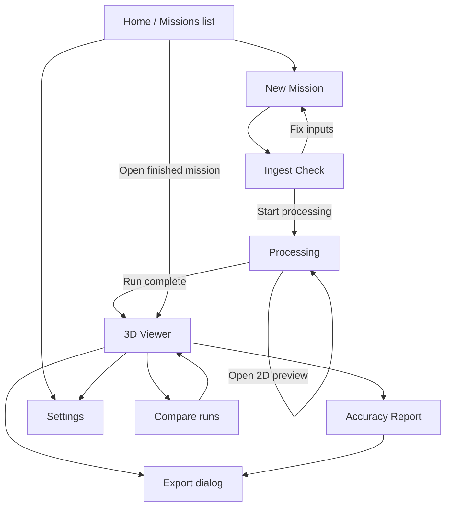
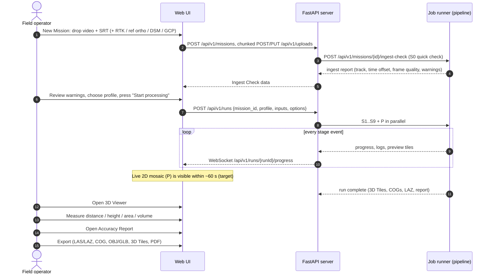
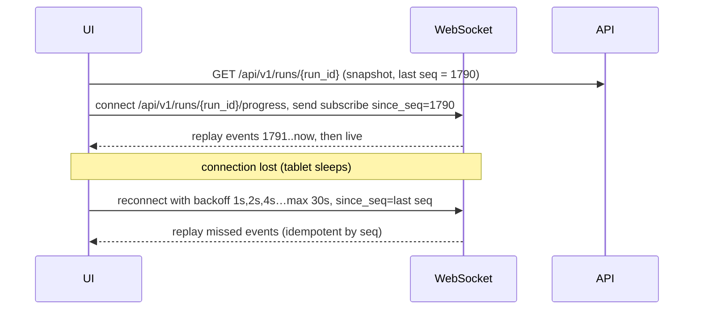

# 09 · Viewer and UI

> **Purpose:** This document defines the Drishti3D web application: who uses it, how the screens are organised, what every screen looks like, how each measurement is computed and how its uncertainty is shown, and how the React + Vite + CesiumJS frontend is built. It covers everything from uploading a mission to exporting a report.
>
> **Status:** Draft v1.0 · 2026-09-30 · Owner: R5 Frontend Engineer (with R2 for measurement maths and uncertainty)

Stage IDs (S0–S9, P), profiles (`preview` / `fast` / `quality`), confidence classes and targets all come from [00-project-charter.md](00-project-charter.md). If this document disagrees with the charter, the charter is correct.

---

## Table of contents

1. [Users and context of use](#1-users-and-context-of-use)
2. [UX principles](#2-ux-principles)
3. [Information architecture](#3-information-architecture)
4. [Primary user flow](#4-primary-user-flow)
5. [Screen wireframes](#5-screen-wireframes)
6. [Measurement tools: specification](#6-measurement-tools-specification)
7. [Confidence overlay and colour scheme](#7-confidence-overlay-and-colour-scheme)
8. [Frontend component architecture](#8-frontend-component-architecture)
9. [Performance](#9-performance)
10. [Accessibility](#10-accessibility)
11. [Keyboard shortcuts](#11-keyboard-shortcuts)
12. [Error, empty and loading states](#12-error-empty-and-loading-states)
13. [Internationalisation (English + Hindi)](#13-internationalisation-english--hindi)
14. [Open questions](#14-open-questions)
15. [Related documents](#related-documents)

---

## 1. Users and context of use

| Persona | Typical setting | Main goal | What they fear | Implications for the UI |
|---|---|---|---|---|
| **Field operator** (drone pilot or technician) | Outdoors, a vehicle or tent, glare, gloves, time pressure, rugged tablet or laptop, **no internet** | Load the clip and SRT, confirm the data is usable, start processing, and show something within a minute | Finding out 15 minutes later that the SRT did not match or the video was unusable | Dark theme, large touch targets, one obvious primary action per screen, early **Ingest Check** before any heavy compute, live 2D preview (tier **P**) |
| **Analyst** (GEOINT / survey / engineering) | Desk, large monitor, mouse and keyboard, possibly air-gapped LAN | Measure accurately, inspect accuracy and confidence, export to GIS tools | Trusting a number that is wrong without knowing it | Every measurement shows **±uncertainty**. Confidence overlay. Accuracy Report with CE90/LE90 and bias vs noise. Keyboard shortcuts. Exports in standard formats |
| **Commander / decision-maker** | Briefing room, projector or large display, a few minutes of attention | Understand the terrain and targets quickly, and know how far to trust them | Being misled by a pretty model | Simple 3D view with an **accuracy badge** (e.g. "Anchored · 0.8 m CE90"), inferred surfaces clearly flagged, a one-page PDF report |

**Deployment context (all personas):** runs fully **offline / air-gapped** (charter §4 and principle 4). There are no calls to Cesium ion, Google, Mapbox, CDNs or telemetry services at runtime. Base imagery comes from the run's own orthomosaic, a user-supplied reference orthophoto, or a pre-packaged offline tile set (see [07-tech-stack.md](07-tech-stack.md)).

---

## 2. UX principles

| # | Principle | Concrete rule |
|---|---|---|
| U1 | **Fail early, before compute** | The Ingest Check (S0 output) is a mandatory gate. Sync, GPS and frame-quality problems appear within seconds, not after S5. |
| U2 | **Always show something** | The live 2D mosaic (P) starts as soon as keyframes exist. Our target is a first visual **≤ 60 s** after the upload starts (charter §6). |
| U3 | **Every number carries its uncertainty** | No measurement, coordinate or accuracy figure is shown without `±` and a tooltip that names the method. Relative and absolute accuracy are always shown separately (charter principle 2). |
| U4 | **Flag, don't fake** | *Inferred* geometry (LoD2 completion from S6) is visibly hatched, can never be hidden by the colour theme, and is excluded from measurements unless the user opts in. When it is included, the result is marked "includes inferred surface". |
| U5 | **Splats are for looking, not measuring** | Measurement tools snap only to the mesh, point cloud or DSM. When only the splat layer is visible, measurement tools are disabled and a tooltip explains why (charter S7: "display only"). |
| U6 | **Field-first ergonomics** | Dark theme by default. Touch targets are at least **48 × 48 px** (preferred 56 px for primary actions on tablets). No hover-only affordances. Critical text is 16 px or larger. |
| U7 | **One primary action per screen** | Primary button colour is used once per view. Destructive actions need confirmation and are never placed next to the primary button. |
| U8 | **Honest progress** | Stage progress uses the canonical S0–S9 names. ETA shows a range (e.g. "6–9 min"), and it is recomputed from measured per-stage timings. |
| U9 | **Offline and resilient** | Uploads are resumable (chunked). Closing the browser does not kill a job. Reconnecting to the websocket restores state from the server. |
| U10 | **Bilingual** | Every label is available in English and Hindi (हिंदी). Numbers, units and coordinates stay in Western Arabic numerals in both languages so they can be read out and copied the same way. |

---

## 3. Information architecture



**Navigation model**

| Level | Items | Location |
|---|---|---|
| Global (always visible) | Missions, Settings, language toggle (EN / हि), theme toggle, system status (GPU, disk, offline) | Top bar |
| Mission-scoped | Ingest · Processing · 3D Viewer · Accuracy · Exports | Tab strip under the top bar, shown once a mission is open. A tab is disabled until its data exists. |
| In-viewer | Layers panel (left), tool bar (top-left of canvas), inspector / results panel (right), status bar (bottom) | Inside the 3D Viewer |

**URL scheme** (deep-linkable, works offline from the local server):

| Route | Screen |
|---|---|
| `/` | Missions list |
| `/missions/new` | New Mission |
| `/missions/:missionId/ingest` | Ingest Check |
| `/missions/:missionId/runs/:runId/progress` | Processing |
| `/missions/:missionId/runs/:runId/view?cam=…&layers=…` | 3D Viewer (camera and layer state in the query string so a view can be shared) |
| `/missions/:missionId/runs/:runId/accuracy` | Accuracy Report |
| `/settings` | Settings |

A **mission** is one flight (video plus sidecars). A **run** is one pipeline execution on that mission with a given profile and anchoring options. One mission can have several runs, for example `fast` first and `quality` later, or with and without a reference ortho. This split lets us compare runs (experiments in [11-testing-and-evaluation.md](11-testing-and-evaluation.md)). Missions are a lightweight grouping in the API (`/api/v1/missions`, [08 §9](08-data-formats-and-interfaces.md#9-rest-and-websocket-api)); each run still has its own self-contained run directory `data/runs/<run_id>/`. Wireframes abbreviate run IDs as `r-0003`; real IDs use the `YYYYMMDD-HHMMSS-<6 hex>` format from 08 §1.

---

## 4. Primary user flow



**Happy-path timing we design for** (targets from the charter, measured in [11-testing-and-evaluation.md](11-testing-and-evaluation.md)):

| Step | Target |
|---|---|
| Upload of a 10-min 4K clip over local LAN or USB copy | Depends on the medium. Not counted in the processing target. The ingest check starts on the SRT and the first video chunks. |
| Ingest Check shown | ≤ 30 s after the SRT and video header are received (our UI target) |
| First 2D preview | **≤ 60 s** after upload starts (charter) |
| Metric 3D product | **≤ 15 min** end-to-end, `fast` profile, reference workstation (charter) |

---

## 5. Screen wireframes

Wireframes are drawn at about 1280 px wide in the dark theme. On tablets under 1024 px, side panels become bottom sheets or drawers. The layout notes after each wireframe give the responsive behaviour.

Legend: `[ Button ]` button · `( )` radio · `[x]` checkbox · `▾` dropdown · `▓` progress fill · `⚠` warning · `✓` pass · `✗` fail

### 5.1 Home / Missions list

```text
┌──────────────────────────────────────────────────────────────────────────────────────────────┐
│ ◉ Drishti3D        Missions   Settings                    ● Offline  GPU 12 GB  Disk 612 GB   │
│                                                                              [EN|हि]  [☾]    │
├──────────────────────────────────────────────────────────────────────────────────────────────┤
│  Missions                                                         [ + New Mission ]          │
│  ┌──────────────────────────────┐  Filter: [ All ▾ ]  Sort: [ Newest ▾ ]                     │
│  │ 🔍 Search missions…           │                                                            │
│  └──────────────────────────────┘                                                            │
│ ┌────────────────────────────────────────────────────────────────────────────────────────┐   │
│ │ ▣ thumb │ Bridge-Recon-07        │ 2026-11-14 10:42 │ 4K · 9m 48s │ ● Complete         │   │
│ │         │ DJI M3E · SRT          │ Run: fast        │ Anchored    │ 0.74 m CE90 ▣      │   │
│ │         │                        │                  │             │ [ Open 3D ] [ ⋯ ]  │   │
│ ├────────────────────────────────────────────────────────────────────────────────────────┤   │
│ │ ▣ thumb │ Village-Flood-02       │ 2026-11-14 09:10 │ 1080p · 6m  │ ▓▓▓▓▓▓░░░ S5 62 %  │   │
│ │         │ DJI Mini 4 Pro · SRT   │ Run: fast        │ GNSS only   │ ETA 4–6 min        │   │
│ │         │                        │                  │             │ [ View progress ]  │   │
│ ├────────────────────────────────────────────────────────────────────────────────────────┤   │
│ │ ▣ thumb │ Test-Clip-Unknown      │ 2026-11-13 18:05 │ 4K · 3m 12s │ ⚠ Needs attention  │   │
│ │         │ No SRT found           │ —                │ —           │ [ Fix inputs ]     │   │
│ └────────────────────────────────────────────────────────────────────────────────────────┘   │
│                                                                                              │
│  Storage: 3 missions · 41.2 GB        [ Import mission bundle… ]   [ Clean up temp files ]   │
└──────────────────────────────────────────────────────────────────────────────────────────────┘
```

| Element | Behaviour |
|---|---|
| Accuracy badge | Shows the run's anchoring tier and headline **CE90**: `GNSS only · 3.4 m CE90`, `Anchored · 0.74 m CE90`, `RTK · 0.06 m CE90`, or `Not assessed` when there are no checkpoints. With no checkpoints, the badge shows the *predicted* value in italics with the word "est." |
| Status chip | `Queued` · `Ingesting` · `S1…S9 nn %` · `Complete` · `Failed` · `Needs attention` · `Cancelled` |
| `⋯` menu | Rename · Re-run with another profile · Duplicate settings · Export bundle · Delete (with confirmation) |
| Import mission bundle | Loads a `.d3d.zip` (inputs plus outputs) exported from another air-gapped machine |
| Responsive | Below 900 px, rows collapse to cards with the thumbnail on top and the badge and primary action at the bottom |

### 5.2 New Mission

```text
┌──────────────────────────────────────────────────────────────────────────────────────────────┐
│ ◉ Drishti3D  ‹ Missions / New Mission                                          [EN|हि] [☾]   │
├──────────────────────────────────────────────────────────────────────────────────────────────┤
│ Mission name  [ Bridge-Recon-07                              ]   Area tag [ Sector-4 ▾ ]     │
│                                                                                              │
│ 1 · REQUIRED INPUTS                                                                          │
│ ┌──────────────────────────────────────────┐  ┌──────────────────────────────────────────┐   │
│ │  ⬆  Drop video here or [ Browse… ]        │  │  ⬆  Drop telemetry here or [ Browse… ]   │   │
│ │     MP4 · MOV · TS  (1080p / 4K)          │  │     DJI .SRT  ·  KLV in .TS (MISB 0601)  │   │
│ │  ✓ DJI_0412.MP4  3840×2160 29.97 fps      │  │  ✓ DJI_0412.SRT  17 634 entries          │   │
│ │    9 m 48 s · 3.8 GB  ▓▓▓▓▓▓▓▓▓░ 91 %     │  │    matched by filename ✓                 │   │
│ └──────────────────────────────────────────┘  └──────────────────────────────────────────┘   │
│                                                                                              │
│ 2 · OPTIONAL ACCURACY INPUTS (each one improves absolute accuracy)            [ What's this? ]│
│ ┌──────────────────────┬─────────────────────────────┬─────────────────────────────────────┐ │
│ │ RTK / PPK positions  │ [ Browse… ] .pos / .csv     │ Expected: ≤ 0.10 m CE90 (target)     │ │
│ │ Reference orthophoto │ [ Browse… ] GeoTIFF / COG   │ Expected: ≤ 1 m CE90 (target)        │ │
│ │ Reference DSM        │ [ Browse… ] GeoTIFF / COG   │ Fixes vertical bias + doming check   │ │
│ │ GCP / known point(s) │ [ Browse… ] .csv  [ + Add ] │ 1 point removes most of the offset   │ │
│ │ Camera intrinsics    │ [ Browse… ] .json / .yaml   │ Locks lens model (reduces doming)    │ │
│ │ CORS / GAGAN log     │ [ Browse… ]                 │ Corrected GNSS (see doc 06)          │ │
│ └──────────────────────┴─────────────────────────────┴─────────────────────────────────────┘ │
│                                                                                              │
│ 3 · PROCESSING PROFILE                                                                       │
│  ( ) preview   2D mosaic only · seconds · no 3D                                              │
│  (•) fast      metric 3D · target ≤ 15 min for 10-min 4K           ← default                 │
│  ( ) quality   maximum detail · no time limit                                                │
│  [x] Build photoreal splat layer (S7, display only, runs after the metric product)           │
│  [x] Mask vehicles and people (S2)          Output CRS [ Auto (UTM 43N / EPSG:32643) ▾ ]     │
│  Heights  [ Orthometric (EGM2008) ▾ ]                                                        │
│                                                                                              │
│ ⚠ No reference ortho, DSM, RTK or GCP given: absolute accuracy will be GNSS-only             │
│   (about 3–7 m CE90). Relative measurements (lengths, areas, volumes) are unaffected.        │
│                                                                                              │
│                                            [ Cancel ]          [ Check inputs → ]            │
└──────────────────────────────────────────────────────────────────────────────────────────────┘
```

| Field | Validation (client-side first, server re-validates) |
|---|---|
| Video | Container and codec probed by the server (ffprobe). Reject if there is no video stream. Warn if the resolution is below 1080p or the frame rate is variable. |
| Telemetry | SRT matched to the video by basename, case-insensitively. We store the original case because ODM's matching is case-sensitive ([ODM README](https://github.com/OpenDroneMap/ODM)). KLV is detected automatically in `.ts` (stretch goal, charter §5). If neither exists, the primary button becomes **"Continue without GPS (relative model only)"** with a red warning. |
| RTK/PPK | Formats listed in [08-data-formats-and-interfaces.md](08-data-formats-and-interfaces.md). Time system (GPST vs UTC) must be declared. |
| Reference ortho / DSM | Must have a CRS. The footprint must overlap the SRT track bounding box; if not, show "Reference raster does not cover the flight area". |
| GCP | CSV `id,lon,lat,h,σh,σv,crs`. At least one point. Points marked `role=check` are held out for the accuracy report and **never** used for anchoring. |
| Profile | Defaults to `fast`. `preview` disables the 3D tabs for this run. |

The expected-accuracy hints come from the charter targets and are labelled as targets. The first time the screen is opened, the "What's this?" link opens a short explainer on why the anchor matters: consumer GNSS error is mostly a rigid offset (Zhang et al. 2019, [ESurfD](https://esurf.copernicus.org/preprints/esurf-2019-2/esurf-2019-2.pdf)).

### 5.3 Ingest Check (S0 result)

```text
┌──────────────────────────────────────────────────────────────────────────────────────────────┐
│ ◉ Drishti3D  ‹ Bridge-Recon-07    [Ingest]  Processing  3D Viewer  Accuracy  Exports         │
├──────────────────────────────────────────────────────────────────────────────────────────────┤
│ INGEST CHECK                                            Overall: ⚠ Usable with 2 warnings    │
│ ┌───────────────────────────────────────────────┐ ┌────────────────────────────────────────┐ │
│ │  GPS TRACK (offline base: reference ortho)     │ │ TIME SYNC  video ↔ SRT                 │ │
│ │                                               │ │ Estimated offset:  +0.37 s ± 0.03 s     │ │
│ │     start ●━━━━━━━━━━━━━━━━━━━━━━━━━━━● end    │ │ Method: GPS speed vs optical-flow       │ │
│ │           ╲   ░░ dropout 12 s ░░              │ │         speed cross-correlation         │ │
│ │  colour = altitude (AGL)  ▁▂▃▄▅▆▇ 78–96 m      │ │  corr                                   │ │
│ │  ◇ = keyframe candidates   ✕ = rejected frame  │ │ 1.0┤          ╭╮                        │ │
│ │                                               │ │ 0.5┤      ╭───╯╰───╮                    │ │
│ │  Length 2.41 km · Speed 4.1 m/s avg (max 7.9)  │ │ 0.0┼──────┴────────┴────── lag (s)      │ │
│ │  Gimbal pitch −90° → −62° (oblique ✓)          │ │   −2    −1    0  +0.37  +1   +2        │ │
│ └───────────────────────────────────────────────┘ │ Peak sharpness: good ✓                  │ │
│                                                   │ [ Override offset… ]                    │ │
│ ┌───────────────────────────────────────────────┐ └────────────────────────────────────────┘ │
│ │ FRAME QUALITY (variance of Laplacian, per 1 s) │ ┌────────────────────────────────────────┐ │
│ │ count                                         │ │ CHECKS                                 │ │
│ │  ██                                           │ │ ✓ Video decodable, 29.97 fps CFR       │ │
│ │  ██ ██                                        │ │ ✓ SRT entries match frame count (±2)   │ │
│ │  ██ ██ ██ ▆▆                                  │ │ ⚠ GPS dropout 12 s at 04:31–04:43      │ │
│ │  ██ ██ ██ ██ ▃▃ ▁▁                            │ │ ⚠ 7 % frames blurred (> threshold)     │ │
│ │ ─┴──┴──┴──┴──┴──┴── sharpness →               │ │ ✓ Oblique segment present (doming ↓)   │ │
│ │    ▲ rejection threshold (auto)               │ │ ✓ Altitude variation 18 m              │ │
│ │ Keep ≈ 912 keyframes (≈1.5 fps)               │ │ ℹ Rolling shutter: model "DJI M3E" ✓   │ │
│ └───────────────────────────────────────────────┘ │ ℹ Burned-in OSD overlay: none detected  │ │
│                                                   └────────────────────────────────────────┘ │
│  Timeline  00:00 ▕██████████████▒▒▒████████████████████████▁▁▁▁████████▏ 09:48              │
│            █ usable  ▒ blurred  ▁ no GPS                                                      │
│                                                                                              │
│  [ ‹ Back to inputs ]      Profile [ fast ▾ ]        [ Start processing → ]  (primary)       │
└──────────────────────────────────────────────────────────────────────────────────────────────┘
```

| Panel | Data source (S0/S1) | Pass / warn / fail rule (initial, tune in testing) |
|---|---|---|
| GPS track | Parsed SRT/KLV positions shown over the reference ortho or run-local tiles | Warn on gaps > 2 s. Fail if more than 50 % of the clip has no GPS. |
| Time sync | S0 time-offset estimator (see [06-georeferencing-and-accuracy.md](06-georeferencing-and-accuracy.md)). The SRT uses local time with no timezone ([ScienceDirect 2025](https://www.sciencedirect.com/science/article/abs/pii/S2352938525003544)), and no published measurement of SRT latency exists, so we always estimate the offset. | Warn if the correlation peak is flat (peak / 2nd peak < 1.2) or the offset is larger than 2 s. The user can override the value, and the override is logged in the report. |
| Frame quality | Variance-of-Laplacian histogram per 1 s window (S1) | Warn if more than 5 % of frames are blurred. Fail if fewer than 50 keyframes survive. |
| Geometry checks | Gimbal pitch range, altitude range, track straightness | ℹ/⚠ "Pure nadir straight strip: doming risk", since oblique views at 20–30° cut deformation by 10–100× ([James & Robson 2014](https://discovery.ucl.ac.uk/id/eprint/1443475/1/esp3609.pdf)) |
| Rolling shutter | Camera model lookup (e.g. DJI Mini 3/4 Pro, Mavic 3 profiles as in [ODM releases](https://github.com/OpenDroneMap/ODM/releases)) | ℹ when the camera is unknown: "readout time will be estimated" |

The primary button is disabled only on **fail**. Warnings never block the user; they are carried into the Accuracy Report.

### 5.4 Processing

```text
┌──────────────────────────────────────────────────────────────────────────────────────────────┐
│ ◉ Drishti3D  ‹ Bridge-Recon-07     Ingest  [Processing]  3D Viewer  Accuracy  Exports        │
├──────────────────────────────────────────────────────────────────────────────────────────────┤
│ Run r-0003 · profile fast · started 10:42:05 · elapsed 06:12 · ETA 5–8 min     [ Cancel run ]│
│ ┌──────────────────────────────────────┐ ┌─────────────────────────────────────────────────┐ │
│ │ STAGES                               │ │ LIVE 2D PREVIEW (P)          [2D] [Track] [⤢]    │ │
│ │ S0 Ingest & Sync        ✓ 00:21      │ │                                                 │ │
│ │ S1 Keyframe Selection   ✓ 00:48      │ │   ░░░░▒▒▒▒▓▓▓▓████████▓▓▓▒▒                     │ │
│ │ S2 Masking & Semantics  ✓ 01:05      │ │   ░░▒▒▒▓▓▓████████████████▓▓▒                   │ │
│ │ S3 Pose Estimation      ✓ 02:10      │ │     ▒▒▓▓████ mosaic grows ███▓▓▒                │ │
│ │ S4 Georef & Anchoring   ✓ 00:31      │ │        ▓▓██████████████████▓▒   ● current frame │ │
│ │    ↳ ortho registration ✓ shift 2.6 m│ │                                                 │ │
│ │ S5 Dense & Mesh    ▓▓▓▓▓▓░░░ 62 %    │ │ 612 / 912 keyframes · GPS-placed (not metric)   │ │
│ │ S6 Completion & Class.  ○ queued     │ │ ⓘ Preview uses raw GPS: may be off by metres    │ │
│ │ S7 Photoreal (opt.)     ○ queued     │ └─────────────────────────────────────────────────┘ │
│ │ S8 Export & Tiling      ○ queued     │ ┌─────────────────────────────────────────────────┐ │
│ │ S9 QA & Confidence      ○ queued     │ │ KEY NUMBERS SO FAR                              │ │
│ │ P  Live Preview         ● running    │ │ Registered frames 903/912 (99 %)                │ │
│ ├──────────────────────────────────────┤ │ Mean reproj. error 0.71 px                      │ │
│ │ GPU ▓▓▓▓▓▓▓░░ 8.9/12 GB  CPU 71 %     │ │ Time offset applied +0.37 s                     │ │
│ │ RAM 38/64 GB   Disk write 210 MB/s   │ │ GPS→model fit residual 1.9 m RMS (bias-like)    │ │
│ └──────────────────────────────────────┘ │ Ortho registration shift ΔE +1.8 ΔN −1.9 m      │ │
│                                          └─────────────────────────────────────────────────┘ │
│ ┌──────────────────────────────────────────────────────────────────────────────────────────┐ │
│ │ LOGS  [All ▾] [Warnings] [Errors]   🔍 filter…                          [ Copy ] [ ⤓ ]   │ │
│ │ 10:47:58 S5 INFO  DensifyPointCloud: 41 % (tile 7/17)                                    │ │
│ │ 10:47:12 S4 INFO  Umeyama 7-DoF: s=1.0021, RMS 1.91 m; roll from gimbal/gravity prior    │ │
│ │ 10:46:40 S3 WARN  14 frames unregistered near 04:31 (GPS dropout segment)                │ │
│ └──────────────────────────────────────────────────────────────────────────────────────────┘ │
│                          [ Open 3D Viewer ] (enabled once S8 publishes first tiles)          │
└──────────────────────────────────────────────────────────────────────────────────────────────┘
```

| Element | Spec |
|---|---|
| Stage list | Always the canonical S0–S9 + P order and names. States: `queued ○`, `running ▓ nn %`, `done ✓ mm:ss`, `warning ⚠`, `failed ✗`, `skipped –` (e.g. S7 off, or S5–S8 in `preview`). Sub-steps expand on click. |
| ETA | Shown as a range: remaining stages × median historical duration per stage for this profile and resolution, scaled by the current stage's measured rate. It shows "—" until S1 finishes. |
| Live 2D preview | Incremental mosaic from GPS-tagged keyframes (P), served as XYZ WebP tiles (`preview/tiles/{z}/{x}/{y}.webp`). It is always labelled **"GPS-placed, not metric"**. Incremental CPU mosaicking at about 2 fps is proven in the literature ([ISPRS Annals 2025](https://isprs-annals.copernicus.org/articles/X-2-W2-2025/65/2025/)). |
| Key numbers | Intermediate QA from S3/S4. It tells an analyst early whether anchoring worked. |
| Resource meters | Polled from the server every 2 s. GPU memory above 95 % shows ⚠ with a hint to switch profile. |
| Cancel | Confirmation dialog. Partial outputs are kept and marked `cancelled`. |
| Failure | The failed stage turns red, the log auto-filters to errors, and a panel shows the error class, a plain-language cause, the suggested fix and a `[ Retry from Sn ]` button. |

### 5.5 3D Viewer

```text
┌──────────────────────────────────────────────────────────────────────────────────────────────┐
│ ◉ Drishti3D  ‹ Bridge-Recon-07    Ingest  Processing  [3D Viewer]  Accuracy  Exports         │
├───────────────┬──────────────────────────────────────────────────────────────┬───────────────┤
│ LAYERS        │ ┌ TOOLS ────────────────────────────────────────────────────┐│ INSPECTOR     │
│ Run [r-0003▾] │ │ ↖  ⟷  ↕  ▱  ⛰  ⌇  ⌖  ▢  ◫  ⟲                             ││               │
│               │ │ sel dist ht area vol prof pick clip cmp reset             ││ Distance #3   │
│ ☑ Mesh (3DT)  │ └───────────────────────────────────────────────────────────┘│ Mode: 3D slant│
│   opacity ▬▬▬○│                                                              ││ 48.37 m       │
│ ☐ Point cloud │               CesiumJS globe / scene                         ││  ± 0.10 m     │
│   size ▬○▬▬   │                                                              ││ (relative,    │
│   colour [RGB▾]│          ▲                                                   ││  1σ)         │
│ ☑ Orthomosaic │         ╱ ╲    ●━━━━━━━━━━━━━━━━━● 48.37 m ± 0.10           ││ Horiz 48.21 m │
│ ☐ DSM (hill.) │        ╱   ╲___                                              ││ ΔH   +3.92 m  │
│ ☐ DTM         │   ____╱  ▒▒▒▒  ╲____   (hatched = inferred)                  ││ Slope 4.6°    │
│ ☐ Splat (view)│  ╱    ░░░░░░░░       ╲                                       ││ Surface: mesh │
│ ☑ Confidence  │                                                              ││ Conf: obs-high│
│   ■ obs-high  │                                                              ││ [ Copy ] [ ✕ ]│
│   ■ obs-low   │                                                              ││───────────────│
│   ▨ inferred  │                                                              ││ MEASUREMENTS  │
│ ☐ Semantic    │                                                              ││ #1 Area 812 m²│
│   ■ ground    │                                                              ││ #2 Ht 11.4 m  │
│   ■ building  │                                                              ││ #3 Dist 48.4 m│
│   ■ road      │                                                              ││ [ Export CSV ]│
│   ■ vegetation│                                                    ┌──────┐  ││ [ GeoJSON ]   │
│   ■ vehicle/p.│                                                    │ N    │  ││               │
│   ■ water     │                                                    │ ↑ ⊕  │  ││               │
│   ■ other     │                                                    └──────┘  ││               │
│ ☐ Flight track│                                                              ││               │
│ ☐ Checkpoints │                                                              ││               │
├───────────────┴──────────────────────────────────────────────────────────────┴───────────────┤
│ ⌖ 17.38521° N 78.48673° E · h 512.4 m (EGM2008) · UTM 43N 217 431.2 E 1 923 884.7 N          │
│   ± 0.74 m CE90 · ± 0.81 m LE90 · Anchored (ortho+DSM) · Conf obs-high · Scale 1:1 200    ⓘ  │
└──────────────────────────────────────────────────────────────────────────────────────────────┘
```

**Layers panel**

| Layer | Source (S8 output) | Default | Notes |
|---|---|---|---|
| Mesh | OGC 3D Tiles (b3dm / glTF content) from the S5 textured mesh | On | Main measurable surface |
| Point cloud | 3D Tiles point cloud (from LAZ via py3dtiles) | Off | Colour by RGB, height, class or confidence. Point size and point budget sliders. |
| Orthomosaic | COG → imagery layer | On | Can drape on the mesh or on the DSM terrain |
| DSM / DTM | COG, shown as hillshade and colour ramp. Optional terrain provider from quantized-mesh generated offline. | Off | DTM is ground-only (from S6 classes) |
| Splat (view only) | 3D Tiles with `KHR_gaussian_splatting` (CesiumJS ≥ 1.139, [radiancefields.com](https://radiancefields.com/cesium-brings-khr_gaussian_splatting-support-to-cesiumjs-and-unreal-engine); LOD per [Cesium blog](https://cesium.com/blog/2026/04/27/3d-gaussian-splats-lod/)) | Off | Measurement disabled when this is the only visible surface (U5) |
| Confidence | Per-vertex / per-point attribute `conf_class` ∈ {observed-high, observed-low, inferred} from S9, styled with a 3D Tiles style expression | On | See §7 |
| Semantic | Class attribute from S2/S6: ground, building, road, vegetation, vehicle/person (masked), water, other | Off | Toggle per class. Palette in §7.3. |
| Flight track | Corrected camera centres (after S3/S4) plus raw GPS track for comparison | Off | Shows the anchoring shift visually |
| Checkpoints | GCP/checkpoint CSV plus residual vectors (exaggeration factor ×10 by default) | Off | Links to the Accuracy Report |

**Toolbar**

| Icon | Tool | Short description (full spec in §6) |
|---|---|---|
| ↖ | Select / navigate | Default. Click a feature to see its class, confidence and source frames. |
| ⟷ | Distance | Polyline. Modes: 3D slant, horizontal (geodesic), grid (projected). |
| ↕ | Height | Two picks, or one pick plus ground. Orthometric height difference. |
| ▱ | Area | Polygon. Planimetric and on-terrain (surface) area. |
| ⛰ | Volume | Polygon plus base: DTM, best-fit plane on the rim, lowest rim point or fixed elevation. Cut and fill. |
| ⌇ | Profile / cross-section | Polyline → elevation chart (DSM, DTM, mesh) with a confidence band |
| ⌖ | Coordinate pick | Lat/lon/h, UTM, MGRS, with CE90/LE90 uncertainty readout |
| ▢ | Clipping box | Oriented box. Hides geometry outside, or inside in "cut-away" mode. Shows building interiors and facades. |
| ◫ | Compare before/after | Split-screen swipe or side-by-side sync between two runs, or between run and reference DSM. Also a toggle for "raw GNSS vs anchored" placement. |
| ⟲ | Reset view | Fit to the run extent |

**Compare mode wireframe**

```text
┌──────────────────────────────────────────────┬───────────────────────────────────────────────┐
│ LEFT: r-0002  GNSS only · 3.6 m CE90          │ RIGHT: r-0003  Anchored · 0.74 m CE90          │
│                                               │                                               │
│   mesh drawn 2.6 m NE of ortho roads  ╳       │   mesh on top of ortho roads  ✓               │
│                                            ◀━━┿━━▶  swipe handle                              │
│                                               │                                               │
├──────────────────────────────────────────────┴───────────────────────────────────────────────┤
│ Mode: ( ) Swipe (•) Side-by-side ( ) Difference DSM (right − left, colour ramp ±2 m)         │
│ [x] Sync cameras     Checkpoint residuals: left 3.58 m CE90 → right 0.74 m CE90             │
└──────────────────────────────────────────────────────────────────────────────────────────────┘
```

This screen is the core of the demo: it shows the before/after accuracy table as geometry (charter §4, item 2).

### 5.6 Accuracy Report screen (S9 result)

```text
┌──────────────────────────────────────────────────────────────────────────────────────────────┐
│ ◉ Drishti3D  ‹ Bridge-Recon-07    Ingest  Processing  3D Viewer  [Accuracy]  Exports         │
├──────────────────────────────────────────────────────────────────────────────────────────────┤
│ ACCURACY REPORT · run r-0003 · ASPRS Ed.2 (2023) method        [ PDF ⤓ ] [ HTML ⤓ ] [ JSON ⤓ ]│
│ Checkpoints: 34 independent (not used in processing) · surveyed RTK ±0.02 m                  │
│ ┌───────────────────────────────────────────────────────────────────────────────────────┐    │
│ │               │ GNSS only (S4a) │ Anchored ortho+DSM │ Target (charter) │ Status     │    │
│ │ RMSE_x        │ 1.62 m          │ 0.33 m             │                  │            │    │
│ │ RMSE_y        │ 1.71 m          │ 0.36 m             │                  │            │    │
│ │ RMSE_H        │ 2.36 m          │ 0.49 m             │                  │            │    │
│ │ RMSE_z        │ 3.88 m          │ 0.47 m             │                  │            │    │
│ │ CE90          │ 3.58 m          │ 0.74 m             │ ≤ 1 m            │ ✓ PASS     │    │
│ │ LE90          │ 6.38 m          │ 0.77 m             │ ≤ 1 m            │ ✓ PASS     │    │
│ │ Rel. length   │ 0.21 %          │ 0.21 %             │ ≤ 0.5 %          │ ✓ PASS     │    │
│ │ Doming (peak) │ —               │ 0.12 m / 1 km      │ ≤ 0.2 m          │ ✓ PASS     │    │
│ │ Completeness  │ 94 %            │ 94 %               │ ≥ 90 %           │ ✓ PASS     │    │
│ └───────────────────────────────────────────────────────────────────────────────────────┘    │
│ (all numbers above are illustrative placeholders)                                            │
│ ┌─────────────────────────────────────────┐ ┌─────────────────────────────────────────────┐  │
│ │ BIAS vs NOISE (per axis)                │ │ CHECKPOINT RESIDUAL MAP                      │  │
│ │        bias ████  noise(σ) ░░░░          │ │   ↗ residual vectors ×20   ● |dz| colour     │  │
│ │ GNSS  E ████████░                       │ │      ↗        ↗                              │  │
│ │       N ████████░                       │ │   ↘     ●  ↗      ↘   ●                      │  │
│ │       U █████████████████░              │ │        ━━━━━━ flight track ━━━━━━            │  │
│ │ Anch. E █░░                             │ │   ↗   ●     ↙   ↗     ●  ↘                   │  │
│ │       N █░░                             │ │  0.5 m ⟶ (scale)  ● −0.5 … +0.5 m            │  │
│ │       U █░░                             │ │  Click a point → residual table row          │  │
│ │ RMSE² = bias² + σ²   (decomposition)    │ └─────────────────────────────────────────────┘  │
│ └─────────────────────────────────────────┘ ┌─────────────────────────────────────────────┐  │
│ ┌─────────────────────────────────────────┐ │ RELATIVE LENGTH TEST (known distances)      │  │
│ │ DOMING PLOT: DSM − reference along track│ │ id  truth   model   err    err %            │  │
│ │ +0.2┤                                   │ │ L1  20.00  20.03  +0.03  0.15 %             │  │
│ │  0.0┼──╮___________________╭─── along   │ │ L2  52.40  52.31  −0.09  0.17 %             │  │
│ │ −0.2┤   ╰───────────────────╯   track   │ │ L3 118.2  118.5   +0.3   0.25 %             │  │
│ │     0      250     500    750   1000 m  │ │ Max 0.25 % (target ≤ 0.5 %) ✓               │  │
│ │ [Along track] [Across track] [Map]      │ └─────────────────────────────────────────────┘  │
│ └─────────────────────────────────────────┘                                                  │
│ CONDITIONS & PROVENANCE: drone, camera, altitude 78–96 m AGL, speed 4.1 m/s, time offset      │
│ +0.37 s, RS model on, intrinsics fixed (calib 2026-11-02), anchors used, software versions,   │
│ config hash, ingest warnings (GPS dropout 12 s; 7 % blurred frames).                          │
└──────────────────────────────────────────────────────────────────────────────────────────────┘
```

| Rule | Detail |
|---|---|
| Method statement | Always lists the number of checkpoints, their survey accuracy, and whether they were independent. Below 30 checkpoints, the header shows ⚠ "Fewer than 30 checkpoints: indicative only, not ASPRS Ed.2 compliant" ([LIDAR Magazine on ASPRS Ed.2](https://lidarmag.com/2023/10/06/the-asprs-positional-accuracy-standards-edition-2/amp/)). |
| No checkpoints | The table shows **predicted** accuracy from anchoring residuals, labelled "Estimated: not validated". CE90 is never shown as PASS without checkpoints. |
| Conversions | CE90 = 2.146 × RMSE_x when RMSE_x ≈ RMSE_y (equivalently 1.5175 × RMSE_H). LE90 = 1.6449 × RMSE_z (charter §6). The formulas are shown in a footnote. Full protocol in [11-testing-and-evaluation.md](11-testing-and-evaluation.md). |
| Bias vs noise | Mean error per axis vs standard deviation. It shows why a single anchor works: the consumer-GNSS error is mostly bias (Zhang et al. 2019, Z bias 3.93 m with SD 0.18 m). |
| Colours | PASS / FAIL uses icon **and** text as well as colour (✓ PASS / ✗ FAIL / ~ INDICATIVE). |

### 5.7 Export dialog

```text
┌──────────────────────────── Export · Bridge-Recon-07 · r-0003 ──────────────────────────────┐
│  PRODUCTS                                   FORMAT                SIZE (est.)                │
│  [x] Point cloud                            [ LAZ 1.4 ▾ ]         1.8 GB                    │
│  [x] Textured mesh                          [ GLB ▾ ] OBJ / GLB   640 MB                    │
│  [x] 3D Tiles (mesh + points)               tileset.json          1.1 GB                    │
│  [x] Orthomosaic                            COG GeoTIFF · 3 cm    2.3 GB                    │
│  [x] DSM / DTM                              COG GeoTIFF · 10 cm   410 MB                    │
│  [ ] Splat layer (display only)             3D Tiles KHR_gs       390 MB                    │
│  [x] Confidence map                         COG + per-point attr  60 MB                     │
│  [x] Accuracy report                        [ PDF + HTML + JSON ] 4 MB                      │
│  [x] Measurements                           [ GeoJSON ▾ ] CSV     < 1 MB                    │
│                                                                                            │
│  CRS      [ UTM 43N · EPSG:32643 ▾ ]   Heights [ Orthometric EGM2008 ▾ ]                   │
│  Clip to  ( ) Full extent  (•) Current view box  ( ) Drawn polygon                          │
│  Include inferred (LoD2) geometry  [x]  (flagged by attribute conf_class = inferred)        │
│                                                                                            │
│  Destination  [ /media/usb0/exports/ ▾ ]  [ Browse… ]                  Free: 58 GB ✓       │
│  [x] Write SHA-256 manifest   [x] Bundle as .d3d.zip   Classification [ RESTRICTED ▾ ]      │
│                                                                                            │
│  ⓘ Data finer than 1 m horizontal / 3 m vertical is regulated under the DST 2021           │
│    geospatial guidelines. Keep exports on approved Indian storage.                          │
│                                                     [ Cancel ]   [ Export 6.9 GB → ]       │
└────────────────────────────────────────────────────────────────────────────────────────────┘
```

Export runs as a server job with its own progress toast. Every export writes a `manifest.json` (file list, SHA-256, CRS, vertical datum, run ID, config hash, accuracy summary). Formats are specified in [08-data-formats-and-interfaces.md](08-data-formats-and-interfaces.md). The DST note refers to the [DST 2021 guidelines](https://dst.gov.in/sites/default/files/Final%20Approved%20Guidelines%20on%20Geospatial%20Data.pdf).

### 5.8 Settings

```text
┌──────────────────────────────────────────────────────────────────────────────────────────────┐
│ ◉ Drishti3D  Settings                                                                        │
├──────────────────┬───────────────────────────────────────────────────────────────────────────┤
│ General          │ GENERAL                                                                   │
│ Display          │ Language          ( ) English  (•) हिंदी   (numbers stay 0–9)             │
│ Units & CRS      │ Theme             (•) Dark (field)  ( ) Light (office)  ( ) High contrast│
│ Processing       │ Touch mode        [x] Large targets (56 px)                               │
│ Viewer           │                                                                           │
│ Storage          │ UNITS & CRS                                                               │
│ Cameras          │ Linear units      [ metres ▾ ]   Area [ m² / ha ▾ ]  Volume [ m³ ▾ ]      │
│ About / licences │ Coordinate display[ Lat/Lon DD ▾ ] + [x] UTM  [x] MGRS                     │
│                  │ Vertical datum    [ EGM2008 orthometric ▾ ]  (geoid grid: installed ✓)   │
│                  │ Uncertainty shown [ 1σ ▾ | 90 % ]                                         │
│                  │                                                                           │
│                  │ PROCESSING                                                                │
│                  │ Default profile   [ fast ▾ ]   Max GPU memory [ 11 GB ▾ ]                 │
│                  │ Keep intermediates[ 7 days ▾ ]                                            │
│                  │                                                                           │
│                  │ VIEWER                                                                    │
│                  │ Point budget      [ 3 000 000 ▾ ]   Max screen-space error [ 16 ▾ ]       │
│                  │ Offline basemap   [ /data/basemaps/india_z14.mbtiles ▾ ]                  │
│                  │ Tile cache        [ 1 024 MB ▾ ]                                          │
│                  │                                                                           │
│                  │ CAMERAS (intrinsics library)   [ + Import calibration ]                   │
│                  │ DJI M3E wide · RS 30 ms (est.) · calib 2026-11-02            [ Edit ]     │
│                  │                                                                           │
│                  │ ABOUT: version, git hash, model weights + licences (from 07-tech-stack)   │
│                  │                                            [ Reset ]  [ Save ]            │
└──────────────────┴───────────────────────────────────────────────────────────────────────────┘
```

---

## 6. Measurement tools: specification

### 6.1 Common rules

| Rule | Specification |
|---|---|
| Snapping | Picks use `scene.pickPosition` on the **mesh** (or on the point cloud if the mesh is hidden). If neither is visible, picks fall back to the DSM. Never snap to splats. Every pick records `{ecef, surfaceType, conf_class, localSigma}`. |
| Coordinate frames | Internal maths in **ECEF / local ENU** (float64). Display in WGS84 lat/lon, UTM (auto zone; India spans roughly UTM 42N–47N) and optionally MGRS. |
| Vertical datum | Cesium works in WGS84 **ellipsoidal** heights. The UI shows **orthometric** heights (EGM2008 by default) by subtracting geoid undulation N from an offline geoid grid shipped with the app: H = h − N. For *differences* over a site under a few km, ΔN is typically at mm–cm level, but we still apply the grid rather than assume it away. |
| Uncertainty level | Displayed as 1σ by default; switchable to 90 % (×1.6449 for 1-D quantities; CE90 for horizontal positions). The tooltip always states which is used. |
| Inferred geometry | If any pick lands on `conf_class = inferred`, the result gets ▨ "includes inferred surface" and its uncertainty uses σ_inferred (below). |
| Persistence | Measurements are saved per run on the server (`GET/POST /api/v1/runs/{run_id}/measurements`) and exported as GeoJSON with the uncertainty fields. |

### 6.2 Uncertainty model (inputs from S9)

Each run publishes an **error budget** (the `error_budget` object in `09_qa/accuracy.json`, schema in [08-data-formats-and-interfaces.md §7.6](08-data-formats-and-interfaces.md#76-accuracy-report-json-09_qaaccuracyjson)) that the frontend uses:

| Symbol | Meaning | Source |
|---|---|---|
| `σ_abs,H`, `σ_abs,Z` | Absolute per-axis horizontal / vertical 1σ (RMSE-based) | Checkpoints if available, otherwise predicted from anchoring residuals |
| `s_rel` | Relative scale uncertainty (fraction of length), e.g. 0.002 | Relative length tests / GPS-baseline scale fit (S4) |
| `σ_loc(c)` | Local point noise for confidence class c: observed-high, observed-low, inferred | S9 per-point MVS depth-consistency statistics. Default seeds, to be tuned: 1× GSD, 3× GSD, 0.5 m. |

Absolute error is mostly a **shared bias**. It cancels in differences (lengths, heights, areas, volumes), so relative measurements use only `s_rel` and `σ_loc`. This follows from the rigid-offset finding in Zhang et al. 2019 and is why relative accuracy is reported separately.

### 6.3 Tool specifications

| Tool | What is computed | Formula / algorithm | Uncertainty shown (1σ) |
|---|---|---|---|
| **Distance: 3D slant** (default) | Straight-line length between consecutive picks, summed over a polyline | Σ ‖P_i+1 − P_i‖ in ECEF | σ_L = √( Σ 2·σ_loc(c_i)² + (s_rel·L)² ) |
| **Distance: horizontal (geodesic)** | Length along the WGS84 ellipsoid between the horizontal positions | Vincenty / Karney geodesic (`Cesium.EllipsoidGeodesic`), summed per segment | Same as above with horizontal σ_loc |
| **Distance: grid (projected)** | Length in the output projected CRS (UTM) | Euclidean in easting/northing | As above, plus a note showing the UTM scale factor k at the site (k runs from 0.9996 on the central meridian to about 1.001 near the zone edge, so grid and ground distances can differ by up to about 0.1 %) |
| **Height** | Orthometric height difference ΔH between two picks, or between a pick and the ground below it (DTM) | ΔH = (h₂ − N₂) − (h₁ − N₁) | σ_ΔH = √( σ_loc,z(c₁)² + σ_loc,z(c₂)² ). Vertical bias cancels. Absolute H of each point is shown separately with its LE90. |
| **Area: planimetric** | Area of the polygon projected onto the local ENU horizontal plane | Shoelace formula in ENU centred on the polygon centroid. For polygons over about 5 km we use an ellipsoidal area (Karney). | σ_A ≈ √( (2·s_rel·A)² + (P·σ_edge)² ), with P = perimeter and σ_edge = mean σ_loc of the vertices |
| **Area: on terrain (surface)** | True 3D area of the surface inside the polygon | Clip the DSM/mesh triangles to the polygon (server-side for large polygons) and sum the triangle areas | As planimetric, plus a term for surface noise: shows "surface ≥ planimetric by x %" |
| **Volume** | Volume between the surface and a base inside the polygon; reports cut, fill and net | V = Σ_cells (z_surf − z_base)·a_cell on a DSM grid (default cell = DSM resolution). Base options: **DTM** (from S6 ground class, the default), **best-fit plane** through the polygon rim, **lowest rim point**, **fixed elevation**. | σ_V ≈ √( (A·σ_base)² + N·(a_cell·σ_loc,z)² + (3·s_rel·V)² ). σ_base is the RMS of the rim residuals to the base (plane) or the DTM σ. The noise term assumes independent cells, which is optimistic, so the tooltip says so. |
| **Profile / cross-section** | Elevation along a polyline for DSM, DTM and mesh | Sample every max(GSD, L/2000) along the geodesic, interpolated bilinearly | Shaded ±σ_loc,z band coloured by the confidence class along the line; gaps where there is no data |
| **Coordinate pick** | Lat, lon, H (orthometric) + UTM + MGRS | Pick → ECEF → geodetic → geoid correction | **CE90** and **LE90** of the run (absolute), combined with local noise: CE90_pt = 2.146·√(σ_abs,x² + σ_loc(c)²), assuming σx ≈ σy. Also shows the anchoring tier. |
| **Clipping box** | Hides geometry outside or inside an oriented box | Cesium `ClippingPlaneCollection` on the tilesets (6 planes) | N/A |
| **Compare** | Side-by-side or swipe of two runs; DSM difference | Difference DSM computed server-side on a common grid | Difference shown with ±√(σ₁² + σ₂²) |

**Worked example (shown in the tooltip "How is this computed?")**: a 48.37 m slant distance between two observed-high picks, with GSD 2.5 cm, σ_loc = 2.5 cm and s_rel = 0.002, gives σ_L = √(2·0.025² + (0.002·48.37)²) = √(0.00125 + 0.00936) ≈ **0.10 m**. The UI displays "48.37 m ± 0.10 m (1σ, relative)".

**Guards**

| Condition | Behaviour |
|---|---|
| Base polygon of a volume crosses a no-data area | Show ⚠ with the percentage of cells missing. Fill by interpolation only when the user opts in, and inflate σ. |
| Height pick on vegetation class | ⚠ "Canopy surface: height may include foliage" |
| Measurement inside a masked dynamic region (vehicle/person) | ⚠ "Region masked during reconstruction" |
| GNSS-only run | The coordinate pick shows a red badge "GNSS only: absolute position ± several metres" |

---

## 7. Confidence overlay and colour scheme

### 7.1 Classes (from S9, charter §4 item 3)

| Class | Definition (computed in S9, see [05-pipeline-design.md](05-pipeline-design.md)) | Colour (Okabe–Ito, colour-blind safe) | Pattern / redundancy |
|---|---|---|---|
| **observed-high** | Seen in ≥ N₁ keyframes with good triangulation angle, low MVS depth-consistency error | **Blue `#0072B2`** | Solid |
| **observed-low** | Seen in few views, grazing angles, low texture, or high depth-consistency error | **Orange `#E69F00`** | Solid, lighter (50 % alpha) + dotted outline in the legend |
| **inferred** | Not observed; completed by plane-based LoD2 fitting in S6 | **Reddish purple `#CC79A7`** | **Diagonal hatching** (procedural stripe in the shader) so it stays distinguishable in greyscale and for all colour-vision types |
| no data | Hole / masked | Transparent + grey `#999999` outline | — |

The blue / orange / reddish-purple triple comes from the Okabe–Ito palette, designed to be distinguishable for common forms of colour-vision deficiency. We never rely on colour alone: the *inferred* class always carries hatching and the legend includes text labels. Overlay opacity defaults to 45 % over the textured mesh so the texture remains readable.

### 7.2 Styling implementation

```js
// 3D Tiles style for point clouds and meshes carrying a conf_class attribute (0,1,2)
const confidenceStyle = new Cesium.Cesium3DTileStyle({
  color: {
    conditions: [
      ["${conf_class} === 0", "color('#0072B2', 0.45)"], // observed-high
      ["${conf_class} === 1", "color('#E69F00', 0.45)"], // observed-low
      ["${conf_class} === 2", "color('#CC79A7', 0.60)"], // inferred (+ hatch shader)
      ["true",               "color('#999999', 0.20)"]
    ]
  }
});
// Mesh tiles: hatching applied via CustomShader using a per-feature/vertex attribute.
```

### 7.3 Semantic class palette

These colours are separate from the confidence palette, and the two overlays are mutually exclusive in the "colour by" selector so they never mix.

| Class | Colour | Class | Colour |
|---|---|---|---|
| ground | `#A6761D` (brown) | vegetation | `#1B9E77` (green) |
| building | `#D95F02` (dark orange) | vehicle/person (masked) | `#E7298A` (magenta), hatched |
| road | `#666666` (grey) | water | `#56B4E9` (sky blue) |
| other | `#E6AB02` (mustard) | | |

### 7.4 Theme tokens

| Token | Dark (field, default) | Light (office) | High-contrast |
|---|---|---|---|
| `--bg` | `#0E1116` | `#F7F8FA` | `#000000` |
| `--surface` | `#161B22` | `#FFFFFF` | `#000000` |
| `--text` | `#E6EDF3` | `#1F2328` | `#FFFFFF` |
| `--text-muted` | `#9DA7B3` | `#59636E` | `#FFFFFF` |
| `--primary` | `#4C9AFF` | `#0B5CD5` | `#FFFF00` |
| `--warn` | `#F2B84B` | `#9A6700` | `#FFFF00` |
| `--danger` | `#FF6B6B` | `#CF222E` | `#FF4040` |
| `--ok` | `#3FB950` | `#1A7F37` | `#00FF00` |

All text/background pairs must meet WCAG 2.2 AA contrast (4.5 : 1 for body text, 3 : 1 for large text and UI components). This is checked in CI with axe (see [11-testing-and-evaluation.md](11-testing-and-evaluation.md)).

---

## 8. Frontend component architecture

### 8.1 Stack

| Concern | Choice | Why |
|---|---|---|
| Framework | React 18 + TypeScript, built with Vite | Charter §8 |
| 3D engine | CesiumJS (no Cesium ion; `Ion.defaultAccessToken` unset, `baseLayer: false`, local imagery provider) | 3D Tiles, glTF, KHR_gaussian_splatting, geodesy built in. Apache-2.0. |
| Server state | TanStack Query (REST cache, retries, background refresh) | Simple offline-tolerant caching |
| Client state | Zustand stores (viewer, layers, tools, measurements, UI) | Small, and works well outside React (Cesium event handlers) |
| Charts | Lightweight SVG charts (e.g. visx or uPlot) for the histogram, correlation, doming, profile and bias-vs-noise charts | No canvas dependency conflicts with Cesium |
| i18n | `react-i18next` with JSON bundles `en.json`, `hi.json` | §13 |
| Styling | CSS variables (theme tokens §7.4) + CSS modules | Theming without runtime cost |
| Testing | Vitest + React Testing Library, Playwright for end-to-end, axe-core for accessibility | See doc 11 |
| Offline assets | Cesium static assets, fonts (Noto Sans + Noto Sans Devanagari) and the geoid grid bundled locally | Air-gapped |

The TanStack Query, Zustand and chart-library choices are proposals by R5; they are listed with licences in [07-tech-stack.md §3.13](07-tech-stack.md).

### 8.2 Component tree

```mermaid
flowchart TD
    App --> Router
    Router --> MissionsPage
    Router --> NewMissionPage
    Router --> IngestCheckPage
    Router --> ProcessingPage
    Router --> ViewerPage
    Router --> AccuracyPage
    Router --> SettingsPage

    NewMissionPage --> FileDropZone
    NewMissionPage --> OptionalInputsTable
    NewMissionPage --> ProfileSelector

    IngestCheckPage --> TrackMap2D
    IngestCheckPage --> TimeSyncChart
    IngestCheckPage --> FrameQualityHistogram
    IngestCheckPage --> ChecksList

    ProcessingPage --> StageList
    ProcessingPage --> LivePreviewMap
    ProcessingPage --> ResourceMeters
    ProcessingPage --> LogConsole

    ViewerPage --> CesiumViewport
    ViewerPage --> LayersPanel
    ViewerPage --> Toolbar
    ViewerPage --> InspectorPanel
    ViewerPage --> StatusBar
    CesiumViewport --> TilesetManager
    CesiumViewport --> ToolControllers
    ToolControllers --> DistanceTool
    ToolControllers --> HeightTool
    ToolControllers --> AreaTool
    ToolControllers --> VolumeTool
    ToolControllers --> ProfileTool
    ToolControllers --> PickTool
    ToolControllers --> ClipTool
    ToolControllers --> CompareTool

    AccuracyPage --> AccuracyTable
    AccuracyPage --> BiasNoiseChart
    AccuracyPage --> ResidualMap
    AccuracyPage --> DomingPlot
    AccuracyPage --> LengthTestTable
```



**Folder layout** (inside `web/`, consistent with the charter §9 layout):

```text
web/
├── index.html
├── vite.config.ts            # copies Cesium static assets; no external URLs
├── public/
│   ├── cesium/               # Workers, Assets, Widgets (copied at build time)
│   ├── geoid/egm2008-2_5.pgm # offline geoid grid (licence noted in 07)
│   └── fonts/                # Noto Sans, Noto Sans Devanagari
└── src/
    ├── main.tsx  App.tsx  routes.tsx
    ├── api/                  # client.ts (fetch wrapper), missions.ts, runs.ts, ws.ts
    ├── stores/               # viewerStore.ts layersStore.ts toolStore.ts measureStore.ts uiStore.ts
    ├── pages/                # one folder per screen (§5)
    ├── viewer/
    │   ├── CesiumViewport.tsx
    │   ├── tilesets.ts       # load/unload 3D Tiles, styles, point budget
    │   ├── tools/            # distance.ts height.ts area.ts volume.ts profile.ts pick.ts clip.ts compare.ts
    │   ├── geodesy.ts        # geodesic, UTM, MGRS, geoid correction
    │   └── uncertainty.ts    # §6.2 / §6.3 formulas (unit-tested)
    ├── components/           # buttons, panels, charts, toasts, dialogs
    ├── i18n/                 # en.json hi.json
    └── theme/                # tokens.css
```

### 8.3 API client and websocket progress

The REST and websocket contracts are defined authoritatively in [08-data-formats-and-interfaces.md §9](08-data-formats-and-interfaces.md#9-rest-and-websocket-api) (base URL `/api/v1`). The frontend relies on the following calls:

| Call | Purpose |
|---|---|
| `POST /api/v1/missions` | Create a mission (one flight) → `mission_id` |
| `POST /api/v1/uploads`, `PUT /api/v1/uploads/{upload_id}/chunks/{n}`, `POST /api/v1/uploads/{upload_id}/complete` | Resumable chunked upload (chunk size returned by the server, SHA-256 verified on completion; `GET /api/v1/uploads/{upload_id}` lists received chunks for resume) |
| `POST` / `GET /api/v1/missions/{mission_id}/ingest-check` | Ingest Check report (S0 quick pass + S1 frame-quality sampling) |
| `POST /api/v1/runs` | Start a run `{mission_id, profile, inputs, options, overrides}` |
| `GET /api/v1/runs/{run_id}` | Run status snapshot (used on reconnect) |
| `WS /api/v1/runs/{run_id}/progress` | Push events: `stage_started`, `progress`, `stage_completed` (carries stage metrics for "Key numbers"), `warning`, `preview_update`, `run_completed`, `run_failed`, `heartbeat` |
| `GET /api/v1/runs/{run_id}/logs` | Log panel (polled while the Processing screen is open) |
| `GET /api/v1/health` | Resource meters (GPU, CPU, RAM, disk), polled every 2 s |
| `GET /api/v1/runs/{run_id}/artifacts` | Artefact list with URLs |
| `GET /files/runs/{run_id}/...` | Static outputs (nginx, Range): `08_export/tiles/mesh/tileset.json`, `08_export/tiles/pointcloud/tileset.json`, `08_export/rasters/ortho.tif`, `08_export/rasters/confidence.tif`, `09_qa/accuracy.json` (includes the error budget) |
| `GET /api/v1/runs/{run_id}/report?format=pdf\|html\|json` | Accuracy report downloads |
| `GET` / `POST /api/v1/runs/{run_id}/measurements` | Saved measurements |
| `POST /api/v1/runs/{run_id}/measure/{kind}` | Server-side volume / area / profile |
| `POST /api/v1/runs/{run_id}/exports` | Start an export job |

**Websocket event (example)**

```json
{
  "type": "progress",
  "seq": 1842,
  "ts": "2026-11-14T05:17:58.214Z",
  "stage": "S5",
  "pct": 41.0,
  "eta_s": 390,
  "msg": "DensifyPointCloud tile 7/17"
}
```

Timestamps are UTC on the wire (08 §1); the UI displays local time and turns `eta_s` into the ETA range described in §5.4.



Events carry a monotonically increasing `seq`, so reconnecting is lossless and applying an event twice is harmless. The UI never infers state from timing; it follows the server's events only.

---

## 9. Performance

| Area | Technique | Target / default (our targets) |
|---|---|---|
| Mesh streaming | OGC 3D Tiles with LOD. `maximumScreenSpaceError` 16 by default (8 on the "quality" viewer preset). `cacheBytes` 1 GB. Skip-LOD enabled. | ≥ 30 fps orbiting a 1 km² model on RTX 3060; ≥ 20 fps on a rugged tablet with an integrated GPU (to measure) |
| Point cloud | 3D Tiles point cloud, **point budget** 3 M points (configurable 1–10 M), eye-dome lighting and attenuation on | Interactive (≥ 20 fps) at the default budget |
| Splats | KHR_gaussian_splatting tiles with hierarchical LOD ([Cesium blog, Apr 2026](https://cesium.com/blog/2026/04/27/3d-gaussian-splats-lod/)), loaded only when toggled | Does not block the mesh from loading |
| Rasters | COG served by range requests, or pre-tiled XYZ from the server | First ortho tiles within 2 s |
| Time to first view | Load the root tile plus the ortho overview first; defer semantics and splats | 3D Viewer interactive ≤ 5 s after opening on the local server |
| Picking | `pickPosition` requires depth; batch picks on pointer-up and not on move (hover uses a throttled 30 Hz pick) | No frame drops during measurement |
| Heavy measurements | Surface area, volume and profiles over more than 10⁵ cells are computed server-side (`POST /api/v1/runs/{run_id}/measure/{kind}`, `kind` = `volume`, `area` or `profile`) | Result ≤ 2 s for 1 ha at 10 cm |
| Bundle size | Code-split per page; Cesium loaded only on viewer routes | Initial JS ≤ 500 kB gzipped (excluding Cesium) |
| Memory | Unload tilesets of runs not in view; one Cesium `Viewer` instance for the app | Browser tab ≤ 3 GB |
| Live preview | Preview tile updates are pushed as `preview_update` events and the client re-fetches the changed WebP tiles. Uses Leaflet-free Cesium imagery or a 2D canvas on low-end devices. | Updates ≥ 1 Hz |

---

## 10. Accessibility

| Requirement | Implementation |
|---|---|
| WCAG 2.2 AA contrast | Theme tokens §7.4, automated axe checks, a high-contrast theme |
| Not colour alone | Status uses icon + text. Confidence *inferred* uses hatching. PASS / FAIL spelled out. |
| Keyboard | Every action reachable by keyboard (§11). Visible focus ring (3 px, `--primary`). Logical tab order. |
| Screen readers | ARIA labels on icon buttons (e.g. `aria-label="Distance tool"`). Measurement results announced through an `aria-live="polite"` region. Charts have a data-table alternative. |
| Touch | Targets ≥ 48 px (56 px in touch mode). Gestures have button equivalents (zoom +/−, rotate). No hover-only information. |
| Motion | Respects `prefers-reduced-motion` by disabling fly-to animations (instant camera jumps). |
| Text | Base 16 px, scalable to 200 % without loss of function. Noto Sans Devanagari for Hindi, with a line height of 1.5 or more. |
| Glove / sunlight | Dark theme with high-luminance primary. Optional "sunlight" preset that raises contrast and font weight. |

---

## 11. Keyboard shortcuts

| Key | Action | Key | Action |
|---|---|---|---|
| `Esc` | Cancel current tool / close dialog | `D` | Distance tool |
| `H` | Height tool | `A` | Area tool |
| `V` | Volume tool | `P` | Profile / cross-section |
| `C` | Coordinate pick | `B` | Clipping box |
| `K` | Compare mode | `S` | Select / navigate |
| `Enter` / double-click | Finish polyline / polygon | `Backspace` | Remove last vertex |
| `1` … `7` | Toggle layers: mesh, points, ortho, DSM, splat, confidence, semantic | `0` | Reset view |
| `F` | Fly to selected measurement | `G` | Toggle GNSS-only vs anchored (in Compare) |
| `U` | Toggle 1σ / 90 % uncertainty display | `L` | Toggle language EN / हि |
| `Ctrl`+`E` | Open Export dialog | `Ctrl`+`Z` / `Ctrl`+`Y` | Undo / redo measurement edits |
| `?` | Show shortcut help overlay | Arrow keys | Pan / move camera |

Letter shortcuts are disabled while a text field has focus. On the processing screen, `L` switches to the Logs tab (the language toggle is `Alt`+`L` there).

---

## 12. Error, empty and loading states

| Situation | Screen | What the user sees | Primary action |
|---|---|---|---|
| No missions yet | Missions | Illustration + "No missions yet. Upload one drone video and its SRT file to start." | `[ + New Mission ]` |
| Upload interrupted | New Mission | "Upload paused at 62 %. It will resume from here." | `[ Resume ]` |
| Unsupported video codec | New Mission | "This video uses codec X, which could not be decoded. Re-export as H.264/H.265 MP4." | `[ Choose another file ]` |
| No SRT/KLV | New Mission | ⚠ "No GPS telemetry found. Only a relative (unscaled or approximately scaled) model is possible." | `[ Continue without GPS ]` (secondary) |
| SRT does not match video | Ingest Check | ✗ "SRT covers 05:12 but the video is 09:48 long" | `[ Replace SRT ]` |
| Flat time-sync correlation | Ingest Check | ⚠ "Time offset uncertain (flat correlation). Using 0 s. Hover or turn during capture next time." | `[ Override offset… ]` |
| Reference raster outside area | New Mission | ✗ "Reference ortho does not overlap the flight track" | `[ Remove file ]` |
| GPU out of memory | Processing | ✗ at the stage + "GPU memory exhausted in S5. Retry with fewer tiles or the `fast` profile." | `[ Retry from S5 ]` |
| SfM registered < 60 % of frames | Processing | ⚠ "Only 54 % of frames registered. Model will have gaps." with a link to the timeline | `[ Continue ]` / `[ Retry S3 with fallback ]` |
| Ortho registration failed | Processing | ⚠ "Could not register to the reference ortho (too few matches). Falling back to GNSS-only placement." | `[ Continue ]` |
| Server unreachable | Any | Top banner "Connection to local server lost. Retrying in 4 s…" (the job keeps running on the server) | `[ Retry now ]` |
| Tileset failed to load | 3D Viewer | Layer row shows ✗ and a tooltip with the HTTP error; other layers keep working | `[ Reload layer ]` |
| WebGL not available | 3D Viewer | "3D view needs WebGL 2. Showing the 2D ortho and report instead." | `[ Open 2D view ]` |
| No checkpoints | Accuracy | "No checkpoints supplied. Accuracy shown is estimated from anchoring residuals and is not validated." | `[ Upload checkpoints ]` |
| Disk nearly full | Global | ⚠ status chip "Disk 4 GB free" + warning on export | `[ Clean up temp files ]` |

**Loading states:** skeleton rows for lists, spinners only for actions shorter than 2 s, and progress bars with text for anything longer. The 3D Viewer shows the ortho overview first, then refines.

---

## 13. Internationalisation (English + Hindi)

| Rule | Detail |
|---|---|
| Library | `react-i18next`; keys are namespaced (`viewer.tools.distance`) |
| Fallback | Any missing Hindi key falls back to English, and CI fails if more than 0 keys are missing in a release build |
| Numbers | Western Arabic digits (0–9) and the decimal point in both languages, so numbers can be read aloud, copied and compared across languages. Units stay SI symbols (m, m², m³). |
| Dates | ISO 8601 in data and exports. Display uses `Intl.DateTimeFormat` with `en-IN` / `hi-IN` and IST by default. |
| Technical terms | Keep standard acronyms untranslated (CE90, LE90, RMSE, DSM, DTM, GNSS, RTK, UTM). Give Hindi glosses in tooltips. |
| Font | Noto Sans Devanagari bundled offline |
| Layout | Hindi strings are often longer: buttons use min-width with wrapping, and no fixed-width labels |
| Reports | The PDF report is generated in the UI language, with a bilingual title block |

**Core label glossary**

| Key | English | Hindi (हिंदी) |
|---|---|---|
| nav.missions | Missions | मिशन |
| nav.settings | Settings | सेटिंग्स |
| mission.new | New Mission | नया मिशन |
| upload.video | Upload video | वीडियो अपलोड करें |
| upload.telemetry | Telemetry (SRT/KLV) | टेलीमेट्री (SRT/KLV) |
| ingest.title | Ingest Check | इनपुट जाँच |
| ingest.timeOffset | Time offset | समय अंतर |
| ingest.frameQuality | Frame quality | फ़्रेम गुणवत्ता |
| run.start | Start processing | प्रोसेसिंग शुरू करें |
| run.cancel | Cancel run | प्रोसेसिंग रद्द करें |
| run.eta | Time remaining | शेष समय |
| stage.S0 | Ingest & Sync | इनपुट और समन्वय |
| stage.S3 | Pose Estimation | कैमरा स्थिति आकलन |
| stage.S4 | Georeferencing & Anchoring | भू-संदर्भन और एंकरिंग |
| stage.S5 | Dense Reconstruction & Mesh | सघन पुनर्निर्माण और मेश |
| stage.S9 | QA & Confidence | गुणवत्ता जाँच और विश्वसनीयता |
| viewer.layers | Layers | परतें |
| layer.mesh | Mesh | मेश |
| layer.pointCloud | Point cloud | बिंदु मेघ |
| layer.ortho | Orthomosaic | ऑर्थोमोज़ेक |
| layer.confidence | Confidence | विश्वसनीयता |
| conf.observedHigh | Observed – high | प्रेक्षित – उच्च |
| conf.observedLow | Observed – low | प्रेक्षित – निम्न |
| conf.inferred | Inferred | अनुमानित |
| tool.distance | Distance | दूरी |
| tool.height | Height | ऊँचाई |
| tool.area | Area | क्षेत्रफल |
| tool.volume | Volume | आयतन |
| tool.profile | Cross-section | अनुप्रस्थ काट |
| tool.pick | Coordinates | निर्देशांक |
| tool.clip | Clipping box | क्लिपिंग बॉक्स |
| tool.compare | Compare before/after | पहले/बाद तुलना |
| accuracy.title | Accuracy Report | सटीकता रिपोर्ट |
| accuracy.bias | Bias | पूर्वाग्रह (स्थिर त्रुटि) |
| accuracy.noise | Noise | यादृच्छिक त्रुटि |
| export.title | Export | निर्यात |
| common.warning | Warning | चेतावनी |
| class.building | Building | इमारत |
| class.road | Road | सड़क |
| class.vegetation | Vegetation | वनस्पति |
| class.water | Water | जल |
| class.ground | Ground | भूमि |

A native Hindi speaker on the team must review the Hindi strings before the finale.

---

## 14. Open questions

| # | Question | Owner | Resolution path |
|---|---|---|---|
| Q1 | What device will NTRO evaluators use at the finale (laptop, projector, tablet)? | R6 | Ask the organisers. Default to laptop + projector, and test on a tablet. |
| Q2 | Which offline basemap is allowed (licence, and DST rules for base imagery)? | R2 / R6 | Prefer the run's own ortho + optional user-supplied reference ortho; document in 07 |
| Q3 | Should MGRS or Indian grid references be shown? | R2 | Confirm with the problem-statement sponsor. MGRS is ready as an option. |
| Q4 | Final `σ_loc` seeds per confidence class | R2 | Calibrate on MARS-LVIG and our own flight (doc 11) |
| Q5 | Does CesiumJS render `KHR_gaussian_splatting` smoothly on the target GPU? | R5 | Benchmark in M4 |

---

## Related documents

- [00-project-charter.md](00-project-charter.md): single source of truth (stages, targets, confidence classes)
- [01-problem-statement.md](01-problem-statement.md)
- [02-solution-overview.md](02-solution-overview.md)
- [03-requirements.md](03-requirements.md): functional and non-functional requirements that these screens satisfy
- [04-system-architecture.md](04-system-architecture.md): server, job runner, storage
- [05-pipeline-design.md](05-pipeline-design.md): S0–S9 + P internals, confidence computation
- [06-georeferencing-and-accuracy.md](06-georeferencing-and-accuracy.md): time sync, anchoring, error budget
- [07-tech-stack.md](07-tech-stack.md): library versions and licences
- [08-data-formats-and-interfaces.md](08-data-formats-and-interfaces.md): REST/WS contracts, file formats, `accuracy.json` error budget
- [10-setup-and-repo-structure.md](10-setup-and-repo-structure.md)
- [11-testing-and-evaluation.md](11-testing-and-evaluation.md): UI tests, accessibility checks, accuracy protocol
- [12-flight-and-data-capture-guide.md](12-flight-and-data-capture-guide.md)
- [13-project-plan.md](13-project-plan.md)
- [14-demo-and-pitch.md](14-demo-and-pitch.md): the Compare screen as the demo centrepiece
- [15-research-and-references.md](15-research-and-references.md)
- [16-glossary.md](16-glossary.md)
