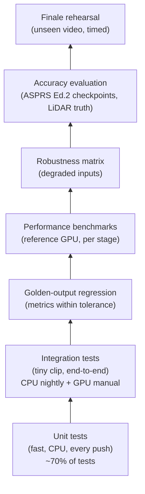

# 11 · Testing and Evaluation

> **Purpose:** This document explains how we show that Drishti3D works and how accurate it is. It covers software tests (unit, integration, golden regression, CI), performance benchmarks, robustness testing, the accuracy protocol (ASPRS Ed. 2, 2023), datasets, baselines, controlled experiments, acceptance criteria and the finale rehearsal drill.
>
> **Status:** Draft v1.0 · 2026-09-30 · Owners: R2 Geo & Accuracy Lead (accuracy protocol, S9), R1 Pipeline Lead (software tests, CI), R6 Data & Flight Ops (datasets, checkpoints, rehearsal)

Stage IDs (S0–S9, P), profiles and targets come from [00-project-charter.md](00-project-charter.md). **All numeric targets here are our own engineering targets** (charter §6: the official PS evaluation table is empty and must be confirmed on sih.gov.in). Targets are marked 🎯.

---

## Table of contents

1. [Test strategy overview](#1-test-strategy-overview)
2. [Unit tests per module](#2-unit-tests-per-module)
3. [Integration tests](#3-integration-tests)
4. [Golden-output regression](#4-golden-output-regression)
5. [Frontend and API tests](#5-frontend-and-api-tests)
6. [Performance benchmarks](#6-performance-benchmarks)
7. [Robustness test matrix](#7-robustness-test-matrix)
8. [Accuracy evaluation protocol](#8-accuracy-evaluation-protocol)
9. [Datasets](#9-datasets)
10. [Baselines](#10-baselines)
11. [Experiments E1–E12](#11-experiments-e1e12)
12. [Results templates](#12-results-templates)
13. [Acceptance criteria](#13-acceptance-criteria)
14. [Finale rehearsal protocol](#14-finale-rehearsal-protocol)
15. [CI setup](#15-ci-setup)
16. [Bug severity definitions](#16-bug-severity-definitions)
17. [Related documents](#related-documents)

---

## 1. Test strategy overview



| Layer | Question it answers | Runs where | When | Owner |
|---|---|---|---|---|
| Unit | Is each function mathematically and logically correct? | GitHub Actions (CPU) | Every push / PR | Module owner |
| Integration | Do S0–S9 connect and produce valid files? | CI (CPU, tiny clip) + GPU workstation | Nightly (CPU), before each milestone (GPU) | R1 |
| Golden regression | Did a change silently make results worse? | GPU workstation | Before merging any change to S3–S9 | R1 / R2 |
| Performance | Do we meet the time and memory budgets? | Reference workstation (RTX 3060 12 GB minimum; RTX 4090 ideal) | Weekly from M2 | R1 |
| Robustness | Does it survive bad input without failing silently? | GPU workstation | M3–M5 | R4 / R2 |
| Accuracy | How accurate is it, measured to a standard? | GPU workstation + field survey data | M3 onwards, final run in M5 | R2 |
| Rehearsal | Can the team deliver on an unseen video under time pressure? | The finale laptop, air-gapped | M5 (≥ 3 drills) | R6 |

**Guiding rules**

1. **Measure, don't claim** (charter principle 1). Every number in the pitch traces back to a row in §12 with the dataset, conditions and commit hash.
2. **Relative and absolute accuracy are always reported separately** (charter principle 2).
3. **Checkpoints are sacred.** A point used for anchoring (S4) is never used as a checkpoint for the same run. This is enforced in code (§2, `qa` tests).
4. **Tests are deterministic where possible.** Seeds are fixed (`numpy`, `torch`, COLMAP `random_seed`). Where GPU non-determinism remains, we use tolerances instead of exact equality.

---

## 2. Unit tests per module

Framework: `pytest` with `hypothesis` for property-based tests. Tests live in `tests/unit/<module>/` (charter §9). Markers: `@pytest.mark.gpu`, `@pytest.mark.slow`, `@pytest.mark.data` (needs downloaded data). CI runs `-m "not gpu and not slow and not data"`.

### 2.1 S0 · `drishti.ingest`

| Test | Method | Pass criterion |
|---|---|---|
| **SRT parser, format coverage** | Fixture SRT files from several DJI models (e.g. Mini 3 / Mini 4 Pro, Mavic 3, Air 2S, Phantom 4 RTK, M3E) plus synthetic variants: `<font>` HTML tags, `[key: value]` blocks, CRLF, UTF-8 BOM, missing altitude, missing gimbal, 1-entry-per-frame vs 1 per second | All fields parsed into the canonical schema of [08-data-formats-and-interfaces.md](08-data-formats-and-interfaces.md). Unknown keys are kept in `extra`. No exceptions. |
| SRT parser, malformed input | Truncated file, non-monotonic timestamps, duplicate indices, lat/lon swapped or out of range | Raises `SrtFormatError` with a line number, or repairs and warns (the list of repairs is logged). Never returns silently wrong values. |
| SRT timestamps | SRT uses local time without a timezone ([ScienceDirect 2025](https://www.sciencedirect.com/science/article/abs/pii/S2352938525003544)) | The parser returns naive times plus a `tz_assumed` flag. Timezone handling is tested for IST (+05:30) and UTC. |
| SRT ↔ frame mapping | Video with 29.97 fps (NTSC 30000/1001) and 25 fps; SRT count ±2 of the frame count | Per-frame telemetry is interpolated correctly (the position at a frame's PTS matches linear interpolation within 1e-9 deg) |
| KLV (MISB ST 0601) | Sample `.ts` with a KLV data PID ([klvdata](https://pypi.org/project/klvdata/)); synthetic packets built with `klvdata` | Sensor lat/lon/alt and platform angles are decoded. Checksum failures are counted and skipped. |
| Video probe | ffprobe on CFR, VFR, rotated (display matrix) and HEVC 10-bit clips | Correct fps, frame count, rotation and pixel format. VFR is flagged. |
| **Time-offset estimator** (synthetic) | Generate a curved trajectory with speed changes (accelerate, turn, hover). Derive a "truth" SRT stream. Derive an "SfM/optical-flow" speed with noise. Shift the SRT by δ ∈ {−3.0, −1.0, −0.5, −0.1, 0, +0.2, +0.37, +1.0, +2.5} s. Add GPS noise: white σ = 1 m plus a random-walk component. | 🎯 \|δ̂ − δ\| ≤ 1 frame period (33 ms at 30 fps) for all δ when the speed varies by ≥ 20 % within the window. The reported σ̂ covers the true error in ≥ 90 % of 200 random trials (calibration check). |
| Time-offset, unobservable case | Constant-speed straight line (no speed variation) | Estimator returns `confidence = low` and `δ̂ = 0` (or the user override). Must **not** return a confident wrong offset. |
| Time-offset, search range | δ beyond the search window (±5 s) | Returns `out_of_range` and a warning |

### 2.2 S1 · `drishti.frames`

| Test | Method | Pass criterion |
|---|---|---|
| Blur score monotonicity | Apply Gaussian blur σ ∈ {0, 0.5, 1, 2, 4} px and motion blur of length {0, 5, 15} px to 20 sharp aerial images | Variance-of-Laplacian decreases monotonically for every image |
| Per-window rejection | Synthetic sequence with known blurred frames | Rejects ≥ 95 % of the injected blurred frames and keeps ≥ 1 frame per window |
| Parallax keyframing | Synthetic translation sequence with known overlap | Selected keyframes keep forward overlap within the configured band (default 🎯 80–90 %, matching the ~1 frame / 2.5 s regime that matched stills in [Remote Sens. 2021](https://doi.org/10.3390/rs13142745)) |
| Hover handling | Sequence where the drone hovers for 30 s | No burst of near-duplicate keyframes (≤ 2 keyframes during hover) |
| Shot cut / overlay | Clip with a scene cut and burned-in OSD text | Cut detected. OSD region added to the static mask. |

### 2.3 S2 · `drishti.masking`

| Test | Method | Pass criterion |
|---|---|---|
| Mask format | Any input frame | Binary mask with the same size as the frame, in the COLMAP mask naming convention |
| Dynamic-class recall | 50 hand-labelled aerial frames (vehicles, people) | 🎯 Vehicle-mask recall ≥ 0.85 at IoU 0.5 (tuned later) |
| Sky / overlay masks | Oblique frames with horizon | Sky masked. No mask on ground below the horizon line. |
| Licence guard | Load the configured weights | Fails if the weight's licence is on the forbidden list (charter §8) |

### 2.4 S3 · `drishti.sfm`

| Test | Method | Pass criterion |
|---|---|---|
| Prior writer | Write GPS and gravity priors to a COLMAP database | Round-trip read equals written values. σ values respected. |
| Rolling-shutter model | Synthetic camera moving at 8 m/s, 70 m AGL, readout 30 ms and 74 ms (the setup of [Vautherin et al. 2016](https://isprs-annals.copernicus.org/articles/III-3/139/2016/isprs-annals-III-3-139-2016.pdf)) | The projection function reproduces the analytical row-dependent displacement to < 0.01 px |
| Fixed intrinsics | Run with `refine_focal=False`, `refine_extra=False` | Intrinsics in the output equal the input exactly |
| Degeneracy detector | Collinear camera centres with nadir views | Flag `strip_degenerate = true`, which triggers roll-from-gimbal/gravity |
| Tiny synthetic scene (`slow`) | 30 rendered views of a textured plane + boxes with known poses | Rotation error < 0.1°, position error < 1 % of baseline |

### 2.5 S4 · `drishti.georef`

| Test | Method | Pass criterion |
|---|---|---|
| **Umeyama with a known transform** | Random Sim(3): scale s ∈ [0.2, 5], random rotation, translation up to 10⁶ m (UTM-scale values). Apply it to N ∈ {3, 10, 1000} non-collinear points. | Noise-free: recovered s, R, t within 1e-9 relative error. Handles large coordinates (centre first; tested in float64). |
| Umeyama with noise | Add isotropic noise σ = 2 m to the targets. 500 Monte Carlo trials. | Mean translation error ≈ σ/√N (within 20 %). Scale error within the analytical expectation (see [06-georeferencing-and-accuracy.md](06-georeferencing-and-accuracy.md)). |
| Robust fit | 20 % gross outliers (50–500 m) | RANSAC/Huber fit recovers the transform within 3× the no-outlier error |
| **Collinear degeneracy** | Points on a straight line (a single straight strip) | Returns `roll_unobservable = true`. The rotation about the line axis is **not** taken from the fit but from the gimbal/gravity prior. The test asserts that the roll comes from the prior. |
| Reflection guard | Point set that tempts a reflection | det(R) = +1 always |
| Ortho registration | Synthetic: crop a reference orthophoto, shift it by (ΔE, ΔN) = (+2.6, −1.9) m, add a brightness change and 5 % cloud mask | Recovered shift within 🎯 0.5 GSD of the reference ortho |
| DSM vertical anchoring | Synthetic DSM + known vertical bias of 3.9 m (as in Zhang et al.'s GNSS-only result, [ESurfD 2019](https://esurf.copernicus.org/preprints/esurf-2019-2/esurf-2019-2.pdf)) | Bias recovered within 0.05 m on bare-ground cells |
| CRS handling | Round-trip WGS84 ↔ UTM 43N/44N ↔ ECEF; ellipsoidal ↔ orthometric with a test geoid | Round-trip error < 1 mm. The geoid value matches the reference tool (GeographicLib GeoidEval) within 1 mm. |
| Lever arm | Antenna-to-camera offset applied with changing attitude | Camera-centre position matches the analytical value |

### 2.6 S5 · `drishti.dense`

| Test | Method | Pass criterion |
|---|---|---|
| OpenMVS runner | Mock the binaries; check the command lines and the scene file | Correct arguments per profile. Non-zero exit becomes `StageError` with stderr attached. |
| DSM rasteriser | Synthetic point cloud of a tilted plane + a box | DSM heights within 1e-6 m of analytic values. No-data outside the hull. CRS and nodata tags set. |
| DTM from ground class | Synthetic scene with buildings | DTM under buildings interpolated. Building cells excluded from the ground fit. |
| Ortho | Synthetic textured plane | Georeferencing error of known texture features < 0.5 px |

### 2.7 S6 · `drishti.completion`

| Test | Method | Pass criterion |
|---|---|---|
| Plane fitting | Noisy synthetic gable roof (σ = 3 cm) | Plane normals within 1°, ridge line within 5 cm |
| LoD2 wall inference | Roof with no observed walls | Walls extruded to the DTM; **every inferred face has `conf_class = inferred`** (hard assertion) |
| Semantic labels | Small labelled cloud | Output class set equals the charter classes exactly: ground, building, road, vegetation, vehicle/person, water, other |

### 2.8 S7 · `drishti.splat`

| Test | Method | Pass criterion |
|---|---|---|
| Export tag | Splat tileset metadata | Marked `display_only = true`. The viewer and API refuse measurement queries against it. |
| Smoke (`gpu`) | 200 iterations on the tiny scene | Loss decreases. Output passes glTF validation. |

### 2.9 S8 · `drishti.export`

| Test | Tool | Pass criterion |
|---|---|---|
| LAS/LAZ | `laspy` / PDAL `info` | Version 1.4, WKT CRS VLR present, scale/offset valid, classification codes as documented in 08 |
| COG | `rio cogeo validate` | Valid COG, overviews present, CRS + nodata set |
| glTF/GLB | Khronos glTF-Validator | 0 errors |
| 3D Tiles | CesiumGS `3d-tiles-validator` | 0 errors. Geometric error decreases with depth. |
| Manifest | SHA-256 of every file | Matches the files on disk |

### 2.10 S9 · `drishti.qa`

| Test | Method | Pass criterion |
|---|---|---|
| **CE90 calculator** | RMSE_x = RMSE_y = 1 m | CE90 = 2.146 m (± 0.001) |
| CE90 from RMSE_H | RMSE_H = 1 m | CE90 = 1.5175 m |
| LE90 | RMSE_z = 1 m | LE90 = 1.6449 m |
| CE90 elliptical case | RMSE_x / RMSE_y < 0.6 | Uses exact numerical integration of the bivariate normal and warns that the circular approximation is invalid (the approximation holds for ratios ≥ 0.6, per the [NSSDA/ASPRS factors as summarised here](https://github.com/uw-cryo/groundcontrol/pull/30)) |
| Monte Carlo cross-check | Draw 10⁶ bivariate-normal errors with random σx, σy | Formula CE90 within 1 % of the empirical 90th-percentile radius (circular case) |
| Bias vs noise | Known μ = 3.93, s = 0.18, n = 16 | RMSE² = μ² + ((n−1)/n)·s² identity holds to 1e-12 |
| RMSE from checkpoints | Hand-computed 5-point example | Exact match |
| **Checkpoint independence** | Pass the same point ID as both anchor and checkpoint | Raises `CheckpointLeakError` |
| ASPRS minimum count | 29 checkpoints | Report flagged `asprs_compliant = false`, "indicative" |
| Doming estimator | Synthetic DSM residual = paraboloid with 0.30 m peak over 1 km + noise σ = 5 cm | Recovered peak-to-trough 0.30 ± 0.02 m. Along- and across-track profiles returned. |
| Completeness | Synthetic footprint with a 7 % hole | Completeness = 93.0 % ± 0.1 % |
| Confidence classes | Points with known view count and angle | Class assignment matches the thresholds in [05-pipeline-design.md](05-pipeline-design.md) |
| Report | Render HTML and PDF from a fixture JSON | Renders. All mandatory fields are present (checkpoint count, method, conditions, versions). |

### 2.11 P · `drishti.preview`

| Test | Method | Pass criterion |
|---|---|---|
| Incremental mosaic | 60 GPS-tagged synthetic frames | Tiles are emitted incrementally, and the mosaic extent grows monotonically |
| Latency (`slow`) | Real 1080p clip on CPU | 🎯 First tile ≤ 60 s after the upload starts (charter) |

---

## 3. Integration tests

| ID | Scenario | Input | Profile | Assertions | Runs |
|---|---|---|---|---|---|
| IT-1 | **Tiny clip end-to-end** | `tests/data/tiny/` — 20 s 1080p clip + SRT (own flight, about 40 keyframes), plus a 5-checkpoint CSV | `fast` (CPU fallback settings) | All S0–S9 artefacts exist. Schemas valid (§2.9). CRS = expected UTM zone. Report JSON has CE90/LE90 fields. Run time < 20 min on a CI CPU runner. | Nightly (CPU) |
| IT-2 | Tiny clip, GPU | Same | `fast` | As IT-1, plus golden metrics (§4) | Manual, before merge to `main` on S3–S9 changes |
| IT-3 | Preview only | Same | `preview` | Only P, S0, S1 run. The 3D tabs are marked unavailable in the run manifest. | Nightly |
| IT-4 | No SRT | Video only | `fast` | Run completes as a *relative* model with `georef = none`. The UI flag is set. No CE90 claimed. | Nightly |
| IT-5 | With reference ortho + DSM | Tiny clip + cropped reference rasters | `fast` | S4 registration runs. The anchoring tier in the report = `ortho+dsm`. | Manual GPU |
| IT-6 | With RTK file | MARS-LVIG short subset (RTK poses as an "RTK file") | `fast` | Anchoring tier = `rtk`. Checkpoint CE90 computed against LiDAR-derived points. | Manual GPU |
| IT-7 | CLI contract | `drishti run --video … --srt … --profile fast --out …` (charter §9) | — | Exit code 0. `--help` lists every documented flag. Unknown flags are rejected. | Every push (argument parsing only) |
| IT-8 | API + websocket | Start the FastAPI server, upload the tiny clip through the API, subscribe to `WS /api/v1/runs/{run_id}/progress` | `preview` | Ordered `seq`. `run_completed` event received. Reconnect with `since_seq` replays missed events. | Nightly |
| IT-9 | **Offline conformance** | IT-1 inside Docker with `--network none` | `fast` | Pipeline and viewer build succeed with **no network access** (charter principle 4) | Nightly |
| IT-10 | Resume after crash | Kill the job runner during S5 | `fast` | Restart resumes from S5 using the cached S0–S4 outputs | Weekly |

---

## 4. Golden-output regression

Bit-exact comparison is not realistic (GPU non-determinism, OpenMVS threading), so we compare **metrics with tolerances**.

| Golden set | Content | Stored in |
|---|---|---|
| G1 tiny-own | IT-1 clip, 5 checkpoints | `tests/golden/g1/metrics.json` (committed) |
| G2 MARS-LVIG short | One 2–3 min sequence segment, RTK + L1 LiDAR truth | Metrics committed. Data via `scripts/download_mars_lvig.py`. |
| G3 synthetic | Rendered scene with exact ground truth (§9) | Metrics committed. Data via script. |

**Compared metrics and tolerances** (initial values, tighten once variance is measured):

| Metric | Tolerance vs golden | Direction |
|---|---|---|
| Registered keyframes (%) | −2 percentage points | Must not drop more |
| Mean reprojection error (px) | +10 % | Must not rise more |
| CE90 / LE90 (m) | +10 % or +5 cm (whichever is larger) | Must not rise more |
| Relative length error (%) | +0.05 pp | Must not rise more |
| Doming peak (m) | +2 cm | Must not rise more |
| Completeness (%) | −1 pp | Must not drop more |
| C2C median distance to LiDAR (m) | +10 % | Must not rise more |
| Point count | ±10 % | Either direction flags a review |
| Stage timings (s) | +20 % | Flags a review (not a failure) |

**Updating goldens:** only through a PR labelled `golden-update`. The PR must include the old vs new table and an explanation, and needs approval from R2.

---

## 5. Frontend and API tests

| Type | Tool | Scope |
|---|---|---|
| Unit | Vitest | `viewer/uncertainty.ts` (all §6 formulas of [09-viewer-and-ui.md](09-viewer-and-ui.md), including its worked example: 48.37 m → ±0.10 m), `geodesy.ts` (geodesic distances vs GeographicLib reference values within 1 mm, UTM zone selection across India, geoid correction), stores, i18n key completeness |
| Component | React Testing Library | Stage list states, Ingest Check warnings, Export dialog validation |
| End-to-end | Playwright (Chromium, headless, WebGL through SwiftShader) | Mission → ingest → progress (mocked websocket) → viewer loads a fixture tileset → distance measurement matches the expected value ± tolerance → export request payload |
| Accessibility | axe-core in Playwright | 0 serious/critical violations on every screen, in both themes and both languages |
| API contract | `pytest` + `httpx` + JSON-schema checks | Every endpoint in [08-data-formats-and-interfaces.md](08-data-formats-and-interfaces.md) |
| Measurement correctness | Fixture: synthetic tileset with a 20.000 m × 10.000 m box, 5.000 m tall, on a plane | Distance 20.000 ± 0.001 m. Height 5.000 ± 0.001 m. Planimetric area 200.000 m² ± 0.01. Volume vs the plane base 1000.0 ± 0.5 m³. |

---

## 6. Performance benchmarks

### 6.1 What we measure

| Metric | How | Tool |
|---|---|---|
| Wall time per stage (S0–S9, P) | Stage start/end timestamps from the job runner | `drishti.run` timing log → `bench.json` |
| Time to first preview tile | Upload start → first `preview_tile` event | Server event log |
| GPU memory peak per stage | NVML sampled at 5 Hz, plus `torch.cuda.max_memory_allocated` for PyTorch stages | `pynvml` |
| GPU utilisation | NVML | `pynvml` |
| CPU / RAM peak | `psutil` sampled at 2 Hz | `psutil` |
| Disk usage (intermediate and final) | Directory size per stage | `scripts/bench.py` |
| Viewer frame rate | CesiumJS `scene.postRender` frame timing in a scripted camera path | Playwright + custom FPS probe |

### 6.2 Benchmark matrix

| Clip | Resolution | Duration | Profile | Hardware |
|---|---|---|---|---|
| B-S | 1080p | 2 min | fast, quality | RTX 3060 12 GB, RTX 4090 24 GB |
| B-M | 4K | 5 min | fast | both |
| **B-L** | **4K** | **10 min** | **fast** 🎯 ≤ 15 min | both (the headline number is on the reference workstation) |
| B-XL | 4K | 20 min | fast | RTX 4090 (stress / memory) |

### 6.3 Time budget for B-L (10-min 4K, `fast`)

These are **planning estimates to be measured**, not sourced figures (the research report explicitly treats per-stage timings as estimates).

| Stage | Budget (min) | Measured RTX 3060 | Measured RTX 4090 | Peak GPU mem | Notes |
|---|---|---|---|---|---|
| S0 Ingest & Sync | 0.5 | | | | decode is streamed |
| S1 Keyframe Selection | 1.0 | | | | about 600–1,200 keyframes at 1–2 fps |
| S2 Masking & Semantics | 1.5 | | | | batch inference |
| S3 Pose Estimation | 3.5 | | | | global mapper + GPU BA |
| S4 Georef & Anchoring | 0.5 | | | | |
| S5 Dense & Mesh | 5.5 | | | | the largest risk |
| S6 Completion & Classification | 1.0 | | | | |
| S8 Export & Tiling | 1.0 | | | | |
| S9 QA & Confidence | 0.5 | | | | |
| **Total (excluding S7)** | **15.0** 🎯 | | | | S7 runs after the metric product is published |
| P first tile | ≤ 1.0 🎯 | | | | runs in parallel |

For context, ODM's community benchmark reported 242 images at ultra quality in 62 min with GPU ([ODM community](https://community.opendronemap.org/t/hardware-recommendations-cpu-cores-graphics-card-cuda-nvidia-memory-ram-storage/13705)). This is why the `fast` profile must not use ODM-style ultra dense settings.

---

## 7. Robustness test matrix

Each factor is tested on at least one base sequence (MARS-LVIG short segment and/or our own flight), one factor at a time, with the other factors at nominal values. The key rule: **the system either produces a correct result with honest uncertainty, or fails loudly with a clear message. It must never produce a confident wrong answer.**

| # | Factor | How injected / obtained | Levels | Expected behaviour | Pass criterion |
|---|---|---|---|---|---|
| RB1 | Motion blur | Synthetic linear motion-blur kernels on a random subset of frames; real fast-yaw segments | 0 %, 10 %, 30 %, 50 % of frames; kernel 5–25 px | S1 rejects blurred frames. Ingest Check warns. | ≤ 10 % degradation in CE90 and completeness up to 30 % blurred frames |
| RB2 | Low light | Gamma/exposure reduction + Poisson-Gaussian noise; real dusk flight if possible | EV −1, −2, −3 | Fewer features. The confidence map shows more observed-low. | Completes at EV −2. Warns at EV −3. |
| RB3 | Compression | Re-encode with H.264/H.265 at controlled bitrates | 60, 20, 8, 4 Mbit/s (4K) | Graceful degradation | 🎯 CE90 within target at ≥ 20 Mbit/s. Warning below 8 Mbit/s. |
| RB4 | Moving vehicles / people | Busy road segments in our own flight; synthetic moving objects in the simulator | none / light / heavy traffic | S2 masks them. No ghost geometry. | No reconstructed vehicle "smears" larger than 2 m² in the mesh (visual audit + class check) |
| RB5 | Water | River/pond scenes | 0 %, 20 %, 50 % of frame area | Water masked or flagged observed-low. No spurious surfaces. | SfM does not break. Water area labelled `water` or observed-low. |
| RB6 | Repetitive texture | Crop fields, solar farms, rooftops | Real scenes | Relies on GPS priors to avoid mismatches | Registered ≥ 90 % of frames. No folded geometry. |
| RB7 | GPS dropouts | Delete SRT entries | 5 s, 30 s, 60 s gaps; 10 % random | Interpolate/extrapolate with visual odometry across the gap | Absolute error inside the gap ≤ 2× outside it. Ingest Check warns. |
| RB8 | GPS noise injection | Add white noise σ ∈ {1, 3, 5} m + random walk + a constant bias (5 m E, 8 m U) | as listed | The bias is removed by anchoring. Noise is averaged. | With anchoring: CE90 still ≤ 1 m 🎯. Without anchoring: the reported CE90 honestly reflects the degradation. |
| RB9 | **Wrong time offset** | Shift the SRT by δ | ±0.2, ±0.5, ±1, ±3 s | S0 estimator recovers δ (see §2.1) | Residual error ≤ 1 frame. With the estimator disabled (E1), the error is visible in the metrics. |
| RB10 | Pure nadir vs oblique | Own flight with gimbal −90° vs −60° (forward-oblique ~30°) | 2 flights, same route | Nadir: doming risk flagged | Doming ≤ 0.2 m 🎯 for oblique. For nadir: report whatever value we get, honestly. |
| RB11 | Different drones / resolutions | DJI Mini-class, Mavic-class, M3E-class if available; 1080p vs 4K | ≥ 2 drones | Camera auto-detected. Rolling-shutter profile or estimated readout. | Completes. Relative accuracy ≤ 0.5 % 🎯 for all. |
| RB12 | Altitude / speed | Own flights at 60, 90, 120 m AGL (green zone, ≤ 120 m per Drone Rules 2021); 3, 6, 10 m/s | grid | Faster speed means more rolling shutter and blur | Report as a table. Identify the operating envelope for doc 12. |
| RB13 | Thermal / IR video (if available) | Thermal clip from a dual-sensor drone | 1 clip | Low texture. Expect lower completeness. | Completes, or fails with a clear "insufficient features" message |
| RB14 | Burned-in OSD overlay | Screen-recorded video with a HUD | 1 clip | Overlay detected and masked | No overlay features used in SfM |
| RB15 | Variable frame rate / rotated video | Phone-style VFR, 90° rotation flag | 1 clip each | Correct frame timing and orientation | Completes with correct geometry |
| RB16 | Corrupted / truncated file | Cut the last 10 % of an MP4 (no moov atom) | 1 clip | Recovers what it can, or fails with a clear error | No crash without an error message; error shown in the UI |

---

## 8. Accuracy evaluation protocol

The protocol follows **ASPRS Positional Accuracy Standards for Digital Geospatial Data, Edition 2 (2023)**. Its key points are: RMSE as the single accuracy statistic, **at least 30 checkpoints**, checkpoints **at least twice as accurate** as the product being tested, and checkpoint survey error included in the reported product accuracy ([LIDAR Magazine summary](https://lidarmag.com/2023/10/06/the-asprs-positional-accuracy-standards-edition-2/amp/); [ASPRS Ed.2 main body](https://aagsmo.org/wp-content/uploads/2023/03/ASPRS_PosAcc_Edition2_MainBody.pdf); [GPS World](https://www.gpsworld.com/asprs-approves-edition-2-of-the-asprs-positional-accuracy-standards-for-digital-geospatial-data/)). We also report the CE90 / LE90 figures a defence evaluator expects ([Maxar accuracy whitepaper](https://dg-cms-uploads-production.s3.amazonaws.com/uploads/document/file/38/DG_ACCURACY_WP_V3.pdf)).

### 8.1 Checkpoints

| Item | Requirement |
|---|---|
| Number | **≥ 30 independent checkpoints** per evaluated product (ASPRS Ed.2). Fewer than 30 → the result is labelled "indicative". |
| Independence | Never used in processing (not as an anchor, GCP or registration tie). Enforced by `CheckpointLeakError` (§2.10). |
| Accuracy of the checkpoint survey | At least 2× more accurate than the product. For the 🎯 ≤ 1 m CE90 tier: product RMSE_H ≈ 1 / 1.5175 = 0.66 m, so checkpoints need RMSE_H ≤ 0.33 m (easy with RTK). For the 🎯 ≤ 0.10 m CE90 RTK tier: product RMSE_H ≈ 0.066 m, so checkpoints need RMSE_H ≤ 0.033 m. This requires good RTK/CORS fixes with occupation averaging, or a total station. |
| Survey method | RTK rover on Survey of India CORS NRTK (about ±3 cm, [SoI CORS](https://cors.surveyofindia.gov.in/introduction.html)) or a local base with PPK, averaged over ≥ 30 epochs per point. Record fix type, PDOP and the number of satellites. |
| Targets | Painted or placed targets visible in the video (size ≥ about 10 × GSD; e.g. ≥ 30 cm for 3 cm GSD) plus well-defined natural features (road markings, manhole centres, corners) |
| Distribution | Spread along **and** across the strip, including near the strip ends and edges, where doming and roll-about-track errors peak ([James & Robson 2014](https://discovery.ucl.ac.uk/id/eprint/1443475/1/esp3609.pdf)). Include some checkpoints on flat open ground for vertical checks. |
| Datum | Checkpoints and product in the same horizontal CRS (e.g. WGS84 / UTM 43N) and the same vertical datum (ellipsoidal or EGM2008 orthometric, stated explicitly) |
| Measurement in the product | Horizontal: target centre picked in the orthomosaic (sub-pixel centroid if possible). Vertical: DSM value interpolated at the checkpoint on bare ground, or the mesh at the pick. Automate where possible; if picked manually, two people pick independently. |

### 8.2 Statistics

For n checkpoints with residuals Δx_i, Δy_i, Δz_i (product − checkpoint):

| Quantity | Formula |
|---|---|
| RMSE_x, RMSE_y, RMSE_z | √( Σ Δ² / n ) per axis |
| RMSE_H (radial horizontal) | √( RMSE_x² + RMSE_y² ) |
| **CE90** | ≈ 2.146 × RMSE_x when RMSE_x ≈ RMSE_y (valid for min/max ratio ≥ 0.6), equivalently ≈ 1.5175 × RMSE_H. Outside that ratio, use exact numerical integration (§2.10). |
| **LE90** | 1.6449 × RMSE_z |
| Checkpoint error inclusion | Report product accuracy with checkpoint survey error folded in, e.g. RMSE_H,product = √( RMSE_H,measured² + RMSE_H,checkpoint² ) as described for Ed.2 (R2 to verify the exact form against the standard's text before the finale) |
| Bias (mean error) | μ_x, μ_y, μ_z = mean of the residuals |
| Noise | s_x, s_y, s_z = sample standard deviation |
| **Bias vs noise decomposition** | RMSE² = μ² + ((n−1)/n)·s². Report the fraction of RMSE² explained by bias. For uncorrected consumer GNSS we expect it to be dominated by bias (Zhang et al.: Z mean 3.93 m vs SD 0.18 m, [ESurfD 2019](https://esurf.copernicus.org/preprints/esurf-2019-2/esurf-2019-2.pdf)). |
| Empirical check | 90th-percentile radial and absolute vertical errors (supplementary only; noisy at n = 30) |
| Outliers | Residuals > 3 × RMSE are investigated (a mis-picked target?). They are **never silently removed**. Any exclusion is listed with a reason, following ASPRS practice. |

**Reference conversion** (research report, derived): Zhang et al. GNSS-only XY 2.29 m / Z 3.93 m → about **3.5 m CE90 / 6.5 m LE90**. Our GNSS-only tier is expected to be in this range (charter: "~3–7 m CE90, report honestly").

### 8.3 Relative accuracy: known-distance tests

| Item | Specification |
|---|---|
| Ground truth | ≥ 10 distances between pairs of checkpoints or taped features, spanning 5 m to more than 200 m, in several directions (along track, across track, diagonal), plus ≥ 3 vertical differences (e.g. building height by total station or laser rangefinder) |
| Measured in | The 3D Viewer measurement tool **and** directly in the exported point cloud (both must agree within 1 cm) |
| Metrics | Signed error, absolute error, error % of length. Max and RMS. |
| 🎯 Targets | ≤ 0.5 % of measured length. ≤ 10 cm on 20 m (charter). Short (~300 m) clips need an extra scale source (RTK/PPK, anchoring or a known length); GNSS-only scale can reach ~0.7 % there. For comparison, the DJI/DroneDeploy whitepaper reports distances within 0.1–0.3 % with RTK ([DJI P4 RTK whitepaper](https://docs.djicdn.com/DJI+Enterprise/measurement-accuracy-dji-phantom-4-rtk-whitepaper-f[1].pdf)). |
| Also tested | Area of a surveyed polygon (≥ 3), volume of a surveyed stockpile or earthwork if available |

### 8.4 Doming test

Single straight strips with self-calibration produce a dome/bowl error of metre magnitude in simulation and about 0.2 m in a real test. Oblique views of 20–30° reduce it by one to two orders of magnitude, and fixing K1 gave a tenfold reduction ([James & Robson 2014](https://discovery.ucl.ac.uk/id/eprint/1443475/1/esp3609.pdf)).

| Step | Detail |
|---|---|
| 1. Reference | LiDAR DSM/DTM (MARS-LVIG DJI L1 map; own flight: reference DSM from a survey-grade photogrammetric or LiDAR product if available, otherwise a dense RTK point grid on open ground) |
| 2. Difference | Δz = model DSM − reference, on a common grid (e.g. 0.5 m), **bare-ground cells only** (ground class in both; slope < 15°; exclude vegetation, buildings, water, vehicles) |
| 3. Remove bias | Subtract the median Δz (the bias is reported separately in §8.2) |
| 4. Frame | Rotate to strip coordinates (u = along track, v = across track) |
| 5. Fit | Robust (Huber) quadratic surface Δz = a·u² + b·v² + c·u·v + d·u + e·v + f |
| 6. Report | Peak-to-trough of the fitted surface over the strip. Along-track profile (median Δz in 25 m bins with IQR). Across-track profile (median Δz in 5 m bins). Map of Δz. |
| 🎯 Target | **≤ 0.2 m** peak vertical deformation along a 1 km strip (charter) |

### 8.5 Completeness

| Item | Definition |
|---|---|
| Footprint | Union of the ground footprints of all keyframes (camera frustum intersected with the reference DSM, or the model DSM if no reference exists) |
| Visible ground footprint | Footprint cells that are visible from ≥ 2 keyframes (ray-cast against the reference DSM, so occluded cells do not count against us) |
| Completeness | Cells with a valid model DSM value and `conf_class ≠ inferred` ÷ visible footprint cells, on a 0.5 m grid |
| 🎯 Target | **≥ 90 %** (charter) |
| Also reported | The percentage of the model area that is observed-high / observed-low / inferred |

### 8.6 Cloud-to-reference distances (geometry quality)

| Metric | Tool | Settings | Reported |
|---|---|---|---|
| **C2C** (cloud-to-cloud, nearest neighbour) | [CloudCompare](https://www.cloudcompare.org/) (command line `-C2C_DIST`) | Reference = LiDAR. Compared = our LAZ, after anchoring and **without** any extra ICP (an ICP step would hide the absolute error). | Mean, median, SD, 95th percentile, per semantic class |
| **C2C after ICP** | CloudCompare ICP, then C2C | Rigid ICP only | Isolates *shape* error from placement error. Internal consistency should be comparable to the 4.8 mm ICP RMS reported for a UAV GS study ([T&F 2026](https://www.tandfonline.com/doi/abs/10.1080/19479832.2026.2661679)); this comparison is informational. |
| **C2M** (cloud-to-mesh) | CloudCompare `-C2M_DIST` | Reference LiDAR points vs our mesh | Same statistics; signed distances |
| **M3C2** | CloudCompare M3C2 plugin (Lague, Brodu & Leroux 2013, [ISPRS J. 82](https://doi.org/10.1016/j.isprsjprs.2013.04.009)) | Normal scale ≈ 5–10× point spacing; projection scale ≈ 2–3× spacing; registration error term = checkpoint RMSE | Signed distance map with significance. Used for doming/vertical systematic error on rough terrain. |

Each metric is reported separately for **anchored** and **GNSS-only** runs, and separately for the observed-high, observed-low and inferred classes. This checks that the confidence classes are well calibrated: observed-high should have the smallest distances.

### 8.7 Protocol checklist (per evaluated run)

```text
[ ] Commit hash, config hash, profile, hardware recorded
[ ] Input: drone, camera, resolution, fps, bitrate, altitude AGL, speed, gimbal pitch, date/time
[ ] Anchors used (a–e) and the IDs of any GCPs used
[ ] Checkpoints: count (≥ 30?), survey method, accuracy, CRS, vertical datum
[ ] Independence verified (no anchor ∩ checkpoint)
[ ] RMSE_x, RMSE_y, RMSE_z, RMSE_H, CE90, LE90, bias, SD per axis
[ ] Relative length table (≥ 10 distances)
[ ] Doming peak + profiles (if reference DSM/LiDAR exists)
[ ] Completeness %
[ ] C2C / C2M / M3C2 vs LiDAR (if available)
[ ] Confidence-class breakdown
[ ] Outliers listed with reasons (none silently removed)
[ ] Report PDF + JSON archived under data/runs/<run_id>/09_qa/ and summarised in §12
```

---

## 9. Datasets

| Dataset | What it contains | What it tests | Limitations | Access |
|---|---|---|---|---|
| **MARS-LVIG** (IJRR 2024) | 21 downward-looking sequences, 80–130 m altitude, 3–12 m/s, global-shutter RGB, IMU, raw GNSS, **RTK ground-truth poses** and a **DJI L1 LiDAR map** | S3 pose accuracy vs RTK; S4 anchoring with noisy GNSS (use raw GNSS, simulate consumer noise); **doming** and C2C/M3C2 vs L1 LiDAR; completeness; long strips (paths up to 7.1 km) | Global shutter, so rolling-shutter tests do not apply. Frames rather than a compressed video (we re-encode to H.264/H.265 to test compression, R3). | [mars.hku.hk](https://mars.hku.hk/dataset.html); [IJRR](https://journals.sagepub.com/doi/abs/10.1177/02783649241227968) |
| **UseGeo** (3DOM-FBK) | UAV images (829 across 3 datasets, 7952×5304) with LiDAR point clouds and ground-truth depth maps | S5 dense depth / point-cloud accuracy; S6 classification sanity | Stills, not video; we downsample to 3840 px wide and sequence them to mimic video | [GitHub 3DOM-FBK/UseGeo](https://github.com/3DOM-FBK/UseGeo) |
| **UAVD4L** (3DV 2024) | About 2.5 km² urban/rural area with an RTK/GCP-aligned textured mesh and DSM from oblique aerial photography, UAV query images | **S4 registration to a prior model / reference ortho-DSM** (anchoring method b) | Localisation dataset. Query imagery is not a continuous single-pass video. | [arXiv 2401.05971](https://arxiv.org/abs/2401.05971); [GitHub](https://github.com/RingoWRW/UAVD4L) |
| **Own green-zone flight(s)** | Real DJI video (4K) + SRT, gimbal nadir and 30° forward-oblique passes, **≥ 30 RTK checkpoints** + ≥ 10 taped distances, optional reference DSM | Everything end-to-end, especially **time sync (S0), rolling shutter, compression, real consumer-GNSS bias**, the headline before/after CE90 table, and the demo | Only flights in green zones up to 120 m AGL (Drone Rules 2021, [PIB](https://static.pib.gov.in/writereaddata/specificdocs/documents/2022/jan/doc202212810701.pdf)); limited scene variety | See [12-flight-and-data-capture-guide.md](12-flight-and-data-capture-guide.md) |
| **Synthetic: Google Earth Studio** | Rendered fly-through video with an exported camera path (keyframe data) | Pipeline robustness, **time-offset injection** with exact camera timing, keyframing, unseen-location drills | Geometry truth is Google's own 3D, not survey truth. Check the terms of use; internal testing only, not shipped or shown as our data. | [earth.google.com/studio](https://earth.google.com/studio/) |
| **Synthetic: simulator** (e.g. Unreal Engine + Cesium for Unreal, or a CARLA/AirSim-style setup) | Rendered video with exact poses, depth and geometry. Scriptable blur, rolling shutter, moving vehicles, water, lighting. | Exact-ground-truth tests for RB1–RB6 and RB9; E2, E7 | Sim-to-real gap | Scripts in `scripts/sim/` |
| ODM sample datasets | Drone image sets (some with video) | Baseline sanity, ODM comparison | Mostly stills, varied quality | [ODM GitHub](https://github.com/OpenDroneMap/ODM) and `odm_data_*` repos |

Licences and download scripts for each dataset are recorded in [15-research-and-references.md](15-research-and-references.md) and `scripts/`. Where a licence is unclear, the dataset is used for internal evaluation only.

---

## 10. Baselines

| ID | Baseline | Exact configuration | Why |
|---|---|---|---|
| **B0** | **Raw GNSS-only** (our pipeline, anchoring method a only) | S0–S3 as normal. S4 = robust 7-DoF Umeyama to SRT GPS, with **no** ortho/DSM/RTK/GCP. | The "before" in the before/after table. Isolates the value of the accuracy engine. |
| **B1** | **ODM default** | Latest ODM 3.x Docker, video + matching `.srt` in `images/`, default arguments (so `--video-limit 500`, `--gps-accuracy 3`, no rolling shutter), `--3d-tiles` ([ODM args](https://docs.opendronemap.org/arguments/)) | The most mature open baseline, and what most competitor teams will use |
| B1-t | ODM tuned | B1 + `--rolling-shutter`, raised `--video-limit`, `--pc-quality medium` | A fair "best effort" ODM |
| **B2** | **COLMAP default** | Frames extracted at 1 fps → `colmap automatic_reconstructor` (defaults) → `model_aligner` to GPS → COLMAP dense | The research-standard pipeline without our additions |
| B3 | Our pipeline, anchored (methods b–e) | Full Drishti3D | The "after" |

All baselines are run on the **same frames** (where applicable), the **same checkpoints** and the **same hardware**, with times recorded.

---

## 11. Experiments E1–E12

Each experiment changes **one factor** relative to the default `fast` configuration. Datasets: **O** = own flight, **M** = MARS-LVIG, **S** = synthetic, **U** = UAVD4L.

| ID | Factor | Variants | Hypothesis | Primary metrics | Data |
|---|---|---|---|---|---|
| **E1** | Time sync (S0) | off (offset = 0) · on (estimated) · on + injected offsets ±0.5/1/3 s | With sync on, CE90 and along-track bias fall noticeably when the true offset is non-zero, because a 0.4 s offset at 5 m/s is a 2 m along-track shift | Along-track bias, CE90, time-offset error | O, S |
| **E2** | Rolling-shutter model | off · on (known readout) · on (estimated readout) | RS modelling reduces reprojection error and improves checkpoint accuracy at higher speeds ([Vautherin et al. 2016](https://isprs-annals.copernicus.org/articles/III-3/139/2016/isprs-annals-III-3-139-2016.pdf)) | Mean reprojection error, RMSE_H, RMSE_z | O, S (not M: global shutter) |
| **E3** | Intrinsics | free (self-calibrated) · fixed from pre-calibration · K1 fixed only | Fixed intrinsics reduce doming on a nadir strip by about 10× ([James & Robson 2014](https://discovery.ucl.ac.uk/id/eprint/1443475/1/esp3609.pdf)) | Doming peak, LE90 | M, O |
| **E4** | View geometry | pure nadir (−90°) · forward-oblique (~−60°) · nadir + altitude variation | Oblique cuts doming by 10–100× (James & Robson 2014; ≥ 10 % oblique per [Drones 2025](https://doi.org/10.3390/drones9060387)) | Doming peak, LE90, completeness (facades) | O |
| **E5** | **Anchoring method** | **a** GPS Umeyama only · **b** + ortho/DSM registration · **c** + CORS/GAGAN-corrected GNSS · **d** + single known point (GCP) · **e** RTK/PPK | Each step removes most of the rigid bias. 🎯 b/c/d reach ≤ 1 m CE90/LE90; e reaches ≤ 0.10 m CE90. GAGAN alone is about 1.5 m H / 2.5 m V ([Wikipedia GAGAN](https://en.wikipedia.org/wiki/GPS-aided_GEO_augmented_navigation)), so c may need b to meet the vertical target. | CE90, LE90, bias fraction | O, M, U |
| **E6** | Keyframe rate | 0.5 · 1 · 2 · 4 fps | Accuracy saturates around 1–2 fps (1 frame/2.5 s matched stills, [Remote Sens. 2021](https://doi.org/10.3390/rs13142745)); higher rates only cost time | CE90, completeness, S3+S5 time | O, M |
| **E7** | Dynamic masking (S2) | off · on | Masking removes ghost geometry and improves texture where there is traffic, with little effect on CE90 | Artefact count (R4 audit), C2C on road class | O, S |
| **E8** | Profile | `fast` · `quality` | Quality improves completeness and C2C modestly, but not absolute accuracy (which is set by georeferencing) | Time, completeness, C2C, CE90 | O, M |
| **E9** | Features | ALIKED + LightGlue · SIFT (COLMAP default) | Learned features raise registration on low-texture and blurred frames | Registered %, reprojection error, time | O, M |
| **E10** | Pose backend | COLMAP global mapper · incremental mapper · DPVO fallback | Global mapper is much faster at similar accuracy ([GLOMAP](https://arxiv.org/html/2407.20219v2)); DPVO is a robust low-memory fallback | S3 time, GPU memory, ATE vs RTK | M |
| **E11** | Roll / gravity prior on straight strips | off · gimbal attitude prior · gravity prior | Without a prior, roll about the track is poorly constrained on collinear GPS; the prior removes the across-track tilt | Across-track Δz slope, LE90 | M, O |
| **E12** | Input quality | 4K vs 1080p; bitrate 60 / 20 / 8 Mbit/s | 1080p and low bitrate reduce completeness and relative accuracy more than absolute accuracy | Completeness, relative length error, CE90 | O, M |

**Rules for experiments:** each variant is run ≥ 3 times where non-determinism exists (report mean ± SD); the same checkpoints are used for all variants; the result goes into §12.3 with the commit hash.

---

## 12. Results templates

*Tables below are to be filled in. Leave cells as "—" until measured, and never pre-fill with expected values.*

### 12.1 Headline accuracy (before / after), per dataset

| Dataset | Anchoring | n checkpoints | RMSE_x (m) | RMSE_y (m) | RMSE_H (m) | RMSE_z (m) | CE90 (m) | LE90 (m) | Bias share of RMSE² (H / Z) | 🎯 Target | Pass |
|---|---|---|---|---|---|---|---|---|---|---|---|
| Own flight 1 | a (GNSS only, B0) | — | — | — | — | — | — | — | — | report honestly | — |
| Own flight 1 | b (ortho+DSM) | — | — | — | — | — | — | — | — | ≤ 1 / ≤ 1 | — |
| Own flight 1 | c (CORS/GAGAN) | — | — | — | — | — | — | — | — | ≤ 1 / ≤ 1 | — |
| Own flight 1 | d (1 GCP) | — | — | — | — | — | — | — | — | ≤ 1 / ≤ 1 | — |
| Own flight 1 | e (RTK/PPK) | — | — | — | — | — | — | — | — | ≤ 0.10 CE90 | — |
| MARS-LVIG seq. — | a | — | — | — | — | — | — | — | — | — | — |
| MARS-LVIG seq. — | e | — | — | — | — | — | — | — | — | ≤ 0.10 CE90 | — |

### 12.2 Relative accuracy, doming, completeness, cloud distance

| Dataset | Run | Max length err (%) | RMS length err (%) | 20 m test err (cm) | Doming peak (m / km) | Completeness (%) | C2C median (m) | C2C 95p (m) | M3C2 mean (m) |
|---|---|---|---|---|---|---|---|---|---|
| Own flight 1 | — | — | — | — | — | — | — | — | — |
| MARS-LVIG — | — | — | — | — | — | — | — | — | — |
| 🎯 Target | | ≤ 0.5 | | ≤ 10 | ≤ 0.2 | ≥ 90 | | | |

### 12.3 Experiments

| Exp | Variant | Runs | CE90 (m) | LE90 (m) | Doming (m) | Rel. err (%) | Completeness (%) | Time (min) | GPU peak (GB) | Commit | Conclusion |
|---|---|---|---|---|---|---|---|---|---|---|---|
| E1 | sync off | — | — | — | — | — | — | — | — | — | — |
| E1 | sync on | — | — | — | — | — | — | — | — | — | — |
| … | … | | | | | | | | | | |

### 12.4 Baseline comparison

| Dataset | Method | Time (min) | CE90 (m) | LE90 (m) | Rel. err (%) | Completeness (%) | C2C median (m) | Outputs produced |
|---|---|---|---|---|---|---|---|---|
| Own flight 1 | B0 GNSS-only | — | — | — | — | — | — | — |
| Own flight 1 | B1 ODM default | — | — | — | — | — | — | — |
| Own flight 1 | B2 COLMAP default | — | — | — | — | — | — | — |
| Own flight 1 | B3 Drishti3D (best anchor) | — | — | — | — | — | — | — |

### 12.5 Robustness

| # | Factor | Level | Completed? | CE90 (m) | Completeness (%) | Warning shown? | Verdict (pass / degrade / fail-loud / **fail-silent**) |
|---|---|---|---|---|---|---|---|
| RB1 | Blur | 30 % | — | — | — | — | — |
| … | | | | | | | |

A **fail-silent** result is automatically a Sev-1 bug (§16).

### 12.6 Performance

| Clip | HW | Profile | S0 | S1 | S2 | S3 | S4 | S5 | S6 | S8 | S9 | Total | P first tile | GPU peak | RAM peak |
|---|---|---|---|---|---|---|---|---|---|---|---|---|---|---|---|
| B-L 4K 10 min | RTX 3060 | fast | — | — | — | — | — | — | — | — | — | — | — | — | — |
| B-L 4K 10 min | RTX 4090 | fast | — | — | — | — | — | — | — | — | — | — | — | — | — |

---

## 13. Acceptance criteria

The release for the finale (M5) is accepted when **all "Must" criteria pass** on the stated evidence. Criteria map one-to-one to the charter §6 targets and to requirements in [03-requirements.md](03-requirements.md).

| ID | Criterion | 🎯 Target (charter §6) | Evidence | Priority |
|---|---|---|---|---|
| AC-1 | End-to-end processing time | ≤ 15 min for a 10-min 4K clip, `fast`, reference workstation | §12.6, B-L, median of 3 runs | Must |
| AC-2 | First visual (2D preview) | ≤ 60 s after upload starts | §12.6 "P first tile" | Must |
| AC-3 | Relative accuracy | ≤ 0.5 % of length; ≤ 10 cm on 20 m (short ~300 m clips need an extra scale source — GNSS-only scale can reach ~0.7 %; charter §6) | §12.2 own flight, ≥ 10 distances | Must |
| AC-4 | Absolute accuracy, GNSS only | Reported honestly (expected about 3–7 m CE90) | §12.1 row a with ≥ 30 checkpoints | Must (report), no threshold |
| AC-5 | Absolute accuracy, anchored | ≤ 1 m CE90 and ≤ 1 m LE90 | §12.1 rows b/c/d, ≥ 30 independent checkpoints | Must (at least one of b/c/d) |
| AC-6 | Absolute accuracy, RTK/PPK | ≤ 0.10 m CE90 | §12.1 row e (own RTK flight or MARS-LVIG RTK) | Should (depends on RTK hardware access) |
| AC-7 | Completeness | ≥ 90 % of visible ground footprint | §12.2 | Must |
| AC-8 | Doming residual | ≤ 0.2 m peak along a 1 km strip | §12.2 vs LiDAR/DSM truth (MARS-LVIG and/or own) | Must on MARS-LVIG; Should on own flight |
| AC-9 | Outputs | LAS/LAZ, OBJ + GLB, 3D Tiles, COG ortho + DSM/DTM, confidence map, report (HTML/PDF + JSON), all passing validators | §2.9 validators on the release run | Must |
| AC-10 | Offline | Full pipeline + viewer with no network | IT-9 passes on the finale laptop | Must |
| AC-11 | Robustness | No **fail-silent** result across RB1–RB16 | §12.5 | Must |
| AC-12 | Honest reporting | Every accuracy number in the UI/report has method, n, conditions; inferred geometry flagged | Report review checklist §8.7 | Must |
| AC-13 | Licence-clean | No forbidden weights in the default build | Licence check test (§2.3) + [07-tech-stack.md](07-tech-stack.md) | Must |
| AC-14 | Unseen-video drill | Pass the rehearsal protocol (§14) in ≥ 2 of the last 3 drills | Drill scorecards | Must |
| AC-15 | Accessibility & i18n | 0 serious axe violations; 0 missing Hindi keys | §5 | Should |

If AC-5 fails on real data, the pitch reports the measured number honestly and shows the bias-vs-noise analysis. We never quote a target as an achievement.

---

## 14. Finale rehearsal protocol

The Grand Finale is a **36-hour event with an unseen NTRO video** (charter §11). Robustness beats peak quality (charter principle 5). The drill simulates the first hours of that event.

### 14.1 Setup

| Item | Rule |
|---|---|
| Video source | R6 (or a mentor) prepares a clip the pipeline team **has never seen**: a different location, and ideally a different drone, altitude or format. Rotate the source each drill (DJI + SRT; a clip with a broken or missing SRT; a `.ts` with KLV if available; a 1080p clip; a clip with a mid-flight pause). |
| Hardware | The actual finale laptop/workstation, **air-gapped** (Wi-Fi off, cable unplugged) |
| Software | The tagged release candidate Docker bundle only. No live code edits during the timed part. |
| Roles | Operator (runs the tool), Analyst (verifies outputs, measures), Scribe (timestamps every step and problem), Presenter (prepares the demo narrative from the result) |
| Surprises | The drill master may inject one fault: wrong timezone in the SRT, a corrupted final 10 % of the video, a missing SRT, or a reference ortho in a different CRS |

### 14.2 Timed run

```mermaid
gantt
    title Unseen-video drill (targets in minutes from receiving the files)
    dateFormat  mm
    axisFormat  %M
    section Operator
    Copy + New Mission            :a1, 00, 3m
    Ingest Check review           :a2, after a1, 2m
    Processing (fast)             :a3, after a2, 15m
    section Analyst
    Watch live 2D preview         :b1, after a2, 15m
    Verify 3D + measure + report  :b2, after a3, 8m
    section Presenter
    Demo narrative ready          :c1, after b2, 5m
```



| Checkpoint | 🎯 Target time from receiving files | Pass condition |
|---|---|---|
| T1 Ingest Check shown | ≤ 5 min | Warnings understood and decided on |
| T2 First 2D preview | ≤ 6 min | Visible on screen |
| T3 3D model in the viewer | ≤ 21 min | Mesh + ortho load, georeferenced on the base layer |
| T4 Accuracy report | ≤ 25 min | Report generated; anchoring tier stated; CE90 "estimated" or measured |
| T5 Measurements + export | ≤ 30 min | Three measurements (distance, height, area) with ± shown; export bundle written to USB |
| T6 Demo ready | ≤ 35 min | Presenter gives a 3-minute walkthrough |

### 14.3 Scorecard

| Criterion | Score |
|---|---|
| All T1–T6 met | 0–6 (1 per checkpoint) |
| Injected fault detected and handled with a clear message | 0 / 2 |
| No crash requiring a restart | 0 / 2 |
| Numbers shown are honest (no GNSS-only run presented as anchored) | 0 / 2 (a 0 here fails the drill) |
| Scribe log complete | 0 / 1 |
| **Pass** | **≥ 10 / 13 and honesty = 2** |

After each drill: a 20-minute retrospective. Every issue is filed with a severity (§16), and Sev-1/Sev-2 issues must be fixed before the next drill. At least **three drills** are held in M5, and the last one runs end-to-end on the packed finale kit (charter §11).

---

## 15. CI setup

**Principle:** GitHub-hosted runners have no GPU, so CI covers everything that runs on CPU. GPU tests are run manually (or on an optional self-hosted runner) and their results are pasted into the PR.

### 15.1 Workflows

| Workflow | Trigger | Jobs |
|---|---|---|
| `ci.yml` | push, pull_request | Python lint (ruff), types (mypy), `pytest -m "not gpu and not slow and not data"` with coverage; web lint (eslint), type-check (tsc), Vitest, production build |
| `nightly.yml` | schedule (daily), manual | IT-1, IT-3, IT-4, IT-8, IT-9 (offline, `--network none`), Playwright e2e + axe |
| `gpu-manual.yml` | `workflow_dispatch` only, `runs-on: [self-hosted, gpu]` (optional) | IT-2, IT-5, IT-6, golden regression §4, benchmark B-S |
| `release.yml` | tag `v*` | Build the offline Docker bundle, run IT-9 on the built image, attach the SBOM + licence report |

### 15.2 `ci.yml` (reference)

```yaml
name: ci
on:
  push:
    branches: [main]
  pull_request:

jobs:
  python:
    runs-on: ubuntu-24.04
    steps:
      - uses: actions/checkout@v4
      - uses: astral-sh/setup-uv@v5      # uv + uv.lock per 07 §5
        with:
          python-version: "3.11"
          enable-cache: true
      - name: System deps (CPU only)
        run: sudo apt-get update && sudo apt-get install -y ffmpeg gdal-bin libgdal-dev
      - name: Install (locked)
        run: uv sync --frozen --project pipeline --extra test
      - name: Lint and types
        run: |
          ruff check pipeline server tests
          mypy pipeline/drishti
      - name: Unit tests (CPU)
        run: pytest -m "not gpu and not slow and not data" --cov=drishti --cov-report=xml -q
      - uses: actions/upload-artifact@v4
        with:
          name: coverage
          path: coverage.xml

  web:
    runs-on: ubuntu-24.04
    defaults:
      run:
        working-directory: web
    steps:
      - uses: actions/checkout@v4
      - uses: pnpm/action-setup@v4       # pnpm + pnpm-lock.yaml per 07 §5
      - uses: actions/setup-node@v4
        with:
          node-version-file: web/.nvmrc  # active LTS, see 07 §2.2
          cache: pnpm
          cache-dependency-path: web/pnpm-lock.yaml
      - run: pnpm install --frozen-lockfile
      - run: pnpm lint
      - run: pnpm typecheck
      - run: pnpm test -- --run
      - run: pnpm build
```

### 15.3 Policies

| Policy | Rule |
|---|---|
| Branch protection | `main` requires a green `ci` and one reviewer |
| Coverage | 🎯 ≥ 80 % line coverage for `ingest`, `georef`, `qa` (the accuracy-critical modules); ≥ 60 % overall |
| Changes to S3–S9 | The PR must include the golden regression table from a manual GPU run (template in the PR description) |
| Test data | Tiny fixtures (< 50 MB) are committed with Git LFS. Larger datasets are downloaded by `scripts/`, checksummed and cached. |
| Flaky tests | Quarantined with `@pytest.mark.flaky` and an issue link; fixed within one week |

### 15.4 Manual GPU test checklist

```text
[ ] git pull; docker compose build (GPU image)
[ ] pytest -m gpu
[ ] python scripts/golden.py --set g1 g2 g3 --compare tests/golden/
[ ] python scripts/bench.py --clip B-S --profile fast
[ ] Paste the golden + bench tables into the PR
```

---

## 16. Bug severity definitions

Severity levels are named **Sev-1 … Sev-4** so they are never confused with the stage IDs S0–S9.

| Severity | Definition | Examples | Response |
|---|---|---|---|
| **Sev-1 Critical** | Wrong result presented as correct (**silent failure**), data loss, crash with no message, a network call in offline mode, or a licence violation in the default build | CE90 computed with a checkpoint that was also an anchor. Inferred geometry not flagged. GNSS-only run labelled "Anchored". Heights shown as orthometric but actually ellipsoidal. | Stop the line: fix before any other work. Add a regression test. |
| **Sev-2 Major** | A core function fails loudly or a charter target is missed with no workaround | S5 crashes on 4K clips. Processing takes 25 min for B-L. Export writes an invalid COG. Websocket reconnect loses progress. | Fix within 48 h, or before the next drill |
| **Sev-3 Minor** | A function is degraded but has a workaround, or there is a UX problem that slows the user | ETA badly wrong. A Hindi label is missing. The profile chart does not resize. | Fix within the current milestone |
| **Sev-4 Trivial** | Cosmetic | Icon misalignment, typo in a log | Backlog |

**Issue template fields:** severity, stage (S0–S9 / P / UI / API), dataset and clip, commit hash, config, steps to reproduce, expected vs actual, logs / screenshots, accuracy impact (yes/no).

---

## Related documents

- [00-project-charter.md](00-project-charter.md): targets, stage IDs, principles (single source of truth)
- [01-problem-statement.md](01-problem-statement.md)
- [02-solution-overview.md](02-solution-overview.md)
- [03-requirements.md](03-requirements.md): requirements traced by the acceptance criteria in §13
- [04-system-architecture.md](04-system-architecture.md)
- [05-pipeline-design.md](05-pipeline-design.md): stage internals under test
- [06-georeferencing-and-accuracy.md](06-georeferencing-and-accuracy.md): time sync, anchoring methods a–e, error budget
- [07-tech-stack.md](07-tech-stack.md): versions and licences (licence tests)
- [08-data-formats-and-interfaces.md](08-data-formats-and-interfaces.md): schemas validated in tests
- [09-viewer-and-ui.md](09-viewer-and-ui.md): measurement formulas tested in §5
- [10-setup-and-repo-structure.md](10-setup-and-repo-structure.md): test folders, scripts, Docker
- [12-flight-and-data-capture-guide.md](12-flight-and-data-capture-guide.md): how the own flight and checkpoints are collected
- [13-project-plan.md](13-project-plan.md): milestones M1–M5 that schedule these tests
- [14-demo-and-pitch.md](14-demo-and-pitch.md): uses the §12 results
- [15-research-and-references.md](15-research-and-references.md)
- [16-glossary.md](16-glossary.md)
