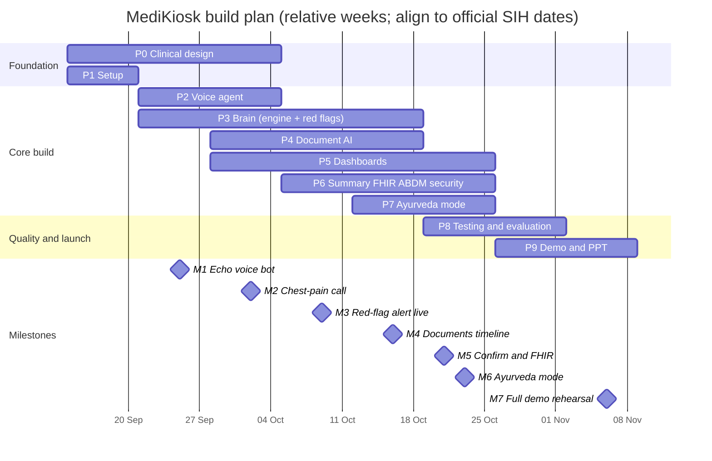

# 12 · Project Plan — MediKiosk

Phases, timeline, team roles, milestones, risks, budget and ways of working.
Related: [01-idea.md](01-idea.md) · [03-architecture.md](03-architecture.md) · [04-tech-stack.md](04-tech-stack.md) · [06-folder-structure.md](06-folder-structure.md) · [11-testing-evaluation.md](11-testing-evaluation.md) · [13-demo-and-pitch.md](13-demo-and-pitch.md)

> ⚠️ **Official SIH 2026 dates are NOT included here.** Fill in the internal hackathon, idea-submission and grand-finale dates from the SIH portal (§3.1) and shift the relative weeks below to fit. Also verify the current SIH rules on team size and composition, pre-built code, and PPT template.

---

## 1. Plan at a glance

| Week | Focus | Milestone |
|---|---|---|
| W1 | Clinical design starts · repo, accounts, Docker setup | — |
| W2 | Echo voice bot · first question trees · ontology engine skeleton | **M1** echo voice bot |
| W3 | Chest-pain call end-to-end · document pipeline starts · dashboards start | **M2** chest-pain call |
| W4 | Red flags + triage board · all 6 complaint trees · OCR → entities | **M3** red-flag alert live |
| W5 | Timeline + lab flags · summary generator · doctor dashboard · ABDM/FHIR | **M4** documents timeline |
| W6 | Doctor confirm + FHIR push · Ayurveda mode · security hardening | **M5** confirm + FHIR · **M6** Ayurveda mode |
| W7 | Testing & evaluation · bug fixing · PPT · demo video | — |
| W8 | Full rehearsals · buffer | **M7** full demo rehearsal |

If the idea-submission deadline comes before W8, **Track A (§4)** takes priority. Its deliverables can be ready by the end of W3.

---

## 2. Phases

| Phase | Goal | Deliverables | Exit criteria | Owner | Depends on | Weeks |
|---|---|---|---|---|---|---|
| **0 · Clinical design** | Define *what* to ask and *when* to escalate | Question bank for 6 complaints + all history sections (YAML), red-flag list (15–20 rules), Ayurveda question set, lexicons (hi, te), doctor-reviewed translations | Clinical mentor signs off on content · `validate_ontology.py` passes · every node has hi/te/en text | Clinical content lead | Clinical mentor availability | W1–W3 (continues in small updates) |
| **1 · Setup** | Everyone can run the stack | Repo layout per [06](06-folder-structure.md), `docker-compose.yml`, `.env.example`, CI skeleton, accounts (Sarvam, ABDM sandbox, Anthropic, Exotel/Twilio) | `make up` works on every laptop · CI green on an empty test | Backend/integration lead | — | W1 |
| **2 · Voice agent** | A live call that listens and speaks in Indic languages | Pipecat pipeline, WebRTC transport, Saaras v3 STT, Bulbul v3 TTS, Silero VAD, DTMF, audio cache, `pregenerate_tts.py` | Round-trip latency ≤ 1.5 s p90 on WebRTC · works in hi/te/en · barge-in works | Voice lead | Phase 1 | W2–W3 |
| **3 · Brain** | Deterministic interview with LLM understanding | Ontology loader, state machine, normalizer, extractor (Sarvam-30B), validator, clarifier, read-back, red-flag engine, escalation | Chest-pain tree runs end-to-end by voice and touch · 100 % of red-flag suite passes · extraction accuracy ≥ target in [11](11-testing-evaluation.md) | Brain lead | Phases 0, 1 (voice integration needs 2) | W2–W5 |
| **4 · Document AI** | Paper → structured timeline | Upload link + kiosk scan, OpenCV preprocess, OCR (Sarvam Vision + Claude Haiku 4.5 fallback), entity extraction, normalization, lab flags, timeline | 20 sample documents processed · entities shown with confidence · abnormal labs flagged | Document AI lead | Phase 1, reference data CSVs | W3–W5 |
| **5 · Dashboards** | Usable screens for patient, doctor, nurse | Kiosk flow, mobile upload page, doctor queue + patient page, triage alert board, admin metrics (stretch) | Wireframes from [05](05-wireframes.md) implemented · works on kiosk resolution and phone width | Frontend lead | API contracts from [09](09-data-model-and-api.md) | W3–W6 |
| **6 · Summary, FHIR, ABDM, security** | Trustworthy output that leaves the system correctly | Summary generator + fact check, doctor edit/confirm, FHIR bundle builder, HAPI push, ABHA verify (sandbox), consent records, encryption, audit logs, cleanup jobs | Confirmed summary produces a valid FHIR bundle accepted by HAPI · ABHA sandbox OTP flow works · audit rows written | Backend/integration lead | Phases 3, 4 | W4–W6 |
| **7 · Ayurveda mode** | AYUSH-specific history | Prakriti, Agni/Koshtha, Ahara-Vihara, Dashavidha, Nidana trees; Prakriti scoring; Ayurveda summary section; NAMASTE codes | An Ayurveda-department visit captures all self-reportable items · summary shows the Ayurveda section · mentor reviewed | Clinical content lead + Brain lead | Phases 0, 3 | W5–W6 |
| **8 · Testing** | Evidence that it works | Recorded test calls, eval sets, red-flag suite, load test, usability test with 5+ non-technical users | Metrics in [11](11-testing-evaluation.md) measured and recorded · no open P0 bugs | Everyone (coordinated by Brain lead) | Phases 2–7 | W6–W7 |
| **9 · Demo & PPT** | Win the room | PPT, demo video, live demo script, Q&A bank, seeded demo data, backup plan ([13](13-demo-and-pitch.md)) | 3 full rehearsals under 5 min without errors · backup video ready | Team lead + Frontend lead | All | W7–W8 |

---

## 3. Timeline

Relative weeks used in this doc: **W1 = 14–20 Sep 2026**, W2 = 21–27 Sep, W3 = 28 Sep–4 Oct, W4 = 5–11 Oct, W5 = 12–18 Oct, W6 = 19–25 Oct, W7 = 26 Oct–1 Nov, W8 = 2–8 Nov.
These are **our planning dates only**. Move the whole plan once the official dates are known.

### 3.1 Official SIH milestones (fill in from the SIH portal)

| Official milestone | Date | Our deliverable | Owner | Status |
|---|---|---|---|---|
| Internal (college) hackathon | _TBD_ | PPT + demo video / clickable prototype | Team lead | ☐ |
| Idea submission deadline on SIH portal | _TBD_ | Final PPT in the official template | Team lead | ☐ |
| Shortlist announcement | _TBD_ | — | — | ☐ |
| Grand finale (on-site hackathon) | _TBD_ | Working demo + pitch | Everyone | ☐ |
| Travel / registration deadlines | _TBD_ | Documents, IDs, college letters | Team lead | ☐ |

---

## 4. Two tracks

### Track A: idea submission / PPT stage
Goal: convince evaluators that the idea is **clear, feasible and built for AIIA's problem**. Evaluators usually see only the PPT (and a video if one is allowed), so make those strong.

| Must exist before submission | Source | Status |
|---|---|---|
| Problem understanding + gaps slide | [01](01-idea.md) §2 | ☐ |
| Solution + patient journey diagram | [01](01-idea.md) §3 | ☐ |
| Architecture diagram (one clean image) | [03](03-architecture.md) §3 | ☐ |
| Tech stack slide with Indian AI models | [04](04-tech-stack.md) | ☐ |
| Wireframes of kiosk, doctor and triage screens | [05](05-wireframes.md) | ☐ |
| Ayurveda mode slide (Dashavidha table) | [01](01-idea.md) §6 | ☐ |
| **Clickable prototype (Figma) or 1–2 min demo video** of an echo/chest-pain call | Phase 2–3 early build | ☐ |
| Feasibility, risks, cost-per-patient estimate | [04](04-tech-stack.md) §4.4, §8 below | ☐ |
| References | [13](13-demo-and-pitch.md) §7 | ☐ |

**Minimum build for a convincing video:** a WebRTC call in Telugu or Hindi that asks 4–5 chest-pain questions, plus a mock doctor screen showing the resulting JSON/summary. That fits inside W1–W3.

### Track B: grand-finale build (~36-hour on-site hackathon)
> **Check the current SIH rules on pre-built code.** Some editions expect the core to be built on-site, and others allow bringing prior work. Plan to follow whatever the rules say, and keep a clean git history that shows what was done when.

If prior work is allowed:

| Pre-build before the finale | Build / polish on-site |
|---|---|
| Docker stack, DB schema, auth, CI | Features suggested by mentors/judges during rounds |
| Voice pipeline (STT/TTS/VAD/DTMF) | Extra complaint trees and more languages (Tamil) |
| Ontology engine + chest-pain tree + red-flag engine | Drug-interaction alerts, WhatsApp upload (stretch) |
| Document pipeline core | Analytics dashboard |
| Doctor/triage/kiosk screens (basic) | UI polish, accessibility pass |
| Seed data, pre-generated audio | Demo data tuned to the judges' questions |

If the rules require on-site building, the pre-hackathon time goes into **design, clinical content (ontology YAML is content, not code — check whether it counts), accounts and API keys, a practised architecture, and rehearsed build scripts**. The 36 hours then go to P1 → P2 → P3 (chest pain) → P5 (minimum screens) → P6 (summary) in that order.

**36-hour on-site schedule (template)**

| Hours | Work |
|---|---|
| 0–2 | Environment up, keys tested, tasks assigned on the board |
| 2–10 | Voice pipeline + engine + chest-pain tree; kiosk + doctor screens; document pipeline |
| 10–12 | Integration #1 (end-to-end chest-pain call → summary) |
| 12–20 | Red flags + triage board, documents timeline, ABHA/FHIR, Ayurveda tree |
| 20–22 | Integration #2 + mentor round feedback |
| 22–28 | Bug fixing, remaining trees, UI polish |
| 28–32 | Freeze features · record the backup demo video · seed data |
| 32–36 | Rehearse the pitch 3×, prepare Q&A, sleep in shifts |

---

## 5. Team structure

> SIH teams are typically **6 members with at least one female member**. **Verify the current rules** on the SIH portal. One of the six also acts as **team lead** (single point of contact, submissions, time-keeping).

| Role | Owns | Key skills | Primary docs |
|---|---|---|---|
| **R1 · Voice lead** | Pipecat pipeline, STT/TTS adapters, telephony, audio cache, latency | Python async, audio, WebRTC | [03](03-architecture.md), [08](08-ai-pipeline.md) |
| **R2 · Brain / clinical-engine lead** | Ontology loader, state machine, extractor, validator, red-flag engine, eval harness | Python, LLM prompting, testing | [03](03-architecture.md) §4, [07](07-conversation-design.md), [11](11-testing-evaluation.md) |
| **R3 · Clinical content lead** | Question banks, red-flag rules, Ayurveda sets, lexicons, translations, liaison with the clinical mentor | Medical/Ayurveda interest, languages, attention to detail | [07](07-conversation-design.md) |
| **R4 · Document AI lead** | Upload/scan, preprocessing, OCR, entity extraction, normalization, lab flags, timeline | Python, OpenCV, LLM/vision | [08](08-ai-pipeline.md), [09](09-data-model-and-api.md) |
| **R5 · Frontend lead** | Kiosk, upload page, doctor & triage dashboards, i18n, accessibility | React, TypeScript, Tailwind, UX | [05](05-wireframes.md) |
| **R6 · Backend / integration lead** | FastAPI, DB, auth, WebSockets, Celery, summary pipeline plumbing, FHIR, ABDM, security, DevOps | Python, SQL, Docker, APIs | [09](09-data-model-and-api.md), [10](10-security-privacy.md) |

**Mentors**
| Mentor | Why needed | Ask them for |
|---|---|---|
| **Clinical mentor**: Ayurveda physician/faculty (ideally with OPD experience), plus one allopathic doctor if possible | Clinical correctness and credibility with AIIA judges | Question-bank review, red-flag list sign-off, Prakriti/Dashavidha questionnaire validation, 1 usability session with real OPD patients (with permission) |
| **Technical mentor**: faculty or industry engineer | Architecture and scaling review | Architecture review in W2, load-test and security review in W6 |

### 5.1 RACI by phase
R = Responsible, A = Accountable, C = Consulted, I = Informed.

| Phase | R1 Voice | R2 Brain | R3 Clinical | R4 Doc AI | R5 Frontend | R6 Backend |
|---|---|---|---|---|---|---|
| 0 Clinical design | I | C | **A/R** | I | C | I |
| 1 Setup | R | R | I | R | R | **A/R** |
| 2 Voice agent | **A/R** | C | C | I | C | C |
| 3 Brain | C | **A/R** | R | I | I | C |
| 4 Document AI | I | C | C | **A/R** | C | C |
| 5 Dashboards | C | C | C | C | **A/R** | R |
| 6 Summary/FHIR/ABDM/security | I | R | C | R | C | **A/R** |
| 7 Ayurveda mode | C | R | **A/R** | I | R | I |
| 8 Testing | R | **A/R** | R | R | R | R |
| 9 Demo & PPT | R | R | R | R | R | R (team lead **A**) |

---

## 6. Weekly checklists

### Week 1: foundation
**R1 Voice**
- [ ] Create Sarvam account; test Saaras v3 STT and Bulbul v3 TTS from a script in hi/te/en
- [ ] Run the Pipecat quickstart locally; get a WebRTC echo in the browser
- [ ] Record 10 short test utterances per language (team members)

**R2 Brain**
- [ ] Draft `ontology/schema.json` (node, slot, options, branch, red_flag_if)
- [ ] Write `ontology_loader.py` + `validate_ontology.py` skeleton
- [ ] Draft the extraction prompt + JSON schema for closed questions

**R3 Clinical**
- [ ] Book the clinical mentor; share [07](07-conversation-design.md) draft
- [ ] Write the chest-pain tree (SOCRATES) + past/drug/allergy sections in English
- [ ] Draft the red-flag list (≥15) with sources
- [ ] Start the Telugu and Hindi lexicons (≥50 terms each)

**R4 Doc AI**
- [ ] Collect 20 synthetic or consented sample documents (prescriptions, lab reports, discharge summaries; printed + handwritten)
- [ ] Test Sarvam Vision and the Claude Haiku 4.5 fallback on 5 samples; note accuracy
- [ ] Draft `lab_ranges.csv` (≥30 common tests) and `drug_brand_generic.csv` (≥100 brands)

**R5 Frontend**
- [ ] Figma wireframes of kiosk (10 screens), doctor (3), triage (1)
- [ ] Scaffold the Vite + React + Tailwind app with the route groups from [06](06-folder-structure.md)
- [ ] Set up i18n (en/hi/te)

**R6 Backend**
- [ ] Create the repo structure, `docker-compose.yml` (postgres, redis, minio, hapi-fhir, api, worker), `.env.example`, Makefile
- [ ] FastAPI skeleton, auth, `/health`, Alembic, first migration (patients, visits, staff_users)
- [ ] Apply for ABDM sandbox credentials (**do this on day 1**; approval may take time)
- [ ] GitHub Projects board + CI (ruff, pytest, ontology validation)

### Week 2: first conversation
**R1 Voice**
- [ ] Pipecat pipeline: Silero VAD → Saaras → echo → Bulbul (**M1**)
- [ ] Measure latency per stage; log to console
- [ ] DTMF handling in the pipeline (for the phone path); on-screen keypad for WebRTC

**R2 Brain**
- [ ] State machine walking the chest-pain tree (text input in tests)
- [ ] Extractor with Sarvam-30B + Pydantic validation + retry
- [ ] Normalizer using the lexicons; unit tests for 30 answers

**R3 Clinical**
- [ ] Translate chest pain + core sections to hi/te; mentor review #1
- [ ] Write fever and abdominal-pain trees
- [ ] Write red-flag test scenarios (`data/eval_sets/redflags.jsonl`, ≥30 cases)

**R4 Doc AI**
- [ ] Preprocessing (crop, deskew, denoise) on the sample set
- [ ] Extraction prompt → entities JSON; store in `document_entities`

**R5 Frontend**
- [ ] Kiosk screens: Attract, Language, Identify, Consent, Question (touch)
- [ ] Doctor login + empty queue page wired to the API

**R6 Backend**
- [ ] Models + migrations for all tables in [09](09-data-model-and-api.md) §2
- [ ] Interview REST endpoints (§5.5), consent endpoints
- [ ] Redis session store; WebSocket hub skeleton

### Week 3: chest-pain call end-to-end
**R1 Voice**
- [ ] Connect the pipeline to the Interview Engine (engine bridge processor)
- [ ] `pregenerate_tts.py`; play cached clips; live TTS only for read-backs
- [ ] Barge-in + filler sound for slow turns

**R2 Brain**
- [ ] Clarifier (re-ask → keypad fallback), read-back per section
- [ ] Full chest-pain call by voice in te/hi → `history_items` (**M2**)
- [ ] Eval harness `run_eval.py` for extraction

**R3 Clinical**
- [ ] Joint pain, cough/breathlessness and headache trees + generic tree
- [ ] Family, personal and ROS sections; translations
- [ ] Mentor review #2 (red flags)

**R4 Doc AI**
- [ ] Upload-link flow (token, SMS stub) + kiosk scan endpoint
- [ ] Normalization (brand → generic, LOINC for labs)
- [ ] Celery task chain; status updates over WebSocket

**R5 Frontend**
- [ ] Mobile upload page; kiosk document scan screen
- [ ] Kiosk voice mode (WebRTC client, handset) + progress indicator
- [ ] Doctor patient page shell (tabs: Summary · Timeline · Documents · Ayurveda · Transcript)

**R6 Backend**
- [ ] Celery workers in compose; document endpoints (§5.7)
- [ ] Doctor queue endpoint + `visit.summary_ready` events
- [ ] ABHA verify init/confirm against the sandbox (or mock if access is pending)

### Week 4: safety and breadth
**R1 Voice**
- [ ] Escalation path: emergency message in the patient's language, transfer (Twilio/Exotel test or simulated)
- [ ] Noise test: play OPD background noise and compare STT confidence

**R2 Brain**
- [ ] Red-flag engine + fail-safe + alert persistence (**M3**)
- [ ] All 6 complaint trees pass the ontology validation and a scripted walk-through
- [ ] Red-flag suite in CI (must be 100 %)

**R3 Clinical**
- [ ] Ayurveda question sets v1 (Prakriti, Agni/Koshtha, Ahara-Vihara, Dashavidha, Nidana)
- [ ] Recruit 5–10 volunteers (family, faculty) for recorded test calls with consent

**R4 Doc AI**
- [ ] Lab flags + timeline ordering; document-date inference
- [ ] OCR confidence thresholds + fallback routing

**R5 Frontend**
- [ ] Triage alert board (live, sound + flash, acknowledge/resolve)
- [ ] Emergency screen on the kiosk; pain scale + body map + duration picker

**R6 Backend**
- [ ] Alerts API + `/ws/triage`
- [ ] Audit logging middleware; field encryption for mobile/ABHA
- [ ] Summary generator skeleton (facts → JSON)

### Weeks 5–8 (summary)
| Week | R1 Voice | R2 Brain | R3 Clinical | R4 Doc AI | R5 Frontend | R6 Backend |
|---|---|---|---|---|---|---|
| W5 | Phone path (Exotel/Twilio) if credentials are ready; resume after drop | Summary fact-check; LLM red-flag safety net | Ayurveda translations + mentor review; Prakriti scoring rules | Timeline UI data, interaction checks (stretch) (**M4**) | Doctor summary + timeline + document viewer | FHIR builder, HAPI push |
| W6 | Latency tuning, elderly VAD settings | Ayurveda flow in the engine (**M6**) | Usability test script | Accuracy eval on 20+ docs | Edit/confirm UX, Ayurveda tab, accessibility pass | Confirm → FHIR/ABDM (**M5**), cleanup jobs, security checklist |
| W7 | Load test (concurrent calls) | Full eval run, fix top errors | Final content freeze | Final eval | UI polish, demo mode seeds | Seed data, deployment on demo VM |
| W8 | Backup phone/video | Q&A prep (safety) | Q&A prep (clinical) | Q&A prep (documents) | Demo-screen setup | Rehearsals (**M7**), buffer |

---

## 7. Milestones & acceptance criteria

| # | Milestone | Target | Acceptance criteria | Demo to |
|---|---|---|---|---|
| **M1** | Echo voice bot | End of W2 | Browser call: the patient speaks Telugu/Hindi, and the bot repeats the transcript back in the same language with Bulbul · p90 latency measured and logged | Team |
| **M2** | Chest-pain call end-to-end | End of W3 | Full SOCRATES + past/drug/allergy sections by voice in te and hi · answers saved as `history_items` · keypad/touch fallback works · read-back confirms | Team + technical mentor |
| **M3** | Red-flag alert live | End of W4 | Saying the RF-CARD-01 pattern during a call makes the triage board flash within **3 s**, the patient hears the emergency message, and the alert can be acknowledged/resolved · red-flag suite 100 % | Clinical mentor |
| **M4** | Documents timeline | End of W5 | Upload 3 documents from a phone link, and within 60 s the doctor sees them ordered by date with entities, confidences and abnormal labs flagged | Team |
| **M5** | Doctor confirm + FHIR | W6 | Doctor edits one field and confirms → edit audited → FHIR `document` bundle accepted by HAPI → ABHA link attempted (sandbox) | Technical mentor |
| **M6** | Ayurveda mode | W6 | An Ayurveda-department visit asks the Ayurveda sets; the summary shows Prakriti, Agni, Koshtha, Dashavidha, with non-reportable items marked *for physician examination* | Clinical mentor |
| **M7** | Full demo rehearsal | W8 | The script in [13](13-demo-and-pitch.md) §4 runs 3× in a row under 5 min with no manual fixes · backup video recorded · Q&A bank rehearsed | Faculty panel (mock judges) |

---

## 8. Risk register

Likelihood and impact: H = high, M = medium, L = low.

| # | Risk | Type | L | I | Mitigation | Owner |
|---|---|---|---|---|---|---|
| 1 | STT accuracy is poor on elderly or accented speech | Technical | H | H | Code-mix mode, read-back confirmation, longer VAD pause for elderly, keypad fallback, kiosk handset | R1 |
| 2 | 8 kHz phone audio lowers accuracy further | Technical | M | M | Telephony-capable STT (Saaras v3), DTMF for numbers/yes-no, WebRTC for the demo | R1 |
| 3 | Voice latency > 2 s makes calls feel broken | Technical | M | H | Pre-generated audio, Sarvam-30B for live turns, short prompts, filler sounds, measure each stage | R1 / R2 |
| 4 | LLM returns invalid or hallucinated JSON | Technical | M | H | Strict schemas + Pydantic validation + retry, template parsing for closed questions, fact-check on summaries | R2 |
| 5 | Red-flag rule misses a true emergency | Clinical | L | **Critical** | Mentor-reviewed rules, 100 % red-flag suite in CI, fail-safe on errors, LLM safety net, "any doubt → escalate" | R2 / R3 |
| 6 | Too many false-alarm alerts annoy nurses | Clinical | M | M | Severity levels (emergency vs urgent), track the false-alarm rate, tune rules with the mentor | R3 |
| 7 | Clinical content is wrong or incomplete | Clinical | M | H | Weekly mentor review, standard frameworks (SOCRATES/OLDCARTS), version-controlled YAML | R3 |
| 8 | Ayurveda assessment seen as superficial by AIIA judges | Clinical | M | H | Ayurveda faculty mentor, validated-style Prakriti questionnaire, honest "for physician examination" labels, NAMASTE coding | R3 |
| 9 | Handwritten OCR accuracy is low | Technical | H | M | Confidence scores, fallback model, original image beside extracted text, "unverified" labels | R4 |
| 10 | API credits run out mid-development or on demo day | Operational | M | H | Track usage weekly, cache TTS, mock providers in tests, top-up budget (§9), key per environment | R6 |
| 11 | ABDM sandbox access is delayed or the sandbox is down | External | M | M | Apply on day 1, mobile-OTP identity fallback, mocked ABDM client for the demo, retry queue | R6 |
| 12 | Telephony KYC / DLT registration blocks real calls or SMS | External | H | M | WebRTC call for the demo, Twilio trial with verified numbers for testing, SMS stub with on-screen link | R1 / R6 |
| 13 | Venue internet is unreliable at the finale | Operational | H | H | Mobile hotspot backup, local Docker stack, recorded backup video, seeded data; keep on-prem models as a future option | R6 |
| 14 | Scope creep (too many features, nothing polished) | Team | H | H | MVP list in [01](01-idea.md) §9, feature freeze at hour 28 / end of W7, the team lead owns scope | Team lead |
| 15 | A team member becomes unavailable (exams, illness) | Team | M | M | Pair ownership (each module has a backup), docs kept current, small PRs | Team lead |
| 16 | Using real patient data without consent | Legal/ethical | L | **Critical** | Synthetic/consented data only, `data/` git-ignored, no real PHI in logs, consent forms for volunteers | R6 / R3 |
| 17 | Integration breaks late (modules built separately) | Technical | M | H | API contracts from [09](09-data-model-and-api.md) first, weekly integration day, end-to-end test from W3 | R6 |
| 18 | Demo hardware fails (mic, handset, touchscreen) | Operational | M | M | Spare headset and webcam, test on the venue's power/USB, laptop-only fallback flow | R5 |
| 19 | Sarvam model or pricing changes | External | L | M | Provider adapters ([03](03-architecture.md) §7), fallbacks configured, re-verify prices before the PPT | R2 |
| 20 | Judges question regulatory status (medical device) | Strategic | M | M | Position as a documentation aid with the physician in the loop, not diagnostic; prepared answer in [13](13-demo-and-pitch.md) | Team lead |

---

## 9. Budget (estimates)

> All figures are **rough estimates in ₹**. Borrow hardware where possible, and check whether your college or SIH provides credits or equipment.

| Item | Purpose | Estimate (₹) | Notes |
|---|---|---|---|
| Sarvam API credits | STT, TTS, LLM, Vision during development and demo | 0 (₹100 free) + 2,000–5,000 top-up | Track usage weekly |
| Anthropic API (Claude Haiku 4.5 fallback) | Hard handwriting OCR fallback | 500–1,500 | Only low-confidence documents |
| Phone number + calling minutes (Exotel/Twilio) | Real phone-call demo (stretch) | 1,000–3,000 | Trials may suffice; KYC needed for Indian numbers |
| SMS (DLT-registered) | Upload links, consent SMS | 0–1,000 | Stub on screen if not registered |
| Cloud VM (8 vCPU / 16 GB) | Public demo URL, shared dev environment | 1,500–4,000 per month | Student credits may cover it |
| Domain + TLS | Clean demo URL | 500–1,000 per year | TLS free via Let's Encrypt |
| Touchscreen monitor or Android tablet | Kiosk demo | 0 (borrow) – 15,000 | A laptop touchscreen also works |
| USB telephone handset / headset with mic | Kiosk handset experience | 500–1,500 | Bring 2 (one spare) |
| Webcam (1080p) + small document stand | Kiosk document scan | 1,000–3,000 | A phone camera can substitute |
| Mobile hotspot / data pack | Venue internet backup | 300–800 | Two different networks |
| Printing (poster, handouts) | Finale booth | 300–1,000 | If allowed |
| **Total** | | **≈ 5,000–35,000** | Low end: free tiers + borrowed hardware |

---

## 10. Ways of working

### 10.1 Cadence
| Ritual | When | Length | Who | Output |
|---|---|---|---|---|
| Daily stand-up | Every day (fixed time) | 15 min | All | Yesterday / today / blockers on the board |
| Integration day | Every Friday | 2–3 h | All | Everything merged into `dev`, end-to-end run recorded |
| Clinical review | Weekly | 45 min | R3, R2 + clinical mentor | Signed-off YAML changes, red-flag updates |
| Demo to mentor | At each milestone | 20 min | All | Feedback → board items |
| Retro | Every 2 weeks | 20 min | All | 1 change to try next sprint |

### 10.2 Tooling
- **GitHub Projects board**, with columns *Backlog → This week → In progress → Review → Done* and labels per module (`voice`, `brain`, `clinical`, `docs-ai`, `frontend`, `backend`, `P0`/`P1`/`P2`).
- **Branching and commits:** as in [06](06-folder-structure.md) §8.
- **Chat:** one team group plus a separate channel for CI/deploy notifications.
- **Docs:** update the relevant `docs/*.md` in the same PR as the change.

### 10.3 Definition of done
A task is done when:
- [ ] The code is merged to `dev` through a PR reviewed by 1 teammate (clinical content is reviewed by R3)
- [ ] CI is green: lint, types, unit tests, ontology validation, red-flag suite
- [ ] New or changed behaviour has a test (or an eval case for AI behaviour)
- [ ] It works in the Docker stack, not just on one laptop
- [ ] UI works in hi/te/en and at kiosk + phone widths
- [ ] No secrets or real patient data are committed; logs contain no PHI
- [ ] The docs are updated if an API, schema, or flow changed

---

## 11. Post-hackathon roadmap

| Stage | Timeframe (indicative) | Key activities |
|---|---|---|
| **1 · Pilot preparation** | 0–3 months after the finale | Present to AIIA; identify a pilot OPD (e.g. Kayachikitsa); apply for **institutional ethics committee approval**; finalize the consent text with the hospital's legal/IT teams; security review |
| **2 · Supervised pilot** | 3–6 months | Deploy in one OPD with staff support; compare summaries against doctor-taken histories; measure time saved, completeness, patient satisfaction, and red-flag performance |
| **3 · On-premise deployment** | 6–9 months | GPU server with self-hosted Sarvam models (vLLM), IndicConformer and Indic Parler-TTS; SIP trunk telephony; hospital LAN kiosks ([03](03-architecture.md) §9.2) |
| **4 · Integration** | 6–12 months | HIS/EMR vendor integration (FHIR), full ABDM HIP certification, NAMASTE/ICD-11 TM2 coding at scale |
| **5 · Scale** | 12+ months | All **22 scheduled languages** (Bhashini / Saaras), more complaint trees and specialties, follow-up visit comparison ("what changed since last visit"), multi-hospital rollout across AYUSH and government hospitals |
