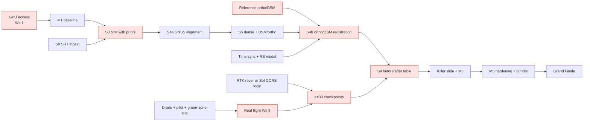

# 13 · Project Plan

> **Purpose:** the delivery plan for Drishti3D from idea submission to the SIH 2026 Grand Finale: timeline, milestones, weekly tasks per role, dependencies, risks, budget, learning plan and the hour-by-hour finale plan.
>
> **Status:** Draft v1.0 · 2026-09-30 · Owner: R6 (Data, Flight Ops & Pitch) with R2 (Geo & Accuracy Lead) · Must agree with [`00-project-charter.md`](00-project-charter.md)

---

## 1. Planning assumptions

| # | Assumption | If it turns out false |
|---|---|---|
| A1 | Six members, roles R1–R6 as in the charter §10, each gives ~15–20 h/week in term time and more in holidays | Re-balance using the RACI (§7); drop stretch goals first (§14) |
| A2 | Idea submission (PPT) closes ~30 Sep 2026; shortlist ~Nov; 36-hour Grand Finale in Dec 2026 | Shift the Gantt; milestones keep their order |
| A3 | We build regardless of the shortlist date. We do not wait for the result before starting M1–M3 | — |
| A4 | At least one CUDA GPU (RTX 3060 12 GB minimum, charter §8) is available from Week 1 | Risk R-01; use cloud credits or CPU-only ODM baseline |
| A5 | One drone flight in a **green zone** (≤120 m, Drone Rules 2021) with ≥30 RTK checkpoints can be done by mid-November | Risk R-02/R-03; fall back to MARS-LVIG (RTK + LiDAR truth) for the accuracy table |
| A6 | Official PS targets (≤15 min, ≤1 m) are still unconfirmed | Charter §6 targets are ours; re-check on sih.gov.in and the NTRO PDF (task T-0.2) |

Week numbering: **Week 1 starts Monday 5 Oct 2026.** All dates below are plans, not commitments from SIH.

## 2. SIH 2026 timeline (external)

> ⚠ **Verify all dates on sih.gov.in.** They come from secondary blogs and mirrors, not the official portal (see [`15-research-and-references.md`](15-research-and-references.md), "claims to verify").

| Date (2026) | Event | Source quality | Our action |
|---|---|---|---|
| 21 Aug | SIH 2026 launched | Secondary blog | — |
| Sep | College internal hackathon rounds | Secondary blog | Done |
| ~30 Sep | SPOC nomination and **idea submission (PPT)** close | Secondary blog — verify | Submit PPT ([`14-demo-and-pitch.md`](14-demo-and-pitch.md)) |
| Oct | Expert evaluation of ideas (novelty, feasibility, impact, clarity) | Secondary blog | Keep building (M1–M2) |
| Nov | **Shortlist** announced (~4–5 teams per PS) | Secondary blog — verify | Confirm team, nodal centre, travel |
| Dec (exact dates TBD) | **36-hour Grand Finale** at nodal centres; unseen NTRO video expected | Secondary blog — verify | Execute §17 |

## 3. Gantt chart (Oct–Dec 2026)

```mermaid
gantt
    title Drishti3D — SIH 2026 plan (verify SIH dates on sih.gov.in)
    dateFormat  YYYY-MM-DD
    axisFormat  %d %b

    section External (SIH)
    Idea submission closes (verify)        :milestone, sih1, 2026-09-30, 0d
    Idea evaluation (SIH)                  :sih2, 2026-10-01, 2026-11-10
    Shortlist announced (approx, verify)   :milestone, sih3, 2026-11-15, 0d
    Grand Finale window (TBD, verify)      :crit, sih4, 2026-12-14, 2026-12-18

    section M1 Baseline
    Repo, CI, env, GPU access              :m1a, 2026-10-05, 5d
    ODM on sample video + SRT              :m1b, 2026-10-05, 7d
    Own/borrowed test video + SRT          :m1c, 2026-10-08, 7d
    MARS-LVIG download + converter         :m1d, 2026-10-08, 8d
    Baseline viewer (static Cesium)        :m1e, 2026-10-12, 6d
    M1 exit review                         :milestone, m1, 2026-10-18, 0d

    section M2 Own pipeline S0-S5
    S0 ingest (SRT, video decode)          :m2a, 2026-10-19, 7d
    S1 keyframes + blur                    :m2b, 2026-10-19, 7d
    S2 masking (vehicles, people, sky)     :m2c, 2026-10-19, 10d
    S3 COLMAP global mapper + GPS priors   :crit, m2d, 2026-10-22, 10d
    S4a Umeyama to GPS                     :m2e, 2026-10-26, 5d
    S5 OpenMVS dense + mesh + DSM/ortho    :m2f, 2026-10-26, 7d
    drishti run one command                :m2g, 2026-10-29, 4d
    M2 exit review                         :milestone, m2, 2026-11-01, 0d

    section M3 Accuracy engine
    Time-sync estimator + rolling shutter  :crit, m3a, 2026-11-02, 8d
    Ortho/DSM registration (S4b)           :crit, m3b, 2026-11-02, 10d
    Real flight + >=30 RTK checkpoints     :crit, m3c, 2026-11-06, 4d
    S9 accuracy report CE90/LE90           :m3d, 2026-11-05, 9d
    Doming test on MARS-LVIG               :m3e, 2026-11-09, 6d
    M3 exit review (before/after table)    :milestone, m3, 2026-11-15, 0d

    section M4 Product
    Viewer: measure, layers, confidence    :m4a, 2026-11-16, 12d
    S8 exports incl. 3D Tiles, COG         :m4b, 2026-11-16, 8d
    Live 2D preview (P)                    :m4c, 2026-11-16, 10d
    S6 LoD2 completion + classes           :m4d, 2026-11-18, 10d
    S7 splat layer (optional)              :m4e, 2026-11-20, 8d
    KLV ingest (stretch)                   :m4f, 2026-11-23, 6d
    M4 exit review                         :milestone, m4, 2026-11-29, 0d

    section M5 Hardening
    Robustness matrix (unseen videos)      :crit, m5a, 2026-11-30, 7d
    Docker offline bundle                  :crit, m5b, 2026-11-30, 6d
    Demo, pitch, Q&A rehearsals            :m5c, 2026-12-02, 10d
    M5 exit review (freeze)                :milestone, m5, 2026-12-06, 0d
    Buffer + finale kit                    :m5d, 2026-12-07, 7d
```

## 4. Milestones and exit criteria

A milestone is **met only when every exit criterion is demonstrably true at the weekly demo** (§10). Evidence goes into `data/runs/<run_id>/` and is linked from the milestone issue.

| ID | Window | Goal | Exit criteria (all required) | Owner |
|---|---|---|---|---|
| **M1 Baseline** | Wk 1–2 · 5–18 Oct | Something 3D on screen from a video; team tooling ready | 1. ODM (`--3d-tiles`) produces ortho, DSM, LAZ and mesh from one sample video + matching `.srt`. 2. Same on **our own** (or borrowed) drone clip. 3. Timings and peak RAM logged for both. 4. Repo layout per charter §9, CI running lint + unit tests. 5. GPU machine reachable by all. 6. MARS-LVIG sequence downloaded and converted to "video + GPS" form. 7. Static CesiumJS page shows the ODM 3D Tiles output. | R1 |
| **M2 Own pipeline** | Wk 3–4 · 19 Oct–1 Nov | `drishti run` S0–S5 end-to-end | 1. `drishti run --video --srt --profile fast --out` finishes on 2 clips without manual steps. 2. Produces LAZ, textured OBJ/GLB, DSM and orthomosaic (COG). 3. Model is GNSS-aligned (S4a, robust 7-DoF). 4. Run manifest (config, versions, timings per stage). 5. Wall-clock time per stage recorded on the reference GPU. 6. Output within ±5 m of GNSS positions on the test clip (sanity check, not an accuracy claim). | R1 |
| **M3 Accuracy engine** | Wk 5–6 · 2–15 Nov | Prove absolute accuracy with numbers | 1. Time-offset estimator (GPS vs SfM velocity cross-correlation) implemented, reports offset ± uncertainty. 2. Rolling-shutter model on, intrinsics fixed or tightly constrained. 3. Ortho/DSM registration (S4b) working on ≥1 real flight. 4. **Real flight flown with ≥30 independent RTK checkpoints** (ASPRS Ed. 2 minimum). 5. S9 report prints RMSE_X/Y/Z, RMSE_H, CE90, LE90, bias vs SD, relative length error — **before and after anchoring**. 6. Doming residual profile vs MARS-LVIG LiDAR along and across track. | R2 |
| **M4 Product** | Wk 7–8 · 16–29 Nov | Usable, demo-able product | 1. Viewer: globe, 3D Tiles mesh, point cloud, DSM/ortho layers, distance/height/area/volume tools, confidence overlay, export buttons. 2. S8 exports all charter formats (LAS/LAZ, COG, OBJ, GLB, 3D Tiles). 3. Live 2D preview appears ≤60 s after upload starts. 4. Confidence map with *observed-high / observed-low / inferred* classes. 5. S6 classes + LoD2 roofs/walls flagged *inferred*. 6. S7 splat layer (optional, display only). | R5 (viewer), R3 (exports) |
| **M5 Hardening** | Wk 9 · 30 Nov–6 Dec | Finale-proof | 1. Robustness matrix (§5 Wk 9) green or documented. 2. `docker compose up` works on a **fresh, offline** machine from USB. 3. End-to-end ≤15 min on a 10-min 4K clip with `fast` (or honest number recorded). 4. Two full demo rehearsals with timing. 5. Pre-computed demo runs and screen recording on 2 drives. 6. Code freeze tag `v1.0-finale`. | R6 (rehearsal), R1 (bundle) |

## 5. Week-by-week plan (≈10 weeks)

Each week ends with the **Sunday weekly demo** (§10). "D" = deliverable.

### Week 1 · 5–11 Oct · M1 start — "tooling and first model"
| Role | Tasks |
|---|---|
| R1 Pipeline | Repo skeleton per charter §9; `pyproject`, pre-commit, CI (ruff, pytest); `configs/*.yaml` stubs; install COLMAP 4.x + pycolmap on GPU box |
| R2 Geo & Accuracy | Confirm PS targets on sih.gov.in/NTRO PDF (T-0.2); pick CRS policy (WGS84 → UTM zone, EGM vs ellipsoid heights); draft checkpoint survey plan; enquire SoI CORS access for academia |
| R3 3D & Mesh | Install ODM (Docker GPU image) and OpenMVS; run ODM on a sample video + `.srt`; log time and RAM |
| R4 AI/ML | Survey YOLO-seg vs SAM 2 licences and speed on aerial frames; collect 200 aerial frames for a masking sanity set |
| R5 Frontend | React + Vite + CesiumJS scaffold; load a local 3D Tiles tileset offline (no Cesium ion) |
| R6 Data & Flight | Line up drone (own/college/rental), pilot, green-zone site, Digital Sky check; download MARS-LVIG; create GitHub Project board and labels (§11) |
| **D** | Board live; ODM first model; data inventory sheet |

### Week 2 · 12–18 Oct · M1 exit
| Role | Tasks |
|---|---|
| R1 | Frame extraction wrapper (ffmpeg); CLI skeleton `drishti run`; run-folder layout and manifest writer |
| R2 | SRT parser prototype for 2 DJI models; MARS-LVIG GNSS → per-frame table; baseline "GNSS-only" metric script (RMSE, CE90, LE90) |
| R3 | ODM on own clip; `--video-limit`, `--fast-orthophoto`, `--3d-tiles` experiments; document ODM timings as baseline |
| R4 | Blur score (variance of Laplacian) + per-window rejection prototype |
| R5 | Show ODM 3D Tiles + ortho in viewer; simple distance tool |
| R6 | Record/borrow first own test video with `.srt` (green zone, ≤120 m, 20–30° forward-oblique gimbal per [`12-flight-and-data-capture-guide.md`](12-flight-and-data-capture-guide.md)) |
| **D** | **M1 review**; baseline timing table; own video + SRT in `data/` |

### Week 3 · 19–25 Oct · M2 build
| Role | Tasks |
|---|---|
| R1 | S1 keyframes (optical-flow parallax, ~1–2 fps target); S3 COLMAP global mapper with sequential matching, ALIKED + LightGlue |
| R2 | S0 SRT → per-keyframe GPS/alt/gimbal/focal; GPS pose priors into COLMAP; timezone handling |
| R3 | S5 OpenMVS runner (densify → mesh → refine → texture), medium resolution |
| R4 | S2 masks (vehicles, people, sky, OSD overlays) written as COLMAP masks |
| R5 | Server API draft with R1 (FastAPI: create job, status, files); job-progress websocket stub |
| R6 | Checkpoint survey logistics: RTK rover or CORS login, markers (≥30), site sketch |
| **D** | S0–S3 on one clip |

### Week 4 · 26 Oct–1 Nov · M2 exit
| Role | Tasks |
|---|---|
| R1 | Orchestrate S0–S5 behind one command; profiles `preview/fast/quality`; per-stage timing |
| R2 | S4a robust 7-DoF Umeyama to GPS (RANSAC/Huber, 1 Hz subsample); CRS export |
| R3 | DSM/DTM and orthomosaic rasterisation (PDAL, GDAL) → COG |
| R4 | Mask quality check on 3 clips; measure % features removed |
| R5 | Viewer loads a Drishti3D run folder (not only ODM) |
| R6 | Book flight date (Wk 5/6); prepare field sheets; start PPT v2 for finale |
| **D** | **M2 review**: `drishti run` end-to-end on 2 clips |

### Week 5 · 2–8 Nov · M3 build
| Role | Tasks |
|---|---|
| R1 | Rolling-shutter model in S3; fixed/pre-calibrated intrinsics; sub-scene splitting for long strips |
| R2 | ⭐ Time-offset estimator (GPS velocity vs SfM velocity cross-correlation); ortho/DSM registration prototype (S4b) |
| R3 | Lens pre-calibration (checkerboard) for the flight drone; DSM residual tool for doming |
| R4 | Semantic labels for S6 (ground/building/road/vegetation/water) from masks + point cloud |
| R5 | Measurement tools: height, area, volume; unit handling |
| R6 | **Fly the real mission** (weather permitting); survey ≥30 checkpoints with RTK; back up raw data same day (3 copies) |
| **D** | Real-flight dataset with checkpoints in `data/` |

### Week 6 · 9–15 Nov · M3 exit
| Role | Tasks |
|---|---|
| R1 | Fallback pose path (DPVO or licence-checked feed-forward) behind a flag |
| R2 | S9 accuracy report (HTML + JSON): before/after anchoring, bias vs noise, CE90/LE90; doming test on MARS-LVIG |
| R3 | Relative-accuracy test: measured lengths vs tape/RTK distances |
| R4 | Blur-aware keyframe ablation (accuracy vs frame rate) |
| R5 | Confidence overlay rendering (vertex colours / tiles attribute) |
| R6 | Fill the "killer slide" with real numbers ([`14-demo-and-pitch.md`](14-demo-and-pitch.md) §6) |
| **D** | **M3 review**: before/after accuracy table on real checkpoints |

### Week 7 · 16–22 Nov · M4 build (shortlist expected — verify)
| Role | Tasks |
|---|---|
| R1 | Server job runner (SQLite), resumable stages, error messages for users |
| R2 | Optional corrections: RTK/PPK file ingest, single-GCP mode, GAGAN/CORS-corrected positions |
| R3 | S8 exports (LAS/LAZ, GLB, 3D Tiles via py3dtiles/ODM tiler); S6 LoD2 roof/wall fitting |
| R4 | Confidence map computation with R2 (views count, angles, residuals) |
| R5 | Layer toggles, export buttons, accuracy panel |
| R6 | If shortlisted: confirm nodal centre, travel, hardware rules; start Q&A bank drills |
| **D** | Exports + LoD2 + confidence in viewer |

### Week 8 · 23–29 Nov · M4 exit
| Role | Tasks |
|---|---|
| R1 | Live 2D preview (P) incremental mosaic from GPS-tagged keyframes |
| R2 | KLV (MISB ST 0601) ingest via `klvdata` on a sample TS (stretch) |
| R3 | S7 gsplat layer with exposure compensation (optional, display only) |
| R4 | Speed: batch/fp16 inference for masks; per-stage GPU memory profile |
| R5 | UI polish, offline assets, error states, dark-room projector test |
| R6 | Demo script v1; record screen capture of full run |
| **D** | **M4 review**: full product demo |

### Week 9 · 30 Nov–6 Dec · M5 hardening
| Role | Tasks |
|---|---|
| R1 | Docker offline bundle (CUDA base, all weights baked, no network); fresh-machine install test |
| R2 | Robustness matrix: 1080p vs 4K, 25/30/60 fps, no SRT, bad SRT offset, KLV TS, 20-min clip, low-texture, IR-like clip; record outcomes |
| R3 | `fast` profile tuning to hit ≤15 min on 10-min 4K |
| R4 | Model-licence register finalised in [`07-tech-stack.md`](07-tech-stack.md) |
| R5 | Viewer runs from local server only; kiosk mode for demo |
| R6 | Two timed rehearsals (5 & 10 min) + Q&A; pack finale kit |
| **D** | **M5 review**, tag `v1.0-finale`, code freeze except P0 bugs |

### Week 10 · 7–13 Dec · buffer and finale readiness
| Role | Tasks |
|---|---|
| All | Only P0 fixes; dry-run §17 finale plan once for 6 hours; sleep schedule; travel |
| R6 | Printed checklists, spare drives, adapters; slides frozen |
| **D** | Finale kit checklist 100 % ticked |

## 6. Work breakdown structure (WBS)

```
1  Project management (R6)
   1.1 Board, labels, cadence   1.2 Risk register   1.3 Budget & procurement   1.4 SIH admin (SPOC, travel)
2  Data & field (R6, R2)
   2.1 Public datasets (MARS-LVIG, UseGeo, UAVD4L)   2.2 Own flights (green zone)
   2.3 Checkpoint survey (≥30, RTK/CORS)   2.4 Reference ortho/DSM acquisition   2.5 Data backup
3  Pipeline core (R1)
   3.1 S1 keyframes   3.2 S3 SfM (global mapper, priors, RS, intrinsics)   3.3 Fallback poses
   3.4 Orchestration, profiles, CLI   3.5 Server job runner
4  Geo & accuracy (R2)
   4.1 S0 ingest (SRT, KLV, time-sync)   4.2 S4 georef (Umeyama, ortho/DSM registration, RTK/PPK/GCP)
   4.3 S9 QA (RMSE, CE90/LE90, doming, report)   4.4 CRS & vertical datum
5  3D products (R3)
   5.1 S5 OpenMVS dense/mesh/texture   5.2 DSM/DTM/ortho rasters   5.3 S6 LoD2 completion
   5.4 S7 splats (optional)   5.5 S8 exports & 3D Tiles
6  AI/ML (R4)
   6.1 S2 dynamic masks   6.2 Blur/quality models   6.3 Semantic classes   6.4 Licence register
7  Viewer & UX (R5)
   7.1 Cesium viewer   7.2 Measurement tools   7.3 Layers & confidence   7.4 Live preview UI   7.5 API integration
8  Packaging & QA (R1, all)
   8.1 Docker offline bundle   8.2 Tests & golden datasets   8.3 Robustness matrix
9  Pitch & demo (R6, all)
   9.1 Idea PPT   9.2 Finale deck   9.3 Demo script & backups   9.4 Q&A drills
```

## 7. RACI matrix

R = Responsible (does it) · A = Accountable (one owner, signs off) · C = Consulted · I = Informed.

| Activity | R1 Pipeline | R2 Geo ⭐ | R3 3D/Mesh | R4 AI/ML | R5 Frontend | R6 Data/Pitch |
|---|---|---|---|---|---|---|
| Repo, CI, orchestration, CLI | **A/R** | C | C | C | I | I |
| S0 ingest & time-sync | C | **A/R** | I | I | I | C |
| S1 keyframes | **A/R** | C | I | C | I | I |
| S2 masking & semantics | C | I | C | **A/R** | I | I |
| S3 pose estimation | **A/R** | C | C | C | I | I |
| S4 georeferencing & anchoring | C | **A/R** | C | I | I | C |
| S5 dense & mesh | C | C | **A/R** | I | I | I |
| S6 completion & classification | I | C | **A/R** | R | I | I |
| S7 photoreal splats | I | I | **A/R** | C | C | I |
| S8 export & tiling | C | C | **A/R** | I | C | I |
| S9 QA & accuracy report | C | **A/R** | C | C | C | C |
| P live preview | R | C | I | I | **A/R** | I |
| Viewer & measurement | I | C | C | I | **A/R** | C |
| Flights & checkpoint survey | I | C | I | I | I | **A/R** |
| Reference ortho/DSM | I | **A** | C | I | I | R |
| Docker offline bundle | **A/R** | C | C | C | C | I |
| Licence register | C | C | C | **A/R** | C | I |
| PPT, pitch, demo script | C | C | C | C | C | **A/R** |
| Risk register & budget | I | C | I | I | I | **A/R** |

## 8. Dependencies and critical path



**Critical path:** GPU access → S3 → S4a → S5 → S4b → S9 (with real-flight checkpoints) → M5 bundle → Finale. The two external long-lead items are **field data** (drone, permission, weather, RTK/CORS) and **reference ortho/DSM**.

| Dependency | Needed by | Lead time | Owner | Plan B |
|---|---|---|---|---|
| GPU (≥ RTX 3060 12 GB) | Wk 1 | 1 week | R1 | Cloud GPU credits (§13); CPU ODM only for M1 |
| Drone + licensed pilot + green-zone site | Wk 5 | 2–4 weeks | R6 | Borrow from college/club; rental with pilot; MARS-LVIG only |
| RTK rover **or** SoI CORS access (free for govt/academia per SoI; confirm) | Wk 5 | 2–3 weeks | R2/R6 | Borrow from civil dept.; PPK with CORS logs; fewer checkpoints (flag < ASPRS 30) |
| ≥30 checkpoint markers + survey | Wk 5 | 1 week | R6 | Natural features (road paint corners) surveyed by RTK |
| Reference ortho/DSM for anchoring | Wk 5 | 2 weeks | R2 | (a) Our own RTK/GCP grid flight processed in ODM as the reference; (b) public ortho/DSM (licence and accuracy to verify); (c) MARS-LVIG L1 LiDAR map for the demo |
| Lens calibration target (checkerboard) | Wk 5 | days | R3 | Self-calibrate on an oblique orbit clip |
| Official PS text / NTRO PDF | Wk 1 | — | R2 | Keep charter targets, label as "ours" |

## 9. Definition of Done

**For a task / pull request**
- [ ] Code merged to `main` via PR with ≥1 reviewer (the stage owner or R1).
- [ ] Unit tests added/updated; CI green.
- [ ] Runs **offline** (no network calls at runtime).
- [ ] Config keys documented; CLI help updated.
- [ ] Any new dependency or model weight added to the licence register ([`07-tech-stack.md`](07-tech-stack.md)).
- [ ] Output format changes reflected in [`08-data-formats-and-interfaces.md`](08-data-formats-and-interfaces.md).
- [ ] Issue closed with a link to the evidence (run folder, screenshot, metric).

**For a stage (S0–S9, P)**
- [ ] Works on ≥2 clips (one own, one public) and the golden test set ([`11-testing-and-evaluation.md`](11-testing-and-evaluation.md)).
- [ ] Time and peak memory logged in the run manifest.
- [ ] Failure produces a clear message and a partial result, not a crash.

**For an accuracy claim**
- [ ] States checkpoints (count, source, accuracy), conditions, method, and both relative and absolute metrics (charter §12).

## 10. Meeting cadence

| Meeting | When | Length | Who | Output |
|---|---|---|---|---|
| Daily stand-up | Every day, 21:30 (after classes) — online | 15 min | All | Yesterday / today / blockers; board updated |
| Weekly demo | Sunday 11:00 | 60 min | All + mentor if available | Live run on the newest build; milestone check vs exit criteria |
| Weekly planning | Sunday, right after demo | 30 min | All | Next week's issues assigned (Ready column) |
| Accuracy review | Wednesday | 30 min | R2 + R1 + R3 | Metrics trend, doming, time-sync results |
| Pitch clinic | Fridays from Wk 6 | 45 min | R6 + 2 rotating | Slide changes, Q&A drill (10 questions) |
| Retro | End of each milestone | 30 min | All | Keep / drop / try |

Rules: stand-up never runs over 15 minutes; problems are taken offline. A demo that fails is still held — the failure is the agenda.

## 11. Task tracking (GitHub Projects)

**Board columns:** `Backlog` → `Ready (this week)` → `In progress` (WIP ≤ 2 per person) → `In review` → `Blocked` → `Done` → `Demo-ready`.

**Issue labels**

| Group | Labels |
|---|---|
| Stage | `stage:S0-ingest`, `stage:S1-frames`, `stage:S2-masking`, `stage:S3-sfm`, `stage:S4-georef`, `stage:S5-dense`, `stage:S6-completion`, `stage:S7-splat`, `stage:S8-export`, `stage:S9-qa`, `stage:P-preview` |
| Area | `area:server`, `area:web`, `area:infra`, `area:data`, `area:docs`, `area:pitch` |
| Type | `type:feature`, `type:bug`, `type:research`, `type:experiment`, `type:chore` |
| Priority | `P0` (blocks milestone/demo), `P1` (this milestone), `P2` (nice to have) |
| Milestone | GitHub milestones `M1`–`M5` |
| Owner | `R1`–`R6` (plus assignee) |
| Flags | `risk`, `licence`, `accuracy-claim`, `finale-blocker`, `good-first-issue` |

**Issue template (minimum):** goal, acceptance test, stage label, milestone, estimate (S/M/L), evidence link on close.

## 12. Risk register

Likelihood (L) and Impact (I): H / M / L. Reviewed every Sunday.

| ID | Risk | L | I | Mitigation | Trigger / early warning | Owner |
|---|---|---|---|---|---|---|
| R-01 | **No GPU / too small GPU** (SLAM baselines need ~30 GB; OpenMVS and masks need CUDA) | M | H | Reference RTX 3060 12 GB minimum; college lab booking; cloud GPU credits; DPVO (<3 GB) and ORB-SLAM3 (CPU) fallbacks; `fast` profile at medium resolution | No GPU by end of Wk 1 | R1 |
| R-02 | **No drone or no permission to fly** | M | H | Borrow/rent early; green zone only (≤120 m, Digital Sky check); MARS-LVIG and public clips as primary test data; never fly red/yellow zones | No confirmed pilot/site by Wk 3 | R6 |
| R-03 | **Weather** (rain, wind) cancels the flight | M | M | Book two dates (Wk 5 and Wk 6); fly early morning; capture guide limits wind | Forecast 72 h before | R6 |
| R-04 | **COLMAP fails on a straight strip** (low parallax, degenerate geometry) | M | H | Sequential matching, GPS/gravity priors, fixed intrinsics, sub-scene splitting; fallback DPVO / licence-checked feed-forward; ODM as last resort | Registered-image ratio < 80 % | R1 |
| R-05 | **Doming** (bowl-shaped height error) on nadir strips | H | H | Lock intrinsics (pre-calibration), 20–30° forward-oblique capture, doming test vs LiDAR/DSM, DSM-registration correction | DSM residual shows centre-vs-edge trend | R2 |
| R-06 | **Video↔GPS time offset** unknown (SRT local time, no timezone, unmeasured latency) | H | H | Cross-correlation estimator; report offset and uncertainty; test with injected offsets | Residuals correlated with speed | R2 |
| R-07 | **Licence problem** (AGPL OpenMVS/ODM; non-commercial or military-excluded weights like VGGT-1B-Commercial, SuperPoint, DUSt3R/MASt3R) | M | H | Licence register; ALIKED default; forbidden list per charter §8; note AGPL for deployment | New dependency without register entry | R4 |
| R-08 | **Finale unseen video in an unexpected format** (MPEG-TS with KLV, IR/thermal, no SRT, 60 fps, 1080p) | H | H | Robustness matrix in Wk 9; KLV via `klvdata`; "no-telemetry" mode gives a relative model + clear message; IR treated as best-effort | Any matrix row red at M5 | R2 |
| R-09 | **Hardware at the finale** differs (no GPU, different OS, restricted USB) | M | H | Ask organisers early; bring own laptop with GPU; Docker + native fallback; CPU-only `preview` path | No answer from nodal centre by Wk 8 | R6 |
| R-10 | **No internet at the finale** | H | M | Fully offline bundle (weights, Cesium assets, basemap tiles, docs) on 2 drives; no Cesium ion | Any runtime network call in tests | R1 |
| R-11 | **Team availability / exams** (mid/end-semester in Nov–Dec, festivals) | H | M | Exam calendar collected in Wk 1; pairs cover each stage (RACI "C"); front-load M3 before exams | ≥2 people unavailable same week | R6 |
| R-12 | **Scope creep** (splats, NeRF, SLAM experiments, edge deployment) | H | M | Charter scope is fixed; stretch items only after the milestone exit; P2 label | Work on P2 while any P0 open | R1 |
| R-13 | **Data loss** (flight data, checkpoints, laptops) | L | H | 3-2-1 backup same day (laptop + external SSD + second member); checksums; field sheets photographed | Missing checksum file | R6 |
| R-14 | **Competitor overlap** (≥10 public repos with COLMAP + OpenMVS + GPS) | H | M | Differentiate on measured real-flight absolute accuracy, time-sync, RS, doming test, KLV, offline, confidence map | Competitor posts real checkpoints | R6/R2 |
| R-15 | **Official targets differ** from charter (e.g. stricter accuracy, different formats) | M | M | Verify PS PDF in Wk 1; configurable outputs | PS PDF text differs | R2 |
| R-16 | **Processing time > 15 min** on 10-min 4K | M | M | Keyframes 1–2 fps, medium MVS resolution, GPU BA, profile tuning; report honest times | M2 timing > 30 min | R3 |
| R-17 | **Reference ortho/DSM unavailable or inaccurate** | M | H | Own RTK grid flight as reference; alternative anchors (RTK/PPK, CORS, GAGAN, one GCP); report GNSS-only honestly | No reference by Wk 5 | R2 |
| R-18 | **Checkpoint survey too weak** (<30 points or RTK float) | M | M | Survey 35–40 to allow rejects; log fix status; state count honestly | Float solutions in field | R6 |
| R-19 | **Demo failure on stage** (crash, projector, time) | M | H | Pre-computed run, screen recording, offline slides (§14 of doc 14) | Rehearsal failure | R6 |
| R-20 | **Security/data sensitivity** of our own imagery (DST ≤1 m data rule) | L | M | Keep data in India, local storage only; no foreign cloud uploads | Cloud upload proposed | R2 |

## 13. Budget estimate (INR)

> All figures are **rough planning estimates**, not quotes. Get written quotes before spending. Software cost is ₹0 by design (open-source stack, charter §8).

| Item | Qty / basis | Estimate (₹) | Notes |
|---|---|---|---|
| Software (COLMAP, OpenMVS, ODM, GDAL/PDAL, CesiumJS, PyTorch) | — | 0 | Open source; licences recorded |
| GPU workstation | Team/college owned | 0 | If none: see cloud credits |
| Cloud GPU credits (fallback) | ~60–100 GPU-hours | 5,000–15,000 | Estimate; prefer Indian region (data localisation) |
| Drone rental with licensed pilot | 1–2 days | 6,000–20,000 | Estimate; ₹0 if borrowed from college/club |
| RTK GNSS rover rental (checkpoints) | 1–2 days | 4,000–15,000 | Estimate; SoI CORS access is free for govt/academia per SoI (confirm), may remove the base-station need |
| Checkpoint markers, paint, tape, stakes | 40 markers | 1,500–3,000 | Estimate |
| Calibration checkerboard (printed, rigid) | 1 | 500–1,500 | Estimate |
| External SSDs for data + backup | 2 × 1–2 TB | 10,000–18,000 | Estimate; also used for finale kit |
| Local travel to flight site | 2 trips | 2,000–5,000 | Estimate |
| Printing (posters, checklists) | — | 1,000–2,000 | Estimate |
| Finale extras (adapters, HDMI, power strip, hotspot not relied on) | — | 2,000–4,000 | Estimate |
| **Subtotal** | | **~32,000–83,500** | Low end if drone/RTK borrowed |
| Contingency 15 % | | ~5,000–12,500 | |
| **Total (planning range)** | | **~37,000–96,000** | Estimate |

Funding sources to check: college/department support for SIH finalists, institute innovation cell, lab equipment loans. Travel/accommodation for the finale: confirm SIH rules (not researched).

## 14. Scope control

Priority order when time runs short (drop from the bottom):
1. S0–S5 + S4 anchoring + S9 report + viewer measurement (**never dropped**).
2. Confidence map, live 2D preview, exports incl. 3D Tiles.
3. S6 LoD2 completion.
4. KLV ingest (stretch per charter §5).
5. S7 splat layer.
6. Feed-forward fallback, extra SLAM experiments.

## 15. Learning plan (per role)

Only sources already in our research set are linked; see [`15-research-and-references.md`](15-research-and-references.md) for the full bibliography. "Official docs" means the project's own documentation site (no link given here because it is not in our research set).

| Role | Must learn (Wk 1–2) | Resources | Practice task |
|---|---|---|---|
| R1 Pipeline | COLMAP 4.x global mapper, pycolmap, pose priors, sequential matching; GLOMAP ideas | COLMAP official docs (tutorial); [COLMAP releases](https://github.com/colmap/colmap/releases); [GLOMAP paper](https://arxiv.org/html/2407.20219v2); [GLOMAP README](https://github.com/colmap/glomap/blob/main/README.md) | Reconstruct a MARS-LVIG segment with and without GPS priors |
| R2 Geo & Accuracy | ASPRS Ed. 2, CE90/LE90, Umeyama, CRS/datums, time sync, rolling shutter, doming | [ASPRS Ed. 2 main body](https://aagsmo.org/wp-content/uploads/2023/03/ASPRS_PosAcc_Edition2_MainBody.pdf); [LIDAR Magazine summary](https://lidarmag.com/2023/10/06/the-asprs-positional-accuracy-standards-edition-2/amp/); [Maxar accuracy whitepaper](https://dg-cms-uploads-production.s3.amazonaws.com/uploads/document/file/38/DG_ACCURACY_WP_V3.pdf); [Zhang et al. 2019](https://esurf.copernicus.org/preprints/esurf-2019-2/esurf-2019-2.pdf); [James & Robson 2014](https://discovery.ucl.ac.uk/id/eprint/1443475/1/esp3609.pdf); [Vautherin et al. 2016](https://isprs-annals.copernicus.org/articles/III-3/139/2016/isprs-annals-III-3-139-2016.pdf); [SoI CORS](https://cors.surveyofindia.gov.in/introduction.html) | Compute CE90/LE90 from Zhang's table; write the GNSS-only baseline script |
| R3 3D & Mesh | OpenMVS pipeline, ODM options, PDAL/GDAL rasters, 3D Tiles, gsplat | [OpenMVS](https://github.com/cdcseacave/openMVS); [ODM](https://github.com/OpenDroneMap/ODM); [ODM arguments](https://docs.opendronemap.org/arguments/); [mvs-texturing](https://github.com/nmoehrle/mvs-texturing); [3D Tiles resources](https://github.com/CesiumGS/3d-tiles/blob/main/RESOURCES.md); [gsplat](https://github.com/nerfstudio-project/gsplat); [City3D](https://arxiv.org/abs/2201.10276) | Mesh + DSM from an ODM sample; tile it to 3D Tiles |
| R4 AI/ML | Segmentation (SAM 2, YOLO-seg), blur metrics, licences, dynamic-object handling | [DroneSplat](https://arxiv.org/abs/2503.16964); [SpotLessSplats](https://arxiv.org/pdf/2406.20055); [VGGT licence notes](https://github.com/facebookresearch/vggt); [hloc (SuperPoint licence)](https://github.com/cvg/Hierarchical-Localization); [SensatUrban](https://arxiv.org/pdf/2009.03137) | Mask vehicles on 200 aerial frames; time per frame |
| R5 Frontend | CesiumJS, 3D Tiles, glTF, offline tiles, measurement maths | CesiumJS official docs; [Cesium splat LOD blog](https://cesium.com/blog/2026/04/27/3d-gaussian-splats-lod/); [Khronos KHR_gaussian_splatting](https://www.khronos.org/news/press/gltf-gaussian-splatting-press-release); [3D Tiles explained](https://swyvl.io/blog/3d-tiles-explained/); [Potree→3D Tiles](https://github.com/yeyan00/potree23dtiles) | Offline Cesium page loading a local tileset + distance tool |
| R6 Data & Pitch | Drone Rules 2021, green zones, capture geometry, checkpoint survey, SIH format | [PIB Drone Rules](https://static.pib.gov.in/writereaddata/specificdocs/documents/2022/jan/doc202212810701.pdf); [DST geospatial guidelines](https://dst.gov.in/sites/default/files/Final%20Approved%20Guidelines%20on%20Geospatial%20Data.pdf); [MARS-LVIG](https://mars.hku.hk/dataset.html); [PS mirror](https://zaidsayyed.in/tools/sih-problem-statements/sih26158); [Tesseract repo](https://github.com/kartikshirode/sih26158-single-pass-3d) (competitor) | Flight + checkpoint plan for one green-zone site |
| Everyone | The research report | [`reports/Drishti3D_Research_Report.pdf`](../reports/Drishti3D_Research_Report.pdf) | 10-question quiz at Wk 1 demo |

## 16. Communication and documentation

- One source of truth: [`00-project-charter.md`](00-project-charter.md). Any change to scope, targets or stage names is made there first.
- Decisions are recorded as short ADR notes in the relevant doc; the board issue links to them.
- Numbers used in the pitch must come from S9 reports or cited research, never from memory.

## 17. 36-hour Grand Finale plan (hour by hour)

> Assumptions: the organisers give an **unseen NTRO video** (format unknown) plus possibly GPS/metadata, and hold judging rounds at announced times. Adjust the plan to the real schedule on arrival. **H0 = official start.** Two shifts: **A** (R1, R2, R5) and **B** (R3, R4, R6); everyone is awake for H0–H4, judging rounds and H32–H36.

| Hour | Activity | Lead | Output / checkpoint |
|---|---|---|---|
| H−2 to H0 | Set up: machines, Docker bundle check (smoke run on the bundled sample clip), offline viewer, power, screens; confirm judging times | R1, R6 | Self-test green on all machines |
| H0–H1 | Receive data. **Triage**: container (MP4/MOV/TS), resolution/fps, telemetry (SRT? KLV? none?), sensor (RGB/IR), length, motion pattern; checksum and copy to 2 drives | R2 | Triage sheet filled |
| H1–H2 | Kick off `preview` (2D mosaic) and `fast` run with defaults in parallel; start KLV/SRT parsing checks | R1, R2 | First 2D preview on screen |
| H2–H4 | Inspect first results: keyframe count, masks, registered-image ratio, time offset estimate; decide config changes | R1, R2, R4 | Config v2 decision logged |
| H4–H6 | Run `fast` with tuned config; prepare anchoring inputs (any provided reference/GCP/known dimension) | R2, R3 | Georeferenced model v1 |
| H6–H8 | **Judging round 1 (if scheduled)**: show preview + v1 model; explain plan | R6 | Judge feedback noted |
| H8–H12 | Fix issues found (e.g. strip degeneracy → sub-scenes; bad SRT → offset); S5 dense + DSM/ortho; viewer loads run | R1, R3, R5 | Model v2 in viewer |
| H12–H14 | Shift B sleeps (H12–H17); Shift A runs `quality` profile in background, checks exports | Shift A | Exports validated |
| H14–H17 | Accuracy: any checkpoints/known features provided → S9 report; else relative checks (known lengths) + GNSS-only honest numbers | R2 | S9 report v1 |
| H17–H22 | Shift A sleeps (H17–H22); Shift B: confidence map, LoD2 completion, optional splat layer, slide updates with finale numbers | Shift B | Confidence + LoD2 layers |
| H22–H24 | **Judging round 2 (if scheduled)**: full product walkthrough | R6, R2 | Feedback noted |
| H24–H28 | Improvements from feedback only; **no new features**; robustness re-run from clean state to prove one-command reproducibility | R1 | Clean re-run timed |
| H28–H30 | Freeze outputs; record screen capture of full run; copy to 2 drives | R5, R6 | Backup demo assets |
| H30–H32 | Finalise deck: finale-video results, before/after table (if anchor available), timings, limitations | R6, R2 | Deck final |
| H32–H34 | Two full rehearsals (demo + Q&A drill from doc 14 §7) | All | Timed ≤ slot |
| H34–H36 | **Final judging / presentation**; answer questions; hand over code/outputs as required | R6 presents, R2 accuracy Q&A, R1 technical Q&A | Submitted |

**Finale rules for ourselves:** no `git pull` or package installs; every command logged in `finale_log.md`; one person owns the "demo machine" and nobody else touches it after H28.

**Finale kit checklist:** 2 laptops with GPUs, Docker bundle on 2 USB SSDs, native-install fallback, offline basemap tiles, sample runs (own flight + MARS-LVIG), screen recording (MP4, 1080p), slides as PDF + PPTX, HDMI/USB-C adapters, power strip, extension cord, printed Q&A bank, printed checklists, college ID + SIH documents.

---

## Related documents

- [00-project-charter.md](00-project-charter.md) — single source of truth
- [01-problem-statement.md](01-problem-statement.md)
- [02-solution-overview.md](02-solution-overview.md)
- [03-requirements.md](03-requirements.md)
- [04-system-architecture.md](04-system-architecture.md)
- [05-pipeline-design.md](05-pipeline-design.md)
- [06-georeferencing-and-accuracy.md](06-georeferencing-and-accuracy.md)
- [07-tech-stack.md](07-tech-stack.md)
- [08-data-formats-and-interfaces.md](08-data-formats-and-interfaces.md)
- [09-viewer-and-ui.md](09-viewer-and-ui.md)
- [10-setup-and-repo-structure.md](10-setup-and-repo-structure.md)
- [11-testing-and-evaluation.md](11-testing-and-evaluation.md)
- [12-flight-and-data-capture-guide.md](12-flight-and-data-capture-guide.md)
- [14-demo-and-pitch.md](14-demo-and-pitch.md)
- [15-research-and-references.md](15-research-and-references.md)
- [16-glossary.md](16-glossary.md)
