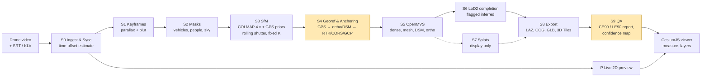

# 14 · Demo and Pitch

> **Purpose:** everything we say and show to judges: the idea-submission PPT, elevator and long pitches, the live demo script with backups, the "killer slide" accuracy table, a judge Q&A bank, and pitch do's and don'ts.
>
> **Status:** Draft v1.0 · 2026-09-30 · Owner: R6 (Data, Flight Ops & Pitch) · Accuracy content owned by R2 · Must agree with [`00-project-charter.md`](00-project-charter.md)

---

## 1. Core message (memorise this)

> **"Everyone can make a pretty 3D model from drone video. We make one you can measure — and we prove where it sits on Earth, with numbers."**

Three facts carry the pitch (all from the research report, [`15-research-and-references.md`](15-research-and-references.md)):

1. **Relative 3D shape is solved; absolute placement is not.** Consumer drone GNSS puts a model ~2–4 m off, but it is a near-rigid shift: in Zhang et al. (2019) vertical error was 3.93 m mean with only 0.18 m spread.
2. **A single straight pass is the worst geometry in photogrammetry** — self-calibrated nadir strips "dome"; 20–30° oblique views cut the deformation by one to two orders of magnitude (James & Robson 2014).
3. **At least 10 public competitor repos** already run COLMAP + OpenMVS + GPS. **None shows measured absolute accuracy on a real flight.** That is our space.

Our five differentiators (charter §4): **Accuracy engine · Proof, not claims · Honest confidence map · Mission-ready (offline, KLV, licence-clean) · Two-tier speed.**

## 2. Idea submission PPT — slide-by-slide outline

SIH idea decks follow a fixed template (title page, then idea, technical approach, feasibility & viability, impact & benefits, research & references). **Use the official SIH 2026 template from the portal** — check the slide limit and required fields there. The outline below maps our content into that structure, plus one differentiator slide if the template allows.

| # | Slide (SIH template section) | Content | Visual |
|---|---|---|---|
| 1 | **Title** | PS ID **26158**, PS title "Single-Pass Drone Video to Accurate 3D Model Generation System", Organisation **NTRO**, Theme **Robotics and Drones**, Category **Software**, Team name, Team ID, Institute. Product name **Drishti3D** + tagline *"One pass. One video. A measurable 3D world."* | Logo + one hero render: textured 3D model over a globe with a measurement line |
| 2 | **Problem & idea** | Why single pass matters (disaster, reconnaissance, border mapping — one chance to fly). Today: multi-pass grids, 80%+/70%+ overlap, GCPs, hours of processing. Our idea: one video + GPS → georeferenced, metric, textured 3D in minutes, **with a measured accuracy report**. Bullet: "Relative shape is solved; absolute placement is the open problem" | Left: grid flight vs single pass cartoon. Right: "~2–4 m GNSS offset" arrow on a model |
| 3 | **Proposed solution** | What the user gets: point cloud (LAS/LAZ), textured mesh (OBJ/GLB/3D Tiles), ortho + DSM/DTM (COG), confidence map, accuracy report (CE90/LE90). Web viewer with measure distance/height/area/volume. Live 2D preview in ≤60 s; metric 3D target ≤15 min for a 10-min 4K clip (our target, to be confirmed with PS) | Screenshot mock of the viewer with layers + accuracy panel |
| 4 | **Technical approach** | Pipeline S0–S9 (charter §7): Ingest & Sync → Keyframes → Dynamic masking → SfM (COLMAP 4.x global mapper, GPS/gravity priors, rolling shutter, fixed intrinsics) → **Georeferencing & anchoring** (7-DoF to GPS → ortho/DSM registration → optional RTK/PPK/CORS/GAGAN/1 GCP) → OpenMVS dense/mesh → LoD2 completion → optional splats → Export/3D Tiles → QA. Stack: Python, PyTorch, COLMAP, OpenMVS, GDAL/PDAL, FastAPI, React + CesiumJS, Docker offline | Pipeline diagram (below); accuracy-engine box highlighted |
| 5 | **What makes us different** (if template allows; else merge into 4) | The five differentiators; one line each; "we never claim real-time 3D the literature doesn't support" | 5 icons row; small comparison: "others: pretty mesh" vs "Drishti3D: mesh + CE90/LE90 + confidence" |
| 6 | **Feasibility & viability** | All core parts exist open-source (COLMAP BSD, OpenMVS AGPL, CesiumJS Apache-2.0); runs on one RTX-class workstation (min RTX 3060 12 GB, 64 GB RAM); evidence it works: video frames at 1 frame/2.5 s matched still-photo accuracy (1.1–2.7 cm boundary RMSE, with good georeferencing); PPK without GCPs reached 2.4 cm XY / 2.2 cm Z. Risks + mitigations: doming → oblique capture + locked intrinsics; time offset → estimator; no GPU → low-memory fallback; licences → register | Risk/mitigation 2×3 table; hardware box |
| 7 | **Impact & benefits** | Users: NTRO/IMINT analysts, disaster response (NDRF/SDRF), border mapping, infrastructure inspection. Benefits: minutes not days (Army OWT/RAPTRS still ~3 h per km² with dedicated collection), no GCP field crews, offline + in-India processing (DST 2021 ≤1 m/3 m data rule), works on pre-recorded video from authorised operators (red-zone sites). Fits the SIH→govt adoption pattern (ISRO accepted a video-geotagging tool from SIH 2024) | 3 use-case tiles with before/after time |
| 8 | **Research & references** | 6–8 key citations: Zhang et al. 2019; James & Robson 2014; Vautherin et al. 2016; ASPRS Ed. 2 (2023); Spagnolo et al. 2026 SLAM benchmark; GeoFF3D 2026; ODM docs; DST guidelines 2021. Link to full list in repo | Compact reference list, small font, QR to repo |

### Pipeline diagram for slide 4

## 3. 90-second elevator pitch (script)

> *(0–15 s)* "When a bridge collapses or a border post needs mapping, a drone often gets **one pass**. Today's tools need planned grid flights, ground control points and hours of processing. PS 26158 asks: can one video become an accurate 3D model?
>
> *(15–40 s)* Our research found the surprising part: **building the 3D shape from video is basically solved.** The hard part is **where it sits on Earth.** A consumer drone's GPS puts the model two to four metres off — but it is almost a pure shift. In one study the height was off by 3.9 metres with only 18 centimetres of spread.
>
> *(40–70 s)* So Drishti3D treats georeferencing as the core problem. We sync video to GPS automatically, model the rolling shutter, lock the lens so a single strip doesn't bend into a bowl, and **anchor the model** to a reference orthophoto or DSM, or to RTK, CORS, GAGAN, or one known point. Then we **prove it**: a before-and-after table in CE90 and LE90 on real checkpoints, plus a map showing which surfaces we saw and which we inferred.
>
> *(70–90 s)* It runs fully offline, reads DJI SRT and military KLV, and uses only licence-clean models. A live 2D preview in a minute, a measurable 3D model in minutes. **One pass. One video. A measurable 3D world.**"

## 4. 5-minute pitch narrative

| Time | Beat | Say | Show |
|---|---|---|---|
| 0:00–0:30 | Hook | One-chance scenario; PS 26158 in one sentence | Title + hero render |
| 0:30–1:15 | Problem | Multi-pass grids, GCPs, hours; commercial "real-time" is preview-only (DJI calls Terra real-time "low accuracy"; FlightHub 2 rapid models publish no accuracy) | Problem slide |
| 1:15–2:00 | Insight | Relative solved, absolute open; Zhang: 3.93 m bias, 0.18 m spread; single-strip doming; ten competitor repos, none with real-flight absolute accuracy | Insight chart (bias vs noise) |
| 2:00–3:15 | Solution | Pipeline S0–S9 in 30 s, then 45 s on the accuracy engine: time-sync, rolling shutter, locked intrinsics, anchoring | Pipeline diagram, anchoring highlighted |
| 3:15–4:00 | Proof | Killer slide: before/after CE90/LE90 on ≥30 checkpoints; doming residual; timings | Killer slide (§6) |
| 4:00–4:40 | Mission-ready | Offline Docker, DST data-localisation, KLV/STANAG 4609, licence register, confidence map | 4 icons |
| 4:40–5:00 | Close | Impact + ask: "evaluate it on your unseen video" + tagline | Closing slide |

## 5. 10-minute pitch narrative (with live demo)

| Time | Section | Content |
|---|---|---|
| 0:00–0:45 | Hook & team | Scenario; team roles R1–R6 in one line each |
| 0:45–2:00 | Problem & landscape | PS asks; commercial (DJI, Skydio, Pix4D, SkyeBrowse) vs defence (Raptor <3 m, Edgybees 1–2 m, register to prior data, no new 3D) — gap table |
| 2:00–3:00 | Research insight | Bias vs noise, doming, time-sync, rolling shutter (74 ms readout → ~10 px at 8 m/s, 70 m) |
| 3:00–4:00 | Architecture | S0–S9 + two-tier speed; why MVS for measurement and splats only for display (GS from video: 5.26 m CE90 in a 2026 study) |
| 4:00–7:30 | **Live demo** (§8) | Upload → live preview → model → measure → confidence → accuracy report |
| 7:30–8:30 | Proof | Killer slide + doming test + timing table |
| 8:30–9:30 | Mission-ready & roadmap | Offline, KLV, licences, DST; future: edge/Jetson, multi-pass change detection |
| 9:30–10:00 | Close | Ask + tagline |

## 6. The killer slide — before/after accuracy table (TEMPLATE)

> ⚠ **Placeholders only.** Fill **only** from an S9 report JSON of a real run. Never round in our favour; never show a number without its checkpoint count and source. `‹…›` = to be filled.

**Title:** "Same video. Same GPS. Anchoring moves it from metres to ‹…›."

**Subtitle:** Flight ‹site›, ‹date›, ‹drone model›, ‹altitude› m AGL, ‹clip length›, ‹N› independent RTK checkpoints (fix status ‹…›, checkpoint accuracy ‹…› cm), processed offline on ‹GPU›.

| Configuration | Anchor used | RMSE_X (m) | RMSE_Y (m) | RMSE_H (m) | RMSE_Z (m) | Mean Z bias (m) | SD Z (m) | **CE90 (m)** | **LE90 (m)** | Relative length error (%) | Time (min) |
|---|---|---|---|---|---|---|---|---|---|---|---|
| A. Raw GNSS (consumer SRT only) | none | ‹…› | ‹…› | ‹…› | ‹…› | ‹…› | ‹…› | ‹…› | ‹…› | ‹…› | ‹…› |
| B. + time-sync + rolling shutter + locked K | none | ‹…› | ‹…› | ‹…› | ‹…› | ‹…› | ‹…› | ‹…› | ‹…› | ‹…› | ‹…› |
| C. + ortho/DSM registration | ‹reference, resolution, accuracy› | ‹…› | ‹…› | ‹…› | ‹…› | ‹…› | ‹…› | ‹…› | ‹…› | ‹…› | ‹…› |
| D. + one GCP / RTK / CORS (optional) | ‹…› | ‹…› | ‹…› | ‹…› | ‹…› | ‹…› | ‹…› | ‹…› | ‹…› | ‹…› | ‹…› |
| Target (charter §6) | — | | | | | | | **≤ 1 (anchored)** | **≤ 1 (anchored)** | **≤ 0.5** | **≤ 15** |

Footer (small): "CE90 ≈ 2.146 × per-axis RMSE (RMSE_x ≈ RMSE_y); LE90 = 1.6449 × RMSE_Z (ASPRS/NSSDA). ≥30 checkpoints per ASPRS Ed. 2 (2023). Checkpoints not used in processing."

Side panel (optional): doming residual plot (DSM minus reference along track), and bias-vs-noise bar chart for row A.

**Context line allowed on the slide (research, not our result):** "Published consumer-GNSS-only example: RMSE 2.29 m H, 3.93 m Z → ≈ 3.5 m CE90 / 6.5 m LE90 (derived from Zhang et al. 2019)."

If fewer than 30 checkpoints: write "‹N› checkpoints — below ASPRS minimum of 30" on the slide.

## 7. Judge Q&A bank

Answer pattern: **one-line answer → one number → one limitation.** Owner = who answers first.

### A. Competition and positioning

| # | Question | Crisp answer | Owner |
|---|---|---|---|
| 1 | Why not just use Pix4D or DJI Terra? | They are built for planned still-image flights. DJI calls Terra's in-flight real-time 3D "of low accuracy" and asks you to re-process the original images; its "within 4 cm, no GCP" figure is Phantom 4 RTK stills at 100 m processed after flight. FlightHub 2 turns up to 500 thumbnails into a model in ~5 min but publishes no accuracy. Pix4Dreact is 2D and stills-only; PIX4Dmapper imports video but loses EXIF and camera auto-detection. None is offline, video-native and reports CE90/LE90 from a single pass. | R6 |
| 2 | SkyeBrowse already does single video to 3D. | It uses a ~2-minute **orbit**, which gives converging views — the opposite of a single linear pass. Its 0.1–0.5 in figures are vendor claims, almost certainly relative accuracy, with no independent study found. It is a cloud service; we run air-gapped. | R6 |
| 3 | Defence tools like Maxar/Vantor Raptor exist. | Raptor and Edgybees **register** video to prior 3D or satellite data (<3 m, 1–2 m) — they do not build new 3D. We borrow their idea (register to a reference) to fix our absolute offset, while generating a new model. | R2 |
| 4 | Other teams also use COLMAP + OpenMVS. How are you different? | We found ≥10 public repos with that baseline; the most mature reports 0.344 m median error on **synthetic** data. Our difference: real-flight absolute accuracy on ≥30 independent checkpoints, automatic time-sync, rolling-shutter modelling, a doming test, KLV ingest, confidence map, and a licence register. | R2 |
| 5 | What is actually novel? | Treating georeferencing as the core problem: bias-vs-noise decomposition, anchoring, and proving it in CE90/LE90 — plus handling the single-strip degeneracies most pipelines ignore. | R2 |

### B. Accuracy

| # | Question | Crisp answer | Owner |
|---|---|---|---|
| 6 | How accurate are you without GCPs? | Relative: target ≤0.5 % length error, with an extra scale source on short clips (DJI's own whitepaper shows 0.1–0.3 % distance agreement with good GNSS). Absolute with consumer GNSS only: honestly metres — published example ≈3.5 m CE90 / 6.5 m LE90. With an anchor (ortho/DSM, CORS, GAGAN or one point): target ≤1 m CE90/LE90. With RTK/PPK: literature shows ~2–5 cm without GCPs. We report whatever we measure. | R2 |
| 7 | Why do you think one anchor fixes metres of error? | Because the consumer-GNSS error is mostly a rigid shift: Zhang et al. measured Z mean error 3.93 m with SD 0.18 m. Remove the shift and what's left is the small noise. | R2 |
| 8 | What reference ortho/DSM will NTRO have? | Whatever they hold — our S4 takes any GeoTIFF ortho/DSM. If none: CORS (±3 cm RTK/NRTK from ~1,000+ SoI stations), GAGAN (~1.5 m H / 2.5 m V), RTK/PPK logs, or one surveyed point. Without any anchor we say so and report GNSS-only accuracy. | R2 |
| 9 | How do you measure accuracy? | ASPRS Ed. 2 (2023): RMSE, ≥30 independent checkpoints at least 2× more accurate than the product; we convert to CE90 (≈2.146 × per-axis RMSE) and LE90 (1.6449 × RMSE_Z), and split bias from noise. | R2 |
| 10 | What is doming and do you have it? | A bowl-shaped height error when lens distortion is self-calibrated on near-parallel images; metre-scale in simulation, ~0.2 m in a real test (James & Robson 2014). We lock intrinsics, recommend 20–30° forward-oblique capture (1–2 orders of magnitude less deformation), and publish a doming residual against LiDAR/DSM. | R2 |
| 11 | Vertical accuracy is usually worse — why trust your heights? | Agreed; it is worse (GAGAN is ~2.5 m V vs 1.5 m H). We report LE90 separately, anchor to a DSM where available, and show the Z residual profile. | R2 |
| 12 | How do you sync video and GPS? | DJI SRT is in local time without timezone and its latency is not publicly measured. We estimate the offset by cross-correlating GPS velocity with SfM camera velocity. For cm-level work sync must be better than 1 ms at 10–30 m/s; at our ≤1 m target, tens of ms matter. | R2 |
| 13 | Rolling shutter — does it matter? | Yes for consumer drones: Pix4D measured 74 ms readout (Phantom 2 Vision+) and 30 ms (Inspire 1) → ~10 px and ~4 px displacement at 8 m/s, 70 m. Modelling it removed systematic error. We enable it in bundle adjustment. | R1 |
| 14 | A straight line of GPS points — can you get roll right? | Not from GPS alone: collinear positions can't fix rotation about the flight axis. We take it from gimbal attitude/gravity, altitude variation or a curved path. | R2 |
| 15 | Video frames are lower quality than photos. | Yes: 4K ≈ 8 MP vs ~20 MP stills, plus compression and blur. But a 2021 study found video sampled at 1 frame per 2.5 s matched a photo flight (1.1–2.7 cm vs 1.3–2.8 cm boundary RMSE). We reject blurred frames per window. | R4 |

### C. Scene challenges

| # | Question | Crisp answer | Owner |
|---|---|---|---|
| 16 | What about occluded walls and overhangs? | One pass under-observes facades. We never fake them silently: every surface is tagged observed-high, observed-low or inferred. Walls are completed with plane-based LoD2 priors (City3D-style: infer walls from roof planes) and shown as *inferred* in the confidence map. Diffusion "hallucination" is not used for measurement. | R3 |
| 17 | How do you handle moving vehicles and people? | Segmentation masks (vehicles, people, sky, overlays) before matching, so they don't create false 3D points or texture. In a single pass a moving car appears in few frames. Parked-then-moving vehicles are the hard case; DroneSplat-style tracking masks are a known remedy (+0.9 to +2.4 dB in their drone benchmark). | R4 |
| 18 | Lighting changes and shadows? | A pass lasts minutes, so the sun barely moves; auto-exposure drift is the real issue — handled with global colour adjustment and seam levelling in texturing, and exposure compensation in the splat layer. Hard shadows get baked into texture — a known limitation. | R3 |
| 19 | Motion blur? | Variance-of-Laplacian scoring rejects the worst frames per window before SfM; video gives us plenty of spare frames. | R4 |
| 20 | Night or IR video? | Geometry stages are sensor-agnostic, and KLV FMV (often EO/IR) is parsed. Thermal video has low texture and resolution, so we have **not validated** IR accuracy; we would report it as best-effort and flag low confidence. | R2 |
| 21 | Low-texture terrain (desert, water, snow)? | SfM needs texture; the benchmark we cite shows even learned SLAM failing on homogeneous terrain. GPS priors keep poses bounded; the confidence map marks sparse areas; water is masked. | R1 |

### D. Speed and scale

| # | Question | Crisp answer | Owner |
|---|---|---|---|
| 22 | Is it real-time? | Two tiers: a **live 2D preview** during processing (incremental CPU mosaicking at ~2.3 fps is published), and the **metric 3D product minutes later** (target ≤15 min for 10-min 4K). We don't claim real-time 3D: SLAM + splatting systems in the literature run ~0.3–3.7 fps and are mostly tested indoors. | R1 |
| 23 | Why not ODM? | We use ODM as our baseline. It ingests video + SRT (default 500-frame cap) but is batch-grade: a community benchmark took 62 min on GPU for 242 images at ultra quality, peaking near 40 GB RAM. | R3 |
| 24 | How do you scale to a 20-minute video? | Keyframes at ~1–2 fps (≈1,200–2,400 frames), global SfM (GLOMAP, now COLMAP's global mapper, "orders of magnitude faster" than incremental), GPU bundle adjustment, and splitting long strips into sub-scenes with GNSS constraints. We publish measured times per profile. | R1 |
| 25 | Why not visual SLAM? | A 2026 benchmark on nadir drone video found good short-flight drift (MASt3R-SLAM 0.53 %, DROID-SLAM 0.58 %) but vertical RMSE >100 m in 29 of 34 long runs, and ~30 GB GPU memory for the best methods. A single pass has no loops to close. We keep DPVO (<3 GB) as a fallback only. | R1 |
| 26 | Why not NeRF or Gaussian splatting only? | They look better but measure worse: an ISPRS 2026 study found 3DGS geometry generally slightly below photogrammetry, a 2026 UAV study got 5.26 m CE90 from GS on video with GNSS, and city-scale GS meshes use 1 m voxels. So MVS for measurement, splats for display only. | R3 |
| 27 | Why not feed-forward models like VGGT? | Licences and domain gap. Original VGGT is non-commercial and **VGGT-1B-Commercial excludes military use**; DUSt3R/MASt3R are non-commercial. Off-the-shelf models "cannot fully replace SfM and MVS" on aerial blocks (Wu et al. 2025). GPS-anchored GeoFF3D (~2,000 images in ~5 min, stable on collinear paths) is promising, but its licence is unverified — optional fallback only after a licence check. | R4 |

### E. Deployment, security, cost

| # | Question | Crisp answer | Owner |
|---|---|---|---|
| 28 | Is it secure / does it need the internet? | No internet at runtime: Docker bundle with all weights and viewer assets, air-gapped. Data never leaves the machine. | R1 |
| 29 | Data localisation? | DST 2021 guidelines: data finer than 1 m horizontal / 3 m vertical must be owned by Indian entities and stored/processed in India. Our ≤1 m output is in that class, so on-premise processing is the right design. | R2 |
| 30 | Licences — can NTRO deploy this? | Every dependency and weight is in a register. COLMAP is BSD; OpenMVS and ODM are AGPL-3.0 (fine internally; noted for any hosted service); segmentation choice checked (SAM 2 Apache-2.0; Ultralytics YOLO is AGPL). No military-excluded or non-commercial weights ship by default. | R4 |
| 31 | What hardware does NTRO need? | One workstation: RTX 3060 12 GB minimum, RTX 4090 24 GB ideal, 64 GB RAM, 1 TB NVMe; Ubuntu 22.04/24.04 or Windows 11 + WSL2. | R1 |
| 32 | What does it cost? | Software ₹0 (open source). Hardware is a single GPU workstation. Commercial single-video services charge per model (e.g. SkyeBrowse ~$20–50 per model in 2026). | R6 |
| 33 | Does it read military FMV / KLV? | Yes as a stretch goal: MISB ST 0601 metadata from STANAG 4609 transport streams via `klvdata`, interpolated to each frame. | R2 |
| 34 | What if the video has no telemetry at all? | We still build a relative 3D model, but scale and position are unknown unless we get an anchor (reference ortho/DSM, known dimension, or GCPs). The report says so explicitly. | R2 |
| 35 | GPS-denied flights? | Same as no telemetry for position; the defence pattern (register to a prior ortho/DSM) is exactly our S4 anchoring path. Vision-only positioning in the literature is ~<10 m RMSE (Raptor Guide) — we would not promise better without testing. | R2 |
| 36 | Can it run on the drone? | Out of scope for SIH. OpenREALM has run real-time 2.5D mapping on a Jetson Xavier NX, so an edge version of our preview tier is a credible roadmap item. | R1 |
| 37 | How did you fly legally? | Green zone only (≤120 m under Drone Rules 2021, checked on Digital Sky). Sensitive/red-zone sites are an operator's job; our tool works on pre-recorded video from authorised operators. | R6 |
| 38 | What if the finale video is different from your data? | That's why robustness beats peak quality: one command, automatic triage of format/telemetry, and a tested matrix (1080p/4K, 25–60 fps, SRT/KLV/none, long clips). | R1 |
| 39 | How do you know your confidence map is right? | It is computed from observable evidence (number of views, viewing angles, residuals) and checked against checkpoint errors; inferred surfaces are never counted as observed. | R3 |
| 40 | What would you build next with NTRO? | Multi-pass fusion and change detection, edge preview, IR validation, and integration with NTRO's reference data for anchoring. | R6 |

## 8. Live demo script (target 3.5 min inside the 10-min pitch)

**Setup before going on stage:** demo laptop in kiosk mode, server running locally, **network off**, viewer tab open, pre-computed run loaded in a second tab, screen recording queued in a video player, slides PDF open. Clip: our own green-zone flight (with checkpoints) — never an untested clip.

| Time | Step | Action | What we say | Fallback if it fails |
|---|---|---|---|---|
| 0:00 | Start | Show Wi-Fi off icon | "Everything you'll see runs offline on this laptop." | — |
| 0:10 | Upload | Drag video + `.srt` into the UI; choose `fast` | "One video, its GPS sidecar, one click." | Switch to pre-computed tab |
| 0:30 | Ingest | Show detected format, fps, telemetry, **estimated time offset** | "It found a ‹…› ms offset between video and GPS — most tools ignore this." | Screenshot slide |
| 0:50 | Live preview | 2D mosaic grows on the globe | "Within a minute the operator has a 2D map." | Pre-recorded clip of preview |
| 1:20 | Jump to finished run | Switch to the completed run of the same clip (processing continues in background) | "The full metric product takes ‹…› minutes; here is the finished one." | — |
| 1:40 | 3D model | Orbit textured 3D Tiles mesh; toggle point cloud, DSM, ortho | "Terrain, roofs, roads, vegetation — georeferenced." | Screen recording |
| 2:10 | Measure | Measure a building height and a road length; compare to tape/RTK value on a sticky note | "Relative error ‹…› %." | Screenshot |
| 2:40 | Confidence | Toggle confidence overlay; point at an *inferred* wall | "We tell you what we saw and what we guessed." | Screenshot |
| 3:00 | Accuracy report | Open S9 report: before/after CE90/LE90 | "Raw GPS: ‹…› m CE90. Anchored: ‹…› m. ‹N› independent checkpoints." | Killer slide |
| 3:25 | Export | Click export: LAZ, GLB, COG, 3D Tiles | "Standard formats, straight into GIS." | — |
| 3:30 | Back to slides | | | |

**Backup ladder** (decide in 5 seconds, no apologies): (1) live run → (2) pre-computed run in second tab → (3) screen recording (MP4, 1080p, on laptop and USB) → (4) static screenshots in slides. All four levels are prepared for every rehearsal. Everything is local — no internet dependency at any level.

## 9. Pitch do's and don'ts

| Do | Don't |
|---|---|
| Lead with the insight (relative solved, absolute open) | Lead with the tech stack |
| Quote numbers with their source and conditions ("Zhang et al., 16 checkpoints, 45 m") | Round numbers in our favour or quote vendor claims as facts |
| Always separate relative from absolute accuracy | Say "accurate" without saying which |
| Say CE90/LE90 and RMSE — NTRO's language | Use only PSNR or "looks good" |
| Say "we don't know yet" + how we'd find out | Bluff on IR, GPS-denied or edge performance |
| Show the confidence map and limitations | Hide inferred surfaces behind a pretty splat |
| Keep the live demo on a tested clip, offline | Demo on conference Wi-Fi or an untested video |
| Name competitors respectfully (DJI, Skydio, SkyeBrowse, Raptor) | Disparage other SIH teams |
| Rehearse with a timer; one speaker per section; hand off by name | Read slides aloud |
| Mention licences and DST data-localisation proactively | Ship or mention VGGT-Commercial / non-commercial weights as the default |
| End with the tagline and the ask | End on a Q&A slide with nothing to say |

---

## Related documents

- [00-project-charter.md](00-project-charter.md) — single source of truth
- [01-problem-statement.md](01-problem-statement.md)
- [02-solution-overview.md](02-solution-overview.md)
- [03-requirements.md](03-requirements.md)
- [04-system-architecture.md](04-system-architecture.md)
- [05-pipeline-design.md](05-pipeline-design.md)
- [06-georeferencing-and-accuracy.md](06-georeferencing-and-accuracy.md)
- [07-tech-stack.md](07-tech-stack.md)
- [08-data-formats-and-interfaces.md](08-data-formats-and-interfaces.md)
- [09-viewer-and-ui.md](09-viewer-and-ui.md)
- [10-setup-and-repo-structure.md](10-setup-and-repo-structure.md)
- [11-testing-and-evaluation.md](11-testing-and-evaluation.md)
- [12-flight-and-data-capture-guide.md](12-flight-and-data-capture-guide.md)
- [13-project-plan.md](13-project-plan.md)
- [15-research-and-references.md](15-research-and-references.md)
- [16-glossary.md](16-glossary.md)
