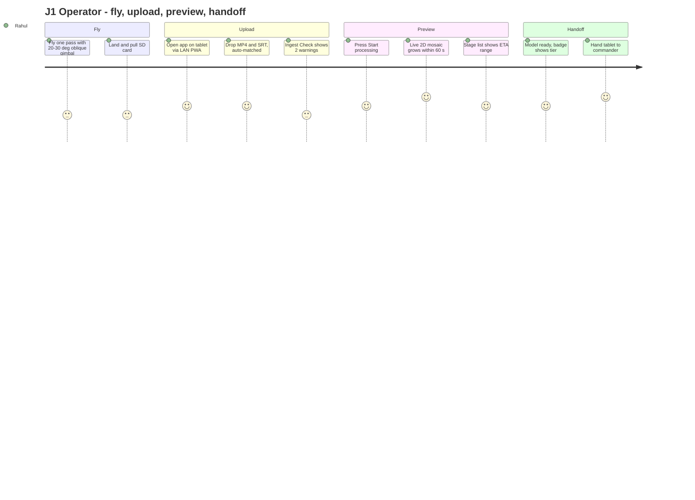
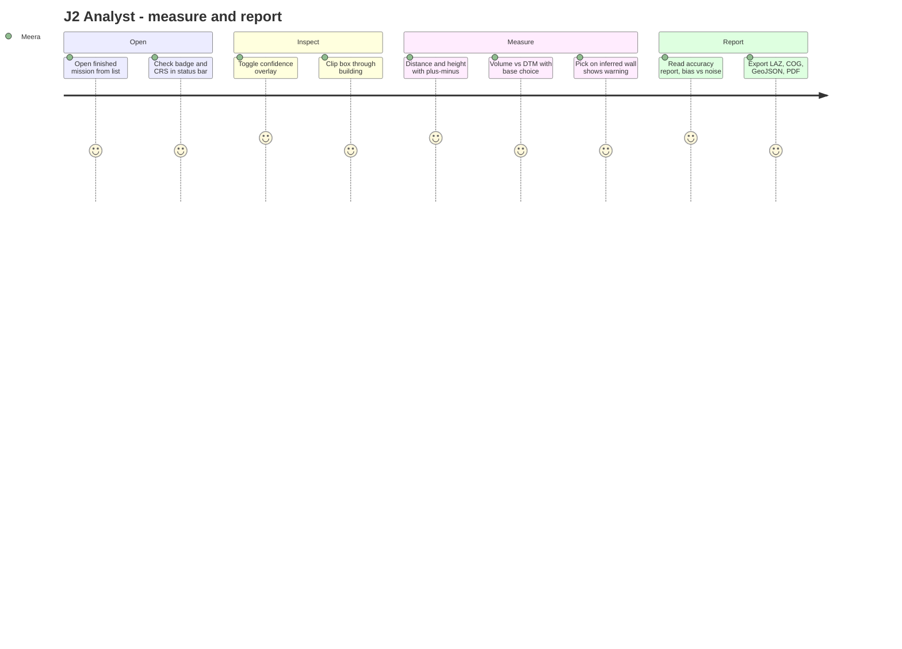
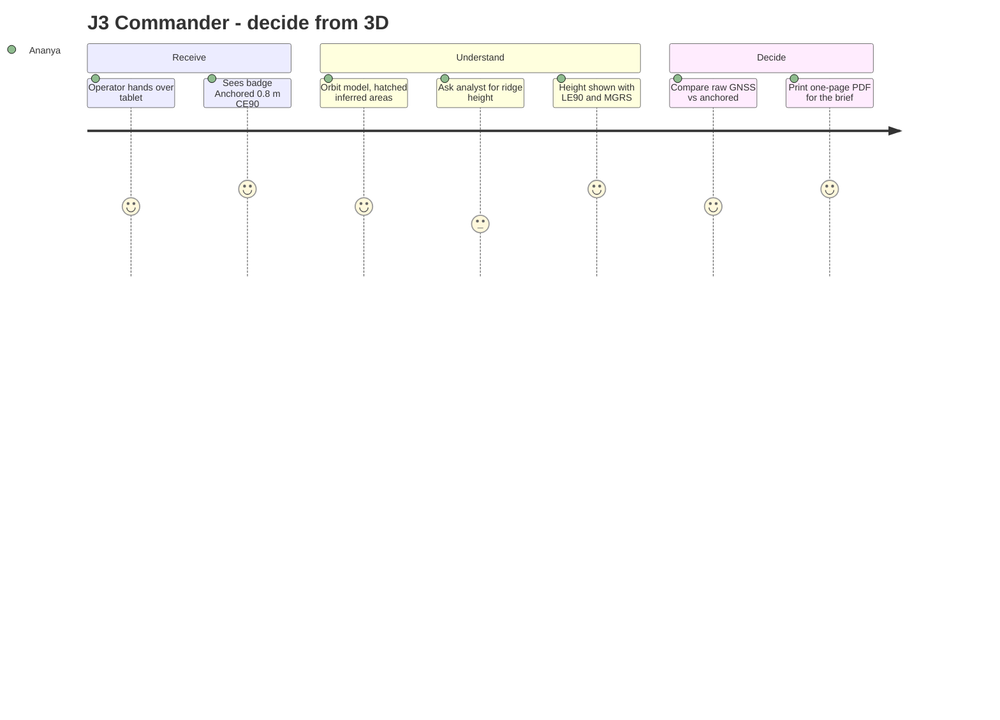
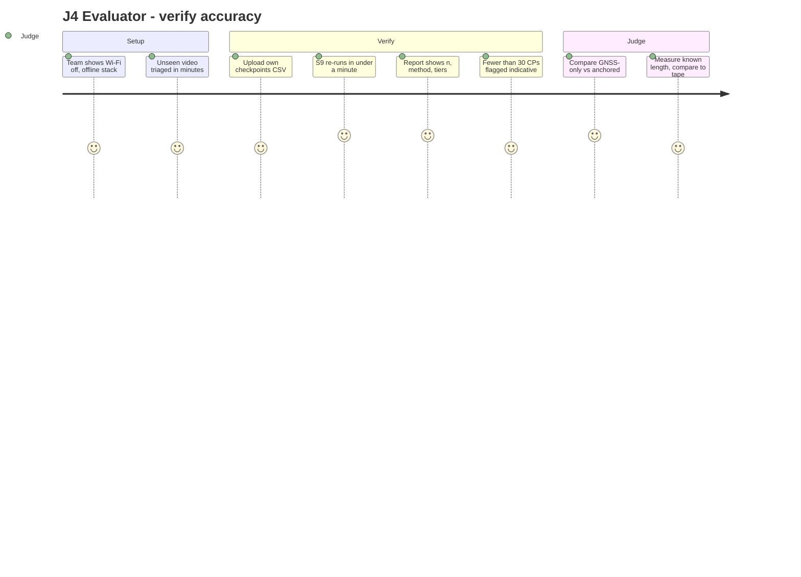
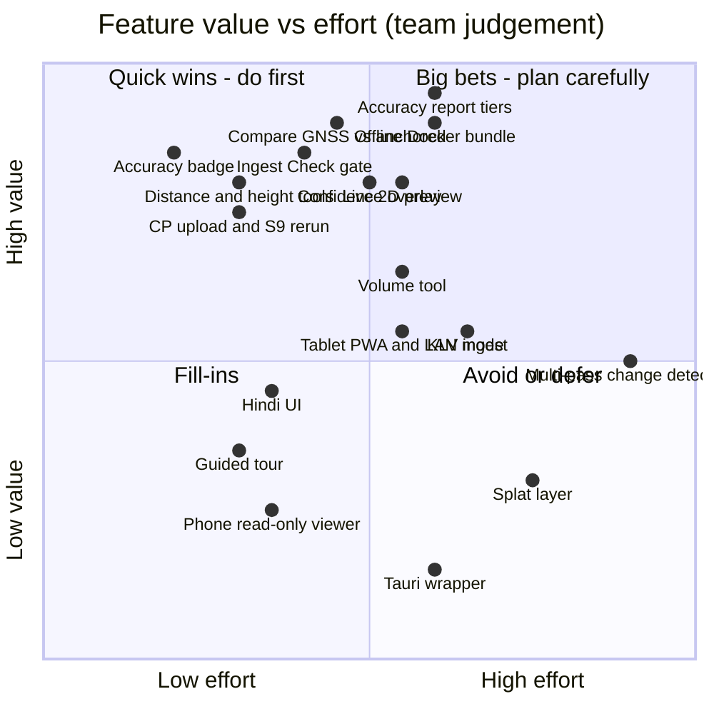
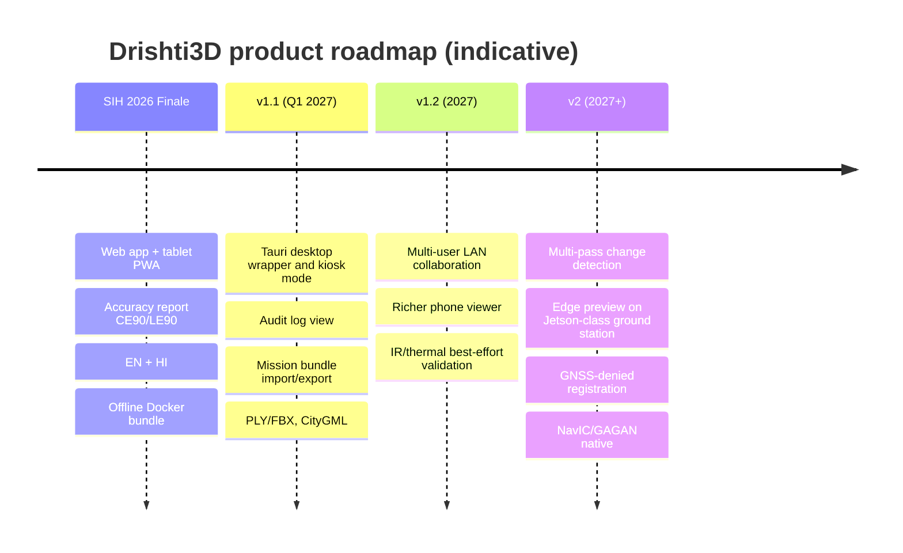

# 17 · Product Requirements Document (PRD)

> **Purpose:** define *what product* Drishti3D is, *for whom*, *why*, and *in what order* we build it: vision, personas, journeys, epics with user stories, releases and success metrics. It sits **above** the SRS ([03-requirements.md](03-requirements.md)) and points to its FR/NFR IDs instead of repeating them.
>
> **Status:** Draft v1.0 · 2026-09-30 · Normative source: [00-project-charter.md](00-project-charter.md). If this PRD disagrees with the charter, the charter is correct.

| Document control | |
|---|---|
| Document | 17 · Product Requirements Document (PRD) |
| Version | 1.0 (draft) |
| Date | 2026-09-30 |
| Owners | **R6** Data, Flight Ops & Pitch (product owner) + **R1** Pipeline Lead (technical feasibility) |
| Reviewers | R2 Geo & Accuracy Lead (every accuracy claim, E5), R5 Frontend Engineer (UX, E3/E4/E8), R3 3D & Mesh Engineer (E6 exports), R4 AI/ML Engineer (licences, masking) |
| Status | Draft for team review. Baselined at the M2 exit review (1 Nov 2026) |
| Change rule | Scope, target or stage-name changes go into the charter first, then here, then the SRS |
| Related specs | SRS [03](03-requirements.md) · UI spec [09](09-viewer-and-ui.md) · Design system [18](18-design-system.md) (upcoming) · Wireframes [wireframes/](wireframes/README.md) (upcoming) |

**Convention.** Numbers marked 🎯 are **our targets** (charter §6). They are not measured results. Numbers with a citation are published research results. Numbers in UI examples are placeholders.

---

## Contents

1. [Executive summary](#1-executive-summary)
2. [Problem and opportunity](#2-problem-and-opportunity)
3. [Vision, principles, positioning and platform](#3-vision-principles-positioning-and-platform)
4. [Goals and non-goals](#4-goals-and-non-goals)
5. [Target users and personas](#5-target-users-and-personas)
6. [Jobs-to-be-done and mission scenarios](#6-jobs-to-be-done-and-mission-scenarios)
7. [User journeys](#7-user-journeys)
8. [Feature set: epics and user stories](#8-feature-set-epics-and-user-stories)
9. [Prioritisation and release plan](#9-prioritisation-and-release-plan)
10. [UX requirements summary](#10-ux-requirements-summary)
11. [Success metrics and KPIs](#11-success-metrics-and-kpis)
12. [Assumptions, constraints and dependencies](#12-assumptions-constraints-and-dependencies)
13. [Product risks and open questions](#13-product-risks-and-open-questions)
14. [Out of scope and future roadmap](#14-out-of-scope-and-future-roadmap)
15. [Appendix: glossary and traceability](#15-appendix-glossary-and-traceability)

---

## 1. Executive summary

**The product.** Drishti3D takes **one drone video pass plus its GPS / flight log** and produces a **georeferenced, measurable, textured 3D model**: point cloud, mesh, orthomosaic, DSM/DTM, a confidence map and a formal accuracy report. Users open it in an **offline web app** where they can view, measure and export. *Tagline: One pass. One video. A measurable 3D world.*

**The problem.** In disaster response, reconnaissance, border mapping and inspection there is often **one chance to fly**. Standard photogrammetry needs planned grids, high overlap, GCPs and hours of processing. Consumer drones can capture video in one pass, but their GNSS puts a model **about 2–4 m off**. Almost all of that error is a rigid shift: Zhang et al. 2019 measured 3.93 m vertical bias with only 0.18 m spread. No public tool shows **measured absolute accuracy** from single-pass video on a real flight ([02 §6](02-solution-overview.md)).

**Our bet.** The relative 3D shape is already a solved problem. Placing that shape correctly on Earth is still open. Drishti3D makes georeferencing the core product feature, and it **proves** accuracy in NTRO's own terms (CE90 / LE90 on independent checkpoints). It shows users what was *observed* and what was *inferred*, and it tells them how far to trust every number.

**Who it serves.** Five personas, detailed in §5:

1. The **field drone operator**, who needs a usable result before leaving the site.
2. The **GIS / imagery analyst**, who needs numbers they can defend.
3. The **mission commander**, who needs a quick, trustworthy picture.
4. The **disaster-response officer**, who needs damage extent and volumes within the hour.
5. The **NTRO evaluator / judge**, who needs to verify our claims on unseen video.

**Platform (decided, §3.4).** A **single offline-first web app** (React + CesiumJS) runs on the ground-station laptop or workstation at `localhost`. On field tablets the same app uses a **responsive tablet layout, installable as a PWA** over the local LAN. There is **no native mobile app**: GPU processing has to happen on the workstation, so a native app would add nothing. A Tauri desktop wrapper is possible future work. The app has two themes: **dark "field"** and **light "analyst"**.

**What we ship, and when.**

| Release | When | What the user gets |
|---|---|---|
| **MVP** (prototype) | M1–M2 · by 1 Nov 2026 | One upload or one CLI command gives a GNSS-aligned mesh, ortho and DSM. The user can view it, measure a distance and export LAS/OBJ/COG |
| **Finale build** | M3–M5 · by 6 Dec 2026 | Everything above, plus: ingest check, live 2D preview, anchoring with a before/after accuracy report, full measurement suite, confidence overlay, compare view, all exports, tablet PWA, EN/HI, offline Docker bundle |
| **Post-hackathon v1.x** | 2027+ | Tauri desktop wrapper, multi-pass change detection, edge preview, richer phone viewer, multi-user LAN collaboration |

**How we will know it works (§11).** 🎯 First 2D preview **≤ 60 s** after upload starts. 🎯 Metric 3D **≤ 15 min** for a 10-min 4K clip. 🎯 **≤ 1 m CE90 / LE90** when anchored. 🎯 **≤ 0.5 %** relative length error. 🎯 Measurement-task success **≥ 80 %**. 🎯 SUS **≥ 75**. **Zero** silent failures, meaning we never show a GNSS-only result labelled as anchored.

---

## 2. Problem and opportunity

### 2.1 The problem

| Today's workflow | Why it fails for single-pass missions | Evidence |
|---|---|---|
| Planned lawn-mower grid, often cross-hatched, with 80 %+ frontal and 70 %+ side overlap | The site may be hostile or unsafe, the airspace window short, or the event already over | 45–90 min grid flights (competitor mirror quoted in [01 §4](01-problem-statement.md)) |
| Ground Control Points laid by surveyors | Impossible in red zones and disaster zones, and slow everywhere else | PS challenge (viii) |
| Batch processing measured in hours | Commanders need an answer within the hour | ODM at ultra quality: 242 images took **124 min on CPU / 62 min on GPU** ([02 §6.1](02-solution-overview.md)). US Army OWT/RAPTRS takes **~3 h** per ~1 km² from a dedicated collection |
| "Real-time" commercial 3D | Works from stills or thumbnails, not video, and is described as low accuracy | DJI calls Terra's real-time mode "of low accuracy". FlightHub 2 publishes no accuracy figure ([02 §6.1](02-solution-overview.md)) |
| Video + consumer GPS through SfM | The shape looks right but the model sits metres from its true position, and nobody reports by how much | Consumer GNSS RMSE **2.29 m H / 3.93 m V**, which converts to about **3.5 m CE90 / 6.5 m LE90** (derived; Zhang et al. 2019). One study found **4.8 mm internal RMS** but **5.26 m CE90** absolute error (T&F 2026) |
| One straight pass | Produces "doming", a bowl-shaped height error | Metre-scale in simulation and about 0.2 m in a real test. 20–30° oblique views reduce it **10–100×** (James & Robson 2014) |

### 2.2 The opportunity

| Signal | Why it matters for the product | Source |
|---|---|---|
| The error is **mostly bias**, not noise | One good anchor removes most of it. That turns a hard research problem into a product feature: an anchoring step plus a report | Zhang et al. 2019 (Z SD 0.18 m against a 3.93 m bias) |
| Defence tools register video to prior geodata and reach **1–3 m**, but **generate no new 3D** | There is a gap: new 3D *plus* registration-grade placement | Edgybees 1–2 m, Vantor Raptor < 3 m ([02 §6.1](02-solution-overview.md)) |
| **≥ 10 public competitor repos** for PS 26158 share the COLMAP + OpenMVS + GPS baseline, and **none shows real-flight absolute accuracy** | A pretty mesh is table stakes. Proof of accuracy is how we differentiate | [02 §6.2](02-solution-overview.md). The most mature repo reports 0.344 m median error on *synthetic* data |
| India already has national anchors: **SoI CORS** (±3 cm RTK/NRTK, free for government and academia) and **GAGAN** (~1.5 m H / 2.5 m V) | The anchors are domestic and work offline | [02 §8](02-solution-overview.md) |
| **DST 2021**: data finer than 1 m H / 3 m V must be owned, stored and processed in India | An offline, on-premise product is a requirement, not an option. Cloud SaaS competitors are ruled out | [03 C-01](03-requirements.md) |
| SIH has a path to adoption | After SIH 2024, ISRO accepted a video-geotagging tool | [02 §8](02-solution-overview.md) |

### 2.3 Why now

1. **The mature building blocks now exist.** COLMAP 4.x includes the global mapper (GLOMAP), which is "orders of magnitude faster" than incremental SfM. CesiumJS supports `KHR_gaussian_splatting` (1.139, March 2026) with LOD (April 2026). Live 2D mosaicking at about 2.3 fps on CPU has been published ([02 §5](02-solution-overview.md)).
2. **The demand has a clear owner.** NTRO has published PS 26158, and the Grand Finale in Dec 2026 will use an **unseen video** ([00 §11](00-project-charter.md)).
3. **The field has converged.** Competitor repos all build the same baseline, so the open space is honesty and accuracy, not reconstruction.

---

## 3. Vision, principles, positioning and platform

### 3.1 Vision

> **Any authorised drone operator in India can turn one video pass into a 3D model that an analyst can measure, a commander can trust, and an evaluator can verify. It runs offline, it is ready within minutes, and every number comes with its evidence.**

### 3.2 Product principles

These principles extend the charter's six (§12) into product behaviour.

| # | Principle | Product rule | Charter link |
|---|---|---|---|
| PP1 | **Measure, don't claim** | No accuracy number without *n*, method, tier and date. CE90 is never marked PASS without checkpoints | Principle 1 |
| PP2 | **Relative ≠ absolute** | The UI always shows both, labelled separately | Principle 2 |
| PP3 | **Flag, don't fake** | *Inferred* surfaces are always hatched and excluded from measurements by default | Principle 3 |
| PP4 | **Offline first** | No network calls at runtime. The app shell also works when the tablet loses the LAN | Principle 4 |
| PP5 | **One upload, any video** | Sensible defaults. The Ingest Check catches problems before heavy compute starts | Principle 5 |
| PP6 | **Show something fast** | Live 2D preview first, metric 3D later, each clearly labelled | Differentiator 5 |
| PP7 | **Field-first ergonomics** | Dark field theme, large touch targets, one primary action per screen | [09 §2](09-viewer-and-ui.md) U6–U7 |
| PP8 | **Licence-clean and in-India** | The About page lists every licence. Exports carry the DST notice | Principle 6 |

### 3.3 Positioning statement

> **For** Indian defence, intelligence and disaster-response teams **who** get only one chance to fly over a site and need measurable 3D within the hour, **Drishti3D is** an offline, AI-assisted single-pass-video-to-3D system **that** delivers a georeferenced, textured, measurable model with a CE90/LE90 accuracy report and an honest confidence map. **Unlike** commercial rapid-3D tools (stills-only, "low accuracy" previews, cloud-dependent), defence georegistration tools (no new 3D) and other SIH baselines (pretty meshes with no measured absolute accuracy), **Drishti3D** treats georeferencing as the core problem and **proves** where the model sits on Earth.

### 3.4 Platform decision (ADR-P1, decided)

| Option | Verdict | Reason |
|---|---|---|
| **Offline-first web app** (React + Vite + CesiumJS), served by the local FastAPI/nginx stack at `http://localhost` on the ground-station laptop or workstation | ✅ **Chosen** | Processing needs the local CUDA GPU ([00 §8](00-project-charter.md)). A browser UI needs nothing installed and matches the stack in charter §8 and [09 §8](09-viewer-and-ui.md) |
| **Responsive tablet layout, installable as a PWA** (same codebase) | ✅ **Chosen** | Field operators and commanders use rugged tablets. Tablets connect to the workstation over the local LAN in **LAN mode**, which needs an admin flag plus TLS from a local CA (NFR-SEC-02). A PWA requires a secure context, and TLS provides it. The service worker caches the app shell, fonts, Cesium assets and i18n bundles |
| **Phone layout (≤ 767 px)** | ✅ Read-only viewer only | Small screens cannot support precise measurement or upload. Phones can view runs, the badge and the report |
| Native mobile app (Android/iOS) | ❌ **Rejected** | GPU processing must stay local on the workstation, so a native app adds no capability. It would double the UI codebase and bring app-store and sideloading problems on secure networks |
| Cloud / SaaS | ❌ **Rejected** | DST 2021 data localisation (C-01) and NTRO security posture (IR-1) |
| **Tauri desktop wrapper** | ⏳ **Future (v1.x)** | Would give a single-icon launch, native file dialogs and a kiosk mode. It is not needed for the finale |

**Themes:** a **dark "field"** theme (default on tablets and in touch mode) for glare, night and vehicle use, and a **light "analyst"** theme (default on desktop, and the "Light (office)" theme in [09 §7.4](09-viewer-and-ui.md)) for office monitors and printed reports. A **high-contrast / sunlight** preset stays available as an accessibility variant. Tokens are defined in [18-design-system.md](18-design-system.md).

---

## 4. Goals and non-goals

### 4.1 Product goals

| ID | Goal | Measured by (§11) |
|---|---|---|
| G-P1 | Turn one video + telemetry into a metric, georeferenced 3D product with **one upload** | KPI-01, KPI-03, NFR-USE-01 |
| G-P2 | Give the operator a **first visual within a minute** | KPI-02 |
| G-P3 | Achieve **anchored ≤ 1 m CE90/LE90** 🎯 and report every tier honestly | KPI-05…07 |
| G-P4 | Make every surface's **provenance visible** (observed-high, observed-low, inferred) | KPI-11 |
| G-P5 | Run **fully offline** on one RTX-class machine, with tablet access over the LAN | KPI-15 |

### 4.2 User goals

| Persona | Goal |
|---|---|
| Operator | Know within 30 s that the data is usable, and hand over a model before leaving the site |
| Analyst | Measure distance, height, area and volume with ± uncertainty, and cite the accuracy report |
| Commander | Understand the terrain and how far to trust it in under 5 minutes |
| Disaster officer | See the blocked roads and damage extent within minutes, and debris volumes within the hour |
| Evaluator | Reproduce our accuracy numbers on their own checkpoints and unseen video |

### 4.3 Business / hackathon goals

| ID | Goal | Evidence |
|---|---|---|
| G-B1 | Get shortlisted for PS 26158 (about 4–5 teams per PS) | Idea PPT ([14 §2](14-demo-and-pitch.md)) |
| G-B2 | Win the Grand Finale on the unseen NTRO video | Drill pass ≥ 2 of the last 3 drills (AC-14) |
| G-B3 | Show the **killer slide**: a before/after CE90/LE90 table on ≥ 30 real checkpoints | M3 exit ([13 §4](13-project-plan.md)) |
| G-B4 | Build a credible route to an NTRO pilot after SIH | Licence register, offline bundle, roadmap (§14) |

### 4.4 Explicit non-goals

| Non-goal | Why |
|---|---|
| Real-time **3D** during flight | The literature does not support it for metric output. We deliver live **2D** only ([02 §7](02-solution-overview.md)) |
| Flight control, autopilot or mission planning | Drone Rules 2021 (C-02). We work on pre-recorded video |
| Measuring on Gaussian splats | Splats are display only (FR-SPL-02) |
| Survey-grade (cm) absolute accuracy with no correction source | Not physically supported by consumer GNSS |
| Native mobile app, cloud/SaaS | §3.4 |
| Hallucinated completion without a flag | PP3 |
| Target tracking or other analytics beyond measurement | Sensitive and not requested ([03 §10](03-requirements.md)) |

---

## 5. Target users and personas

Personas A–C extend [01 §7](01-problem-statement.md). Personas D and E are new to this PRD. The SRS actor names are given in brackets ([03 §3](03-requirements.md)).

### 5.1 Persona summary

| | **P1 Rahul** | **P2 Meera** | **P3 Maj. Ananya** | **P4 Kavita** | **P5 Evaluator** |
|---|---|---|---|---|---|
| Role | NDRF/SDRF field drone operator *(Drone Operator)* | GIS / imagery analyst, NTRO/SoI-style lab *(Analyst)* | Recon planning officer / mission commander | District disaster-response officer / incident commander | NTRO evaluator / SIH judge *(Evaluator)* |
| Primary device | Rugged tablet + ground-station laptop | Workstation, 2 monitors | Tablet or projector in a briefing room | Laptop or tablet in a control room | Laptop / projector at the nodal centre |
| Theme | Dark field | Light analyst | Dark field (projector: light) | Light analyst | Either |
| Tech comfort | Medium: flies DJI, not GIS | High: QGIS/ArcGIS, CRS-literate | Medium: map-literate, not a GIS user | Low–medium | High: domain expert, sceptical |
| Top screen | Ingest Check, Processing | 3D Viewer, Accuracy | 3D Viewer (badge), 1-page PDF | Processing (preview), Viewer (volume) | Accuracy, Compare |

### 5.2 Persona details

#### P1 · Rahul Verma, field drone operator (NDRF/SDRF)

| | |
|---|---|
| **Context** | Flood or landslide site. Flies a DJI Mavic-class drone that records `.MP4` + `.SRT`. A GPU laptop sits in the field vehicle and a rugged tablet is in his hand |
| **Environment** | **Offline** (no mobile data, or it is not allowed). **Bright sunlight** or rain. Wears **gloves**. Under time pressure. Battery allows one pass |
| **Goals** | Confirm the data is usable before packing up, start processing, and show the commander a map within minutes |
| **Pains** | Finding out 15 minutes later that the SRT did not match. Moving rescuers in the frame. Tiny buttons. Jargon |
| **Tech comfort** | Medium. Expert pilot, not a photogrammetrist |
| **Needs from us** | Drag-and-drop with SRT auto-match, an Ingest Check within 30 s 🎯, a live 2D preview, 56 px touch targets, dark theme, Hindi labels |
| **Success looks like** | "The preview was on screen before I'd packed the drone. The 3D came while we were still in the briefing." |

#### P2 · Dr. Meera Iyer, GIS / imagery analyst

| | |
|---|---|
| **Context** | Air-gapped lab workstation. Integrates models with reference orthos, DEMs and vectors in QGIS/ArcGIS |
| **Environment** | Office, large monitors, mouse and keyboard, air-gapped LAN, long sessions |
| **Goals** | Trust the position, measure precisely, report accuracy formally, and export into GIS |
| **Pains** | Pretty meshes that are metres off. No CRS or vertical datum. No evidence behind the accuracy numbers |
| **Tech comfort** | High |
| **Needs from us** | ± on every number, CE90/LE90 and bias vs noise, explicit CRS and datum, COG/LAZ/3D Tiles, keyboard shortcuts, JSON report |
| **Success looks like** | "The JSON report gives me RMSE, CE90, LE90, the checkpoint count and the method. I can cite it." |

#### P3 · Maj. Ananya Rao, mission commander / recon planning officer

| | |
|---|---|
| **Context** | Forward unit. Receives FMV (KLV MPEG-TS) from one sortie along a valley. Briefs in 5-minute windows |
| **Environment** | Briefing tent or room, projector or tablet, **offline** by policy, little attention to spare |
| **Goals** | Know ridge heights, lines of sight and track widths on a map grid, and know how much to trust them |
| **Pains** | Cannot re-fly (red zone). Tools that need a cloud connection or a grid flight. Being misled by a pretty model |
| **Tech comfort** | Medium |
| **Needs from us** | A big **accuracy badge** ("Anchored · 0.8 m CE90"), hatched *inferred* surfaces, a one-page PDF, MGRS coordinates, KLV ingest |
| **Success looks like** | "The model's ridge is within a metre of our map, and I can see which parts the drone never saw." |

#### P4 · Kavita Deshmukh, district disaster-response officer (new)

| | |
|---|---|
| **Context** | District Emergency Operations Centre after an earthquake or landslide. Coordinates NDRF teams, the PWD and hospitals |
| **Environment** | Crowded control room, intermittent power, a shared laptop, and a tablet passed around the room |
| **Goals** | Which roads are blocked, how many structures have collapsed, and how much debris there is (m³) for trucks and excavators |
| **Pains** | Waiting hours for a survey. Technical screens she cannot read quickly. English-only interfaces for field staff |
| **Tech comfort** | Low–medium |
| **Needs from us** | Live 2D preview, a volume tool with a plain-language base choice, a Hindi UI, a one-click PDF, and clear "not metric" labels on the preview |
| **Success looks like** | "Within the hour I had the debris volume with a ± range, and I could send trucks with confidence." |

#### P5 · NTRO evaluator / SIH judge (new)

| | |
|---|---|
| **Context** | Scores teams at the 36-hour Grand Finale on an **unseen** video. May bring their own checkpoints |
| **Environment** | Nodal centre, projector, short slots, other teams competing |
| **Goals** | Verify the claims: is the ≤ 1 m absolute, on which checkpoints, and does it work on *their* video? |
| **Pains** | Vendor-style claims with no method. Synthetic-only results. Demos that need the internet |
| **Tech comfort** | High, and sceptical |
| **Needs from us** | Checkpoint upload after a run with an S9 re-run in ≤ 60 s 🎯, a GNSS-only vs anchored compare view, a provenance section, an offline demo |
| **Success looks like** | "I uploaded our checkpoints and saw CE90 recomputed in a minute, with the before/after side by side." |

**Secondary persona** (not designed for first): Karthik N., municipal / infrastructure engineer ([01 §7](01-problem-statement.md) Persona D). He is served by the same analyst flows and standard exports.

---

## 6. Jobs-to-be-done and mission scenarios

### 6.1 Jobs-to-be-done

| ID | When… | I want to… | So I can… | Persona | Epics |
|---|---|---|---|---|---|
| JTBD-1 | I have just landed after the only pass I will get | know within seconds whether the video and GPS are usable | re-fly if needed while I still can | P1 | E1 |
| JTBD-2 | processing has started | see a map immediately and know when the 3D will be ready | brief people now and plan my time | P1, P4 | E2 |
| JTBD-3 | the model is ready | measure lengths, heights, areas and volumes with honest uncertainty | give numbers that hold up | P2, P4 | E3, E4 |
| JTBD-4 | I am about to act on the model | know where it is reliable and where it was guessed | not plan on fake geometry | P3 | E3, E5 |
| JTBD-5 | I need to put the model in a GIS or a report | export standard, georeferenced formats and a formal report | integrate it and cite it | P2 | E6, E5 |
| JTBD-6 | I am evaluating the claims | apply my own checkpoints and see the before/after | score the accuracy objectively | P5 | E5 |
| JTBD-7 | I am setting up in an air-gapped facility | install and run with no internet | meet security policy | Admin | E7 |
| JTBD-8 | I am using the tool for the first time under pressure | be guided without training | succeed on the first mission | P1, P4 | E8 |

### 6.2 Key use cases

| UC | Use case | Primary persona | Epics | Pipeline stages |
|---|---|---|---|---|
| UC-1 | Create a mission from video + SRT and pass the Ingest Check | P1 | E1 | S0, S1 |
| UC-2 | Process with the `fast` profile and watch the live preview | P1, P4 | E2 | P, S0–S9 |
| UC-3 | Inspect the 3D model with layers and the confidence overlay | P2, P3 | E3, E5 | S5, S6, S8, S9 |
| UC-4 | Measure distance, height, area, volume, profile and coordinates | P2, P4 | E4 | Viewer (uses S5/S9 outputs) |
| UC-5 | Anchor to a reference ortho/DSM, RTK or a GCP, and read the before/after report | P2, P5 | E1, E5 | S4, S9 |
| UC-6 | Upload checkpoints after a run and recompute accuracy | P5 | E5 | S9 |
| UC-7 | Export a delivery bundle to USB | P2 | E6 | S8 |
| UC-8 | Brief from the 3D model on a tablet or projector | P3 | E3, E6 | — |
| UC-9 | Install the offline bundle and enable LAN mode for tablets | Admin | E7 | — |

### 6.3 Mission scenarios

The detailed step tables are in [01 §8](01-problem-statement.md). The product view of each is:

| Scenario | Trigger | Critical product moments | Must-have features |
|---|---|---|---|
| **S-A Post-earthquake damage assessment** | One 8-min pass at ~80 m over a damaged block | Ingest Check shows usable data → 2D preview ≤ 60 s 🎯 → anchored model ≤ 15 min 🎯 → debris volume with ± → *inferred* alleys flagged | E1, E2, E4 volume, E5 confidence |
| **S-B Border strip mapping** | 3 km linear pass, MPEG-TS with KLV, air-gapped | KLV auto-detected → doming-risk notice → LE90 in the report → 3D Tiles/LAS export stays on the machine | E1 KLV, E5 doming, E6, E7 offline |
| **S-C Infrastructure corridor** | One oblique pass with an RTK/PPK log | RTK tier ≤ 0.10 m CE90 🎯 → clearances and heights → splat layer for stakeholders marked "not for measurement" | E4, E5, E3 splat |
| **S-D Finale evaluation** | Unseen NTRO video, unknown format | Triage within 5 min → preview → model → judge uploads checkpoints → Compare view | All epics. Drill T1–T6 ([11 §14](11-testing-and-evaluation.md)) |

---

## 7. User journeys

Scores in the journey diagrams are the **expected user feeling with Drishti3D** (1 = frustrated, 5 = delighted). Pain points are shown alongside the design response.

### 7.1 J1 · Operator: fly → upload → preview → handoff (P1 Rahul)

| # | Step | Screen | Thinking / feeling | Pain point | Design response | Stories |
|---|---|---|---|---|---|---|
| 1 | Flies one pass, following the in-app capture checklist | (Help) | "One chance. Did I set the gimbal right?" | No capture guidance at the site | Pre-flight checklist taken from doc 12 | US-E8-05 |
| 2 | Copies the SD card to the ground station (USB), or uploads from the tablet | New Mission | "Is this going to take ages?" | 4 GB over Wi-Fi is slow and drops | Chunked, resumable upload. Recommend a direct USB copy to the workstation | US-E1-01, US-E1-02 |
| 3 | SRT auto-matched to the video | New Mission | Relief | Mismatched filenames | Case-insensitive basename match | US-E1-01 |
| 4 | Ingest Check in ≤ 30 s: 12 s GPS dropout, 7 % blurred frames | Ingest Check | "Can I still use it?" | Finding out after 15 min | A gate before compute. Warnings do not block. Fail states name a remedy | US-E1-03 |
| 5 | Starts `fast` | Ingest Check | Confident | Too many options | One primary button, `fast` preselected | US-E2-01 |
| 6 | Watches the 2D mosaic grow | Processing | "It's working!" | Blank waiting screen | Live preview labelled "GPS-placed, not metric" | US-E2-02 |
| 7 | Tablet sleeps and reconnects | Processing | Worry, then relief | Lost progress | Server-side job with WebSocket replay | US-E2-06 |
| 8 | Run completes, opens the viewer, sees the badge | 3D Viewer | Pride | Unsure how far to trust it | Accuracy badge showing tier + CE90 ("est." without checkpoints) | US-E3-03 |
| 9 | Hands over the tablet or exports to USB | Viewer / Export | Done | — | One-tap delivery bundle | US-E6-03 |

### 7.2 J2 · Analyst: measure and report (P2 Meera)

| # | Step | Screen | Feeling | Pain point | Design response | Stories |
|---|---|---|---|---|---|---|
| 1 | Opens the mission and reads the badge "Anchored · 0.74 m CE90" | Missions | Curious and sceptical | Accuracy hidden or unclear | Badge on every list row and in the viewer | US-E3-03 |
| 2 | Confirms CRS / datum in the status bar | Viewer | Reassured | Datum mix-ups (tens of metres in India) | UTM + EGM2008 always shown with numbers | US-E7-04, NFR-USE-04 |
| 3 | Turns on the confidence overlay | Viewer | "Now I know where to trust it" | Colour-only legends | Okabe–Ito colours + hatching + text | US-E5-05 |
| 4 | Measures a distance and a height | Viewer | Satisfied | Numbers without error bars | "48.37 m ± 0.10 m (1σ, relative)" plus a "How is this computed?" link | US-E4-01, -02, US-E8-03 |
| 5 | Computes a volume against the DTM | Viewer | Focused | Hidden base assumptions | Explicit base selector, cut/fill/net, ± | US-E4-04 |
| 6 | A pick lands on an inferred wall | Viewer | Cautious | Silent use of guessed geometry | ▨ "includes inferred surface", inflated σ | US-E4-08 |
| 7 | Reads the accuracy report | Accuracy | Convinced | Missing method | n checkpoints, method, tiers, bias vs noise, provenance | US-E5-01, -04, -08 |
| 8 | Exports to GIS | Export | Efficient | Proprietary formats | LAZ/COG/3D Tiles/GeoJSON with SHA-256 manifest | US-E6-01, -03 |

### 7.3 J3 · Commander: decide from 3D (P3 Maj. Ananya; also P4 Kavita)

| # | Step | Screen | Feeling | Pain point | Design response | Stories |
|---|---|---|---|---|---|---|
| 1 | Receives the tablet with the viewer open | Viewer (tablet) | Time-poor | Cluttered GIS UI | Tablet layout: panels become drawers, big badge | US-E3-07 |
| 2 | Reads the trust level | Viewer | Needs certainty | Pretty but misleading | Badge + inferred hatching that no theme can hide | US-E3-03, US-E5-05 |
| 3 | Asks for a height and a coordinate | Viewer | Engaged | Coordinates in the wrong grid | MGRS / UTM / lat-lon with CE90/LE90 | US-E4-05 |
| 4 | Sees why anchoring matters | Compare | "So raw GPS would have been 3.6 m off" | Abstract accuracy talk | Swipe between GNSS-only and anchored | US-E3-05 |
| 5 | Takes a one-page brief | Export | Decisive | Long technical reports | One-page commander PDF (EN/HI) | US-E5-11 |
| 6 | Views later on a phone (read-only) | Phone viewer | Convenient | — | Read-only viewer ≤ 767 px | US-E3-08 |

### 7.4 J4 · Evaluator: verify accuracy (P5)

| # | Step | Screen | Feeling | Pain point | Design response | Stories |
|---|---|---|---|---|---|---|
| 1 | Watches the team prove it runs offline | Status bar | Sceptical | Hidden cloud calls | "● Offline" indicator, no external URLs | US-E7-03 |
| 2 | Unseen video goes through the Ingest Check | Ingest Check | Testing robustness | Crashes on unfamiliar formats | Tolerant parsers, relative-only mode, clear errors | US-E1-03, -05, -06 |
| 3 | Uploads their own checkpoints | Accuracy | Probing | Numbers tuned in advance | CP upload + S9 re-run ≤ 60 s 🎯. CP IDs never used as anchors | US-E5-02 |
| 4 | Reads the method and conditions | Accuracy | Assessing | Vendor-style claims | Provenance section, < 30 CP warning, "Estimated: not validated" when there are no checkpoints | US-E5-03, -08 |
| 5 | Compares the tiers | Compare | Convinced | — | Before/after swipe + residual table | US-E3-05 |
| 6 | Checks a known length | Viewer | Final check | — | Distance tool with relative ± | US-E4-01 |

---

## 8. Feature set: epics and user stories

**Legend.** Priority is MoSCoW: **M** Must, **S** Should, **C** Could, **W** Won't this edition. **Release**: MVP (M1–M2), Finale (M3–M5), Future (v1.x). Acceptance criteria use **G**iven / **W**hen / **T**hen. SRS IDs refer to [03-requirements.md](03-requirements.md). IDs marked *(proposed)* do not exist in the SRS yet (see §15.3). Stage IDs are from charter §7.

### 8.1 Epic overview

| Epic | Name | Goal | Primary personas | Main SRS groups | Stages | Owner |
|---|---|---|---|---|---|---|
| **E1** | Mission & Ingest | Get the right data in and catch problems before compute starts | P1, P5 | FR-ING, FR-UI-05 | S0, S1 | R2 (S0) + R5 (UI) |
| **E2** | Processing & Live Preview | Honest progress and a first visual within a minute | P1, P4 | FR-PRV, FR-UI-04, FR-API-04 | P, S0–S9 | R1 + R5 |
| **E3** | 3D Viewer | View the model offline on desktop, tablet and phone | P2, P3 | FR-UI-01/03/09 | S5, S6, S8 | R5 |
| **E4** | Measurement tools | Measure with uncertainty | P2, P4 | FR-UI-02/07 | Viewer (S5/S9 outputs) | R5 + R2 |
| **E5** | Accuracy & Confidence | Prove placement and show provenance | P2, P3, P5 | FR-QA, FR-GEO-07/08 | S4, S9 | R2 |
| **E6** | Export & Sharing | Deliver standard products and reports | P2, P3 | FR-EXP, FR-UI-06 | S8 | R3 + R5 |
| **E7** | Admin, Settings & Offline ops | Install, secure and run air-gapped | Admin | NFR-OFF, NFR-SEC, FR-API-07 | — | R1 |
| **E8** | Onboarding & Help | Succeed first time without training | P1, P4 | NFR-USE | — | R5 + R6 |

### 8.2 E1 · Mission & Ingest

**Description.** Create a mission (one flight) from a video plus its telemetry and any optional accuracy inputs. Validate everything within seconds, show an **Ingest Check** gate, and never start heavy compute on bad data. Screens: New Mission, Ingest Check ([09 §5.2–5.3](09-viewer-and-ui.md)).

| ID | User story | Acceptance criteria (Given / When / Then) | Pri | Release | SRS | Stage |
|---|---|---|---|---|---|---|
| US-E1-01 | As an **operator**, I want to drop a video and its SRT in one step and have them matched automatically, so that I don't make pairing mistakes under pressure. | **G** `DJI_0412.MP4` and `dji_0412.srt` **W** both are dropped **T** they are paired by case-insensitive basename, the video shows resolution, fps and duration, and the SRT shows its entry count | M | MVP | FR-UI-05, FR-ING-01, FR-ING-02, FR-ING-03 | S0 |
| US-E1-02 | As an **operator on a tablet**, I want uploads to resume after a Wi-Fi drop or sleep, so that a 4 GB clip doesn't restart from zero. | **G** an upload at 62 % **W** the connection drops and returns **T** it resumes from the last verified chunk and the SHA-256 is checked on completion | M | Finale | FR-UI-05, FR-ING-08 | S0 |
| US-E1-03 | As an **operator**, I want an Ingest Check showing the GPS track, the video↔GPS time offset, frame quality and pass/warn/fail checks, so that I know whether the data is usable before processing. | **G** video + SRT uploaded **W** the header and SRT are received **T** the Ingest Check appears in ≤ 30 s 🎯. Warnings never block. Fail states (e.g. > 50 % no GPS, < 50 keyframes) disable Start and name a remedy | M | Finale (MVP: manifest warnings via CLI) | FR-ING-03, FR-ING-05, FR-FRM-02, FR-FRM-03, NFR-REL-05, FR-UI-15 *(proposed)* | S0, S1 |
| US-E1-04 | As an **analyst**, I want to attach an RTK/PPK log, reference ortho/DSM, GCP/checkpoint CSV and intrinsics, each with an expected-accuracy hint, so that I get the best available anchoring tier. | **G** a reference ortho that does not overlap the track **W** it is attached **T** ✗ "Reference ortho does not overlap the flight track" appears. **G** no anchor at all **T** a banner explains GNSS-only (~3–7 m CE90) and states that relative measurements are unaffected | M | Finale | FR-ING-07, FR-GEO-02, FR-GEO-03, FR-GEO-04, FR-GEO-05 | S0, S4 |
| US-E1-05 | As an **operator** with no telemetry, I want to continue in relative-only mode, so that I still get a 3D shape. | **G** no SRT/KLV/GPX **W** I choose "Continue without GPS" **T** the run is flagged *relative-only* everywhere, and absolute metrics are hidden and not estimated | M | Finale | A-02, NFR-REL-02 | S0, S4 |
| US-E1-06 | As a **commander's analyst**, I want KLV (MISB ST 0601) in `.ts` detected automatically, so that military FMV works like DJI video. | **G** a STANAG 4609 `.ts` **W** it is dropped **T** telemetry is marked "KLV detected" and the track is drawn with no NaN over the video span | S | Finale (stretch) | FR-ING-06 | S0 |
| US-E1-07 | As an **analyst**, I want to override the estimated time offset or timezone, so that I can correct a flat correlation. | **G** a flat correlation peak (peak/2nd < 1.2) **W** I enter +0.40 s **T** the override is applied and logged in the report provenance | S | Finale | FR-ING-04, FR-ING-05, NFR-ACC-07 | S0 |
| US-E1-08 | As an **operator**, I want the camera model resolved from metadata with intrinsics from the library, so that doming risk drops without manual work. | **G** a known DJI model **W** ingest runs **T** Ingest Check shows "ℹ Rolling shutter: model X ✓". For an unknown model it shows "readout time will be estimated" | S | Finale | FR-ING-10, FR-SFM-03, FR-SFM-04 | S0, S3 |
| US-E1-09 | As an **operator**, I want a doming-risk notice when the clip is a pure nadir straight strip, so that I learn to capture obliques next time. | **G** gimbal pitch fixed at −90° and a straight track **W** the Ingest Check runs **T** ⚠ "Pure nadir straight strip: doming risk" with a link to the capture guide | S | Finale | FR-SFM-04, FR-QA-05 | S0, S1 |
| US-E1-10 | As an **analyst**, I want to import a `.d3d.zip` mission bundle from another air-gapped machine, so that I can move work without a network. | **G** a valid bundle **W** it is imported **T** the mission and its runs appear with checksums verified | C | Future | FR-EXP-06 | S8 |

### 8.3 E2 · Processing & Live Preview

**Description.** Start a run with a profile. Show honest progress using the canonical S0–S9 + P names, a live 2D mosaic, key intermediate numbers, resource meters and recoverable failures. Screen: Processing ([09 §5.4](09-viewer-and-ui.md)).

| ID | User story | Acceptance criteria | Pri | Release | SRS | Stage |
|---|---|---|---|---|---|---|
| US-E2-01 | As an **operator**, I want to pick `preview`, `fast` (default) or `quality`, so that I can trade speed for detail. | **G** the Ingest Check passed **W** I press Start without changing anything **T** a `fast` run starts. Choosing `preview` disables the 3D tabs for that run | M | MVP | FR-FRM-05, FR-API-01, FR-API-05 | S1–S9 |
| US-E2-02 | As an **operator / disaster officer**, I want a live 2D mosaic while processing runs, so that I can brief people immediately. | **G** upload started **W** keyframes exist **T** the first preview tile is visible in ≤ 60 s 🎯, updates at ≥ 1 Hz 🎯, and is always labelled "GPS-placed, not metric" | M | Finale | FR-PRV-01, FR-PRV-02, FR-PRV-03, FR-PRV-04, NFR-PERF-02 | P |
| US-E2-03 | As an **operator**, I want stage-by-stage progress with an ETA range, so that I can plan my time. | **G** a running job **W** a stage event occurs **T** the UI updates in ≤ 2 s 🎯. ETA shows a range ("5–8 min") and shows "—" until S1 is done | M | MVP (list) · Finale (ETA) | FR-UI-04, NFR-PERF-07 | all |
| US-E2-04 | As an **analyst**, I want key intermediate numbers (registered frames, reprojection error, time offset, ortho shift), so that I know early whether anchoring worked. | **G** S3/S4 complete **W** I look at "Key numbers" **T** the registered %, mean reprojection error, applied offset, GPS fit RMS and registration shift are shown with units | S | Finale | FR-SFM-01, FR-GEO-01, FR-GEO-07 | S3, S4 |
| US-E2-05 | As an **operator**, when a stage fails I want a plain-language cause, a remedy and "Retry from Sn", so that I can recover without a developer. | **G** GPU out of memory in S5 **W** it fails **T** S5 turns red, the log filters to errors, the panel shows cause and fix, and Retry resumes from S5 with S0–S4 cached | M | Finale | FR-API-04, FR-API-06, NFR-USE-02, NFR-REL-03 | all |
| US-E2-06 | As a **tablet user**, I want the job to keep running when I close the browser or the tablet sleeps, so that I don't lose work. | **G** a run at S5 **W** the tablet sleeps for 5 min and wakes **T** the WebSocket reconnects with `since_seq`, missed events replay, and the state matches the server | M | Finale | FR-UI-04, FR-API-03 | all |
| US-E2-07 | As an **operator**, I want to see degradation in plain words (e.g. "anchoring failed → GNSS-only"), so that I never mistake a degraded result for a good one. | **G** ortho registration fails **W** S4 finishes **T** ⚠ banner appears, the run badge shows "GNSS only", and anchoring.json records why | M | Finale | NFR-REL-02, FR-GEO-02, FR-GEO-07 | S4 |
| US-E2-08 | As an **operator**, I want GPU, RAM and disk meters with warnings, so that I can avoid a crash. | **G** GPU memory > 95 % **W** the meter polls (every 2 s) **T** ⚠ appears with a hint to switch profile. A run is refused if free disk is < 5× the video size | S | Finale | NFR-PERF-04, NFR-REL-06 | — |
| US-E2-09 | As an **operator**, I want to cancel a run and keep its partial outputs, so that I can change settings quickly. | **G** a running job **W** I confirm Cancel **T** the status becomes `cancelled` and completed stage outputs are kept | S | Finale | FR-API-03 | all |
| US-E2-10 | As a **commander's analyst**, I want an optional photoreal splat layer built in the background, so that presentations look realistic without delaying the metric product. | **G** S7 is enabled **W** S9 completes **T** S7 runs as a separate job and the metric outputs are already available | C | Finale | FR-SPL-01, FR-SPL-04 | S7 |
| US-E2-11 | As an **analyst**, I want to re-run a mission with another profile or anchor, so that I can compare results. | **G** a completed mission **W** I choose "Re-run with…" **T** a new run ID is created under the same mission and the settings are duplicated | S | Finale | FR-API-03, FR-API-05 | all |

### 8.4 E3 · 3D Viewer

**Description.** An offline CesiumJS globe that shows the mesh, point cloud, ortho, DSM/DTM, semantic classes, flight track and checkpoints. It has an accuracy badge, compare mode and a clipping box, and it adapts to desktop, tablet and phone. Screen: 3D Viewer ([09 §5.5](09-viewer-and-ui.md)).

| ID | User story | Acceptance criteria | Pri | Release | SRS | Stage |
|---|---|---|---|---|---|---|
| US-E3-01 | As an **analyst**, I want to open a run on an offline 3D globe quickly, so that I can start work straight away. | **G** a completed run with the network cable unplugged **W** I open the viewer **T** it is interactive in ≤ 5 s 🎯, keeps ≥ 30 fps 🎯 on an RTX 3060, and makes 0 external requests | M | MVP | FR-UI-01, NFR-PERF-06, NFR-OFF-03, NFR-SEC-06 | S8 |
| US-E3-02 | As an **analyst**, I want to toggle mesh, points, ortho, DSM/DTM, semantic, track and checkpoint layers, so that I can see what I need. | **G** the viewer is open **W** I press `1`–`7` or tap a layer **T** that layer toggles. A layer that fails to load shows ✗ with a reload button while the other layers keep working | M | MVP (mesh + ortho) · Finale (all layers) | FR-UI-03 | S5, S6, S8 |
| US-E3-03 | As a **commander**, I want an always-visible accuracy badge (tier + CE90), so that I know how far to trust the model at a glance. | **G** any run **W** the viewer or mission list is shown **T** the badge reads e.g. "Anchored · 0.74 m CE90", or "*est.*" in italics when there are no checkpoints. A GNSS-only run can never show "Anchored" | M | Finale | NFR-ACC-08, FR-QA-03 | S9 |
| US-E3-04 | As an **analyst**, I want a clipping box, so that I can see facades and building interiors. | **G** a mesh **W** I drag an oriented box **T** geometry outside (or inside, in cut-away mode) is hidden | S | Finale | FR-UI-03 | — |
| US-E3-05 | As a **commander / evaluator**, I want to compare GNSS-only and anchored placements (swipe, side-by-side, difference DSM), so that I can *see* what anchoring fixed. | **G** two runs or tiers **W** I open Compare **T** synced cameras, swipe handle, and checkpoint CE90 for left → right are shown | M | Finale | FR-GEO-08, FR-QA-03, FR-UI-10 *(proposed)* | S4, S9 |
| US-E3-06 | As an **analyst**, I want the camera and layer state in the URL, so that I can share an exact view over the LAN. | **G** a view **W** I copy the link and open it on another LAN device **T** the same camera and layers load | C | Finale | FR-UI-16 *(proposed)* | — |
| US-E3-07 | As a **field user on a tablet**, I want a touch layout with drawers, ≥ 48 px targets (56 px in touch mode) and button equivalents for gestures, so that I can use it with gloves. | **G** a viewport 768–1279 px **W** the viewer loads **T** side panels become drawers or bottom sheets, zoom/rotate have buttons, and nothing is hover-only | M | Finale | NFR-USE-03, FR-UI-11 *(proposed)* | — |
| US-E3-08 | As a **commander on a phone**, I want a read-only viewer, so that I can review a run away from the tablet. | **G** a viewport ≤ 767 px **W** a run is opened **T** view, layers, badge and report are available. Upload, measure and export are hidden with a note "Use a tablet or desktop to measure" | C | Finale | FR-UI-12 *(proposed)* | — |
| US-E3-09 | As a **viewer**, I want the splat layer shown as "Photoreal – not for measurement", so that I don't measure on it. | **G** only the splat layer is visible **W** I select a measurement tool **T** the tool is disabled with a tooltip explaining why | C | Finale | FR-UI-09, FR-SPL-02, FR-SPL-03 | S7 |
| US-E3-10 | As any **user without WebGL 2**, I want a 2D fallback, so that I can still see the ortho and report. | **G** WebGL 2 is unavailable **W** the viewer opens **T** the 2D ortho and report are shown with an explanation | S | Finale | NFR-PORT-01 | — |

### 8.5 E4 · Measurement tools

**Description.** Distance, height, area, volume, profile and coordinate tools. Every result carries ± uncertainty computed from the S9 error budget and a "How is this computed?" explanation, with guards for inferred, vegetation and masked regions. The spec is in [09 §6](09-viewer-and-ui.md).

| ID | User story | Acceptance criteria | Pri | Release | SRS | Stage |
|---|---|---|---|---|---|---|
| US-E4-01 | As an **analyst**, I want 3D, horizontal and grid distance with ±σ, so that I can report lengths honestly. | **G** two observed-high picks 48.37 m apart **W** I measure **T** "48.37 m ± 0.10 m (1σ, relative)" is shown and matches the CLI/PDAL value within 1 cm | M | MVP (3D only) · Finale (all modes, ±) | FR-UI-02, NFR-ACC-01 | S9 (error budget) |
| US-E4-02 | As a **commander**, I want the height difference between two points, or between a point and the ground, so that I know ridge and building heights. | **G** a roof pick and a ground pick **W** I use the Height tool **T** orthometric ΔH (EGM2008) ± σ is shown, and absolute H is shown separately with LE90 | M | Finale | FR-UI-02, FR-GEO-06 | S4, S9 |
| US-E4-03 | As an **analyst**, I want planimetric and surface area, so that I can measure footprints and slopes. | **G** a closed polygon **W** I finish it (Enter / double-tap) **T** both areas with ± are shown, plus "surface ≥ planimetric by x %" | M | Finale | FR-UI-02 | — |
| US-E4-04 | As a **disaster officer**, I want the volume (cut/fill/net) against a base I choose (DTM, rim plane, lowest rim, fixed elevation), so that I can plan debris removal. | **G** a polygon around a debris pile **W** I pick a base **T** cut, fill and net m³ ± σ are shown. For > 10⁵ cells the calculation runs on the server in ≤ 2 s 🎯. No-data cells show a ⚠ percentage | M | Finale | FR-UI-02, FR-DNS-04 | S5, S6 |
| US-E4-05 | As a **commander**, I want coordinate pick in lat/lon, UTM and MGRS with CE90/LE90, so that I can pass grid references. | **G** any pick **W** I use the Coordinate tool **T** all three formats are shown with CE90/LE90 and the anchoring tier. A GNSS-only run shows a red "± several metres" badge | M | Finale | FR-UI-02, FR-GEO-06 | S4, S9 |
| US-E4-06 | As an **analyst**, I want a cross-section profile with a confidence band, so that I can inspect terrain and clearances. | **G** a polyline **W** I use Profile **T** the DSM/DTM/mesh chart shows a ±σ band coloured by confidence class, with gaps where there is no data | S | Finale | FR-UI-07 | S5, S9 |
| US-E4-07 | As an **analyst**, I want measurements saved per run and exportable as CSV/GeoJSON with uncertainty fields, so that I can reuse them. | **G** three measurements **W** I reload the page or export **T** they persist on the server, and the GeoJSON contains value, σ, method and conf_class | M | Finale | FR-API-03, FR-UI-02 | — |
| US-E4-08 | As a **commander**, I want picks on inferred, vegetation or masked regions flagged, so that I don't trust guessed geometry. | **G** a pick on `conf_class = inferred` **W** the result is computed **T** it is marked ▨ "includes inferred surface" with inflated σ. Inferred surfaces are excluded by default unless I opt in | M | Finale | FR-CMP-03, NFR-ACC-08 | S6, S9 |
| US-E4-09 | As an **analyst**, I want to switch between 1σ and 90 % uncertainty, so that I can match my reporting standard. | **G** any result **W** I press `U` **T** all values switch and the tooltip states which level is shown | S | Finale | NFR-USE-04 | — |
| US-E4-10 | As an **analyst**, I want undo/redo and editable vertices, so that I can correct picks quickly. | **G** a polygon **W** I press Backspace or Ctrl+Z **T** the last vertex or edit is undone | S | Finale | NFR-USE-03 | — |

### 8.6 E5 · Accuracy & Confidence

**Description.** The core differentiator. It covers the S9 accuracy report (tiers, RMSE, CE90/LE90, bias vs noise, relative length, doming, completeness, provenance), the confidence overlay, and checkpoint upload after a run. Screen: Accuracy Report ([09 §5.6](09-viewer-and-ui.md)). Method: [06](06-georeferencing-and-accuracy.md), [11 §8](11-testing-and-evaluation.md).

| ID | User story | Acceptance criteria | Pri | Release | SRS | Stage |
|---|---|---|---|---|---|---|
| US-E5-01 | As an **analyst / evaluator**, I want a report table per placement tier (GNSS-only, anchored, RTK) with RMSE_x/y/z/H, CE90, LE90 and PASS/FAIL against targets, so that I can judge accuracy. | **G** ≥ 30 independent checkpoints **W** S9 completes **T** one row per tier is shown. PASS/FAIL uses an icon **and** text. The values match hand-computed values to 1 mm | M | Finale | FR-QA-01, FR-QA-03, FR-GEO-08 | S9 |
| US-E5-02 | As an **evaluator**, I want to upload my checkpoints after a run and have S9 re-run only, so that I can verify on my own truth. | **G** a completed run **W** I upload a CP CSV **T** S9 re-runs in ≤ 60 s 🎯 and S0–S8 are untouched. CP IDs that are also GCPs are rejected | M | Finale | FR-QA-09, FR-GEO-04, NFR-PERF-08 | S9 |
| US-E5-03 | As an **evaluator**, I want honest labels when evidence is weak, so that I'm not misled. | **G** n < 30 **T** ⚠ "indicative only, not ASPRS Ed.2 compliant". **G** n = 0 **T** "Estimated: not validated", and CE90 is never PASS | M | Finale | FR-QA-02, NFR-ACC-08 | S9 |
| US-E5-04 | As an **analyst**, I want a bias-vs-noise breakdown per axis, so that I can see why one anchor fixes most of the error. | **G** checkpoints **W** the report renders **T** a bar chart plus data table of mean vs SD per axis and tier is shown, with RMSE² = bias² + σ² | M | Finale | FR-QA-01 | S9 |
| US-E5-05 | As a **commander**, I want a confidence overlay (observed-high, observed-low, inferred), so that I know what was seen and what was guessed. | **G** the overlay is on **W** I view in any theme or in greyscale **T** Okabe–Ito colours are used, *inferred* is always hatched, the legend has text, and opacity defaults to 45 % | M | Finale | FR-QA-06, FR-UI-03, FR-CMP-03 | S6, S9 |
| US-E5-06 | As an **analyst**, I want a relative-length test table, so that I can report scale accuracy. | **G** distance pairs supplied **W** S9 runs **T** truth, model, error and % are listed, with the max vs the ≤ 0.5 % 🎯 target | M | Finale | FR-QA-04, NFR-ACC-01 | S9 |
| US-E5-07 | As an **analyst**, I want a doming plot (along/across track), so that I can check single-strip deformation. | **G** a reference DSM/LiDAR **W** S9 runs **T** the peak deformation is plotted against ≤ 0.2 m / 1 km 🎯 | S | Finale | FR-QA-05, NFR-ACC-06 | S9 |
| US-E5-08 | As an **evaluator**, I want a Conditions & Provenance section (drone, altitude, speed, time offset, RS model, intrinsics, anchors, versions, config hash, ingest warnings, overrides), so that results are reproducible. | **G** any report **W** it is opened **T** all fields are present and link to anchoring.json and the manifest | M | Finale | FR-GEO-07, NFR-MNT-04, FR-ING-08 | S0, S4, S9 |
| US-E5-09 | As an **analyst**, I want a checkpoint residual map and to pick checkpoints on the model, so that I can find local problems. | **G** CPs **W** I click a residual vector **T** its table row highlights. Picking a CP on the model shows the residual | C | Finale | FR-UI-08 | S9 |
| US-E5-10 | As an **analyst**, I want completeness (% of the visible footprint reconstructed), so that I can judge coverage. | **G** S9 completes **T** completeness is shown against ≥ 90 % 🎯 | S | Finale | FR-QA-08, NFR-ACC-05 | S9 |
| US-E5-11 | As a **commander / disaster officer**, I want a one-page summary PDF (badge, map, key numbers, limitations) in EN or HI, so that I can brief quickly. | **G** a completed run **W** I choose "Commander summary" **T** a one-page PDF renders offline in the UI language with a bilingual title block | S | Finale | FR-QA-07 | S9 |

### 8.7 E6 · Export & Sharing

**Description.** Export standard georeferenced products and reports to local or removable storage with checksums, CRS control, clipping and the DST notice. Share views over the LAN only. Screen: Export dialog ([09 §5.7](09-viewer-and-ui.md)). Formats: [08](08-data-formats-and-interfaces.md).

| ID | User story | Acceptance criteria | Pri | Release | SRS | Stage |
|---|---|---|---|---|---|---|
| US-E6-01 | As an **analyst**, I want to pick products and formats (LAZ, OBJ/GLB, 3D Tiles, COG ortho/DSM/DTM, confidence), so that I can feed my GIS. | **G** a completed run **W** I export **T** the files pass validators (PDAL info, glTF-Validator, `rio cogeo validate`) and carry CRS WKT2, vertical datum, run ID and anchoring tier | M | MVP (LAS, OBJ, COG) · Finale (all) | FR-EXP-01…04, FR-UI-06 | S8 |
| US-E6-02 | As an **analyst**, I want to choose the output CRS and height type, so that exports match my project. | **G** the export dialog **W** I choose UTM 43N + EGM2008 **T** all rasters and clouds use it, with round-trip error < 1 mm | M | Finale | FR-GEO-06 | S4, S8 |
| US-E6-03 | As an **operator**, I want a single delivery bundle with a SHA-256 manifest written to USB, so that the handover is verifiable. | **G** a USB target with enough space **W** I export as a bundle **T** `SHA256SUMS` verifies, and a free-space check runs first | S | Finale | FR-EXP-06, NFR-REL-06 | S8 |
| US-E6-04 | As an **analyst**, I want to clip the export to the current view or a drawn polygon, so that files stay small. | **G** a drawn polygon **W** I export **T** only data inside it is written | S | Finale | FR-EXP-01…04 | S8 |
| US-E6-05 | As a **security-conscious user**, I want a classification marking and the DST 2021 notice on every export, so that data handling stays compliant. | **G** any export **W** it is written **T** the manifest records the marking, the audit log records the export, and the DST notice is shown in the dialog | S | Finale | C-01, C-07, NFR-SEC-05 | S8 |
| US-E6-06 | As an **analyst**, I want the inferred geometry toggle stored as an attribute in exports, so that downstream tools can filter it. | **G** "Include inferred" is on **W** I export **T** the LAS synthetic flag and `conf_class = 2` are present on 100 % of LoD2 points | M | Finale | FR-CMP-03, FR-EXP-01 | S6, S8 |
| US-E6-07 | As an **analyst**, I want the accuracy report as PDF, HTML and JSON, so that I can file and parse it. | **G** S9 is done **W** I download it **T** the JSON validates against the schema and the PDF renders offline | M | Finale | FR-QA-07 | S9 |
| US-E6-08 | As an **analyst**, I want PLY/FBX on request, so that I can support other tools. | **G** a request **W** I export **T** the files open in Blender | C | Future | FR-EXP-05 | S8 |
| US-E6-09 | As a **commander**, I want building footprints as GeoJSON (CityGML LoD2 optional), so that I can overlay them on planning maps. | **G** S6 has run **W** I export **T** the GeoJSON is valid | C | Future | FR-CMP-04 | S6 |

### 8.8 E7 · Admin, Settings & Offline ops

**Description.** Offline install, local users and roles, LAN mode for tablets, PWA installation, settings (units, CRS, datum, language, theme, touch mode), storage, camera library, the About/licences page and the audit log. Screen: Settings ([09 §5.8](09-viewer-and-ui.md)). Deployment: [04](04-system-architecture.md), [10](10-setup-and-repo-structure.md).

| ID | User story | Acceptance criteria | Pri | Release | SRS | Stage |
|---|---|---|---|---|---|---|
| US-E7-01 | As an **admin**, I want to install the whole stack from a USB bundle with no internet and run a self-test, so that I can deploy in an air-gapped facility. | **G** a fresh offline machine **W** I run `docker compose up` from the bundle and `drishti selftest` **T** the stack starts, weights pass SHA-256, and the self-test run passes | M | Finale | NFR-OFF-01, NFR-OFF-02, FR-API-02 | — |
| US-E7-02 | As an **admin**, I want local users with admin, operator and analyst roles, so that only authorised people start or delete runs. | **G** an analyst account **W** it tries to delete a run **T** 403 is returned and the UI hides the action | S | Finale | FR-API-07, NFR-SEC-03 | — |
| US-E7-03 | As **any user**, I want a status bar showing offline state, GPU, disk and server connection, so that I trust the environment. | **G** the app is open **W** the server becomes unreachable **T** a banner reads "Connection to local server lost. Retrying…" and the job keeps running | S | Finale | NFR-SEC-01, NFR-REL-02 | — |
| US-E7-04 | As an **analyst**, I want settings for units, coordinate display (DD, UTM, MGRS), vertical datum, uncertainty level, language, theme and touch mode, so that the app fits my work. | **G** Settings **W** I change values and save **T** they persist per user and take effect immediately. Units and CRS always appear next to numbers | M | Finale | NFR-USE-04 | — |
| US-E7-05 | As an **admin**, I want **LAN mode** (bind beyond localhost with TLS from a local CA), so that field tablets can connect securely. | **G** LAN mode is off (default) **T** ports are closed to other hosts. **G** an admin enables it **T** HTTPS with the local CA works and the tablet can install the PWA | S | Finale | NFR-SEC-02, FR-UI-11 *(proposed)* | — |
| US-E7-06 | As a **field user**, I want to install the app on my tablet as a PWA, so that it launches full-screen and the shell loads offline. | **G** LAN mode over HTTPS **W** I choose "Install" **T** the app launches standalone. With the server unreachable, the shell, fonts and i18n load and show the connection-lost state | S | Finale | FR-UI-11 *(proposed)*, NFR-OFF-03 | — |
| US-E7-07 | As an **admin**, I want storage usage, retention of intermediates and "Clean up temp files", so that the disk does not fill mid-mission. | **G** disk < 10 GB **T** a status chip warns. **W** I clean up **T** intermediates older than the retention period are removed | S | Finale | NFR-REL-06 | — |
| US-E7-08 | As an **evaluator / admin**, I want an About page listing the version, git hash, model weights and licences, so that licence cleanliness is visible. | **G** About **W** it is opened **T** every weight and dependency from the 07 register is listed with its licence | M | Finale | NFR-LIC-01, NFR-LIC-02 | — |
| US-E7-09 | As an **admin**, I want an audit log of logins, uploads, exports and deletions, so that I can meet security review. | **G** actions happen **W** I open the audit view **T** append-only entries are shown and can be filtered | C | Future | NFR-SEC-05 | — |
| US-E7-10 | As an **analyst**, I want to manage the camera intrinsics library, so that new drones get locked intrinsics. | **G** a calibration file **W** I import it **T** it appears in Cameras and is used by matching runs | S | Finale | FR-ING-10, FR-SFM-04 | S0, S3 |
| US-E7-11 | As a **user who deletes a run**, I want all its files removed, so that sensitive data does not linger. | **G** a run **W** I confirm Delete **T** the run directory is gone and the deletion is audited | M | Finale | NFR-SEC-04, NFR-SEC-05 | — |

### 8.9 E8 · Onboarding & Help

**Description.** Help a first-time user succeed under pressure. This covers empty states with a bundled sample, contextual explainers (anchoring, CE90, doming, inferred), "How is this computed?", a shortcuts overlay, a capture checklist, a message catalogue with cause and remedy, and full Hindi.

| ID | User story | Acceptance criteria | Pri | Release | SRS | Stage |
|---|---|---|---|---|---|---|
| US-E8-01 | As a **first-time user**, I want an empty state that offers a bundled sample mission, so that I can learn without my own data. | **G** no missions **W** I open the app **T** "No missions yet…" appears with `[ + New Mission ]` and `[ Open sample ]`, and the sample opens offline | S | Finale | NFR-USE-01, FR-UI-14 *(proposed)* | — |
| US-E8-02 | As a **first-time analyst**, I want a 5-minute guided tour of the viewer, so that I can measure without training. | **G** first visit to the viewer **W** I accept the tour **T** it covers layers, badge, confidence, measure and export in ≤ 5 min, and can be skipped or replayed | S | Finale | NFR-USE-03, FR-UI-14 *(proposed)* | — |
| US-E8-03 | As an **analyst**, I want "How is this computed?" on every measurement and accuracy figure, so that I can defend the number. | **G** any result **W** I open the tooltip **T** the formula, inputs and uncertainty level are shown, as in the worked example in [09 §6.3](09-viewer-and-ui.md) | M | Finale | NFR-ACC-08, NFR-USE-04 | — |
| US-E8-04 | As an **operator**, I want short "What's this?" explainers for anchoring, CE90/LE90, doming and inferred surfaces, so that I understand the warnings. | **G** a warning or input hint **W** I tap "What's this?" **T** a ≤ 80-word explainer with a doc link opens (EN/HI) | S | Finale | NFR-USE-02 | — |
| US-E8-05 | As an **operator**, I want an in-app pre-flight capture checklist (oblique gimbal, altitude variation, checkpoints), so that the next flight gives better geometry. | **G** Help **W** I open the checklist **T** it shows the doc 12 items with tick boxes and works offline | C | Finale | — (doc 12) | Capture |
| US-E8-06 | As **any user**, I want every error to state its cause and remedy, so that I can recover alone. | **G** the message catalogue **W** it is reviewed **T** 100 % of messages have cause + remedy + error code (RFC 7807) | M | Finale | NFR-USE-02, FR-API-06 | all |
| US-E8-07 | As a **Hindi-speaking user**, I want the whole UI in Hindi with numbers kept in 0–9, so that field teams can use it comfortably. | **G** the language is set to हि **W** I use any screen **T** there are 0 missing keys, standard acronyms stay in English with Hindi tooltips, and there is no layout overflow | S | Finale | AC-15, FR-UI-13 *(proposed)* | — |
| US-E8-08 | As a **keyboard user**, I want a `?` shortcut overlay, so that I can work fast. | **G** the viewer **W** I press `?` **T** the shortcut list from [09 §11](09-viewer-and-ui.md) appears | S | Finale | NFR-USE-03 | — |

---

## 9. Prioritisation and release plan

### 9.1 Value vs effort

Positions are the team's qualitative judgement (value = user and judging impact, effort = build and test cost). They are not measured data.

### 9.2 Release plan aligned with charter milestones

| Release | Charter milestone | SRS release | Window | Theme | Stories included (all Must unless noted) | Exit / demo evidence |
|---|---|---|---|---|---|---|
| **MVP** (prototype) | M1 Baseline, M2 Own pipeline | Rel-0, Rel-1 | 5 Oct – 1 Nov 2026 | "One command, something measurable" | US-E1-01, US-E2-01, US-E2-03 (stage list), US-E3-01, US-E3-02 (mesh + ortho), US-E4-01 (3D distance), US-E6-01 (LAS, OBJ, COG). CLI `drishti run` is the fallback UI | M2 exit: `drishti run` on 2 clips, viewer loads the run ([13 §4](13-project-plan.md)) |
| **Finale · A: Accuracy** | M3 Accuracy engine | Rel-2 | 2 – 15 Nov | "Proof, not claims" | E5 Musts (US-E5-01…06, -08), US-E1-04, US-E1-07 (S), US-E2-04 (S), US-E2-07, US-E3-05 | Killer slide filled from S9 JSON on ≥ 30 CPs |
| **Finale · B: Product** | M4 Product | Rel-3 | 16 – 29 Nov | "Usable and demo-able" | US-E1-02/03, US-E2-02/05/06, E3 Musts (+ US-E3-04 S), E4 Musts (+ US-E4-06/09/10 S), E6 Musts (+ US-E6-03/04 S), US-E5-07/10/11 (S), US-E2-10 (C) | M4 exit: full product demo. Preview ≤ 60 s 🎯 |
| **Finale · C: Hardening** | M5 Hardening | Rel-4 | 30 Nov – 6 Dec | "Any video, any device, offline" | E7 (US-E7-01/04/08/11 M; -02/03/05/06/07/10 S), E8 (US-E8-03/06 M; rest S/C), US-E3-07 (tablet), US-E3-08 (C), US-E1-06 KLV (S, stretch), US-E1-05 | `v1.0-finale` tag. Drill pass ≥ 2 of the last 3. Offline install on a fresh machine |
| **Post-hackathon v1.x** | — | — | 2027+ | "Deployable pilot" | US-E1-10, US-E6-08/09, US-E7-09, Tauri wrapper, multi-pass change detection, edge preview, multi-user LAN collaboration, richer phone viewer, IR validation | NTRO pilot feedback |

**Cut order when time runs short** (it follows [13 §14](13-project-plan.md), never drop from the top):

1. E5 core + S0–S5 + viewer measure (never dropped).
2. Confidence overlay, live preview, exports incl. 3D Tiles, Compare.
3. Tablet PWA / LAN mode, Hindi.
4. KLV.
5. Splat layer, phone viewer, guided tour.

### 9.3 Story count by priority and release

| Epic | M | S | C | MVP | Finale | Future |
|---|---|---|---|---|---|---|
| E1 | 5 | 4 | 1 | 1 | 8 | 1 |
| E2 | 6 | 4 | 1 | 2 | 9 | 0 |
| E3 | 5 | 2 | 3 | 2 | 8 | 0 |
| E4 | 7 | 3 | 0 | 1 | 9 | 0 |
| E5 | 7 | 3 | 1 | 0 | 11 | 0 |
| E6 | 4 | 3 | 2 | 1 | 6 | 2 |
| E7 | 4 | 6 | 1 | 0 | 10 | 1 |
| E8 | 2 | 5 | 1 | 0 | 8 | 0 |
| **Total** | **40** | **30** | **10** | **7** | **69** | **4** |

*MVP stories also carry into Finale with their full acceptance criteria. A story is counted in its first release.*

---

## 10. UX requirements summary

The detailed UI spec is [09-viewer-and-ui.md](09-viewer-and-ui.md). Visual tokens, components and microcopy are in [18-design-system.md](18-design-system.md) (upcoming). Clickable wireframes are in [wireframes/](wireframes/README.md) (upcoming).

### 10.1 Screen inventory

| # | Screen / state | Route | Purpose | Primary persona | Key actions | Layouts | Stories |
|---|---|---|---|---|---|---|---|
| 1 | Login (only when roles are enabled) | `/login` | Local authentication | All | Sign in | D, T | US-E7-02 |
| 2 | Missions list (home) | `/` | Find, resume and triage missions | P1, P2 | New Mission, Open 3D, View progress, Fix inputs | D, T, P (read-only) | US-E3-03, US-E8-01 |
| 3 | New Mission | `/missions/new` | Upload data + optional anchors, choose profile | P1 | Drop files, attach anchors, Check inputs | D, T | US-E1-01/02/04/05 |
| 4 | Ingest Check | `/missions/:id/ingest` | Gate before compute | P1, P5 | Review warnings, override offset, Start processing | D, T | US-E1-03/07/08/09 |
| 5 | Processing | `…/runs/:runId/progress` | Progress, live preview, recover from failure | P1, P4 | Watch preview, Retry from Sn, Cancel, Open 3D | D, T | E2 |
| 6 | 3D Viewer | `…/runs/:runId/view` | Inspect and measure | P2, P3 | Toggle layers, measure, clip, compare | D, T, P (read-only) | E3, E4 |
| 7 | Compare mode | `…/view?mode=compare` | Show the effect of anchoring | P3, P5 | Swipe, side-by-side, difference DSM | D, T | US-E3-05 |
| 8 | Accuracy Report | `…/runs/:runId/accuracy` | Prove accuracy | P2, P5 | Read tiers, upload CPs, download PDF/HTML/JSON | D, T, P (read-only) | E5 |
| 9 | Export dialog | modal | Deliver products | P2 | Choose products, CRS, clip, destination, bundle | D, T | E6 |
| 10 | Settings (General, Display, Units & CRS, Processing, Viewer, Storage, Cameras, Users, About/licences) | `/settings` | Configure and administer | Admin, P2 | Theme, language, LAN mode, users, cleanup | D, T | E7 |
| 11 | Help overlay / shortcuts / capture checklist | overlay | Learn and recall | P1, P4 | Tour, explainers, `?` | D, T | E8 |
| 12 | Connection lost / offline shell | global state | Stay informed without the server | All | Retry now | D, T, P | US-E7-03, US-E7-06 |
| 13 | Error, empty and loading states | per screen | Recover with cause and remedy | All | Per [09 §12](09-viewer-and-ui.md) | D, T, P | US-E8-06 |

Layouts: **D** desktop, **T** tablet, **P** phone.

### 10.2 Responsive breakpoints

| Class | Width | Devices | Behaviour | Capabilities |
|---|---|---|---|---|
| **Desktop** | **≥ 1280 px** | Ground-station laptop, analyst workstation, projector | Three-pane viewer (Layers · Canvas · Inspector), full keyboard shortcuts, light "analyst" theme by default | Everything |
| **Tablet** | **768–1279 px** | Rugged 10–12" tablet (PWA over LAN), laptop in split view | Side panels become drawers or bottom sheets. Toolbar becomes a floating bar. Touch mode (56 px targets) and dark "field" theme by default. List rows become cards | Everything except bulk admin. Upload recommended via the workstation for large files |
| **Phone** | **≤ 767 px** | Commander's phone on the LAN | Single column. The viewer shows badge, layers and report | **Read-only**: no upload, measure or export |

*Note:* [09 §5](09-viewer-and-ui.md) mentions some intermediate adaptations (panels become drawers below 1024 px, list rows become cards below 900 px). Those are component-level adaptations inside the tablet class. [18](18-design-system.md) is where the two sets of thresholds are reconciled.

### 10.3 Accessibility (WCAG 2.2 AA)

| Requirement | Rule | Verified by |
|---|---|---|
| Contrast | 4.5 : 1 body text, 3 : 1 large text and UI components, in both themes and high contrast | axe-core in Playwright, 0 serious/critical ([11 §5](11-testing-and-evaluation.md)) |
| Not colour alone | Icon + text for status. Hatching for *inferred*. PASS/FAIL spelled out | Design review |
| Target size | ≥ 48 px, and 56 px in touch mode (above the WCAG 2.2 minimum of 24 px) | Design review |
| Keyboard | Every action is keyboard-reachable, with a visible 3 px focus ring and logical order | Playwright |
| Screen readers | ARIA labels on icon buttons, `aria-live` for results, data tables behind charts | axe + manual |
| Motion and text | `prefers-reduced-motion` respected. Text scales to 200 % | Manual |
| Field conditions | Dark field theme, sunlight preset, glove-friendly targets, no hover-only affordances | Field test in M4 |

### 10.4 Internationalisation

English and Hindi (हिंदी) via `react-i18next`. Numbers stay Western Arabic (0–9). Units are SI. Acronyms (CE90, LE90, DSM, RTK, UTM) are kept in English with Hindi glosses. Noto Sans Devanagari is bundled offline. CI fails the build on any missing Hindi key. The PDF report is produced in the UI language with a bilingual title block. A native Hindi speaker reviews strings before the finale ([09 §13](09-viewer-and-ui.md)).

### 10.5 Offline behaviour

| Situation | Behaviour |
|---|---|
| Runtime network | None. No CDN, Cesium ion, fonts, analytics or telemetry (NFR-SEC-06) |
| Workstation (localhost) | The full app is served locally. Closing the browser never stops a job |
| Tablet PWA, server reachable | Live data over HTTPS on the LAN |
| Tablet PWA, server unreachable | The cached app shell loads and a "Connection to local server lost" banner shows retry. Last-viewed run metadata and the report summary are available read-only from cache. **No** processing and no new tiles |
| WebSocket drop | Automatic reconnect with backoff (1, 2, 4 … 30 s) and lossless replay by `seq` |
| Upload interrupted | Resumable chunks |

### 10.6 Error states

The full catalogue is in [09 §12](09-viewer-and-ui.md). Product rules:

1. Every error states **cause + remedy + one primary action**.
2. Warnings never block. Failures block only when continuing would produce a wrong result.
3. **Degraded ≠ failed.** A degraded run finishes and says so in its badge.
4. A **silent failure** (a wrong result presented as correct) is a Sev-1 stop-the-line defect ([11 §16](11-testing-and-evaluation.md)).

---

## 11. Success metrics and KPIs

🎯 = our target (charter §6 or set here). Measured with `drishti benchmark`, the test suites in [11](11-testing-and-evaluation.md), and usability sessions.

| ID | KPI | Target | How measured | Owner | Source |
|---|---|---|---|---|---|
| KPI-01 | **Time-to-Ingest-Check** | 🎯 ≤ 30 s after SRT + video header are received | UI timestamp in benchmark runs | R5 | [09 §4](09-viewer-and-ui.md) |
| KPI-02 | **Time-to-first-preview** | 🎯 ≤ 60 s after upload starts | Benchmark "P first tile" | R1 | NFR-PERF-02, AC-2 |
| KPI-03 | **Time-to-metric-model** | 🎯 ≤ 15 min for a 10-min 4K clip, `fast`, RTX 4090. ≤ 30 min on RTX 3060 | Median of 3 benchmark runs | R1, R3 | NFR-PERF-01/03, AC-1 |
| KPI-04 | Hands-on time to first model (new user) | 🎯 ≤ 10 min | Moderated task test | R5 | NFR-USE-01 |
| KPI-05 | **CE90 / LE90, anchored** | 🎯 ≤ 1 m / ≤ 1 m on ≥ 30 independent CPs | S9 report, own flight | R2 | NFR-ACC-03, AC-5 |
| KPI-06 | CE90, GNSS-only | Reported honestly (expected ~3–7 m) | S9 report row "GNSS only" | R2 | NFR-ACC-02, AC-4 |
| KPI-07 | CE90, RTK/PPK | 🎯 ≤ 0.10 m | S9 report, RTK flight or MARS-LVIG | R2 | NFR-ACC-04, AC-6 |
| KPI-08 | **Relative length error** | 🎯 ≤ 0.5 % (≤ 10 cm on 20 m) | ≥ 10 known distances | R2, R3 | NFR-ACC-01, AC-3 |
| KPI-09 | **Completeness** | 🎯 ≥ 90 % of visible footprint | S9 | R3 | NFR-ACC-05, AC-7 |
| KPI-10 | Doming residual | 🎯 ≤ 0.2 m peak / 1 km | S9 vs LiDAR/DSM | R2 | NFR-ACC-06, AC-8 |
| KPI-11 | **Honesty rate** | 🎯 100 % of accuracy numbers carry n, method, tier and date. **0** GNSS-only runs labelled "Anchored" | Report review checklist + UI audit | R2 | NFR-ACC-08, AC-12 |
| KPI-12 | **Measure-task success** | 🎯 ≥ 80 % of tasks completed unaided (distance, height, area, volume, coordinate) by ≥ 5 test users. ≥ 4/5 users complete all | Moderated usability test after a 5-min walkthrough | R5, R6 | NFR-USE-03 |
| KPI-13 | Measurement correctness | 🎯 Viewer result within 1 cm of the CLI/PDAL result | Playwright + unit tests | R5 | FR-UI-02 |
| KPI-14 | **SUS score** | 🎯 ≥ 75 (team target) | SUS questionnaire after the task test, ≥ 5 users incl. ≥ 2 non-team | R5, R6 | Set here |
| KPI-15 | **Crash-free runs** | 🎯 ≥ 90 % of ≥ 10 held-out unseen videos complete (possibly degraded) without manual intervention. 0 crashes without a message across RB1–RB16 | Robustness matrix | R2, R1 | NFR-REL-01, AC-11 |
| KPI-16 | Unseen-video drill | 🎯 T1–T6 in ≤ 35 min. Pass ≥ 2 of the last 3 drills | Drill scorecard | R6 | AC-14, [11 §14](11-testing-and-evaluation.md) |
| KPI-17 | Viewer performance | 🎯 ≥ 30 fps desktop (RTX 3060), ≥ 20 fps tablet (to measure). Interactive ≤ 5 s | FPS probe | R5 | NFR-PERF-06, [09 §9](09-viewer-and-ui.md) |
| KPI-18 | Checkpoint re-run time | 🎯 ≤ 60 s | Timer on `POST …/checkpoints` | R2 | NFR-PERF-08 |
| KPI-19 | Offline integrity | 🎯 0 external requests; offline install passes | Egress test, bundle scan | R1 | NFR-SEC-01/06, AC-10 |
| KPI-20 | Accessibility and i18n | 🎯 0 serious axe violations. 0 missing Hindi keys | CI | R5 | AC-15 |

---

## 12. Assumptions, constraints and dependencies

### 12.1 Assumptions

The SRS assumptions A-01…A-07 ([03 §4.1](03-requirements.md)) apply. The PRD adds:

| ID | Assumption | If false |
|---|---|---|
| PA-1 | Field teams have a GPU laptop or workstation in the vehicle or command post that acts as the ground station | Process at the nearest command post. Tablets only view results |
| PA-2 | Tablets run a current Chromium-based browser that supports PWA and WebGL 2 | 2D fallback (US-E3-10). Use a laptop |
| PA-3 | A local LAN (hotspot from the workstation or a field router) links tablets to the ground station, with no internet | Use the workstation screen directly |
| PA-4 | Large videos are usually copied by USB/SD to the workstation, not uploaded over tablet Wi-Fi | Resumable upload still works, but more slowly |
| PA-5 | Evaluators will use a laptop + projector at the finale ([09 §14](09-viewer-and-ui.md) Q1) | Test on a tablet as well |
| PA-6 | Usability testers are available (team, college GIS dept., NCC/drone club) | Use a smaller sample and report n |

### 12.2 Constraints

| ID | Constraint | Product consequence | Ref |
|---|---|---|---|
| C-01 | **DST Geospatial Guidelines 2021**: data finer than 1 m H / 3 m V must be Indian-owned and stored/processed in India | Offline, on-premise only. DST notice on export. No cloud | [03 §4.3](03-requirements.md) |
| C-02 | **Drone Rules 2021**: own flights only in green zones (≤ 120 m AGL) | No flight control. Pre-recorded video only. Capture checklist | [12](12-flight-and-data-capture-guide.md) |
| C-03 | Offline / air-gapped runtime | Bundle every asset. PWA shell cache | NFR-OFF-* |
| C-04 | **Licences**: no military-use-excluded or non-commercial weights by default. AGPL components (OpenMVS, ODM, Ultralytics) noted | About page licence list. Isolated processes | NFR-LIC-*, [07](07-tech-stack.md) |
| C-05 | **Hardware**: RTX 3060 12 GB minimum / RTX 4090 ideal, 64 GB RAM, 1 TB NVMe | Profiles, GPU meter, `fast` budget ≤ 11 GB | [00 §8](00-project-charter.md) |
| C-06 | 36-hour finale on unseen video | Robustness over polish. Ingest Check. Degraded modes | [13 §17](13-project-plan.md) |
| C-07 | Sensitive-site data handling | Explicit export action, classification marking, audit, deletion | NFR-SEC-04/05 |
| PC-1 | Six-person team, ~15–20 h/week each, with exams in Nov–Dec | Strict MoSCoW. Cut order in §9.2 | [13 §1](13-project-plan.md) |

### 12.3 Dependencies

| Dependency | Needed for | Owner | Plan B |
|---|---|---|---|
| Pipeline S0–S9 + P outputs and the REST/WS API ([08 §9](08-data-formats-and-interfaces.md)) | All epics | R1 | Mock API + fixture runs for UI work |
| S9 `accuracy.json` error budget | E4 uncertainty, E5 | R2 | Default σ seeds labelled "estimated" |
| Real flight with ≥ 30 RTK checkpoints (M3) | E5 proof, KPI-05 | R6 | MARS-LVIG truth |
| Reference ortho/DSM | Anchored tier | R2 | RTK/PPK, CORS, GAGAN, single GCP. GNSS-only reported honestly |
| CesiumJS (offline), `KHR_gaussian_splatting` | E3, splat layer | R5 | Hide the splat layer |
| Offline geoid grid (EGM2008), Noto fonts | Heights, Hindi | R5 | — (bundled) |
| Local CA / TLS for LAN mode | Tablet PWA | R1 | Workstation-only use |
| Usability test participants | KPI-12, KPI-14 | R6 | Smaller n, reported |
| 18-design-system.md, wireframes | UI build | R5 | 09 wireframes |

---

## 13. Product risks and open questions

### 13.1 Product-level risks

Technical and delivery risks are in [13 §12](13-project-plan.md) (R-01…R-20). The risks below are about users, adoption and trust.

| ID | Risk | L | I | Mitigation | Owner |
|---|---|---|---|---|---|
| PR-01 | Users treat the **live preview as metric** | M | H | Permanent "GPS-placed, not metric" label. Measurement tools disabled on the preview | R5 |
| PR-02 | A **GNSS-only result is read as accurate** by a commander | M | H | Tier badge, red "± several metres" on coordinates, compare view. Sev-1 test for mislabelled tier | R2 |
| PR-03 | **Inferred geometry** is used for planning | M | H | Hatching that no theme hides. Excluded from measurements by default. Export attribute | R3 |
| PR-04 | Tablets cannot render large 3D Tiles smoothly | M | M | Point budget and SSE presets for tablets. Ortho-first loading. 2D fallback | R5 |
| PR-05 | The PWA will not install on LAN without TLS, or the local CA is not trusted | M | M | LAN-mode setup script and CA install guide. Workstation fallback | R1 |
| PR-06 | UI overload for commanders and disaster officers | M | M | Tablet layout with fewer panels, commander summary PDF, guided tour | R5 |
| PR-07 | Hindi terminology is confusing or wrong | M | L | Native-speaker review. Acronyms kept in English with glosses | R6 |
| PR-08 | Sunlight and glove use make the field UI unusable | M | M | Dark field theme + sunlight preset, 56 px targets. Outdoor test in M4 | R5 |
| PR-09 | Official evaluation criteria differ (e.g. FBX required, a different metric) | M | M | Configurable targets. FBX via conversion (C). Ask NTRO early | R6 |
| PR-10 | UI work eats time needed for the accuracy engine | H | H | E5 and pipeline first. Cut order in §9.2. UI built against a mock API | R6 |
| PR-11 | Evaluators distrust numbers prepared in advance | M | H | CP upload by the judge + S9 re-run live. Provenance section | R2 |
| PR-12 | Large uploads over tablet Wi-Fi are too slow in the field | H | M | Recommend USB/SD copy to the workstation. Resumable chunks | R1 |

### 13.2 Open questions

The PS-level questions **Q1–Q14** in [01 §12](01-problem-statement.md) (evaluation criteria, absolute vs relative accuracy, hardware, drone/camera, metadata format, reference data, RTK, measurement method, formats, real-time meaning, edge, licensing, CRS, GPU provision) all affect this PRD. Product-specific additions:

| # | Question | Why it matters | Default until answered | Owner |
|---|---|---|---|---|
| PQ1 | What device and screen will evaluators use (laptop, projector, tablet)? | Theme and layout for the demo | Laptop + projector, light theme, tablet tested | R6 |
| PQ2 | Do NTRO/field units use tablets at the ground station, and are PWAs allowed on their networks? | Tablet investment | PWA as a Should | R6 |
| PQ3 | Which classification markings and handling caveats should exports carry? | Export dialog, audit | Configurable marking, default "RESTRICTED" | R2 |
| PQ4 | MGRS, Indian grid, or UTM for coordinates? | Coordinate tool | Lat/lon + UTM + MGRS | R2 |
| PQ5 | Is multi-user access on a LAN (analyst + commander at once) needed? | E7 scope | Single workstation with LAN read access | R1 |
| PQ6 | Is Hindi enough, or are other regional languages needed? | i18n scope | EN + HI | R6 |
| PQ7 | Is a one-page commander summary useful, or do they prefer the full report? | E5 scope | Both | R6 |

---

## 14. Out of scope and future roadmap

### 14.1 Out of scope (this edition)

The list is consistent with charter §5 and [03 §10](03-requirements.md): flight control and autopilot · onboard/edge processing · real-time full 3D in flight · multi-pass fusion / change detection · survey-grade accuracy without a correction source · cloud/SaaS · 360°/multi-camera, thermal and multispectral reconstruction · target tracking analytics · unflagged diffusion completion · **native mobile apps** · measurement on the phone layout.

### 14.2 Roadmap (post-hackathon, indicative)

| Item | User value | Enabler / evidence | Ref |
|---|---|---|---|
| Tauri desktop wrapper | One-icon launch, native dialogs, kiosk mode | Same web codebase | §3.4 |
| Multi-pass change detection | Damage, construction and border changes over time | S4 registration reused on our own earlier outputs | [02 §9](02-solution-overview.md) |
| Edge / onboard preview | Preview before landing | OpenREALM on Jetson Xavier NX. DPVO < 3 GB | [02 §9](02-solution-overview.md) |
| GNSS-denied operation | Works when GPS is jammed | Raptor-style registration (< 10 m RMSE published) | [02 §9](02-solution-overview.md) |
| NavIC / GAGAN native | Indian positioning by default | GAGAN ~1.5 m H | [02 §9](02-solution-overview.md) |
| Splat + mesh in one viewer | Photoreal and measurable together | CesiumJS `KHR_gaussian_splatting` + LOD | [02 §9](02-solution-overview.md) |

---

## 15. Appendix: glossary and traceability

### 15.1 Glossary

All terms (CE90, LE90, RMSE, GCP, checkpoint, anchor, DSM/DTM, COG, 3D Tiles, KLV, doming, rolling shutter, PWA, etc.) are defined in [16-glossary.md](16-glossary.md). PRD-specific terms:

| Term | Meaning here |
|---|---|
| Mission | One flight (video + sidecars). It can have several runs |
| Run | One pipeline execution with a given profile and anchors |
| Tier | Placement tier: GNSS-only, anchored (ortho/DSM, CORS, GAGAN, GCP) or RTK/PPK |
| Ground station | The laptop or workstation with the GPU that runs Drishti3D at `localhost` |
| LAN mode | Admin-enabled HTTPS access for other devices on the local network |
| 🎯 | A target, not a measured result |

### 15.2 Traceability summary: PRD epics → SRS

| Epic | User stories | SRS functional requirements | SRS non-functional requirements | Stages |
|---|---|---|---|---|
| E1 Mission & Ingest | US-E1-01…10 | FR-ING-01…08, -10, FR-FRM-02, -03, FR-UI-05, FR-GEO-02…05, FR-SFM-03, -04, FR-QA-05, FR-EXP-06 | NFR-REL-02, -05, NFR-ACC-07 | S0, S1, S3, S4 |
| E2 Processing & Preview | US-E2-01…11 | FR-PRV-01…04, FR-UI-04, FR-API-01, -03…06, FR-FRM-05, FR-SFM-01, FR-GEO-01, -02, -07, FR-SPL-01, -04 | NFR-PERF-02, -04, -07, NFR-REL-02, -03, -06, NFR-USE-02 | P, S0–S9 |
| E3 3D Viewer | US-E3-01…10 | FR-UI-01, -03, -09, FR-GEO-08, FR-QA-03, FR-SPL-02, -03 | NFR-PERF-06, NFR-OFF-03, NFR-SEC-06, NFR-ACC-08, NFR-USE-03, NFR-PORT-01 | S5–S9 |
| E4 Measurement | US-E4-01…10 | FR-UI-02, -07, FR-GEO-06, FR-DNS-04, FR-CMP-03, FR-API-03 | NFR-ACC-01, -08, NFR-USE-03, -04 | S4–S6, S9 |
| E5 Accuracy & Confidence | US-E5-01…11 | FR-QA-01…09, FR-GEO-04, -07, -08, FR-UI-03, -08, FR-CMP-03, FR-ING-08 | NFR-ACC-01, -05, -06, -08, NFR-PERF-08, NFR-MNT-04 | S0, S4, S6, S9 |
| E6 Export & Sharing | US-E6-01…09 | FR-EXP-01…06, FR-UI-06, FR-GEO-06, FR-CMP-03, -04, FR-QA-07 | NFR-REL-06, NFR-SEC-05; C-01, C-07 | S4, S6, S8, S9 |
| E7 Admin & Offline | US-E7-01…11 | FR-API-02, -07, FR-ING-10, FR-SFM-04 | NFR-OFF-01…03, NFR-SEC-01…05, NFR-LIC-01, -02, NFR-REL-02, -06, NFR-USE-04 | S0, S3 |
| E8 Onboarding & Help | US-E8-01…08 | FR-API-06 | NFR-USE-01…04, NFR-ACC-08; AC-15 | — |

### 15.3 Gaps: proposed SRS additions

These stories have no matching FR in [03](03-requirements.md) yet. **R1 should add them to the SRS §5.12 (FR-UI)** at the M2 baseline, or the stories should be de-scoped.

| Proposed ID | Requirement (short) | Pri | Stories |
|---|---|---|---|
| FR-UI-10 | Compare view: swipe / side-by-side / difference DSM between runs or tiers, with synced cameras | M | US-E3-05 |
| FR-UI-11 | Responsive tablet layout (768–1279 px) installable as a PWA over LAN-mode HTTPS, with app-shell caching | S | US-E3-07, US-E7-05, US-E7-06 |
| FR-UI-12 | Read-only phone layout (≤ 767 px) | C | US-E3-08 |
| FR-UI-13 | Dark "field" and light "analyst" themes plus high-contrast, with full EN/HI localisation | S | US-E8-07, US-E7-04 |
| FR-UI-14 | Onboarding: sample mission, guided tour, contextual explainers | S | US-E8-01, US-E8-02 |
| FR-UI-15 | Ingest Check screen as a mandatory gate before compute | M | US-E1-03 |
| FR-UI-16 | Deep-linkable view state (camera + layers) shareable on the LAN | C | US-E3-06 |

### 15.4 Story-level SRS coverage check

- Every **Must** FR-UI requirement (FR-UI-01…06) is covered by at least one Must story: US-E3-01, US-E4-01…05, US-E5-05, US-E2-03, US-E1-01, US-E6-01.
- Every **Must** FR-QA requirement is covered by E5.
- Every **Must** FR-PRV requirement is covered by US-E2-02.
- Pipeline-internal FRs (e.g. FR-MSK-*, FR-DNS-01…03, FR-SFM-02/05…08) have **no direct user story** by design. Users see them only through outputs and the Ingest Check / Processing screens. They are owned in [05](05-pipeline-design.md).

---

## Related documents

- [00-project-charter.md](00-project-charter.md): single source of truth
- [01-problem-statement.md](01-problem-statement.md)
- [02-solution-overview.md](02-solution-overview.md)
- [03-requirements.md](03-requirements.md): SRS (FR/NFR IDs referenced throughout)
- [04-system-architecture.md](04-system-architecture.md)
- [05-pipeline-design.md](05-pipeline-design.md)
- [06-georeferencing-and-accuracy.md](06-georeferencing-and-accuracy.md)
- [07-tech-stack.md](07-tech-stack.md)
- [08-data-formats-and-interfaces.md](08-data-formats-and-interfaces.md)
- [09-viewer-and-ui.md](09-viewer-and-ui.md)
- [10-setup-and-repo-structure.md](10-setup-and-repo-structure.md)
- [11-testing-and-evaluation.md](11-testing-and-evaluation.md)
- [12-flight-and-data-capture-guide.md](12-flight-and-data-capture-guide.md)
- [13-project-plan.md](13-project-plan.md)
- [14-demo-and-pitch.md](14-demo-and-pitch.md)
- [15-research-and-references.md](15-research-and-references.md)
- [16-glossary.md](16-glossary.md)
- [18-design-system.md](18-design-system.md): tokens, themes, components (upcoming)
- [wireframes/README.md](wireframes/README.md): clickable wireframes (upcoming)
