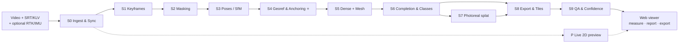

# Drishti3D — Documentation Index

> Documentation for **Drishti3D**, our Smart India Hackathon 2026 solution to **PS 26158 — Single-Pass Drone Video to Accurate 3D Model Generation System** (NTRO · Software · Robotics and Drones).
>
> Draft v1.0 · 2026-09-30

---

## Start here

| If you are… | Read in this order |
|---|---|
| **New to the team** | 00 → 01 → 02 → 16 (glossary) → 13 (plan) → your role's docs below |
| **A judge / evaluator** | 02 → 06 → 11 → 14 |
| **Implementing the pipeline** | 00 → 05 → 06 → 08 → 10 |
| **Building the web viewer** | 00 → 04 → 08 → 09 |
| **Flying the drone / collecting data** | 12 → 11 → 06 |
| **Preparing the pitch** | 02 → 14 → 15 |

## All documents

| # | Document | What it answers |
|---|---|---|
| 00 | [Project Charter](00-project-charter.md) | **Single source of truth** — name, scope, targets, pipeline stage IDs, tech, repo layout, roles, timeline |
| 01 | [Problem Statement & Analysis](01-problem-statement.md) | What exactly NTRO asked for, why it's hard, who uses it, challenge-by-challenge mapping |
| 02 | [Solution Overview](02-solution-overview.md) | What Drishti3D is, how it works, why it's different, competitive landscape |
| 03 | [Requirements (SRS)](03-requirements.md) | Functional & non-functional requirements with IDs, acceptance criteria, traceability |
| 04 | [System Architecture](04-system-architecture.md) | Context/container/component views, deployment, run layout, ADRs |
| 05 | [Pipeline Design](05-pipeline-design.md) | Stage-by-stage algorithms S0–S9 + live preview, parameters, fallbacks, time budget |
| 06 | [Georeferencing & Accuracy](06-georeferencing-and-accuracy.md) | ⭐ Our core differentiator — time sync, rolling shutter, doming, anchoring, CE90/LE90 |
| 07 | [Tech Stack & Licences](07-tech-stack.md) | Every component, why chosen, alternatives, licence register, hardware |
| 08 | [Data Formats & Interfaces](08-data-formats-and-interfaces.md) | SRT/KLV inputs, config, outputs, CRS policy, CLI & REST API reference |
| 09 | [Viewer & UI](09-viewer-and-ui.md) | Screens, wireframes, measurement tools, confidence overlay, frontend architecture |
| 10 | [Setup & Repo Structure](10-setup-and-repo-structure.md) | Dev environment, Docker offline bundle, conventions, git workflow, troubleshooting |
| 11 | [Testing & Evaluation](11-testing-and-evaluation.md) | Test strategy, accuracy protocol (ASPRS Ed. 2), datasets, experiments, acceptance |
| 12 | [Flight & Data Capture Guide](12-flight-and-data-capture-guide.md) | Indian drone rules, camera settings, single-pass flight profile, checkpoint survey |
| 13 | [Project Plan](13-project-plan.md) | Timeline, milestones, week-by-week tasks, RACI, risks, finale plan |
| 14 | [Demo & Pitch](14-demo-and-pitch.md) | PPT outline, pitch scripts, live demo script, judge Q&A bank |
| 15 | [Research & References](15-research-and-references.md) | Research summary, full bibliography, claims to verify |
| 16 | [Glossary](16-glossary.md) | Plain-language definitions of every technical term |

## Supporting material (outside `docs/`)

- [`../reports/Single pass drone 3D reconstruction.md`](../reports/Single%20pass%20drone%203D%20reconstruction.md) — full research report (who has solved what, with citations).
- [`../research_notes/`](../research_notes/) — raw research notes behind the report (six topics).

## Pipeline at a glance

## Documentation conventions

- **Stage IDs** (S0–S9, P), **role IDs** (R1–R6), **milestones** (M1–M5) and **targets** come from the charter — never redefine them elsewhere.
- Numbers from research carry a source link; our own estimates are labelled *estimate* or *target*.
- Anything not yet confirmed with the official PS / NTRO is marked **⚠ to verify**.
- Changing a decision? Update [00-project-charter.md](00-project-charter.md) first, then the affected docs, in the same commit.
