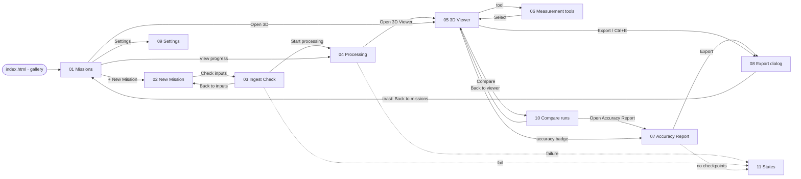

# Drishti3D · Clickable wireframes

> **Purpose:** A self-contained, click-through, mid-fidelity prototype of every screen in [09-viewer-and-ui.md](../09-viewer-and-ui.md), built with the tokens and components of [18-design-system.md](../18-design-system.md).
>
> **Status:** Draft v1.0 · 2026-09-30 · Owner: R5 Frontend Engineer

---

## How to open

1. Double-click **`index.html`** in this folder (or drag it into Chrome, Edge or Firefox).
2. That's it: no build step, no server, no network. Everything is inline or in `assets/`, and the pages work from `file://` on an air-gapped laptop.

Use the dark **prototype bar** at the top of every page:

| Control | What it does |
|---|---|
| ‹ previous · Gallery · next › | Walks the screens in numeric order. The screens themselves also link to the next step of the real flow. |
| Field (dark) / Analyst (light) | Switches theme. The app's own top-bar sun/moon button does the same. |
| Desktop / Tablet / Phone | Desktop fills the window (≥ 1280 px layout). Tablet is a 1024 px frame (panels become an icon rail / drawer / bottom sheet). Phone is a 390 px frame and **read-only**: actions that change data disappear and a banner explains why. Implemented with CSS container queries, so the layouts are real. |
| EN / हि | Switches key labels to Hindi (the 09 §13 glossary plus 18 §13 microcopy). Numbers, units and acronyms stay the same. |
| Notes | Shows or hides the numbered yellow annotation pins and the notes panel. |

Choices are remembered in `localStorage` (wrapped in `try/catch`; in a private window they last for the session only). They can also be set by URL, which is handy for sharing a specific view: `05-viewer-3d.html?theme=analyst&viewport=tablet&lang=hi&anno=off`.

All accuracy figures (CE90, LE90, RMSE, volumes…) are **illustrative**: they carry an <kbd>EXAMPLE</kbd> tag, as required by [18 §14 V10](../18-design-system.md#14-data-visualisation-rules-for-accuracy-charts).

---

## Screen inventory

Run IDs follow [08 §1](../08-data-formats-and-interfaces.md#1-conventions) (`20261114-051205-7c2e91`, shown with the 09 alias `r-0003`). API paths are relative to `/api/v1` unless they start with `/files` ([08 §9](../08-data-formats-and-interfaces.md#9-rest-and-websocket-api)).

| # | Screen | File | Persona(s) | Key actions | 09 section | API endpoints used |
|---|---|---|---|---|---|---|
| 00 | Screen gallery | [`index.html`](index.html) | Team, judges | Pick a screen, set theme / viewport / language | — | — |
| 01 | Missions list | [`01-missions.html`](01-missions.html) | Operator, analyst, commander | New Mission · Open 3D · View progress · Fix inputs · ⋯ (re-run, compare, duplicate, export bundle, delete) | [§5.1](../09-viewer-and-ui.md#51-home--missions-list) | `GET /missions`, `GET /health`, `DELETE /runs/{run_id}` |
| 02 | New Mission | [`02-new-mission.html`](02-new-mission.html) | Field operator | Drop video + SRT · add anchors (RTK, ref ortho/DSM, GCP, intrinsics, CORS/GAGAN) · choose profile · Check inputs | [§5.2](../09-viewer-and-ui.md#52-new-mission) | `POST /missions`, `POST /uploads`, `PUT /uploads/{id}/chunks/{n}`, `POST /uploads/{id}/complete`, `GET /uploads/{id}` |
| 03 | Ingest Check | [`03-ingest-check.html`](03-ingest-check.html) | Field operator | Review track, time sync, frame quality, checks · override offset · Start processing | [§5.3](../09-viewer-and-ui.md#53-ingest-check-s0-result) | `POST /missions/{id}/ingest-check`, `GET /missions/{id}/ingest-check`, `POST /runs` |
| 04 | Processing | [`04-processing.html`](04-processing.html) | Operator, analyst | Watch S0–S9 + P, live 2D preview, key numbers, logs · Cancel run · Open 3D Viewer | [§5.4](../09-viewer-and-ui.md#54-processing) | `GET /runs/{id}`, `WS /runs/{id}/progress`, `GET /runs/{id}/logs`, `GET /health`, `POST /runs/{id}/cancel`, `/files/runs/{id}/preview/tiles/{z}/{x}/{y}.webp` |
| 05 | 3D Viewer | [`05-viewer-3d.html`](05-viewer-3d.html) | Analyst, commander | Toggle layers (mesh, points, ortho, DSM/DTM, splat, confidence, semantic, track, checkpoints) · inspect measurement · export CSV/GeoJSON | [§5.5](../09-viewer-and-ui.md#55-3d-viewer), [§7](../09-viewer-and-ui.md#7-confidence-overlay-and-colour-scheme) | `GET /runs/{id}/artifacts`, `/files/runs/{id}/08_export/tiles/{mesh,pointcloud}/tileset.json`, `/files/runs/{id}/08_export/rasters/*.tif`, `/files/runs/{id}/09_qa/accuracy.json`, `GET /runs/{id}/measurements` |
| 06 | Measurement tools | [`06-measure.html`](06-measure.html) | Analyst | Select · Distance · Height · Area · Volume · Profile · Coordinates · Clip (live, with keys S D H A V P C B) · splat-only disabled state | [§5.5 toolbar](../09-viewer-and-ui.md#55-3d-viewer), [§6](../09-viewer-and-ui.md#6-measurement-tools-specification) | `POST /runs/{id}/measurements`, `DELETE /runs/{id}/measurements/{mid}`, `POST /runs/{id}/measure/{volume\|area\|profile}` |
| 07 | Accuracy Report | [`07-accuracy-report.html`](07-accuracy-report.html) | Analyst, commander | Read CE90/LE90, before/after table, bias vs noise, residual map, doming, length test · download PDF/HTML/JSON | [§5.6](../09-viewer-and-ui.md#56-accuracy-report-screen-s9-result) | `GET /runs/{id}/report?format=pdf\|html\|json`, `/files/runs/{id}/09_qa/accuracy.json` |
| 08 | Export dialog | [`08-export.html`](08-export.html) | Analyst | Pick products and formats, CRS, heights, clip, inferred on/off, destination, manifest, bundle, classification · Export | [§5.7](../09-viewer-and-ui.md#57-export-dialog) | `POST /runs/{id}/exports`, `GET /runs/{id}/artifacts` (incl. `bundle`), `GET /runs/{id}/artifacts/{artifact_id}` |
| 09 | Settings | [`09-settings.html`](09-settings.html) | All | Language, theme, touch mode, units & CRS, uncertainty level, processing defaults, viewer budgets, storage clean-up, camera library | [§5.8](../09-viewer-and-ui.md#58-settings) | None in 08 §9 (stored per device; server defaults from `configs/*.yaml`); `GET /version`, `GET /health` for About/Storage |
| 10 | Compare runs | [`10-compare.html`](10-compare.html) | Commander, analyst | Swipe / side-by-side / difference DSM · sync cameras · run picker · raw GNSS vs anchored (`G`) | [§5.5 Compare](../09-viewer-and-ui.md#55-3d-viewer), [§6.3](../09-viewer-and-ui.md#63-tool-specifications) | `GET /runs?mission_id=…`, `GET /runs/{id}/artifacts` (both runs); difference DSM: **no endpoint yet** |
| 11 | Empty, error & loading states | [`11-states.html`](11-states.html) | All | One card per 09 §12 situation, each with its copy and primary action; server-lost banner; phone read-only | [§12](../09-viewer-and-ui.md#12-error-empty-and-loading-states) | Error model [08 §9.4](../08-data-formats-and-interfaces.md#94-error-model); `POST /runs/{id}/resume`, `POST /runs/{id}/checkpoints` |

### Interactive parts

| Where | Try this |
|---|---|
| 01 | ⋯ menu on the first row; "Delete mission…" opens a confirm dialog |
| 02 | "What's this?" explainer dialog; pause on the upload row |
| 03 | "Override offset…" dialog |
| 04 | Log tabs (arrow keys work); "Cancel run" dialog |
| 05 | Layer checkboxes redraw the scene (Confidence ⟷ Semantic are mutually exclusive; Flight track; Checkpoints) |
| 06 | Every tool in the toolbar, keyboard shortcuts, and "Only the splat layer visible" (disabled state) |
| 08 | "Export 6.3 GB" starts a progress toast with a link back to Missions |
| 10 | Drag the swipe handle, or focus it and use ← →; switch Swipe / Side-by-side / Difference DSM |

---

## User flow



---

## Files

```text
docs/wireframes/
├── README.md                 # this file
├── index.html                # gallery + flow + live token swatches
├── 01-missions.html … 11-states.html
└── assets/
    ├── wireframe.css         # tokens (= 18 §5) + components + container-query layouts
    └── wireframe.js          # prefs (theme/viewport/lang/notes), Lucide-style icon sprite,
                              # prototype bar, stylised town SVG, dialogs/menus/toasts/tools
```

Conventions used in the pages:

- Icons are written as `<i data-icon="ruler"></i>` and expanded by `wireframe.js` from an inline sprite (drawn in the Lucide style; the product bundles real Lucide, [18 §9](../18-design-system.md#9-iconography)).
- The 3D scene is `<div class="map" data-map="viewer|thumb|mosaic|gps|offset|diff">`. Measurement drawings sit in an `<svg class="overlay">` with the same `viewBox="0 0 1000 600"`.
- Annotations: any element with `data-anno="n"` gets pin *n*; the notes are the `<ol>` in `.anno-panel`.
- Classes `rw-only` (hidden on phone) and `phone-block` / `phone-hide` implement the phone read-only rule.
- Translatable labels carry `data-i18n="key"` with keys from 09 §13 / 18 §13.

## Known gaps (tracked in [18 §15](../18-design-system.md#15-deltas-and-open-items))

- **Import mission bundle (`.d3d.zip`)** has no API in 08 §9, so it is shown disabled and tagged *Future*.
- **Difference DSM** (Compare) has no endpoint in 08 §9.
- **Settings** have no API; they are per-device in this design.
- The high-contrast theme from 09 §7.4 is listed in Settings but not rendered in the wireframes.
